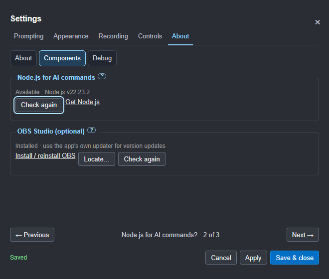
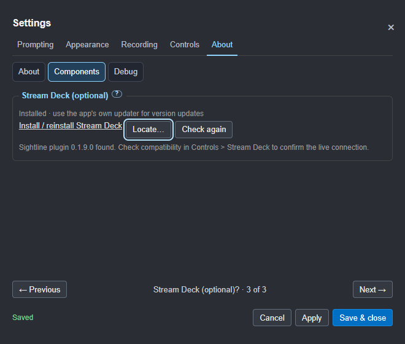
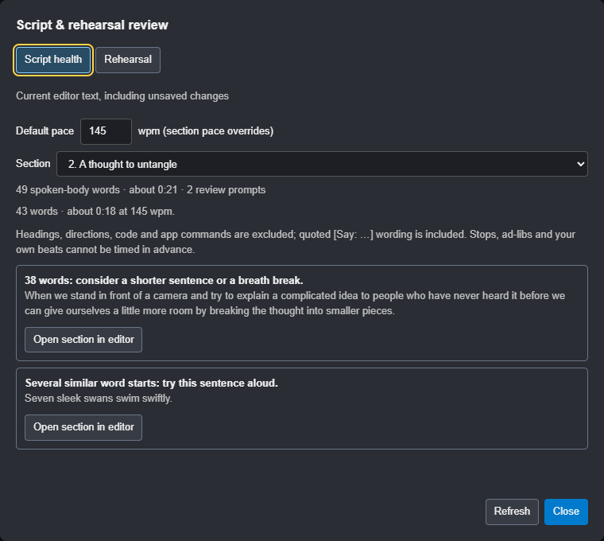
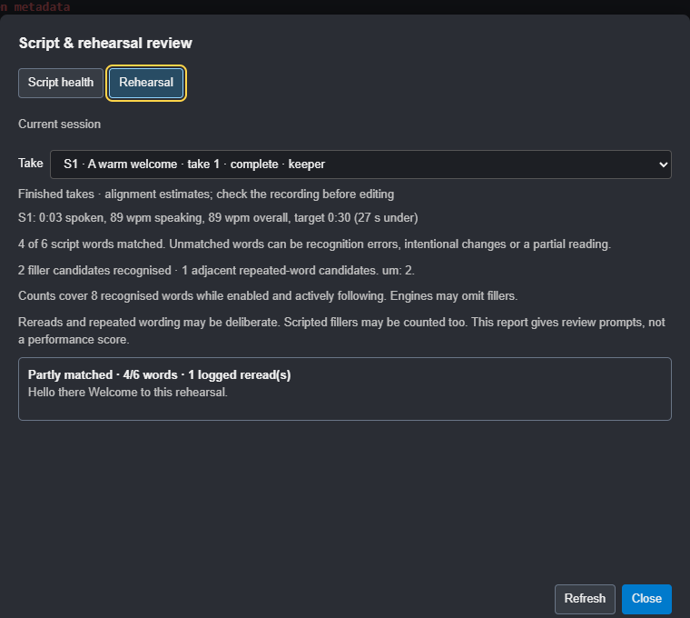

# Next-candidate batch for review

Updated 31 October 2026. **RC15 has not been built or installed.** The work
is on `codex/obs-integration`; the installed RC14 remains available for testing.
Publication, merging, tagging and website deployment remain on hold.

## Changes ready to review

**Workflow review:** Joanne has asked to replace numbered component pages with
named subtabs, promote Components/Debug, distinguish onboarding from frequent
use, and add an optional OBS setup assistant. The
[workflow proposal and mock-ups](SETTINGS-WORKFLOW-PROPOSAL.md) address this
direction. These wider navigation/onboarding/OBS-setup changes are proposed,
not implemented; the availability checks below are built and tested.

### Component availability

Components now includes optional OBS Studio and Stream Deck. Official supplier
installer links, Locate and Check again support standard and portable copies.
Stream Deck app detection and plugin-manifest detection are separate from the
existing live compatibility handshake. Third-party app update status remains
the responsibility of its own updater.

Dependent controls grey out with visible reasons and retain their saved values.
AI kit readiness does not block other API clients or the built-in reviews.
Remote OBS configuration stays available without a local installation. Existing
enabled integrations can always be disabled. The longer Components topic uses
pages, with a focus fix for explanatory pages that contain no active controls.

Unit checks cover missing, portable and removed apps, plugin manifests, Flatpak
and dependency rules. Native checks cover disabled options, preserved drafts,
setup navigation and remote OBS. No installer was run and RC14 is unchanged.

### Script health and rehearsal coach

Roadmap **30** adds **Script health…** in the editor, using current text
including unsaved changes. It gives per-section word/time estimates, pace
and targets, timed-pause information and optional delivery prompts for long
sentences or similar word starts. It excludes non-spoken directions, headings,
code and commands, includes quoted directions, and can return to the section.

Roadmap **28** adds **Rehearsal** in the same review window, plus take-summary
and Recordings entry points. It shows finished-take pace, sentence coverage,
unmatched/unreached wording and logged rereads. Recognition estimates do not
change keepers or editing choices. The optional recognised filler/repetition
counts default off, use active voice following only, and add no new listener,
transcript or audio. The preference is protected from API/import changes.

`rehearsal-coach.json`, the recordings API and the CLI `coach` verb share the
same derived report. Existing CSV columns and edit choices keep their meanings.
Native checks cover the editor, unsaved text, speech exclusions, section jump,
tab accessibility and saved takes. A silent generated stream/stub recogniser
checks command filtering, holds, mute and commands-only exclusion. No real
microphone, speaker, camera or OBS recording is used by those checks.

### Other changes in this batch

| Change | Result |
| --- | --- |
| Shared pad layouts | The local settings API and actual JSON/XML imports update the pad and phone live. Action IDs are filtered, duplicates removed and column counts validated. Invalid layouts are rejected before other settings change. Protected permissions remain protected. |
| Debug capture override, roadmap 57 | **Settings > About > Debug > Allow all windows to be captured** permits captures of open and newly opened windows, including the head guide. It applies immediately and has desktop/phone warnings. Turning it off restores current normal rules; a full restart clears it. No saved capture preference is changed. |
| Phone feedback | A tap shows Sending, then the button name and sent when the request is accepted. The app's actual section, prompting and OBS state are shown separately. Refused requests show unavailable; missing acknowledgements show no reply. Pending duplicate taps are suppressed, requests have a timeout and commands are never automatically replayed. |
| Phone landscape | The Studio selection uses six columns and two rows in short landscape windows. Button order is retained, portrait targets remain large and the footer has extra browser spacing. Long layouts remain scrollable. |
| Installation route | A plan-first helper verifies the manifest/hash, preserves spaces in the complete destination, elevates the installer directly when Run is requested and verifies its installed version/location afterwards. The native directory-parser fixture installs nothing. |

### Components and custom inputs

Roadmap **47** adds **About > Components**: optional offline model and AI kit,
Install/Reinstall/Remove, and a separate Node.js check. The app bundles the
standalone checker, command tool, skills, briefs and examples; no clone or npm
install is needed. Reinstall stages a fresh copy. Failed downloads leave the
existing model available; removal asks first and uses the system bin. Model
maintenance requires prompting and recording to be stopped.

Roadmap **40** adds **Controls > Buttons & keys**: choose an action and press
an input. Assignments save immediately. Plain keys/Shift combinations stay
local to the prompter; system shortcuts remain reserved. Controller device
overrides, pages, removal and reset are included. Shared pad actions retain
their OBS permissions. Stream Deck profiles remain independent.

Native checks exercise install/repair/removal and cancellation, real key
learning/execution, simulated controller learning/execution, typing guards,
repeat/reconnect suppression, reset and all 22 Settings topics without scrolling.
Pure checks cover corrupt/missing downloads, rollback, standalone kit command
execution, device overrides, held/reconnected buttons and settings round trips.
The new controller/pedal assignments still need a physical acceptance pass.
An additional Electron archive fixture verifies installation directly from
an app archive, and the file-list check covers every bundled kit dependency.
The fixture creates no product installer or release candidate.

### Capture controls

Guide snapshots add `captureOverride` and describe the changed policy in
`captureStatus`. These fields do not prove whether a particular OBS source
recorded the guide; inspect the recorded picture.

### Phone acknowledgement and landscape

## Verification

- Script/rehearsal unit checks cover editorial estimates, qualified coverage,
  missing data, aggregate counts, CLI output and additive exports. The native
  editor test includes a silent generated stream/stub recogniser to verify
  command, hold, mute and commands-only exclusion without real media capture.
- Trusted Settings input verifies default-off coaching counts, Apply and
  opt-out. API/import protection is checked alongside the existing permissions.

- Unit checks cover settings validation, protected fields, structured JSON/XML
  round trips, capture-policy restoration, new windows and close cleanup.
- Native isolated-app checks cover API changes and real file-import handlers,
  phone feedback, duplicate taps, refused/lost acknowledgements, no command
  replay, stalled-request timeout, capture indicators, guide metadata and
  resetting after a full restart. The banner's Turn off button also works
  while the prompter is in click-through mode.
- The existing native Settings checks cover fixed dimensions, pagination rather
  than scrolling, small screens, movement, keyboard access and draft guards.
- The simulated OBS/production rehearsal passed. It uses a test OBS server;
  these checks do not operate Joanne's OBS or record her camera/microphone.
- The harmless native NSIS fixture retained complete paths containing spaces.
  It does not test a real elevated installation or relocate the live app.
- The guide, privacy text, edit-pack notes, AI session skill, feature list,
  roadmap, change log and website preview are updated with this batch.

## Installation review

The live RC14 was found under `C:\Program\Sightline Prompter`. Its physical
relocation is **still pending an approved installation**. Nothing in this
review has uninstalled, moved or replaced it.

`scripts/install-candidate.ps1` defaults to a plan: provide a candidate folder
containing `BUILD-MANIFEST.json` to inspect the intended installer and destination.
The normal destination is `C:\Program Files\Sightline Prompter`. Only `-Run`
starts installation and requests the normal Windows administrator approval.
Close Sightline normally first; the helper never forces it closed.

The argument handling follows the [official NSIS installer command-line
rules](https://nsis.sourceforge.io/Docs/Chapter3.html#installerusage): the
destination switch is last and its path is kept intact. After installation,
the helper checks both the intended destination and expected version.

## Before another candidate

1. Joanne reviews this batch and its screenshots.
2. Reconcile any new conversation requests and unfinished fixes immediately
   before packaging; batch them together.
3. Build only after the review. No RC number, installer or release tag was
   minted as part of this work.

The five physical production acceptance requirements and manual Windows
accessibility checks still apply. macOS/VoiceOver remains deferred to a Mac
tester. Components and controller remapping are built for review; physical
controller/pedal acceptance remains. Signing still awaits its arrangements.
