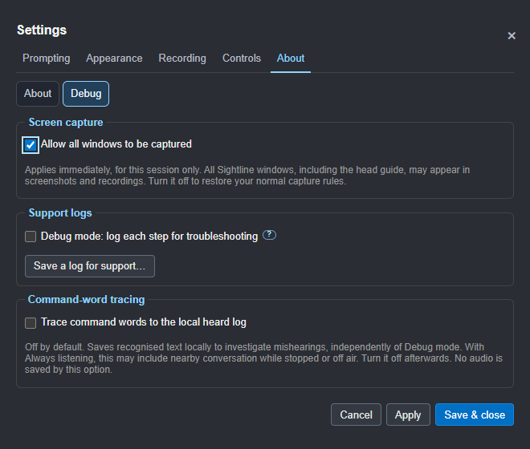
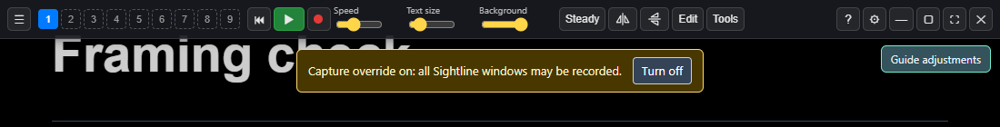

# Next-candidate batch for review

Prepared 30 October 2026. **RC15 has not been built or installed.** The work
is on `codex/obs-integration`; the installed RC14 remains available for testing.
Publication, merging, tagging and website deployment remain on hold.

## Changes ready to review

| Change | Result |
| --- | --- |
| Shared pad layouts | The local settings API and actual JSON/XML imports update the pad and phone live. Action IDs are filtered, duplicates removed and column counts validated. Invalid layouts are rejected before other settings change. Protected permissions remain protected. |
| Debug capture override, roadmap 57 | **Settings > About > Debug > Allow all windows to be captured** permits captures of open and newly opened windows, including the head guide. It applies immediately and has desktop/phone warnings. Turning it off restores current normal rules; a full restart clears it. No saved capture preference is changed. |
| Phone feedback | A tap shows Sending, then the button name and sent when the request is accepted. The app's actual section, prompting and OBS state are shown separately. Refused requests show unavailable; missing acknowledgements show no reply. Pending duplicate taps are suppressed, requests have a timeout and commands are never automatically replayed. |
| Phone landscape | The Studio selection uses six columns and two rows in short landscape windows. Button order is retained, portrait targets remain large and the footer has extra browser spacing. Long layouts remain scrollable. |
| Installation route | A plan-first helper verifies the manifest/hash, preserves spaces in the complete destination, elevates the installer directly when Run is requested and verifies its installed version/location afterwards. The native directory-parser fixture installs nothing. |

### Capture controls

Guide snapshots add `captureOverride` and describe the changed policy in
`captureStatus`. These fields do not prove whether a particular OBS source
recorded the guide; inspect the recorded picture.

### Phone acknowledgement and landscape

## Verification

- Unit checks cover settings validation, protected fields, structured JSON/XML
  round trips, capture-policy restoration, new windows and close cleanup.
- Native isolated-app checks cover API changes and real file-import handlers,
  phone feedback, duplicate taps, refused/lost acknowledgements, no command
  replay, stalled-request timeout, capture indicators, guide metadata and
  resetting after a full restart. The banner's Turn off button also works
  while the prompter is in click-through mode.
- The existing native Settings checks cover fixed dimensions, pagination rather
  than scrolling, small screens, movement, keyboard access and draft guards.
- The simulated OBS/production rehearsal passed. It uses a test OBS server;
  these checks do not operate Joanne's OBS or record her camera/microphone.
- The harmless native NSIS fixture retained complete paths containing spaces.
  It does not test a real elevated installation or relocate the live app.
- The guide, privacy text, edit-pack notes, AI session skill, feature list,
  roadmap, change log and website preview are updated with this batch.

## Installation review

The live RC14 was found under `C:\Program\Sightline Prompter`. Its physical
relocation is **still pending an approved installation**. Nothing in this
review has uninstalled, moved or replaced it.

`scripts/install-candidate.ps1` defaults to a plan: provide a candidate folder
containing `BUILD-MANIFEST.json` to inspect the intended installer and destination.
The normal destination is `C:\Program Files\Sightline Prompter`. Only `-Run`
starts installation and requests the normal Windows administrator approval.
Close Sightline normally first; the helper never forces it closed.

The argument handling follows the [official NSIS installer command-line
rules](https://nsis.sourceforge.io/Docs/Chapter3.html#installerusage): the
destination switch is last and its path is kept intact. After installation,
the helper checks both the intended destination and expected version.

## Before another candidate

1. Joanne reviews this batch and its screenshots.
2. Reconcile any new conversation requests and unfinished fixes immediately
   before packaging; batch them together.
3. Build only after the review. No RC number, installer or release tag was
   minted as part of this work.

The five physical production acceptance requirements and manual Windows
accessibility checks still apply. macOS/VoiceOver remains deferred to a Mac
tester. Components, controller remapping and signing remain on the roadmap.
