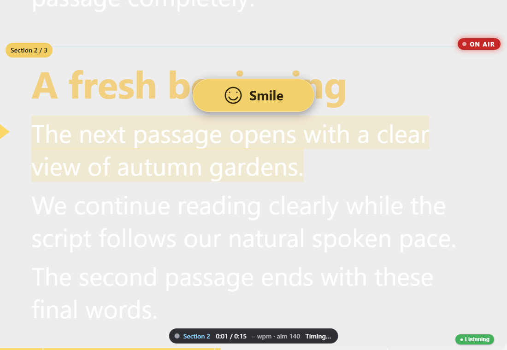
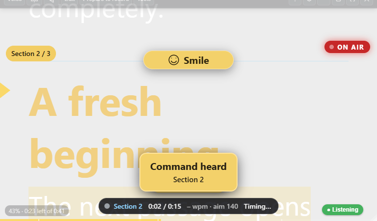

# Sightline 1.3.0 RC10 preview

11 November 2026 · documentation revision 26. Includes the RC9 paragraph
spacing and earlier candidate features. Public stable versions are unchanged.

## Voice passages flow without hard stops

In Voice mode, `{stop}` is a soft passage boundary. When the final words are
recognised, Sightline positions the next passage's first spoken line at the
reading line and keeps listening. Headings and preparation comments stay above
that opening. There is no extra “Prompter, go” needed between sections.
“Go” at the prepared opening reaffirms that position without skipping again.

**Prompter, again** or **restart section** returns to the section just completed
until you begin speaking the next passage. After recognition reaches that next
passage, Retake belongs to the new section. Merely previewing its opening does
not start a new take in the log.

Scroll mode still honours stops and timed pauses. Voice ignores pause tags;
explicit spoken Pause, off-script microphone holds and sound checks retain
their deliberate controls. The final Voice boundary leaves commands listening;
use **Prompter, finish recording** to finish the recorder explicitly.

An active Voice “go” preserves the current recording/practice policy. From an
idle prompter, “go” still starts practice with OBS unchanged.

## Toolbar on smaller displays

Whole control groups wrap onto additional rows when needed. Minimise,
maximise/restore, fullscreen and Close remain visible, including with nine
filled script slots at 1024, 768 and 560 pixels wide. Session controls sit
below the complete toolbar. The Voice slider's compact label is Catch-up.

## Tracking through repeated headings

A replay of the reported session reproduced a 155-word jump into a similar
heading in the following section. Unordered automatic matching is now confined
to the current section. Ordered nearby speech can cross section boundaries,
and explicit **Prompter, resync** retains whole-script recovery. This avoids
mistaking another heading for the current read and prematurely crossing a stop.

The replay no longer makes that jump. Automated tests cover soft transitions,
reading-line positioning, Retake ownership, take-log section identity, spoken
Pause and explicit recovery. Actual microphone acceptance remains necessary.

## Visible HUD cues and Retake recognition

The gold HUD direction pill now sits above the active reading line, with a
compact form in short windows and clearance from toolbar/session controls.
Pointing targets retain their saved head-relative positions behind the words.
Review keeps inline directions. This follows Joanne's 11 November placement
request and supersedes only the earlier pill location.

Observed Retake transcripts “V take” and “VE take” are accepted as exact
wake-prefixed aliases. Ordinary speech without the wake word does not trigger
them. The correct operator phrase remains “Prompter, retake”.

## References and follow-up

Help, script-writing guidance, demo comments and the 269-row feature reference
describe these mode differences. Existing client scripts, recording snapshots,
media and slots are retained. Quick paragraph editing in the prompter is a
roadmap follow-up; Ctrl+E opens the existing editor in this build.
