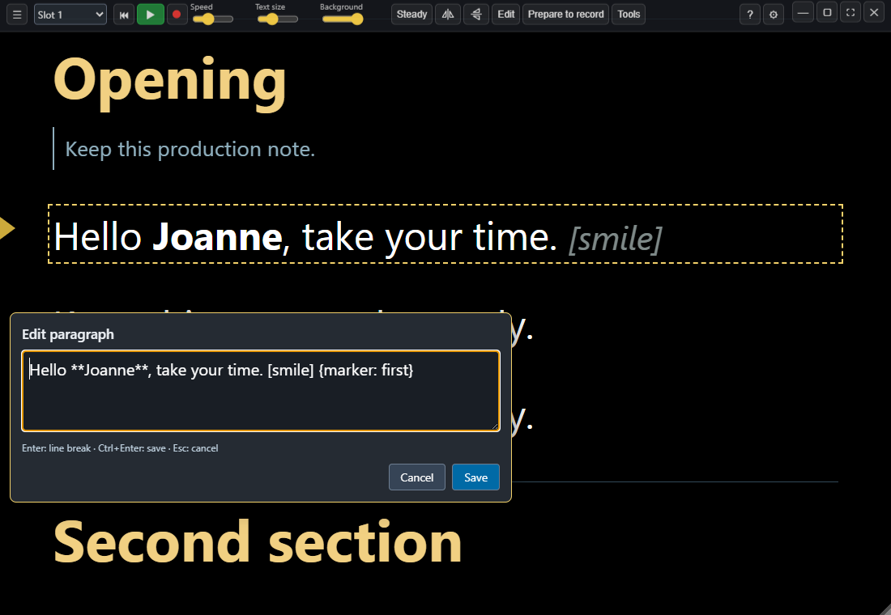
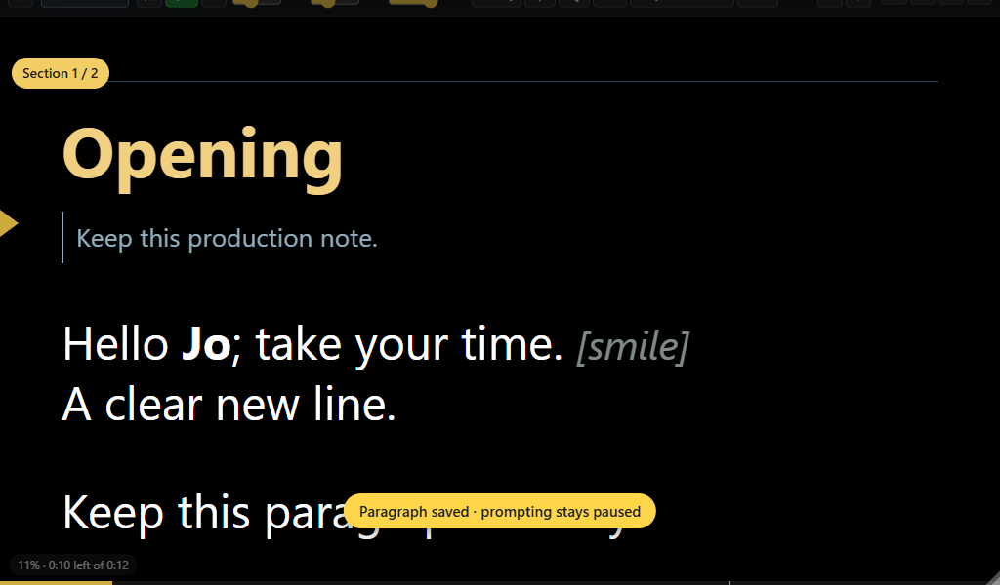

# Sightline 1.3.0 RC11 preview

11 November 2026 · documentation revision 27. Includes RC10's Voice and
recording fixes. Public stable versions remain app 1.2.0 and companion 0.2.0.

## Quick changes while paused

Double-click a spoken paragraph to correct a word, punctuation or a line break.
The small editor shows the original Markdown. Enter inserts a visible break;
Ctrl+Enter saves and Escape cancels. Save updates only the selected source range,
preserving formatting and cues. Prompting remains paused at the same passage.
Play resumes; after a paused Voice session, Prompter, go also resumes using the
updated text. Earlier take snapshots stay intact.

External file changes block Save and keep the draft available to copy. Samples
need an editable copy first. Saved Markdown/text is supported; use Ctrl+E for
larger edits, headings, complex structures and other formats. No new script
directive or controller action is required.

## Compact slots and consistent window controls

At 1100 pixels wide or less, a Slot 1–9 picker replaces the nine numbered
script buttons. Wide windows retain those buttons; Ctrl+1…9 remains available.
Minimise, maximise/restore, fullscreen and Close stay on the first toolbar row
at the top right. Other groups wrap below without hiding the window controls.

## Validation and references

Unit checks cover exact source ranges, Windows line endings, formatting and
visible breaks. Native checks cover Save/Cancel, duplicate paragraphs, external
conflicts, playback/slot guards, sample protection, held Voice resume and compact
toolbars. Synthetic audio and simulated recording checks are not microphone UAT.

The guide, F1 help, welcome tour, roadmap, promo supplement and 270-row feature
grid describe this preview. JL copy and downloads are staged separately from
the public stable website. Test with a backed-up copy of the current profile.
