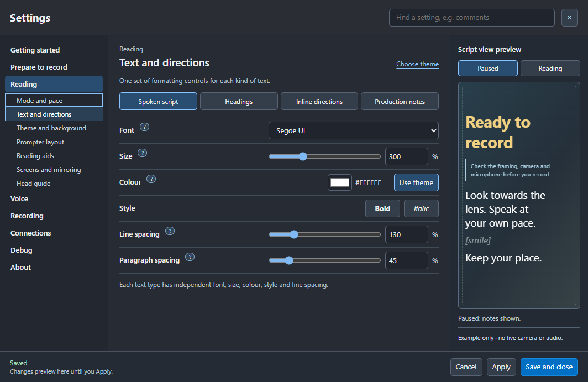

# Sightline 1.3.0 RC9 preview

11 November 2026 · documentation revision 25. Includes RC8 and earlier
candidate changes. The public app remains 1.2.0; Marketplace plugin 0.2
and the separate companion candidate remain unchanged.

## Script spacing and themes

**Settings > Reading > Text and directions > Spoken script** now includes
**Paragraph spacing**, independent of line spacing. Choose 0–300% in steps
of five. 100% preserves the established one-em paragraph gap; 0% closes it.
Heading margins and production-note block margins retain their existing rules.

Changes preview in the script and the right-hand sample. Apply saves them;
Cancel restores the last applied values. Settings transfers and saved reading
themes include the gap. Older themes without this field use 100%.

## Voice following

The aligner now recognises short, ordered phrases near the current reading
position even when those words occur frequently throughout a long script.
It also tolerates common contraction and compound-word boundaries, such as
“I have”/“I've” and “health care”/“healthcare”, without changing script indexes.
Distant relocation retains its stricter distinctive-word checks.

**Scroll catch-up speed** replaces “Voice response/responsiveness”. This
controls how quickly the display moves towards recognised speech: 100% is
normal. Raising it does not improve recognition or microphone gain.

## Clearer reading screen

Bookmark and retake commands retain navigation anchors, take-log events and
enabled OBS chapter sending. They no longer paint yellow flags over the
script, in either delivery or review. There is no extra visibility preference.
The reading-line triangle, sentence highlight and approved HUD targets retain
their own existing settings.

To restart the current section, say **Prompter, again** or **Prompter, restart
section**. A numbered **Prompter, section N** also goes to that section.

## Validation and acceptance

Automated checks cover alignment continuity and false-jump guards, settings
and theme round trips, actual paragraph controls and preview/cancel behaviour,
section positioning and invisible bookmark anchors. Recorded recognition replay
shows earlier advancement through the reported stall; it is not a guarantee
of live microphone accuracy. Confirm a short read with your actual microphone.

The candidate uses a separate copy of Joanne's latest saved profile and script
slots. Original recordings and RC8 settings remain available. Command training
is still a roadmap item; it is not implemented in this candidate.
