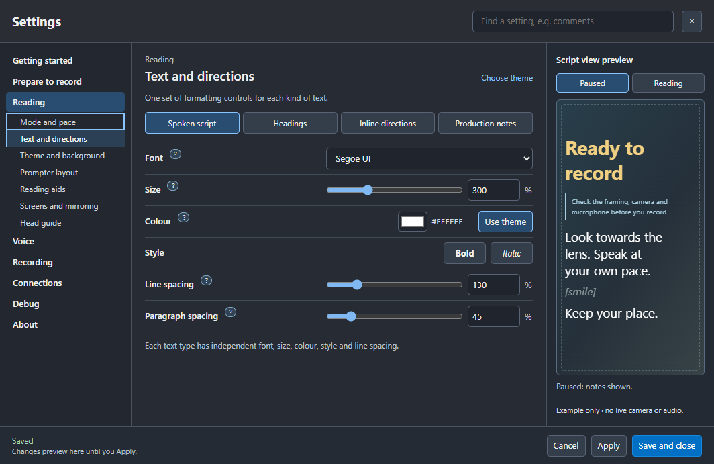
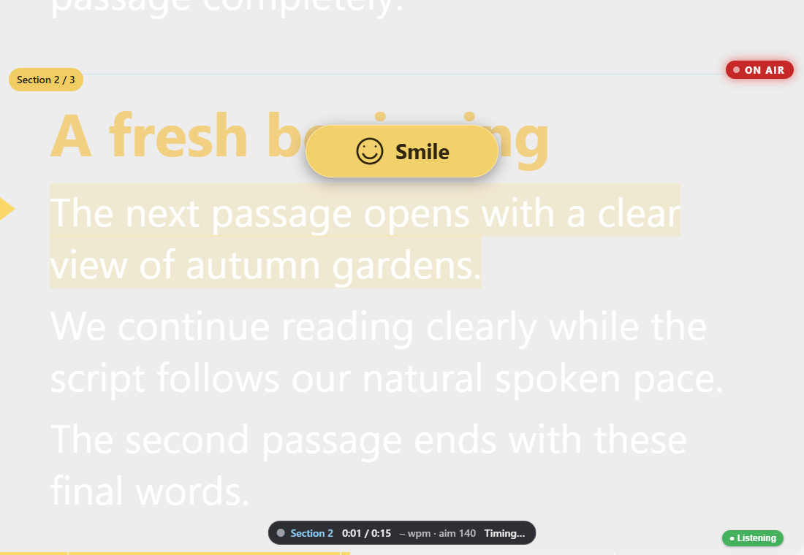
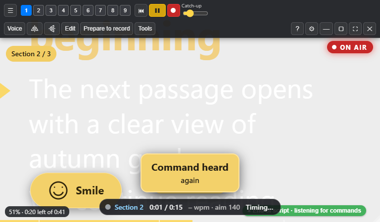
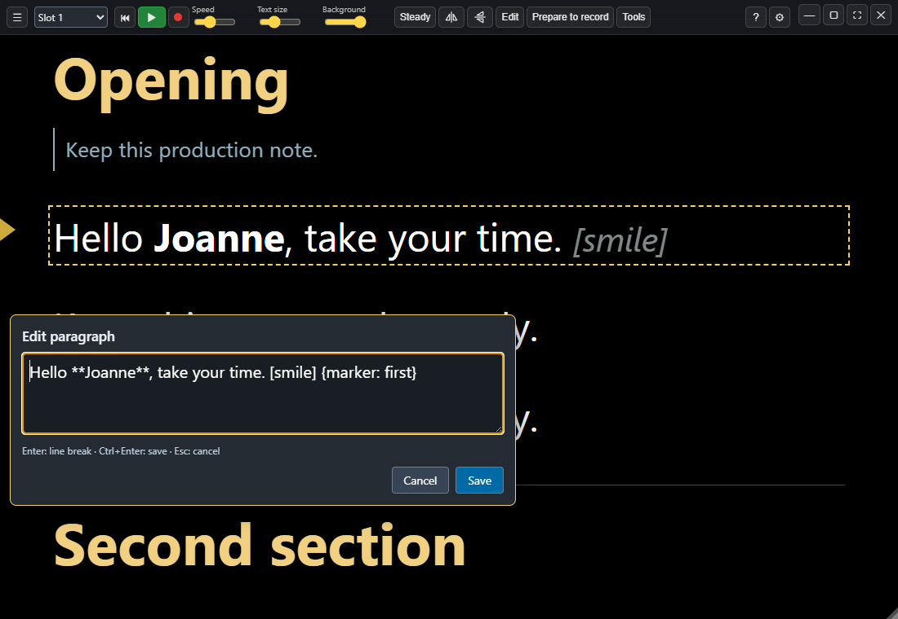
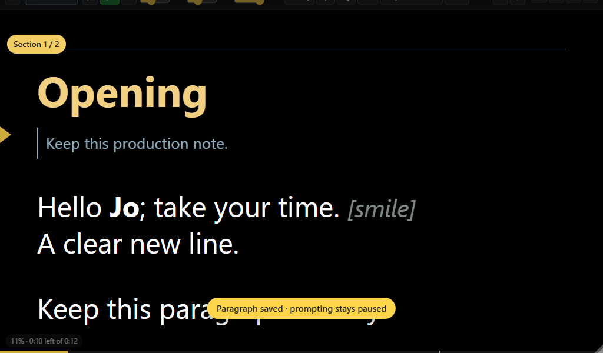
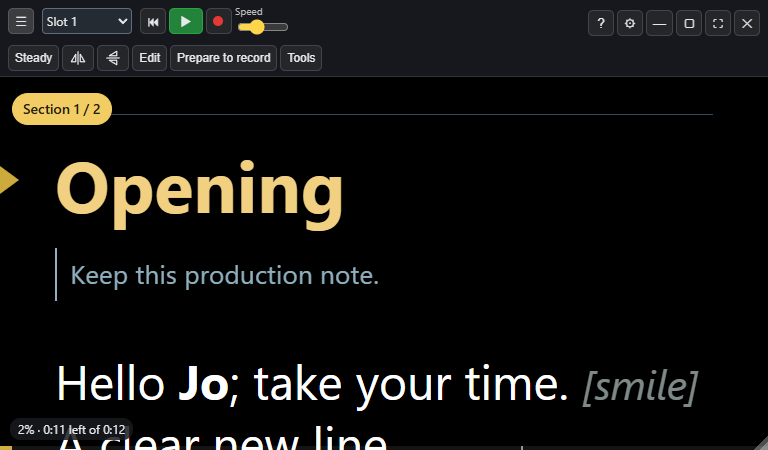
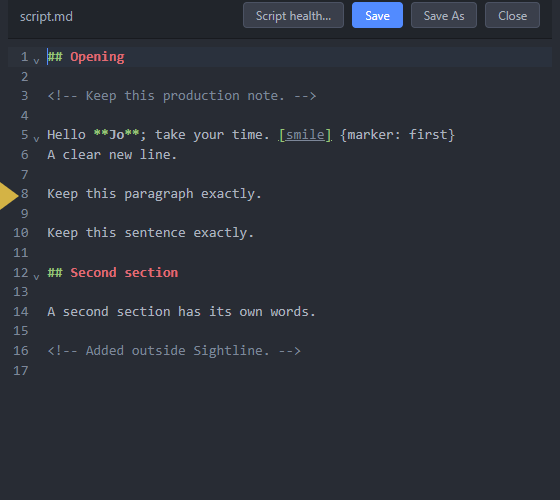

# Sightline 1.3.0 release notes

**Current candidate: RC12 · 12 November 2026 · documentation revision 28.**
This is the cumulative 1.3.0 history. The public stable app remains 1.2.0;
Stream Deck companion 0.2.0 is published, with 0.2.1.6 a separate candidate.
The RC sections below record when each change arrived. Later corrections
supersede earlier behaviour; they do not change frozen older packages.

## RC12 recording reliability

12 November 2026. The combined RC12 includes these source fixes; frozen RC11
packages are unchanged.

- **Retake recognition:** exact wake-prefixed A RETAKE, VO TAKE, PTAKE and VOTE
  fallbacks recover all seven observed misses in recorded-chunk replay. Keep
  using the operator phrase Prompter, retake. Ordinary speech is excluded.
- **Voice recovery:** a longer ordered phrase can bridge a short gap after
  misheard words within the current section; repeated headings and unrelated
  speech retain their guards. The observed replay advances about three seconds
  sooner, not perfectly through every recognition error.
- **Heading alignment:** automatic boundaries, Go and restored targets follow
  the existing Start from section heading preference. The off state retains
  body-line positioning; ordinary mid-paragraph edit/resume keeps its place.
- **Microphone capture:** speech/wake listening and test metering explicitly
  request AGC off. Other apps/driver settings can still alter the input level.

Source checks include both heading states, Retake ownership and paused quick
editing, recorded-chunk replay, command negatives and capture constraints.
The [RC11 feedback batch](uat/1.3.0-RC11-FEEDBACK.md) is integrated into RC12.
See the [combined UAT](uat/1.3.0-RC12.md). Hardware microphone UAT remains.

## Prepared after RC12 — next combined preview

The full editor gains **Insert…**, a grouped menu with 41 code/direction
templates. Insert at the cursor, replace selected text, edit selected values,
then use normal Undo/Save. Every directive family, all nine pointing cues,
comments and headings are covered. Samples remain protected and insertion
never executes recorder actions. Windows filenames and editing marker
visibility are tidied too. Native checks cover cursor/selection behaviour and
compact layouts. This source change is not in the frozen RC12 package.

## Current behaviour to use in RC12

- **Voice stops:** RC10 makes `{stop}` a soft passage boundary. The next spoken
  opening is positioned and listening continues. Scroll still honours stops
  and timed pauses; an explicit spoken Pause deliberately holds Voice.
- **Begin and Go:** RC8 supersedes RC4's Begin alias. Record, start recording
  and Begin confirm OBS before delivery. Practice/start practice leaves OBS
  unchanged. Go resumes an active or edited Voice session; from idle it starts
  practice. Recorder commands retain permission and connection checks.
- **Toolbar:** RC11 supersedes RC10's window-button wrapping. Window controls
  stay top right on row one. Small windows use a Slot 1–9 picker.
- **Quick edit:** RC11 replaces the earlier roadmap-only status. Saved Markdown
  and text paragraphs can be edited while paused; Save stays paused, and Voice
  can resume using the revised words. Earlier take snapshots stay intact.

## Candidate sections

- [RC1 — Recorded evidence and onboarding](#rc1)
- [RC2 — Controller workflows](#rc2)
- [RC3 — Pointing and production cues](#rc3)
- [RC4 — HUD, navigation and About](#rc4)
- [RC5 — Natural spoken lead-in](#rc5)
- [RC6 — Review clearance and Voice pauses](#rc6)
- [RC7 — Guided OBS setup](#rc7)
- [RC8 — Recording, practice and acknowledgement](#rc8)
- [RC9 — Paragraph spacing and Voice continuity](#rc9)
- [RC10 — Continuous Voice passages](#rc10)
- [RC11 — Quick edits and compact slots](#rc11)
- [RC12 — Dialogs, audio checks and recording reliability](#rc12)

## RC1 — Recorded evidence and onboarding

4 November 2026 · documentation revision 17 · stable app 1.2.0 · companion 0.2.0

### Recorded words and editorial evidence

- New nonmodal Recording review, from Files, the session library or Recording >
  Takes. Optional local CPU transcription or timed JSON import uses recorded
  audio after a session; no API key or cloud upload is required.
- Expected/heard comparison, substitutions and uncertain-alignment candidates
  supplement omissions. Single-take sections are prioritised for listening.
  Original takes, ratings, keeper choices, script snapshots and audio stay intact.
- Reviewed exports retain original CSV column prefixes and `live-*` estimates.
  Captions use transcript words; bunched live pace is not relabelled as measured.
  Fingerprinted sidecars prevent reusing evidence after the source log changes.

### Command reliability and cut ranges

- Recorded wake forms `popter` and `pumpter` are recognised. A delayed number
  fragment can wait four seconds from that fragment, with a six-second absolute
  wake limit; recorder commands keep their four-second deadline.
- A separately finalised repeated wake separates a completed bare section
  command from the next attempt. `Prompter twelve` works; a bare number remains
  ordinary speech. Phrase-end and recording permission safeguards remain.
- Post-record command cut ranges include successful and unsuccessful attempts;
  live metadata adds recognised/unmatched/blocked outcomes without raw speech
  unless command tracing was explicitly enabled. Review every suggested cut.

### Audio alignment and sync readiness

- Three waveform windows estimate an independent offset for each master or
  clean-camera file, with scores, drift checks, file hashes and clock allowance.
  Ambiguous/unrelated audio is not accepted as a measured match.
- The recorder-start reminder asks for an in-recording reference. It does not
  fire before a confirmed recording state or declare picture sync verified.
- Changed audio inputs and source logs require a new analysis. Jobs cancel on
  request, window close or a new recording/prompting session.

### Onboarding

- Optional first-use coach marks, rerunnable from Getting started and Help.
  Next/Back, Skip, Escape and Finish work without applying preferences or
  enabling devices. Disabled integrations are skipped. The approved Settings
  composition remains unchanged.

### Validation and remaining limits

The original slot-04 scratch audio produced a 484-word local transcript.
Main audio zero reproduced 658.951 seconds and camera audio zero 659.0965,
with consistent start/middle/end checks. Their difference is approximately
0.145 seconds. This does not establish camera picture-to-sound sync.

The exact live speech worker and command listener recovered both recorded
section-seven attempts, five section-twelve attempts and four tail commands
after the targeted fixes. This is evidence for that recording, not universal
microphone recognition. Negative phrases and command expiration are tested too.

Native review selection/import/export/cancellation, stale-source refusal,
compact layouts and tour navigation/cancellation/rerun pass. The 34-section
Settings checks pass at five sizes. The final preview manifest records package
checks separately; source tests alone do not prove a packaged runtime.

RC1 transcription is explicitly triggered and uses an optional external Python
runtime plus a cached English small.en model. Import works without it. Automatic
post-stop transcription, clap detection, human disposition controls and additional
platform acceptance remain follow-up work. No automatic finished-video edit or
frame-accurate captions are claimed. Windows remains unsigned.

[Post-record setup](guide/19-post-record-review.md) · [Guided tour](guide/20-guided-tour.md)
· [Current roadmap](../ROADMAP.md) · [Stable release](https://github.com/JoJo-1965/sightline-prompter/releases/tag/v1.2.0)

## RC2 — Controller workflows

4 November 2026 · documentation revision 18 · companion candidate 0.2.1.1.
Stable Sightline 1.2.0 and companion 0.2.0 remain the public releases.

### Useful controller functions

Stream Deck has grouped action entries with a Function selector. Each placed
key performs its chosen function directly and shows its own icon. Play/pause,
Record take and Finish recording retain dedicated entries. Navigation adds
Again; Reading mode offers Notes, Voice and Scroll explicitly. The Adjustment
dial offers pace, text size, scrolling, sections or backing, with a visible
press/tap choice. The focused Head guide dial remains available.

The pad, phone and mapped keyboard/controller picker use the same workflow
names. Preparation controls open the real workflow, run the combined room/voice
check, start/stop/play a test, lock a detected draft position, restore a recording
reference or return after a break. Saving requires the existing framing, audio
and human picture/sound acceptance. Assigning a key never starts capture.

Recorder utilities explicitly pause/resume OBS, with enabled/permission,
connection and confirmed-state checks. Recording review opens the current
script's logged session; reviewed export needs matching post-record evidence
and asks for a destination in the app. Neither function downloads a model or
starts transcription. Display-only status keys default to no press action.

### Compatibility

All 34 published key/dial UUIDs remain registered. Older entries can be hidden
from the action list while saved keys, settings, states, resource paths and
profiles continue working. There is no automatic profile conversion or switch.
The two RC2 profiles are separate opt-in layouts; the blank Virtual profile,
existing Virtual layouts and MCP Deck stay separate.

RC1's recording review, audio alignment and optional guided tour remain in this
build. See [RC1 notes](RELEASE-1.3.0-rc.1.md) and the
[controller guide](guide/21-controller-functions.md).

### Acceptance limits

Windows source and packaged checks are recorded in the handoff manifest.
Joanne's physical camera, microphone, OBS and controller workflow still need
morning UAT. Mac/Linux hardware and dial feel are not certified by Windows
fixtures. No stable release, live website deployment or Marketplace submission
is part of this preview. Existing production recordings remain unchanged.

## RC3 — Pointing and production cues

Documentation revision 19 · compatible with Stream Deck candidate 0.2.1.5.
Stable Sightline 1.2.0 remains the public app release.

### Cue a gesture and graphic

Write `[point left: growth-chart]` before the relevant spoken phrase. The
presenter sees a short inline direction. The production agent receives the
same intent with the captured script, section and take. Left/right always
mean the presenter's own sides. Up/down, four diagonals and centre also work;
the graphic label is optional and remains silent even in quotes.

The existing Inline directions font, size, colour, attributes, line spacing
and Normal/Dimmed/Hidden controls apply. Generic notes and quoted `[Say: ...]`
speech remain supported. No new Settings layout or app command is introduced.

### Hand over the intent

The edit pack adds `production-cues.json`, `production-cues.csv` and
`PRODUCTION-CUES.md` when the captured script has structured cues. It keeps
each retake, selected-take status, source snapshot and nearby spoken anchors.
Matching reviewed transcript evidence takes priority over live estimates.
Unavailable timing stays null. These are navigation candidates, not measured
gesture times. The editor checks the visible gesture, recorded orientation
and chosen asset before placing anything. No asset is downloaded or inserted.

### Try it

Open **Files > Sample scripts > Pointing and graphic cues**, or Save a copy
and add a cue to your own script. Keep inline directions Normal or Dimmed.
The start tour, authoring brief, machine spec/checker, user guide and feature
grid describe the same syntax. A separate promo supplement is included.

RC1 recording review and RC2 controller functions remain included. RC2 profiles
and existing installed settings are not migrated by this preview. Original
recorded scripts, master media and old snapshots remain unchanged.

### Validation and remaining acceptance

Authoring follow-up in the source branch: script and production agents share
`POINTING-CUE-AUTHORING.md`, with a complete promo draft and matching cue plan.
It also requires a check of Academy source-comment conversion in generated
scripts. Installed local skills can use this now; the frozen installer receipt
predates this documentation/kit follow-up and is not silently replaced.

Parser/export tests cover all directions, silent labels, retakes, snapshot
matching, reviewed/live/missing anchors and legacy packs. A native isolated
Windows check covers real rendering, speech exclusions and saved take snapshots.
The handoff manifest records packaged checks. No microphone, camera, OBS or
user profile is used by these fixtures.

Joanne should rehearse an actual cue, export the pack and check it beside the
chosen take. Physical performance, production-agent editing and Mac/Linux UAT
remain human acceptance work. This preview does not publish a release or site.

## RC4 — HUD, navigation and About

Prepared 6 November 2026, documentation revision 20. This is a UAT candidate;
public app/plugin releases remain 1.2.0/0.2.0. Optional companion preview 0.2.1.6
adds the HUD key. Earlier companions retain their existing functions.

### Delivery and framing

- Short silent directions appear in a large gold HUD pill during a take.
- Pointing targets use the saved/shared head reference. Each side target bisects
  its head-edge/screen-edge gap, just below the eyes; text scrolls in front.
- Targets stay fixed through the gesture. One current cue is shown, then cleared.
- Paused Review restores the existing bracket directions. Spoken Say quotations
  remain spoken and inline; preparation notes retain their separate behaviour.
- HUD visibility is optional in Text and directions and in controller mappings.
  It does not enable a camera, start OBS or alter the recorded script.

### Navigation and recognition

- Recognised Next/Previous and Section N release the inherited voice stop and
  align to spoken words rather than a visible preparation note or cue line.
- The scripted product name Sightline Prompter no longer arms a following Free
  misrecognition as Section 3. Explicit section commands remain supported.
- Begin is a Go alias. Acoustic recognition still needs real-microphone UAT.

### Settings and scripts

- Production comments reflow soft source wraps while retaining paragraph breaks.
- About combines version/update, help/support and credits; the existing coffee
  reminder can be hidden for the current version, resetting on a new release.
- Welcome/HUD demos, built-in help, authoring guidance and a separate new promo
  draft describe the same workflow. Earlier recorded RC3 files/snapshots remain.

### Controllers and acceptance

One optional Display/View HUD function covers Stream Deck, pad, phone, keyboard
and game-controller mappings. Six-key/pedal core layouts and saved bindings
are retained. Four opt-in Mobile/Virtual 64 profiles fill a free cell; no profile
is automatically imported and Joanne's edited 8x8 layout remains untouched.

Check your own camera/projector framing, mirroring, voice commands and recorder
state before production. Automated geometry/rendering checks do not certify
physical hardware, camera output, lip sync or capture protection. Standalone
playback/microphone recording is still a separate queued feature; existing
scratch/audio exports remain available. No automatic graphic insertion is added.

## RC5 — Natural spoken lead-in

Prepared 7 November 2026, documentation revision 21. Includes the RC4 HUD batch.
Public app/plugin releases remain 1.2.0/0.2.0; optional companion 0.2.1.6 is unchanged.

### A natural spoken lead-in

Reading > Mode and pace adds **Start from section heading**, visible in Voice
mode. Enable it to begin at the H2 heading on a cold start, section navigation
or retake. Say a short warm-up phrase, read the heading, settle naturally, then
continue into the actual script. Wait for Listening before speaking.

The default stays off: section navigation positions the first body line.
Scroll and Notes keep their existing behaviour; the saved option is retained
when changing modes. Headings keep their existing structured identity in the
script and handover, so the production agent can trim the spoken opening from
the recording. No duplicated body heading, new directive or device key is needed.
This is not a verified word-timing/cut boundary or an automatic edit.
Section jumps also cancel an earlier voice-scroll glide so it cannot pull the
view away from the chosen start after a retake.

Help, voice instructions, authoring brief, focused sample, feature matrix and
versioned JL preview guidance describe the same option. Earlier recorded
scripts, take logs and the RC4 build remain unchanged. Real microphone/camera
acceptance remains part of UAT; synthetic speech tests do not measure acoustics.

## RC6 — Review clearance and Voice pauses

9 November 2026 · documentation revision 22. Includes the earlier RC1–RC5
features. The public app remains 1.2.0. Marketplace plugin 0.2 is published;
the optional 0.2.1.6 companion remains a separate candidate.

### Reading and review

- Paused/review mode leaves space above the opening script so the first
  preparation comment can scroll clear of the floating session controls.
- The space follows wrapped control rows on smaller windows. Scroll up or
  choose Back to the start to read the beginning in full.
- Delivery removes the review space, hides preparation comments and keeps
  the reading-line alignment. Script content and saved appearance stay intact.

### Voice and script pauses

- Bare `{pause}` and timed `{pause: 3s}` directives apply to Scroll mode.
  Voice keeps following naturally, including when OBS recording is linked.
- Explicit `{stop}`, spoken pause commands, sound checks and recording
  commands retain their deliberate behaviour. A timed Voice tag remains a
  visual beat cue; it does not force a countdown or pause linked recording.
- RC5's section-heading lead-in and Next/section/retake behaviour remain.
  A section jump resumes Voice without a separate Prompter, go command.

### Documentation and distribution

The included guide, authoring instructions, demos and 268-entry feature grid
describe RC6. Marketplace links use the published 0.2 listing, with a direct
download alternative. Public stable references retain their 1.2.0 basis.
The missing Marketplace video poster is a listing-media follow-up, outside
this app package. No video recut, plugin installation or submission is included.

### UAT and retained setup

The RC6 launcher uses its own profile copied from the latest backed-up RC5
setup. Existing scripts, slots, themes, connections and mappings are retained.
A focused RC6 test script can occupy the first spare slot; occupied slots are
never replaced. The opening active script stays selected.

Automated tests use isolated profiles and synthetic inputs. Real microphone
recognition, camera framing and production recordings still need Joanne's UAT.
Keep the current Virtual Stream Deck profile; the companion is not changed.

## RC7 — Guided OBS setup

11 November 2026 · documentation revision 23. Includes RC6 and earlier
candidate features. Public stable app and Marketplace versions are unchanged.

### OBS setup

Guided setup previously stopped with `OBS rejected GetReplayBufferStatus`
when OBS's optional replay buffer was disabled or unavailable. That prevented
the camera, microphone and presentation lists from loading despite a working
OBS connection. RC7 accepts that specific unavailable-output response and
continues to inspect configured sources.

Recording, streaming and an active replay buffer still block setup changes.
Unexpected request errors and lost connections remain blocking. Setup does
not enable the replay buffer, start recording or alter an existing profile
while inspecting sources. Creation still requires reviewing the plan.

### Validation and retained setup

Regression tests cover disabled replay buffers, active outputs, unexpected
errors, reviewed creation and restoration. A read-only check uses the local
OBS connection; creating a real profile remains an explicit user action.

The local preview retains a backed-up copy of Joanne's current RC6 settings,
slots, saved OBS password and supporting files. No controller mapping, script
directive or approved interface layout changes. Test the source lists in
Connections > OBS integration > Profile and scenes > Set up OBS.

## RC8 — Recording, practice and acknowledgement

11 November 2026 · documentation revision 24. Includes RC7 and all earlier
candidate features. Public stable app and Marketplace versions are unchanged.

### Recording and practice

- Say **Prompter, record**, **start recording**, **begin** or **record take**
  to confirm OBS is recording, then enter prompter delivery. Recording-control
  permission is required; a failed confirmation leaves prompting stopped.
- Say **Prompter, practice**, **start practice** or **go** to run the prompter
  while leaving OBS unchanged. This bypasses saved linked-recording behaviour,
  recorder directives, recorded slates and chapters for practice. It never
  stops a recorder that was already running. Explicit recording commands and
  Record take return to recording operation.
- An explicit recording command can transition from running practice: hold
  prompting, confirm the recorder, then resume delivery at the current place.

### Voice feedback and recognition

A prominent gold acknowledgement appears in the script and every open local
Settings/utility window. It confirms the wake word, recognised commands and
recording outcomes or explains blocked/failed commands. It does not take focus
or play a sound into a recording.

Observed exact transcripts such as "recalled take" and "cord take" map to
Record take. Recording commands still require the wake word and explicit
permission; no generic fuzzy recorder matching is introduced. A recording
prefix heard within four seconds can finish within six seconds of the wake
word, accommodating delayed final words. Unrelated commands still expire.

### Guided OBS setup

The stage hint names missing camera, microphone and recording-folder choices.
The top Review plan action unlocks when ready and performs the same review as
the footer button. Result unlocks after creating the reviewed setup. Existing
OBS setups can record without using this optional assistant.

### Validation and handover

Native regression uses synthetic audio/speech and a simulated OBS IPC boundary:
foreground acknowledgements, recording permission, practice with linked mode
and recorder directives, practice-to-record transition, failed confirmation
and setup stage progression. Physical recognition remains Joanne's UAT.
The preview retains a backed-up copy of the latest RC7 settings and slots.

## RC9 — Paragraph spacing and Voice continuity

11 November 2026 · documentation revision 25. Includes RC8 and earlier
candidate changes. The public app remains 1.2.0; Marketplace plugin 0.2
and the separate companion candidate remain unchanged.

### Script spacing and themes

**Settings > Reading > Text and directions > Spoken script** now includes
**Paragraph spacing**, independent of line spacing. Choose 0–300% in steps
of five. 100% preserves the established one-em paragraph gap; 0% closes it.
Heading margins and production-note block margins retain their existing rules.

Changes preview in the script and the right-hand sample. Apply saves them;
Cancel restores the last applied values. Settings transfers and saved reading
themes include the gap. Older themes without this field use 100%.

### Voice following

The aligner now recognises short, ordered phrases near the current reading
position even when those words occur frequently throughout a long script.
It also tolerates common contraction and compound-word boundaries, such as
“I have”/“I've” and “health care”/“healthcare”, without changing script indexes.
Distant relocation retains its stricter distinctive-word checks.

**Scroll catch-up speed** replaces “Voice response/responsiveness”. This
controls how quickly the display moves towards recognised speech: 100% is
normal. Raising it does not improve recognition or microphone gain.

### Clearer reading screen

Bookmark and retake commands retain navigation anchors, take-log events and
enabled OBS chapter sending. They no longer paint yellow flags over the
script, in either delivery or review. There is no extra visibility preference.
The reading-line triangle, sentence highlight and approved HUD targets retain
their own existing settings.

To restart the current section, say **Prompter, again** or **Prompter, restart
section**. A numbered **Prompter, section N** also goes to that section.

### Validation and acceptance

Automated checks cover alignment continuity and false-jump guards, settings
and theme round trips, actual paragraph controls and preview/cancel behaviour,
section positioning and invisible bookmark anchors. Recorded recognition replay
shows earlier advancement through the reported stall; it is not a guarantee
of live microphone accuracy. Confirm a short read with your actual microphone.

The candidate uses a separate copy of Joanne's latest saved profile and script
slots. Original recordings and RC8 settings remain available. Command training
is still a roadmap item; it is not implemented in this candidate.

## RC10 — Continuous Voice passages

11 November 2026 · documentation revision 26. Includes the RC9 paragraph
spacing and earlier candidate features. Public stable versions are unchanged.

### Voice passages flow without hard stops

In Voice mode, `{stop}` is a soft passage boundary. When the final words are
recognised, Sightline positions the next passage's first spoken line at the
reading line and keeps listening. Headings and preparation comments stay above
that opening. There is no extra “Prompter, go” needed between sections.
“Go” at the prepared opening reaffirms that position without skipping again.

**Prompter, again** or **restart section** returns to the section just completed
until you begin speaking the next passage. After recognition reaches that next
passage, Retake belongs to the new section. Merely previewing its opening does
not start a new take in the log.

Scroll mode still honours stops and timed pauses. Voice ignores pause tags;
explicit spoken Pause, off-script microphone holds and sound checks retain
their deliberate controls. The final Voice boundary leaves commands listening;
use **Prompter, finish recording** to finish the recorder explicitly.

An active Voice “go” preserves the current recording/practice policy. From an
idle prompter, “go” still starts practice with OBS unchanged.

### Toolbar on smaller displays

Whole control groups wrap onto additional rows when needed. Minimise,
maximise/restore, fullscreen and Close remain visible, including with nine
filled script slots at 1024, 768 and 560 pixels wide. Session controls sit
below the complete toolbar. The Voice slider's compact label is Catch-up.

### Tracking through repeated headings

A replay of the reported session reproduced a 155-word jump into a similar
heading in the following section. Unordered automatic matching is now confined
to the current section. Ordered nearby speech can cross section boundaries,
and explicit **Prompter, resync** retains whole-script recovery. This avoids
mistaking another heading for the current read and prematurely crossing a stop.

The replay no longer makes that jump. Automated tests cover soft transitions,
reading-line positioning, Retake ownership, take-log section identity, spoken
Pause and explicit recovery. Actual microphone acceptance remains necessary.

### Visible HUD cues and Retake recognition

The gold HUD direction pill now sits above the active reading line, with a
compact form in short windows and clearance from toolbar/session controls.
Pointing targets retain their saved head-relative positions behind the words.
Review keeps inline directions. This follows Joanne's 11 November placement
request and supersedes only the earlier pill location.

Observed Retake transcripts “V take” and “VE take” are accepted as exact
wake-prefixed aliases. Ordinary speech without the wake word does not trigger
them. The correct operator phrase remains “Prompter, retake”.

### References and follow-up

Help, script-writing guidance, demo comments and the 269-row feature reference
describe these mode differences. Existing client scripts, recording snapshots,
media and slots are retained. Quick paragraph editing in the prompter is a
roadmap follow-up; Ctrl+E opens the existing editor in this build.

## RC11 — Quick edits and compact slots

11 November 2026 · documentation revision 27. Includes RC10's Voice and
recording fixes. Public stable versions remain app 1.2.0 and companion 0.2.0.

### Quick changes while paused

Double-click a spoken paragraph to correct a word, punctuation or a line break.
The small editor shows the original Markdown. Enter inserts a visible break;
Ctrl+Enter saves and Escape cancels. Save updates only the selected source range,
preserving formatting and cues. Prompting remains paused at the same passage.
Play resumes; after a paused Voice session, Prompter, go also resumes using the
updated text. Earlier take snapshots stay intact.

External file changes block Save and keep the draft available to copy. Samples
need an editable copy first. Saved Markdown/text is supported; use Ctrl+E for
larger edits, headings, complex structures and other formats. No new script
directive or controller action is required.

### Compact slots and consistent window controls

At 1100 pixels wide or less, a Slot 1–9 picker replaces the nine numbered
script buttons. Wide windows retain those buttons; Ctrl+1…9 remains available.
Minimise, maximise/restore, fullscreen and Close stay on the first toolbar row
at the top right. Other groups wrap below without hiding the window controls.

### Validation and references

Unit checks cover exact source ranges, Windows line endings, formatting and
visible breaks. Native checks cover Save/Cancel, duplicate paragraphs, external
conflicts, playback/slot guards, sample protection, held Voice resume and compact
toolbars. Synthetic audio and simulated recording checks are not microphone UAT.

The guide, F1 help, welcome tour, roadmap, promo supplement and 270-row feature
grid describe this preview. JL copy and downloads are staged separately from
the public stable website. Test with a backed-up copy of the current profile.

## RC12 — Dialogs, audio checks and recording reliability

12 November 2026 · documentation revision 28.

### Interface and editing

- Help, Settings and all four window controls stay together on the top-right
  first row. Narrow windows keep the slot picker; wide views retain nine slots.
- Full-editor Close/Cancel follows the saved text, including Undo and successful
  saves. Failed/cancelled saves retain drafts; discard and sample-copy gates remain.
- App-owned utility windows, preparation, recording review, guide adjustments
  and the offline guide remember separate monitor/bounds. First open follows
  the parent; removed screens fall back to the parent's visible work area.
  Native OS dialogs use their actual owner and platform placement. Settings
  snapshots are replaced atomically so readers do not encounter half-written JSON.

### Voice and audio

- Enabled foreground Sightline dialog button labels are speakable without a
  repeated wake word while command listening is enabled. The same handlers,
  confirmations and permissions apply. Hidden/disabled/background/ambiguous
  actions are excluded; this does not control arbitrary native OS prompts.
- Voice-check sampling waits for onset, allows breaths and ends after sustained
  silence or ten seconds. Room baseline remains quiet. No speech is incomplete.
  Both preparation and script checks use the same local level gate.
- Sightline joins the selectable wake words without replacing saved choices.
  Ordinary product-name narration remains protected.
- Speech/wake and selected-input tests explicitly request AGC off. Actual input
  names and applied processing flags are recorded locally for support, without
  new recordings/uploads or hardware-gain changes. The Windows level report
  remains a physical UAT item, not an attributed driver/application fix.
- Marked/discarded takes below 1.5 seconds retain raw readings and raw warnings
  but say Too short to assess instead of issuing a quiet/noisy verdict. Clipping
  monitoring remains. CSV adds assessment/raw-warning fields after older columns.
- The Retake, heading alignment and bounded following fixes above are included.

### Evidence and handover

Automated checks use isolated profiles and synthetic devices/OBS. Recorded
replay evidence remains qualified; real microphone/recognition UAT is required.
Use [RC12 UAT](uat/1.3.0-RC12.md) and the short **rc12-audio-and-dialogs** sample.
The original promo/Frimley scripts and recordings are preserved. The promo
supplement lists replacement UI inserts; the older video is not an RC12 recut.
Stable app 1.2.0, live website and Marketplace publication remain separate.
