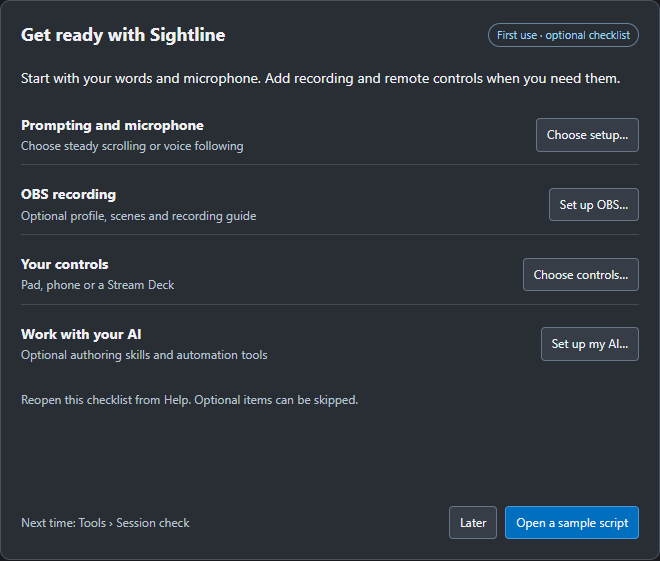
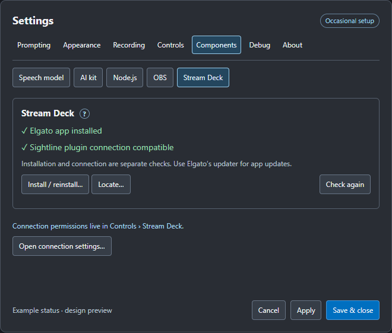
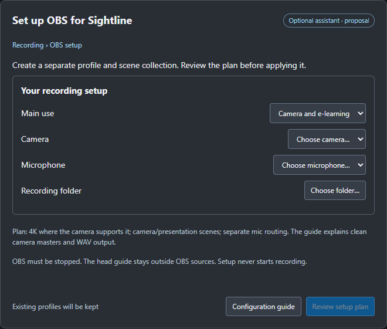

# A workflow for setup, recording and review

Design proposal, 31 October 2026. These mock-ups are not implemented screens.
The component detection work is built; no new RC has been packaged or installed.

## What needs correcting

The toolbar and shared pad already serve frequent recording actions. Settings
has grown around feature additions rather than the order in which a person
prepares and records. Numbered overflow pages make controls harder to find,
separate status from actions and obscure what has already been configured.
Installation, connection permissions and live connection status need different
labels. An installed program is not necessarily running or connected.

## Frequency and location

| When | Entry point | Contents |
| --- | --- | --- |
| First use, or a new setup | Getting started checklist | Microphone and prompting choice; optional speech model, OBS, Stream Deck, phone and AI setup. Optional items can be skipped. |
| Before a recording session | Tools > Session check | Current mic, sound check, framing, OBS connection, output readiness and sync reference. Links open the relevant existing setup screen. |
| While recording | Toolbar, pad, phone and Stream Deck | Prompting, sections, retakes, markers, keeper/scrap, recording and guide controls. Show enabled capabilities and confirmed state. |
| After a take or session | Recordings and rehearsal review | Pace, take choices, qualified recognition feedback, script snapshot and edit-pack export. |
| Occasional configuration | Settings | Prompting preferences, appearance, recording connections/setup, control methods and optional installations. |
| When something fails | Debug and contextual help | Connection checks, health, logs and opt-in tracing, with privacy explanations. |

## Settings structure to review

The stable frame retains **Prompting**, **Appearance**, **Recording**,
**Controls**, **Components**, **Debug** and **About** as named top-level areas.
Each setting has one home; toolbar and session-check links open that home.
About keeps version, attribution and support information.

- **Recording:** take preferences, audio references, OBS connection, OBS
  recording permissions and one entry to the optional setup assistant.
- **Controls:** pad, button mappings, phone, Stream Deck connection and AI/API.
- **Components:** named subtabs for Speech model, AI kit, Node.js, OBS and
  Stream Deck. Each keeps status, explanation and install/repair actions
  together. No numbered component pages.
- **Debug:** diagnostics and optional word tracing. Core use needs no visit.

This is a proposal for the wider navigation change. The existing component
availability checks have been tested independently; their current pagination
is an interim implementation awaiting this layout review.

## OBS setup assistant

Requested scope: an optional new profile and scene collection, selected camera,
microphone and output folder, a 4K e-learning preset, separate audio routing,
and an illustrated configuration guide. Review the complete plan before Apply.

Create a separately named Sightline profile/collection. Inspect existing names
and never overwrite a user's setup. Require OBS to be connected with streaming,
recording and replay buffer stopped. Retain the previous profile/collection;
report partial completion and restoration clearly if a step fails. Never begin
recording as part of setup. Device modes and encoders must be checked before
offering a quality preset as supported.

Scenes should cover clean camera, camera with presentation and presentation
with camera. Use camera/window sources, not a capture of the desktop containing
the guide or prompter. A clean scene alone does not create a simultaneous clean
camera master: that requires an additional recording route. Likewise a separate
mic track is not automatically a WAV file. The assistant/guide must distinguish
what it configured from the extra clean-recording and WAV-extraction steps.
Keep scratch audio independent. Use the existing explicit recorded-slate
preparation and verify the captured picture/sound before calling sync ready.

The assistant is proposed work, not built or validated. It will not modify the
workstation's OBS configuration during this design review.
