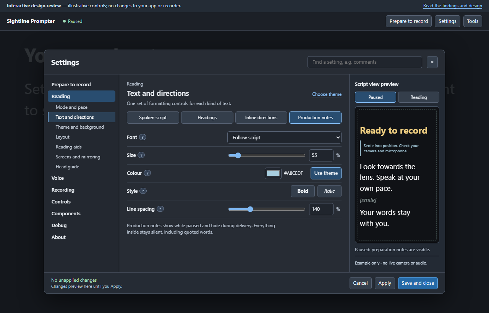
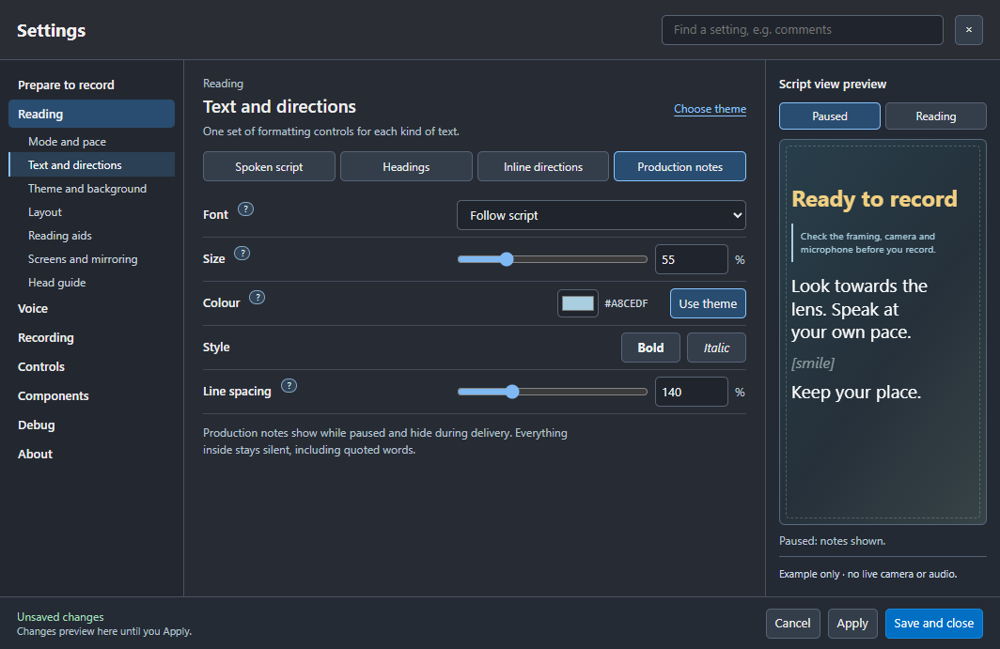

# Preview 05 layout fidelity

The user reauthorised implementation of the original interactive preview on
2 November 2026. Its source at `d1302a1` remains the reference. Native layout
rules map directly from that preview, while existing form controllers retain
their values, drafts and service permissions.

## Matched production-note screen

[Approved screen, full size](images/typography-production-notes.png)

[Real app, full size](images/layout-signed-off-typography.png)

The real app uses its native utility-window frame. The composition, labels,
column ownership, header search, fixed footer and preview modes follow the
approved demo. This image uses matching note/heading sizes for comparison;
the user's saved appearance is retained when launching the app.

## Checks independent of functional tests

- Area labels/order are checked against the actual approved HTML source.
- Areas form one vertical list; exactly one child section list expands under
  its own area. The selected area has the approved highlight.
- Desktop rectangles establish left navigation, centre controls and right
  preview. The sample must not appear inside the controls column.
- Header search opens the actual named section.
- Reading hides only the sample's production note. Prompting remains stopped.
- Compact selectors and Preview dialog follow the approved responsive design;
  Escape dismisses only the example.
- All 34 sections and four typography targets fit the checked frames. Native
  source and packaged-app checks supplement matched screenshot inspection.

The full unit suite, source lint, theme/mapping/close-guard checks and production
guide/recorder fixture remain required. Physical output, clean tracks, capture
exclusion and camera/mic sync still need the actual recording acceptance.
