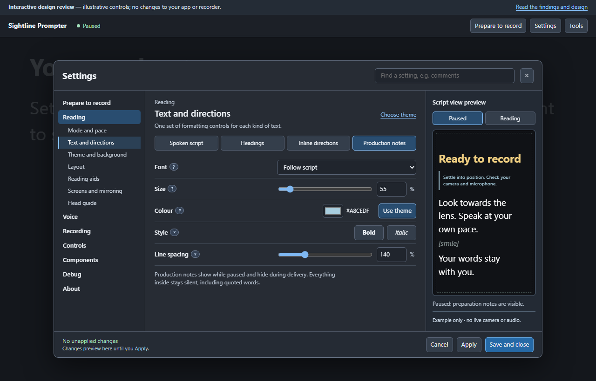
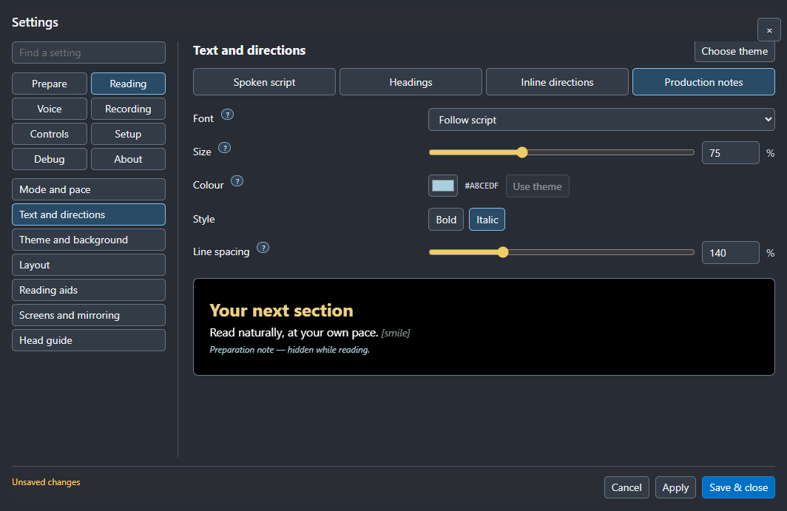

# Layout correction: use the signed-off interactive preview

Review checkpoint, 2 November 2026. **No app-code changes in this review.**
The original interactive preview is the specification. This comparison does
not propose a replacement design. Preview 04's layout departed from the approved
composition and must not be treated as visually signed off.

## The target you approved

[Open the full-size approved screen](images/typography-production-notes.png)

The exact interactive source is
[the signed-off demo at d1302a1](https://github.com/JoJo-1965/sightline-prompter/blob/d1302a1/docs/design/settings-and-tools-prototype.html).
The local HTML file opens directly in a browser and remains unchanged.

## What Preview 04 incorrectly substituted

[Open the full-size Preview 04 screen](../guide/images/settings-preview04-text-production.png)

## The correction to implement

- **Left:** one vertical area list. Only the selected area expands, with its
  section links directly beneath it. Match the approved labels, including
  **Prepare to record** and **Components**. No category-button grid.
- **Centre:** the selected section's controls, with the approved breadcrumb,
  title, typography tabs and consistent control rows. Keep the sample out of
  this column.
- **Right:** a dedicated **Script view preview**, with **Paused / Reading**
  controls, the tall script sample, explanatory state and example-only footer.
  It remains a separate column as sections change.
- **Header:** Settings title, search at the right and Close, as in the demo.
- **Footer:** fixed draft feedback and Cancel, Apply, Save and close actions.
- **Compact windows:** use the demo's labelled Area and Section selectors;
  open the sample with its Preview action when the right column is hidden.

Existing behaviour is to be connected to this composition. Any departure from
the interactive preview must be shown and reviewed before implementation.

## How the mismatch happened

The implementation treated the demo as a function inventory, reused the app's
separate category/section navigation and embedded the sample inside forms.
Validation checked functionality, saving and clipping, but did not compare the
rendered app side by side with the approved demo. Passing those checks was
incorrectly treated as completion of the design implementation.

Before another handover, compare the real app and this exact demo in matched
states: Prepare to record, production-note typography, theme/background,
Controls, and a compact window. Check the composition and interactions as well
as control operation. The next work is layout fidelity, not a new design.
