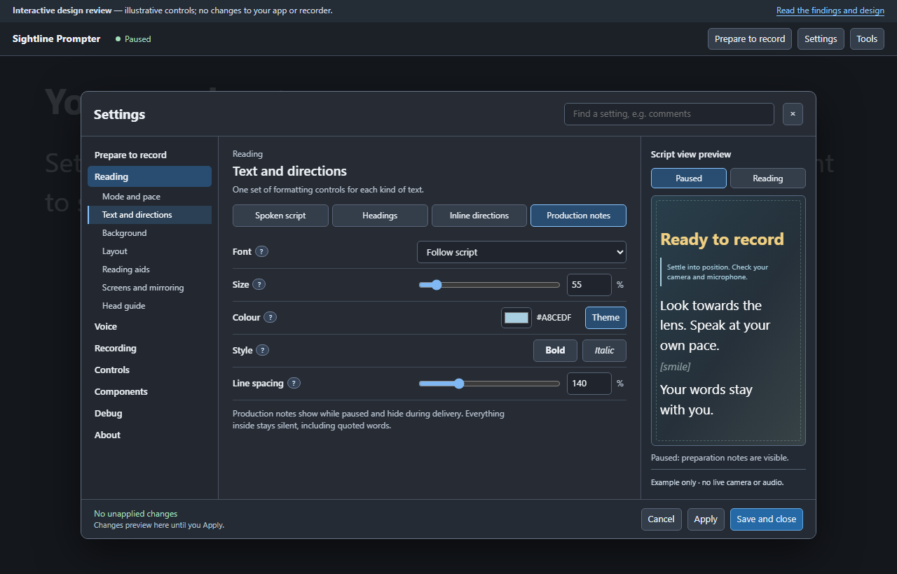
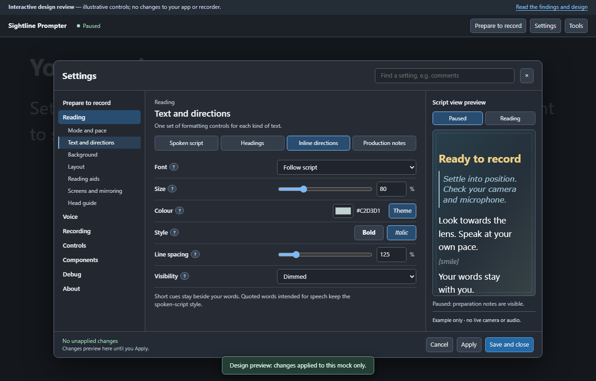
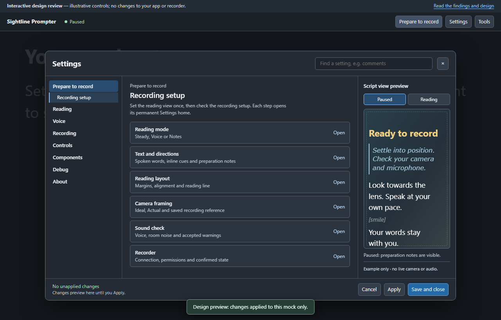
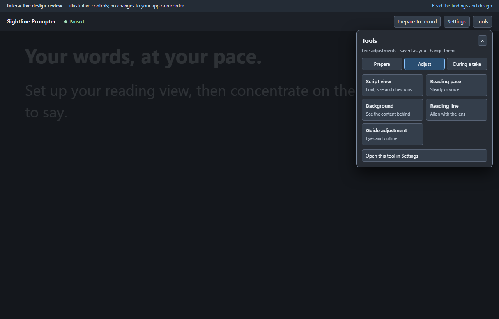
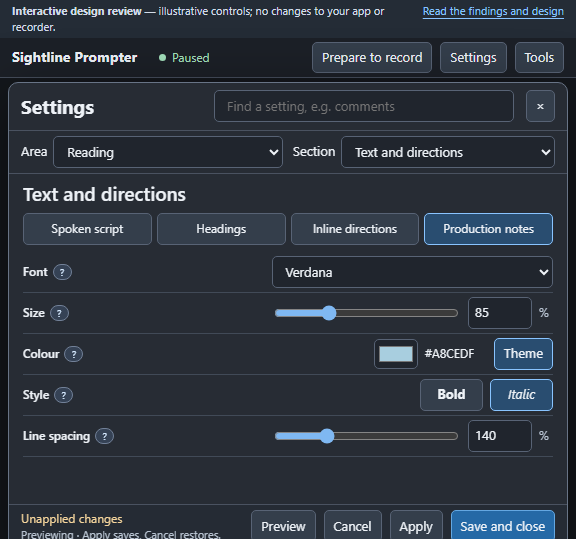

# Settings and Tools design review

**Proposal only — these screens are not an installed app update.**
The mock uses illustrative settings and never contacts a microphone, camera,
recorder or external service.

[Open the interactive mock](settings-and-tools-prototype.html) or read the
[complete review and function map](SETTINGS-AND-TOOLS-REDESIGN.md).

## Production notes

One complete formatting component: Font, Size, Colour with Theme reset,
Bold, Italic and Line spacing. The selected target is always named. The preview
can switch between paused and reading states.

## Inline directions

The same controls, in the same order. Visibility affects inline cues; it does
not change the automatic behaviour of production notes.

## Prepare to record

The initial setup route opens each control in its permanent home: reading,
directions, layout, framing, sound and recorder. It does not create a second
set of preferences.

## Tools

Prepare, Adjust and During a take use the same visual language as Settings.
Live adjustments are labelled; each tool links to its permanent settings home.

## Smaller window

Area and Section selectors replace the wide navigation. The controls remain
in the same named section. There are no generated Previous/Next pages and no
internal settings scrolling.

## Checks

The prototype was checked at 1280 × 820, 1024 × 600, 680 × 600 and 576 × 539.
All 33 sections and four formatting targets fit the content area. Tools stayed
inside the viewport in all three groups. Font, italic, swatch/Theme state,
paired size inputs, note hiding, search and pending-change handling were
checked. These checks validate the mock, not the still-unfinished application.
