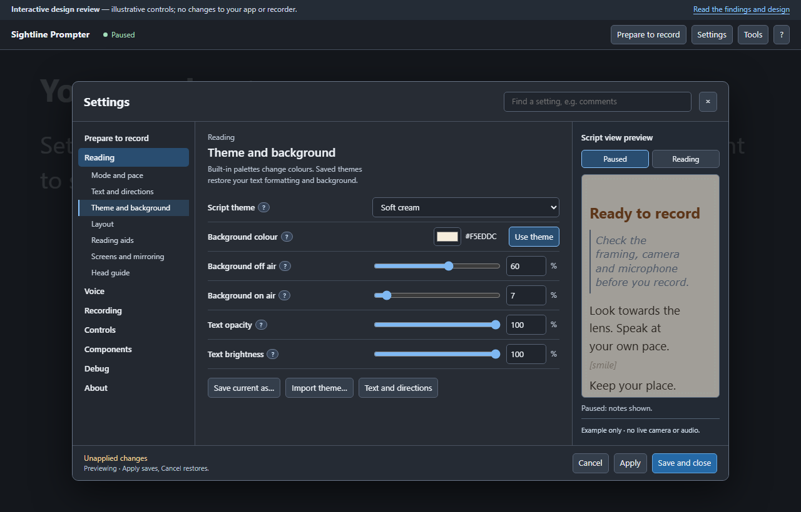
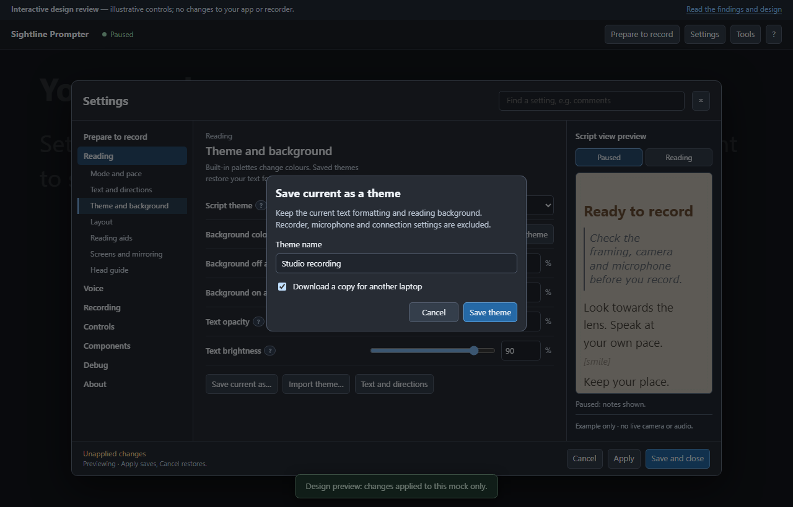
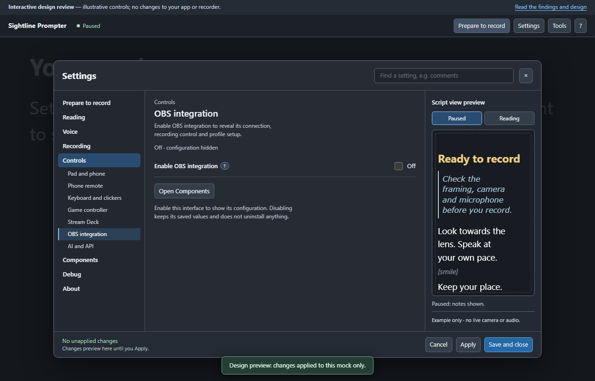
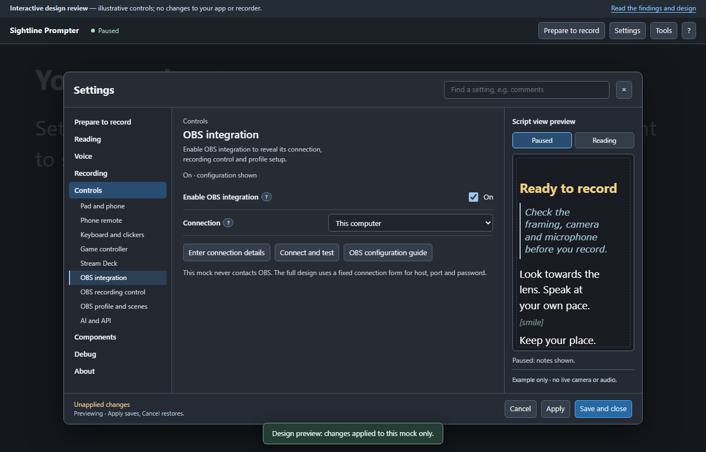
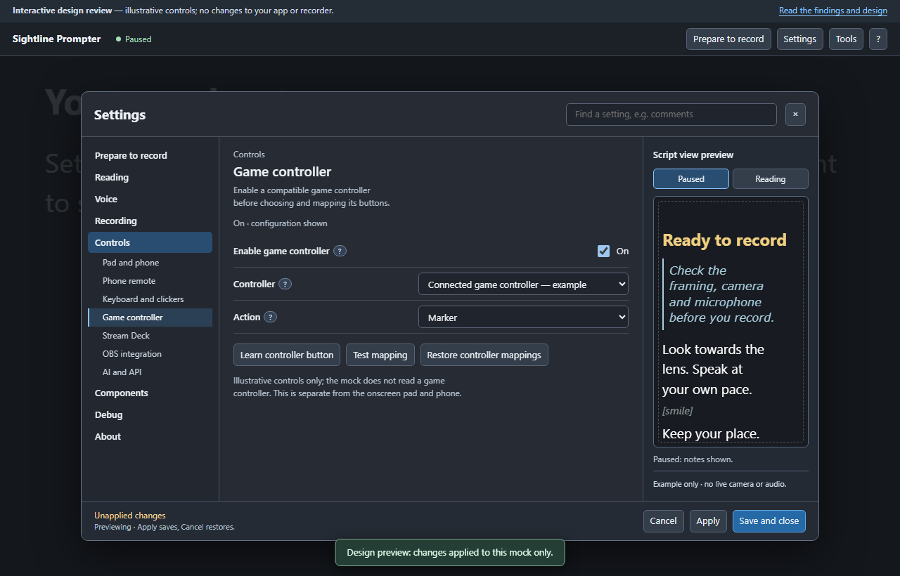
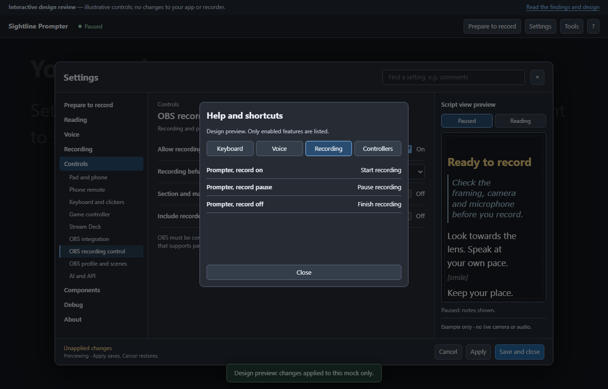

# Settings and Tools design review

**Proposal only — these screens are not an installed app update.**
The mock uses illustrative settings and never contacts a microphone, camera,
recorder or external service.

[Open the interactive mock](settings-and-tools-prototype.html) or read the
[complete review and function map](SETTINGS-AND-TOOLS-REDESIGN.md).

## Production notes

One complete formatting component: Font, Size, Colour with Use theme reset,
Bold, Italic and Line spacing. The selected target is always named. The preview
can switch between paused and reading states.

## Inline directions

The same controls, in the same order. Visibility affects inline cues; it does
not change the automatic behaviour of production notes.

## Theme and background

Choose theme opens the palette selector from text formatting. The four
palettes change the script preview; custom text colours are preserved.
Use theme removes a custom colour for the selected text type only.

The background colour picker works independently of opacity and has the same
Use theme reset as the four text colours. Off-air/on-air backing, text opacity
and brightness are editable and update the preview.

**Save current as…** creates a named theme from the four text styles and
background colour/values. Pick it under **My saved themes** to restore that look.
Select the download option when saving, then use **Import theme…** on another
laptop. A theme file saves reading appearance, not the whole UI configuration.
These actions work in this browser mock; they do not update the app.

## Optional interfaces

OBS configuration now lives under Controls. Off shows the enable switch;
connection, recording-control and profile/scenes configuration stays hidden.

Game controller has its own enable switch and mapping controls. Keyboard and
clickers are separate from both gamepads and the onscreen Pad and phone layout.
The same enable/configure rule applies to the other optional interfaces.

## Conditional help

The fixed-size ? dialog shows only enabled shortcut and controller topics.
Voice recorder commands also require speech, microphone, listening and OBS
recording permission. Disabling a feature removes the related help entries.

## Prepare to record

The initial setup route opens each control in its permanent home: reading,
directions, layout, framing, sound and recorder. It does not create a second
set of preferences.

## Tools

Prepare, Adjust and During a take use the same visual language as Settings.
Live adjustments are labelled; each tool links to its permanent settings home.

## Smaller window

Area and Section selectors replace the wide navigation. The controls remain
in the same named section. There are no generated Previous/Next pages and no
internal settings scrolling.

## Checks

The prototype was checked at 1280 × 820, 1024 × 600, 680 × 600 and 576 × 539.
All 34 named sections, with optional interfaces enabled, and four formatting
targets fit the content area. Tools stayed
inside the viewport in all three groups. Font, italic, swatch/Use theme state,
paired size inputs, note hiding, search and pending-change handling were
checked. All four theme palettes, per-target colour resets and Apply/Cancel
were checked, including opening the downloaded HTML file directly. Named-theme
save, reload, restore, portable JSON download/import, custom background colour,
backing opacity, text opacity/brightness, duplicate names and invalid-file
handling were checked. All nine optional interface switches were checked for
hidden/revealed configuration and retained values, along with OBS placement,
conditional navigation/search, dependent help and the fixed help-dialog frame.
These checks validate the mock, not the still-unfinished application.
