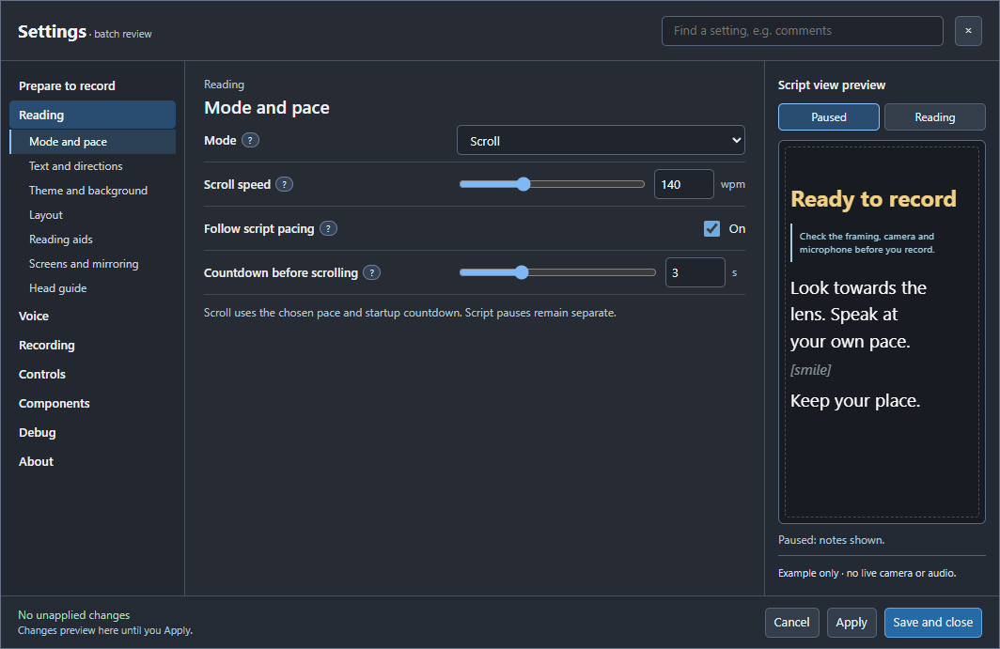
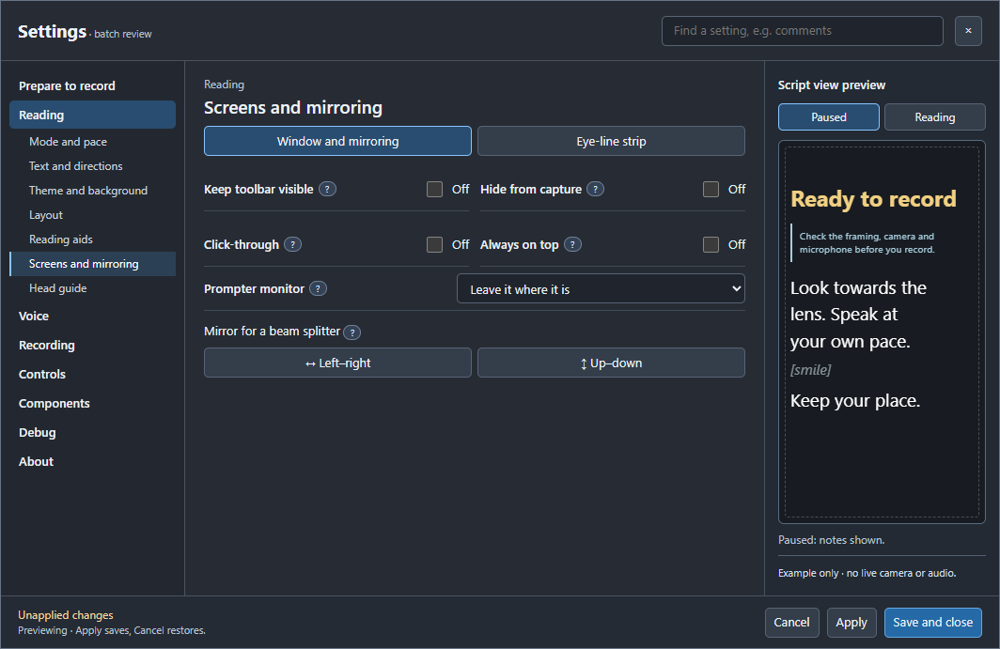
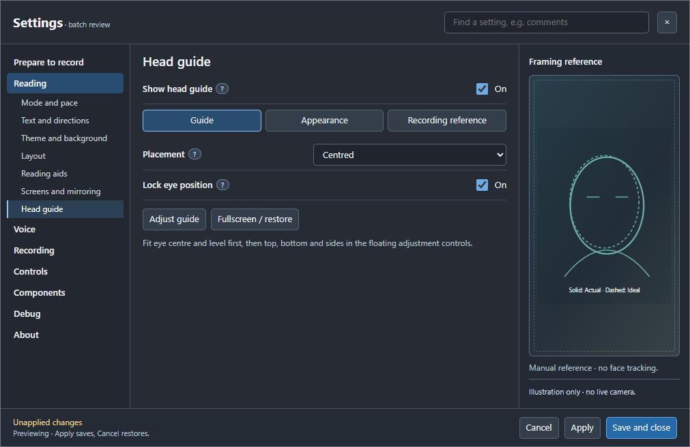
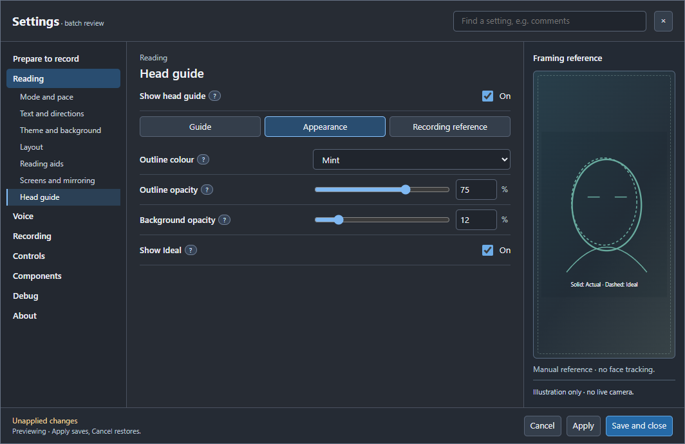
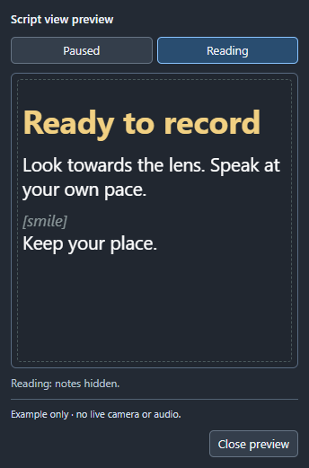
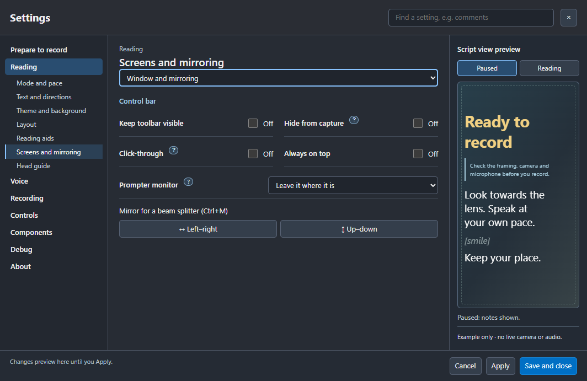

# Settings feedback batch — 2 November 2026

These are review proposals unless marked implemented. Show the combined layout
before wiring any departure from the signed-off interactive preview. No new
package, RC, supported-feature claim or website deployment is implied.

## One combined review

Use the [interactive mock](settings-feedback-batch-prototype.html) and
[screenshot gallery](settings-feedback-batch-gallery.html). They retain the
approved left navigation, central controls, right preview and fixed footer.
The workstation serves the review at `http://192.168.0.150:4881/` and its gallery
at `/gallery` while the read-only review helper is running. The mock changes
only its own example data, with no access to the app, microphone or recorder.

This batch covers mode dependencies, mirror spacing, visible group navigation,
focus styling, Head guide configuration and preview layout/behaviour together.
The layout mock fits 1064 × 691, 1011 × 656, 680 × 600 and 560 × 500. In the
short/wide case, the third column remains visible. Compact windows use a
non-modal companion preview. Obtain one layout sign-off before wiring the
remaining proposals; then build and review one combined app preview.

## Implemented, awaiting the next batched package

- Focus treatment: the actual app source now draws keyboard focus inside the
  control border, with no detached outer halo. This is no longer only a mock
  change. Native rendering confirms a visible focus cue with no outside paint.
  The earlier package retains the old rule; no running preview was available
  for an in-place update when this follow-up was checked.
- Compact preview: replaced the modal dialog in source with a movable,
  non-modal utility window, placed beside Settings where space permits. Both
  preview copies share the current draft. Explicit 13px control fonts prevent
  the close button inheriting prompter text size. Escape, native X, minimum size,
  real pointer interaction with Settings and capture-policy inheritance pass
  native checks. The running package remains unchanged.
- Mode and pace: one selector for Notes / page, Voice and Scroll replaces the
  independent Notes checkbox. Scroll shows WPM, script pacing and countdown;
  Voice shows response; Notes shows page-navigation guidance. Irrelevant fields
  and their number boxes are hidden and disabled. Mode changes retain pace,
  response and countdown preferences. Notes retains the previous underlying
  scrolling choice. Voice still requires speech and microphone input.
- Native checks cover all three modes, retained values, saving/reopening Notes,
  Apply/Cancel, component prerequisites and compact layouts. The running package
  is unchanged. Source captures for review:
  [Scroll](images/mode-context-scroll.png),
  [Voice](images/mode-context-voice.png),
  [Notes / page](images/mode-context-notes.png).
- Mirror group: restore the vertical layout lost when it moved outside the
  old Layout host. Source and the open preview use 12px above the group and
  8px before its buttons. Native checks pass at five window sizes. The open
  preview's temporary CSS lasts for this app session.

## Screens and mirroring — proposal

- Replace the hidden Window and mirroring / Eye-line strip dropdown with two
  visible named tabs. Keep the signed-off left navigation and right preview.
- Show Eye-line strip configuration only when that mode is enabled.
- Use the same visible-tab treatment for the existing Reading aids groups;
  keep the four text-target choices as visible buttons. Mode selection remains
  a value selector, not hidden group navigation.
- The former blue extra edge was the keyboard-focus outline offset 3px beyond
  the normal border. The source now uses one inset focus treatment; keyboard
  focus remains visible. This correction is ready for the combined package.

## Persistent preview column — proposal

The current compact rule replaces the third column with a Preview button at
width <= 920px OR height <= 670px. This rule also exists in the approved
prototype. The reported window measured 1011 × 656 CSS pixels: height alone
triggered the replacement despite sufficient width. Proposed correction for
review: choose the inline preview versus button by available width; adapt the
preview's height within the fixed frame. Do not resize the user's window or
silently change the agreed composition. Check short/wide and narrow windows
alongside the full layout before wiring this change.

## Head guide — proposal

The current Settings page is only a launcher. The Show guide action invokes
show, not toggle; the label never communicates visibility. Most candidate
settings already exist in the dedicated adjustment window.

| Group | Candidate controls |
| --- | --- |
| Guide | Stateful Show/Hide switch; centred/beside-prompter placement; fullscreen/window state. |
| Appearance | Existing outline colour choices, outline opacity, background opacity and Show Ideal. |
| Recording reference | Saved/not saved status; Save current as recording reference; Restore saved reference; eye-lock state. |

Use the page for setup and the recording reference. Keep the precise eye
centre/level, top/bottom and left/right fitting in the floating Adjust guide
controls, accessible during recording. Keep Save as Ideal separate from Save
recording reference. Restore is unavailable until a reference exists.

When hidden, retain saved guide preferences. Use the right preview for an
illustration of Actual versus Ideal, labelled as manual framing, not tracking.
Any capture status must report the protection policy honestly; it cannot prove
the actual guide is absent from recorded footage.

The mock must fit the fixed panel without scrolling, hidden group dropdowns or
cramped controls. Check compact widths and the absence of hanging label words.
Review what fits before choosing which appearance controls belong directly on
this page. A useful page is the goal; filling every blank area is not.

## Review captures

These layout captures come from the combined interactive mock. They are not
claims about the currently running package. Open an image at full size to zoom.

The following capture is from the **native app in an isolated test profile**,
showing the implemented non-modal companion and its standard Close control.

The focus correction below is also from the native app test. Its group
navigation is still the pre-batch version; this capture verifies focus styling.

