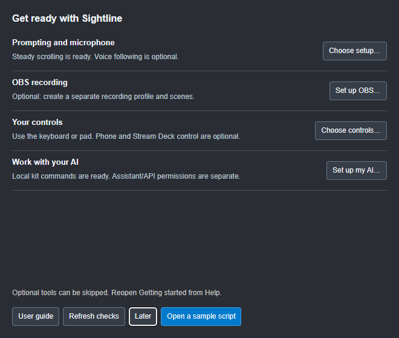
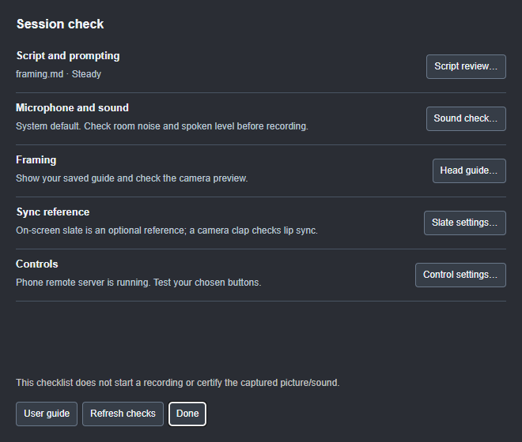
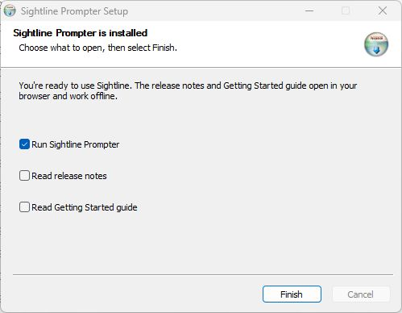
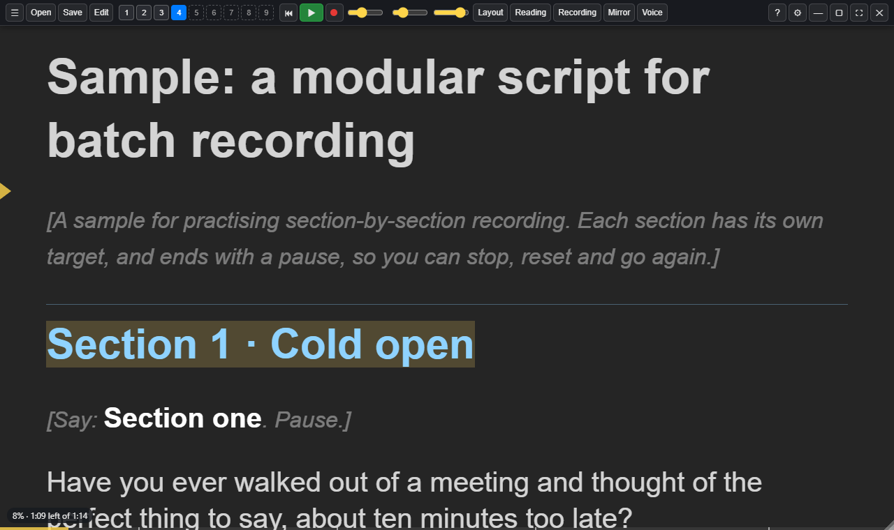
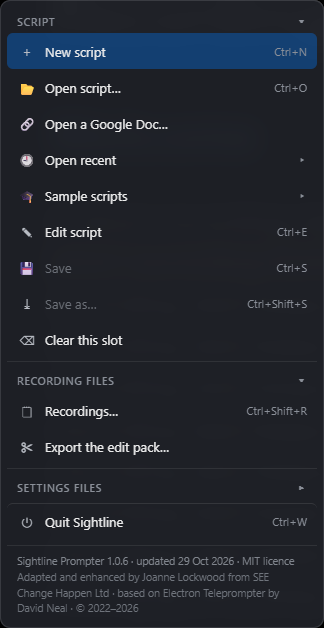

# Getting started

## Set up once, check before a session

With no saved scripts, Sightline opens **Start here: Sightline feature tour**.
It works without optional devices or services. Use Space at each planned stop,
try its suggested action, and continue. Reopen it from Files > Sample scripts.
The [demo guide](../DEMO-SCRIPTS.md) explains the focused recording/Notes samples.

In Sightline 1.2.0, **Settings > Getting started > First setup** is the first
navigation entry. It shows the current script, reading mode, text appearance
and optional tools, with instructions and links to their settings. The guide
scrolls in the centre pane while navigation, the sample and footer stay fixed.
Opening this page does not enable a camera, microphone or external integration.

The optional **Get ready with Sightline** checklist is also available.
Choose prompting and microphone settings, try a sample, and optionally set up
OBS, controls or your AI. Skip optional parts with **Later**. Reopen it from
**Help > Getting started…**, or the Getting started button in F1 Help.

To recreate the shipped setup, use **Settings > Getting started > Restore defaults…**.
After confirmation Sightline restarts into this checklist. Installed components,
script files, recordings and service keys remain. Preferences, layouts, slots
and pairings reset; integrations start off. See [Settings](07-settings.md).

**Tools > Session check…** is the shorter pre-recording checklist: script,
sound, framing, enabled OBS, sync and controls. Its links open the existing
tools and settings. **Refresh** updates known status; a test recording is
still needed to confirm the captured picture and sound.

## Installing Sightline

For the preparation workflow, open **Tools > Prepare > Prepare to record**.
Align the shot, verify audio, review a real recorded test and explicitly save
a reference. See [Prepare to record](16-prepare-to-record.md).

Sightline is free. Download the installer for your computer from the
[latest release](https://github.com/JoJo-1965/sightline-prompter/releases/latest), under **Assets**:

| Your computer | Download | Then |
| --- | --- | --- |
| Windows 10 or 11 | `Sightline-Prompter-Setup-<version>.exe` | Double-click it. It installs and opens Sightline |
| Mac with Apple silicon (M1 and later) | `Sightline-Prompter-<version>-arm64.dmg` | Open it and drag Sightline Prompter to Applications |
| Mac with an Intel processor | `Sightline-Prompter-<version>-x64.dmg` | The same |
| Linux (most) | `Sightline-Prompter-<version>-x86_64.AppImage` | Make it executable (right-click > Properties, or `chmod +x`), then run it |
| Debian or Ubuntu | `Sightline-Prompter-<version>-amd64.deb` | `sudo apt install ./Sightline-Prompter-<version>-amd64.deb` |

Not sure which Mac you have? Apple menu > **About This Mac**: **Chip** means
Apple silicon, **Processor** means Intel.

**Windows installer finish page (RC9):** choose **Run Sightline Prompter**,
**Read release notes** and/or **Read Getting Started guide**, then **Finish**.
Run is ticked initially; the two reading options start unticked. Each works
independently, including opening both documents without starting Sightline.
The documents open in your browser from the installed files and work offline.
They include the installed version number and links to the bundled user guide.
Silent installations do not open these pages.

### Browser and security confirmations

**Windows installers are unsigned; Mac apps are ad-hoc signed and unnotarised.**
Use the [illustrated download and installation guide](18-installation.md) for
your exact message. It is also in **Help > Download and installation help**.

- **Edge:** Downloads (Ctrl+J) > the file's … menu > Keep. If asked, select
  Show more > Keep anyway before opening the saved installer.
- **Windows SmartScreen:** More info > check the Sightline filename > Run anyway.
- **macOS:** copy to Applications, try opening, then System Settings > Privacy &
  Security > Open Anyway for the blocked Sightline app.

These steps concern a chosen official download. A malware detection or damaged
file needs a separate source/hash check. Device policy may prevent an exception;
do not disable protection globally. The full guide includes pictures and checksums.

### Uninstalling

- **Windows:** **Settings > Apps > Installed apps** > Sightline Prompter >
  **Uninstall**.
- **Mac:** drag Sightline Prompter from Applications to the Bin.
- **Linux:** delete the AppImage, or `sudo apt remove sightline-prompter`.

Your settings, take logs and speech model stay behind, in case you reinstall.
To remove them too, delete the **Sightline Prompter** folder in
`%APPDATA%` (Windows), `~/Library/Application Support` (Mac) or
`~/.config` (Linux).

## The prompter window

The prompter is an ordinary window that you can see through. Put it near the
top of the screen, just under your webcam, so your eyes stay close to the lens
while you read.

The small yellow arrow on the left is the **reading line**: the place your eyes
should rest. The script scrolls up past it.

## The control bar

Move the mouse over the window and the control bar appears along the top. It
hides again while you read (**Ctrl+Shift+B** keeps it showing).

From left to right:

| Control                      | What it does                                                                                                             |
| ---------------------------- | ------------------------------------------------------------------------------------------------------------------------ |
| **☰ Files**                 | New/Open, recent and sample scripts, Edit/Save, Recordings, edit-pack export, settings-file import/export and Quit |
| **1** to **9**               | Script slots. Each slot holds a script and remembers your place, so you can swap between them (**Ctrl+1** to **Ctrl+9**) |
| **⏮**                        | Back to the top                                                                                                          |
| **▶**                        | Start or pause scrolling (**Space**)                                                                                     |
| **On air**                   | Go on air by hand (**Ctrl+Shift+A**): the on-air backing and the ON AIR light. It lights red whenever you're on air, including while scrolling |
| **Speed**                    | Words per minute for steady scrolling                                                                                    |
| **Size**, **Backing**        | Text size, and how solid the dark background behind the text is                                                          |
| **Steady / Voice**            | Switch the scrolling mode; the label shows the current mode |
| **Tools**                     | Sound check, head guide, keeper/scrap, quick display and voice panels, control pad and control window |
| **?**, **⚙**                 | Help and Settings                                                                                                        |
| **— ▢ ⛶ ✕**                  | Minimise, maximise, full screen and close                                                                                |

In a narrower window the bar makes room by dropping, in turn, the units, the
slider labels and the number boxes (**On air** becomes a red record dot), then
the restart button, empty slots and the size/backing sliders. **Files, Tools,
Settings and Help stay available.** Settings and shortcuts give access to the
additional adjustments.

## The progress bar

The thin yellow bar along the bottom shows how far through the script you
are, and the bottom left shows the time left. It's also a quick way to move:
point at it to see the section and time at that place, then click to jump
there, or drag along it. The white ticks mark where each section starts.
While the prompter is running, clicks on the bar are ignored, so a stray
click can't jump a take: pause first. Turn the bar off in Reading > Reading aids.

## The menu

Opening one group folds the others away, so the menu stays short. Click
anywhere else to close it. **Quit Sightline** is always at the bottom (also
**Ctrl+W**, or **✕** on the control bar). Copyright and attribution are on
the About page: **Help > About**, or **Settings > About > Credits**.

## Your first take

1. Choose **☰ Files > Script > Open script…**, press **Ctrl+O**, or drop a file onto the window. The
   first time you run the app it opens a short welcome script that shows you
   around.
2. Set the **Speed** to your usual pace. 140 to 150 words per minute suits most
   people.
3. Press **Space**. After a short countdown the script starts to scroll.
4. Press **Space** again to pause. The **←** and **→** arrows jump between
   sections.

When you're ready, try [voice scrolling](03-scrolling-and-voice.md), where the
prompter follows you instead of keeping a fixed pace.
