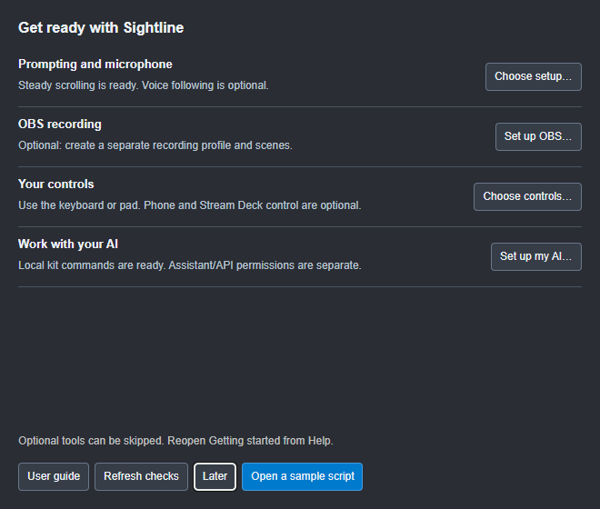
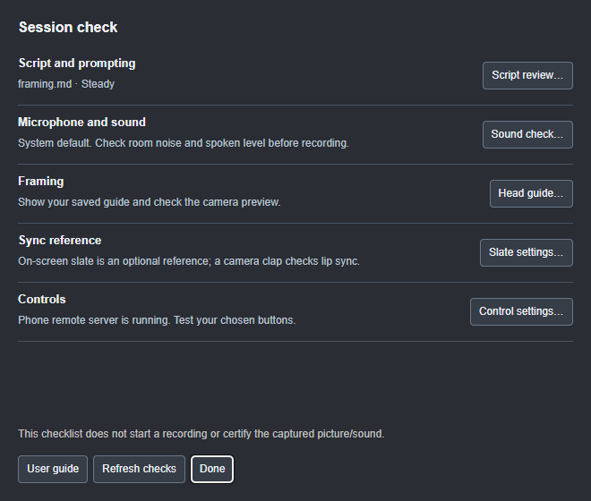
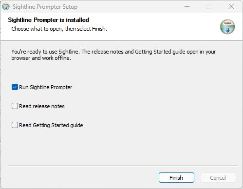

# Getting started

## Set up once, check before a session

In 1.1.0, a new profile opens **Get ready with Sightline**.
Choose prompting and microphone settings, try a sample, and optionally set up
OBS, controls or your AI. Skip optional parts with **Later**. Reopen it from
**Help > Getting started…**, or the Getting started button in F1 Help.

To recreate the shipped setup, use **Settings > About > Restore defaults…**.
After confirmation Sightline restarts into this checklist. Installed components,
script files, recordings and service keys remain. Preferences, layouts, slots
and pairings reset; integrations start off. See [Settings](07-settings.md).

**Tools > Session check…** is the shorter pre-recording checklist: script,
sound, framing, enabled OBS, sync and controls. Its links open the existing
tools and settings. **Refresh** updates known status; a test recording is
still needed to confirm the captured picture and sound.

## Installing Sightline

Sightline is free. Download the installer for your computer from the
[latest release](https://github.com/JoJo-1965/sightline-prompter/releases/latest), under **Assets**:

| Your computer | Download | Then |
| --- | --- | --- |
| Windows 10 or 11 | `Sightline-Prompter-Setup-<version>.exe` | Double-click it. It installs and opens Sightline |
| Mac with Apple silicon (M1 and later) | `Sightline-Prompter-<version>-arm64.dmg` | Open it and drag Sightline Prompter to Applications |
| Mac with an Intel processor | `Sightline-Prompter-<version>-x64.dmg` | The same |
| Linux (most) | `Sightline-Prompter-<version>-x86_64.AppImage` | Make it executable (right-click > Properties, or `chmod +x`), then run it |
| Debian or Ubuntu | `Sightline-Prompter-<version>-amd64.deb` | `sudo apt install ./Sightline-Prompter-<version>-amd64.deb` |

Not sure which Mac you have? Apple menu > **About This Mac**: **Chip** means
Apple silicon, **Processor** means Intel.

**Windows installer finish page (RC9):** choose **Run Sightline Prompter**,
**Read release notes** and/or **Read Getting Started guide**, then **Finish**.
Run is ticked initially; the two reading options start unticked. Each works
independently, including opening both documents without starting Sightline.
The documents open in your browser from the installed files and work offline.
They include the installed version number and links to the bundled user guide.
Silent installations do not open these pages.

### The security warnings, and how to get past them

Sightline's installers are currently unsigned. That can trigger publisher or
download-reputation warnings. A warning is not proof that a file is safe or
unsafe: check its source and the specific message. Use the
[official releases](https://github.com/JoJo-1965/sightline-prompter/releases),
or a test package supplied by Joanne, and compare supplied checksums.
Public installers are built by GitHub; local acceptance packages are built
separately and have a build manifest. Your organisation's device policy applies.

**Downloading (any browser)**

- **Edge** may say the file *isn't commonly downloaded*. Point at the
  download, choose **…** > **Keep**, then **Show more** > **Keep anyway**.
- **Chrome** may say it's *suspicious* or *unverified*. Choose **Keep** (in
  the downloads list, the **⋮** menu > **Keep**).
- **Safari** and **Firefox** usually download it without asking.

**Windows: "Windows protected your PC"**

Microsoft Defender SmartScreen shows this the first time you run the
installer. Choose **More info**, check it says *Sightline-Prompter-Setup*, then
**Run anyway**. It won't ask again for that version.

- **"Smart App Control blocked an app"**: this is a different control from
  SmartScreen and may offer no per-app bypass. Follow your organisation's
  policy or ask its administrator. See Microsoft's
  [current Smart App Control guidance](https://support.microsoft.com/en-gb/windows/security/threat-malware-protection/smart-app-control-frequently-asked-questions).
- **Your antivirus quarantines it**: keep it quarantined while checking the
  exact detection, source and hash. Report the details through the project's
  support route; a detection should not be dismissed merely because the app
  is unsigned. Do not disable antivirus to install Sightline.

**Mac: "Apple could not verify Sightline Prompter"**

macOS shows this the first time you open the app (older versions say it's
*from an unidentified developer*). Choose **Done** (not **Move to Bin**), then:

1. Open **System Settings > Privacy & Security**.
2. Scroll down to **Security**. Next to *Sightline Prompter was blocked*,
   choose **Open Anyway**, and enter your password.
3. Open Sightline again and choose **Open Anyway**.

On macOS 14 and earlier, right-clicking the app in Applications and choosing
**Open** does the same.

If the Mac says the app is damaged, cannot be checked, or contains malware,
do not assume those messages mean the same thing. Re-download from the
official release and check Apple's
[guidance for apps from outside the App Store](https://support.apple.com/en-gb/102445).
Use the normal Privacy & Security exception only when you have verified the
source and chosen to trust it. macOS hardware testing for this build is deferred.

**Linux** doesn't warn. If the AppImage won't start, make sure it's
executable; some distributions also need `libfuse2`.

### Uninstalling

- **Windows:** **Settings > Apps > Installed apps** > Sightline Prompter >
  **Uninstall**.
- **Mac:** drag Sightline Prompter from Applications to the Bin.
- **Linux:** delete the AppImage, or `sudo apt remove sightline-prompter`.

Your settings, take logs and speech model stay behind, in case you reinstall.
To remove them too, delete the **Sightline Prompter** folder in
`%APPDATA%` (Windows), `~/Library/Application Support` (Mac) or
`~/.config` (Linux).

## The prompter window

The prompter is an ordinary window that you can see through. Put it near the
top of the screen, just under your webcam, so your eyes stay close to the lens
while you read.

The small yellow arrow on the left is the **reading line**: the place your eyes
should rest. The script scrolls up past it.

## The control bar

Move the mouse over the window and the control bar appears along the top. It
hides again while you read (**Ctrl+Shift+B** keeps it showing).

From left to right:

| Control                      | What it does                                                                                                             |
| ---------------------------- | ------------------------------------------------------------------------------------------------------------------------ |
| **☰ Files**                 | New/Open, recent and sample scripts, Edit/Save, Recordings, edit-pack export, settings-file import/export and Quit |
| **1** to **9**               | Script slots. Each slot holds a script and remembers your place, so you can swap between them (**Ctrl+1** to **Ctrl+9**) |
| **⏮**                        | Back to the top                                                                                                          |
| **▶**                        | Start or pause scrolling (**Space**)                                                                                     |
| **On air**                   | Go on air by hand (**Ctrl+Shift+A**): the on-air backing and the ON AIR light. It lights red whenever you're on air, including while scrolling |
| **Speed**                    | Words per minute for steady scrolling                                                                                    |
| **Size**, **Backing**        | Text size, and how solid the dark background behind the text is                                                          |
| **Steady / Voice**            | Switch the scrolling mode; the label shows the current mode |
| **Tools**                     | Sound check, head guide, keeper/scrap, quick display and voice panels, control pad and control window |
| **?**, **⚙**                 | Help and Settings                                                                                                        |
| **— ▢ ⛶ ✕**                  | Minimise, maximise, full screen and close                                                                                |

In a narrower window the bar makes room by dropping, in turn, the units, the
slider labels and the number boxes (**On air** becomes a red record dot), then
the restart button, empty slots and the size/backing sliders. **Files, Tools,
Settings and Help stay available.** Settings and shortcuts give access to the
additional adjustments.

## The progress bar

The thin yellow bar along the bottom shows how far through the script you
are, and the bottom left shows the time left. It's also a quick way to move:
point at it to see the section and time at that place, then click to jump
there, or drag along it. The white ticks mark where each section starts.
While the prompter is running, clicks on the bar are ignored, so a stray
click can't jump a take: pause first. Turn the bar off in the Layout panel.

## The menu

Opening one group folds the others away, so the menu stays short. Click
anywhere else to close it. **Quit Sightline** is always at the bottom (also
**Ctrl+W**, or **✕** on the control bar). Copyright and attribution are on
the About page: **Help > About**, or **Settings > About > Credits and licence**.

## Your first take

1. Choose **☰ Files > Script > Open script…**, press **Ctrl+O**, or drop a file onto the window. The
   first time you run the app it opens a short welcome script that shows you
   around.
2. Set the **Speed** to your usual pace. 140 to 150 words per minute suits most
   people.
3. Press **Space**. After a short countdown the script starts to scroll.
4. Press **Space** again to pause. The **←** and **→** arrows jump between
   sections.

When you're ready, try [voice scrolling](03-scrolling-and-voice.md), where the
prompter follows you instead of keeping a fixed pace.
