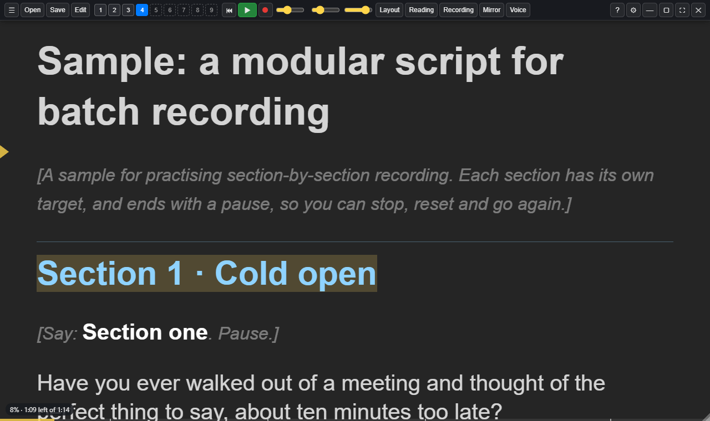

# Getting started

## The prompter window

The prompter is an ordinary window that you can see through. Put it near the
top of the screen, just under your webcam, so your eyes stay close to the lens
while you read.

The small yellow arrow on the left is the **reading line**: the place your eyes
should rest. The script scrolls up past it.

## The control bar

Move the mouse over the window and the control bar appears along the top. It
hides again while you read (**Ctrl+Shift+B** keeps it showing).

From left to right:

| Control                      | What it does                                                                                                             |
| ---------------------------- | ------------------------------------------------------------------------------------------------------------------------ |
| **☰**                       | The main menu, in fold-up groups: Script, Playback, Display, Window, Settings and Help                                   |
| **Open**, **Save**, **Edit** | Open a script, save it, or edit it in the built-in editor                                                                |
| **1** to **9**               | Script slots. Each slot holds a script and remembers your place, so you can swap between them (**Ctrl+1** to **Ctrl+9**) |
| **⏮**                        | Back to the top                                                                                                          |
| **▶**                        | Start or pause scrolling (**Space**)                                                                                     |
| **On air**                   | Go on air by hand (**Ctrl+Shift+A**): the on-air backing and the ON AIR light. It lights red whenever you're on air, including while scrolling |
| **Speed**                    | Words per minute for steady scrolling                                                                                    |
| **Size**, **Backing**        | Text size, and how solid the dark background behind the text is                                                          |
| **Layout**, **Reading**, **Recording** | The Layout panel, in three views: spacing; opacity and reading aids; recording and script options |
| **Mirror**                   | Mirroring for beam-splitter glass: click to step through off, ↔ horizontal, ↕ vertical and ↔↕ both (**Ctrl+M**) |
| **Voice**                    | The Voice panel                                                                                                          |
| **?**, **⚙**                 | Help and Settings                                                                                                        |
| **— ▢ ⛶ ✕**                  | Minimise, maximise, full screen and close                                                                                |

## The menu

Opening one group folds the others away, so the menu stays short. Click
anywhere else to close it. The line at the bottom shows the version and has a
link to **About**.

## Your first take

1. Click **Open** (or drop a file onto the window) and choose a script. The
   first time you run the app it opens a short welcome script that shows you
   around.
2. Set the **Speed** to your usual pace. 140 to 150 words per minute suits most
   people.
3. Press **Space**. After a short countdown the script starts to scroll.
4. Press **Space** again to pause. The **←** and **→** arrows jump between
   sections.

When you're ready, try [voice scrolling](03-scrolling-and-voice.md), where the
prompter follows you instead of keeping a fixed pace.
