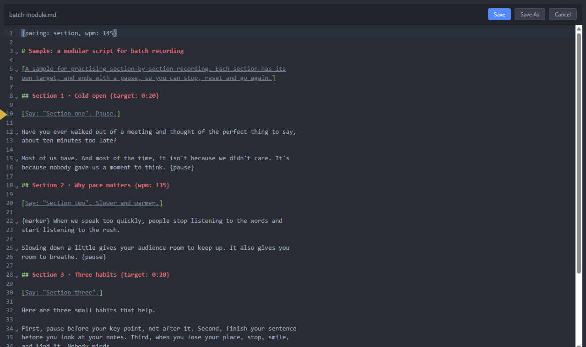
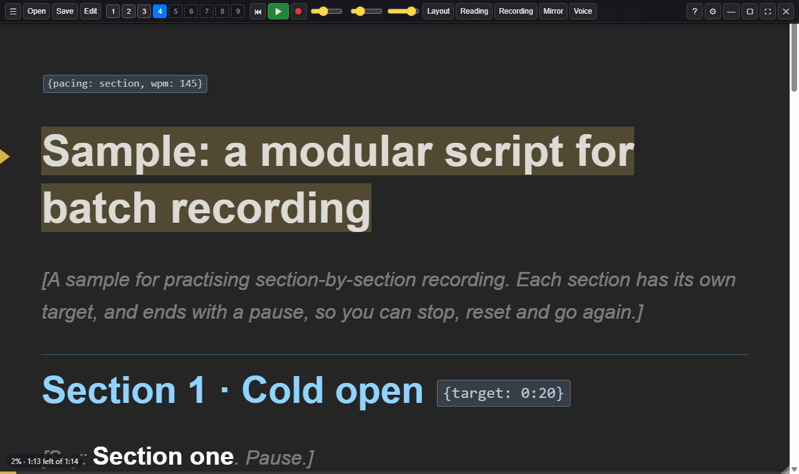

# Writing scripts

## File types

Sightline opens Markdown (`.md`, `.markdown`), plain text (`.txt`), Word
(`.docx`), rich text (`.rtf`), PDF (`.pdf`) and web pages (`.html`, `.htm`).
Markdown and plain text can be edited inside the app (**Edit** or **Ctrl+E**).
Word and rich text files open in Word, and the prompter reloads them when you
save.

**PDFs:** Sightline reads the text and rebuilds the paragraphs. Larger text
becomes headings, so the arrow keys jump between sections, and page numbers and
running headers or footers are left out. To change a PDF script, edit the
original document and save the PDF again: the prompter reloads it. A scanned
PDF is a picture of the page, with no text to read, so open the original
instead.

### Google Docs

Choose **File > Open a Google Doc…** (or ☰ > Script), paste the doc's link and
click **Open**. You can also drag the link from your browser's address bar onto
the prompter.

- In Google Docs, choose **Share** and set General access to **Anyone with the
  link** first. Sightline doesn't sign in to Google, so it can only fetch docs
  shared that way.
- Headings in the doc become sections, and `{pause}`, `[directions]` and the
  other script markings work as usual.
- Edit the script in Google Docs. Each time you open it, Sightline fetches the
  latest version; to fetch it now, choose **File > Reload from Google Docs**.
- Offline, the last copy fetched is used.

## Sections

Break a script into sections with headings (`## Section title` in Markdown) or
with a line like `=== SECTION ===` in plain text. Sections let you:

- jump between them with **←** and **→**, a presenter clicker, the pad or the
  phone remote
- give each one its own pace and target time
- record a module one section at a time, with a summary at the end

## Notes for you: [square brackets]

Anything in square brackets is a note to you, the speaker, such as
`[smile]` or `[Say: "Section one". Pause.]`. Notes are shown dimmed, so they
don't get read out by mistake. Any `"quoted words"` inside a note stay bright,
because you do say those. Settings > Display can show notes normally, or hide
them.

Voice scrolling and the sentence highlight both ignore notes.

## Instructions for the app: {curly braces}

Words in curly braces are instructions to the app. They're hidden while you
read.

| Directive                     | What it does                                              |
| ----------------------------- | --------------------------------------------------------- |
| `{stop}` (or `{pause}`)       | Stops here until you say "Prompter, go", or press Space or the clicker |
| `{pause: 3s}`                 | A 3-second countdown, then it carries on by itself. In voice mode, a **⏸ 3s** mark: take the beat yourself |
| `{marker}` or `{marker: Setup}` | A bookmark for retakes. **Ctrl+B** jumps to the next one. A name, such as `{marker: Setup}`, shows in the take log and the edit pack |
| `{listen: off}` … `{listen: on}` | Off script (an ad-lib, a demo, questions): the microphone is off and the prompter holds; Space carries on from `{listen: on}` |
| `{prompter: bigger}`          | Runs a command as you reach it: `slower`, `faster`, `bigger`, `smaller` or `marker` |
| `{wpm: 140}`                  | On a section heading: that section's pace                 |
| `{target: 1:20}`              | On a section heading: that section's target time          |
| `{mode: notes}`               | At the top: open the script as notes, a page at a time (`{mode: points}` too) |
| `{page}`                      | In notes: start a new page here, with no title (a `# heading` also starts one) |
| `{pacing: section, wpm: 145}` | At the top: settings for the whole script                 |

To check a script, tick **Show directives** in the Layout panel. Each
directive appears as a small tag, with ⚠ on any it doesn't recognise (usually a
typo).

Stops hold in steady and voice scrolling; countdowns only hold in steady
scrolling. See
[Stops and timed pauses](03-scrolling-and-voice.md#stops-and-timed-pauses).
The full reference is in [SCRIPT-DIRECTIVES.md](../SCRIPT-DIRECTIVES.md).

### Writing scripts with an AI assistant

Choose **Help > Copy the AI Script Prompt** (or ☰ > Help). It puts a set of
instructions on the clipboard: paste it into ChatGPT, Claude or Gemini, then
describe the script you want. The script that comes back has sections, target
times, stops and countdowns ready for Sightline. The same instructions are in
[AI-SCRIPT-BRIEF.md](../AI-SCRIPT-BRIEF.md). The whole AI workflow, from
script to edit, is in [Working with AI](09-working-with-ai.md).
