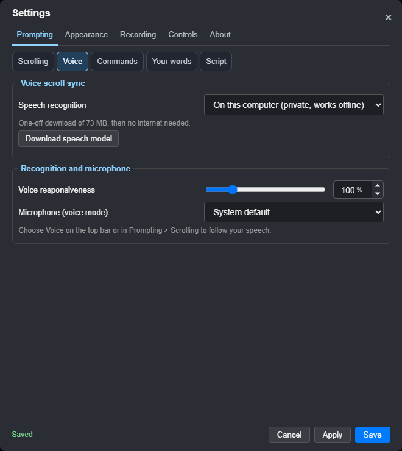
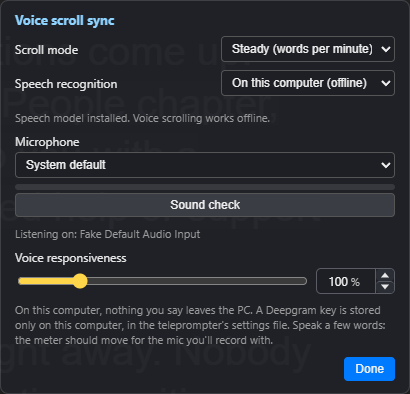
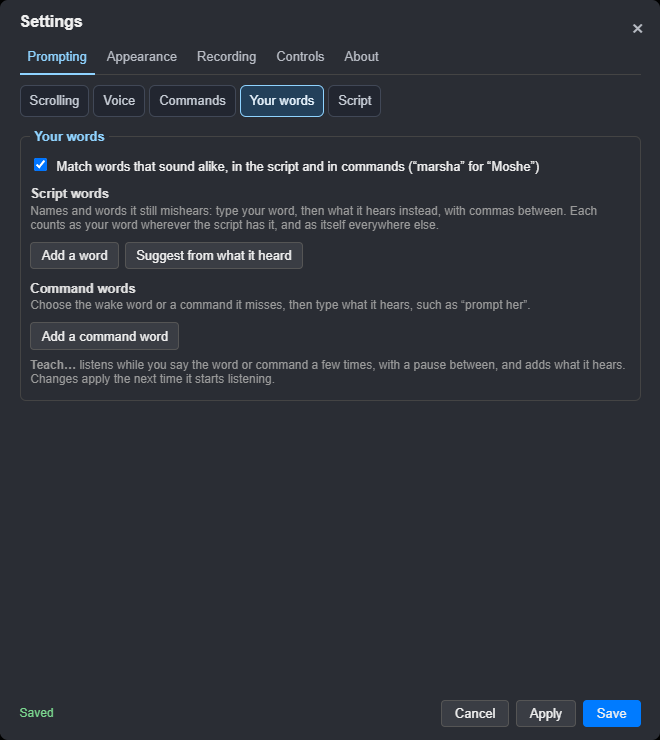
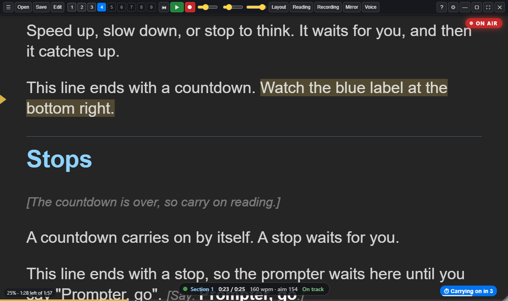
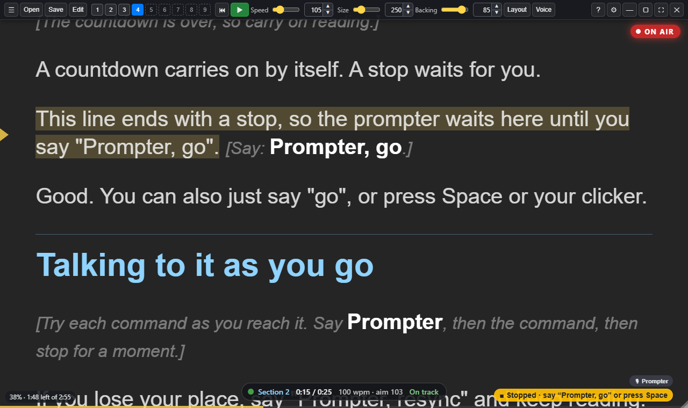
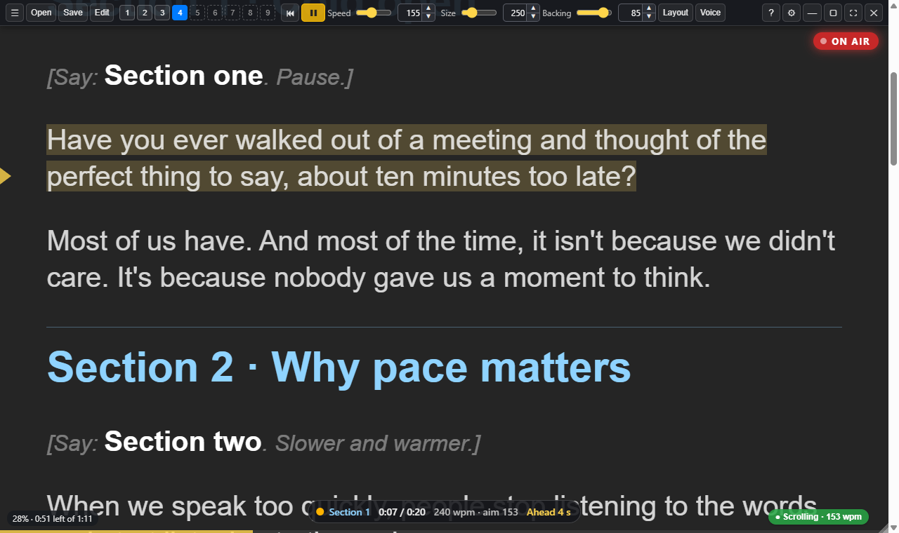

# Scrolling and voice

Choose **Steady / Voice** on the top bar, or use **Settings > Prompting >
Scrolling**. **Tools > Voice and microphone** opens the quick voice panel.

## Steady scrolling

The script moves at a fixed pace in words per minute. Set it with the **Speed**
slider. While scrolling, **↑** and **↓** make it faster or slower by 5 words a
minute. A script can set its own pace, section by section, with `{wpm: 140}`.
Turn on **Follow the script's pace** in the Layout panel to use those
settings.

## Voice scrolling

In voice mode the prompter listens to you and keeps the words you're saying on
the reading line. Speed up, slow down, pause to think or ad-lib a line, and it
waits for you and then catches up.



### Speech recognition on this computer (the default)

Speech is turned into words **on your own computer**. You don't need an
account or a key, it works offline, and nothing you say leaves the PC.

The first time you open Sightline, a small note at the bottom right offers it:
choose **Download**. Or open **Settings > Prompting > Voice** (or the Voice panel) and
click **Download speech model**.
It's a one-off download of about 73 MB, and progress is shown as it goes.
After that, voice scrolling works with no internet connection at all.

### Deepgram (online)

If you prefer, choose **Deepgram** as the speech recognition and paste in a key
from [console.deepgram.com](https://console.deepgram.com/). Your audio is then
sent to Deepgram while voice scrolling is on. The key is stored only on this
computer and is never written to exported settings files.

### Using it

1. Choose **Voice** as the scroll mode.
2. Pick your microphone in the Voice panel. Speak a few words and check the
   meter moves.
3. Press **Space** (or **Ctrl+Shift+L**). A green **Listening** label appears
   at the bottom right.
4. Start reading. If you scroll by hand, voice scrolling gives way for a moment
   and then picks up from what's on screen.
5. Press **Space** again, or click the Listening label, to stop.



**Voice responsiveness** sets how quickly the script glides to catch up with
you. Higher is snappier, lower is smoother.

### If ordinary words or whole lines are missed

Check that Sightline is using your intended microphone, then run the room
and voice sound checks at your normal speaking distance and level. A meter
can move even when the input is too quiet for reliable recognition. Adjust
the input level that actually feeds Sightline and check again; an OBS or
Riverside recording fader may affect only that app's recording.

Once the level is suitable, use **Your words** for recurring names or
phonetic forms. Playing synthetic speech through speakers is useful for
development checks, but it adds a different speaker/room/mic path. Check
normal speech before changing a working recording setup.

### What it heard

While voice scrolling listens, Sightline keeps a **heard log**: every word
the speech engine heard, next to the script words it matched them with, one
file per script per day in the `heard-logs` folder in Sightline's settings
folder. It never leaves your computer. It's there to find the words voice
scrolling keeps mishearing (a name, a technical term), so they can be
corrected. An AI assistant can read it with `node scripts/sightline.mjs heard`
(see [Setting up your AI](10-setting-up-your-ai.md)), which lists the words
heard in place of script words, most often first.

### Your words

Names and unusual words are what speech recognition gets wrong most:
*Siobhan* heard as *shivawn*, *Sightline* as *site line*, and sometimes the
wake word or a command. **Settings > Prompting > Your words** fixes them.



- **Match words that sound alike** (on unless you turn it off): a word heard
  that isn't in the script but sounds like a longer script word, starts with
  the same letter and is about as long counts as that word: *marsha* for
  *Moshe*, *abrams* for *Abrahams*. It works for commands too: *prompta*
  wakes it like *Prompter*, and *slowa* is *slower*. No list needed.
- **Script words** is your list for the rest. Type your word, then what it
  hears instead, with commas between. A heard form of two or three words,
  such as *site line*, works too.
- **Command words** does the same for the wake word and the commands: choose
  one (the wake word, pause, keeper and so on), then type what it hears, such
  as *prompt her* for Prompter or *cheaper* for keeper. A command still only
  counts at the end of what you say. Give each heard form one meaning:
  conflicting forms are declined, and built-in phrases keep their meaning.
  Recording and guide on/off use explicit phrases or your taught synonyms;
  similar spelling alone does not trigger them.
- Each form is a **synonym**, not a replacement: it counts as your word
  wherever the script has your word, and as itself everywhere else. So a
  script that really says *Marsha* still matches *Marsha*.
- **Suggest from what it heard** looks through the heard logs for words it
  took for another more than once, with **Add** beside each.
- **Teach…** (on either list) listens for eight seconds while you say the
  word or command a few times, with a pause between, and adds whatever it
  hears that isn't the word. It needs the speech model on this computer.

The fixes apply the next time voice scrolling starts, and they're kept with
your settings, so **Export Settings** takes them to another computer.

## Voice commands: "Prompter, …"

**The wake word** is "Prompter" unless you choose another on **Settings > Prompting > Commands >
Wake word**: Computer, Teleprompter or Director. Pick one that doesn't come up in
your scripts. Below, read "Prompter" as whichever you chose; it takes effect the
next time Sightline starts listening.

Say **"Prompter"**, leave a brief beat, say the command, then stop for a moment.
The beat helps the recogniser separate the wake word from the command. Finish
within four seconds of the wake acknowledgement; after that, say the wake word
again. Commands only count at the end of a phrase. Pick a wake word your script
doesn't use as an instruction: reading a complete command aloud can trigger it.
For the Teleprompter choice, the recogniser's split spelling *tele prompter*
works too. Split command words are held out of script tracking.

As soon as it hears **"Prompter"**, a message at the bottom says
*Listening… go · pause · again · marker*, so you know it's ready for the
command. Another confirms what was heard, such as *Heard: "Prompter,
slower"*, and if what followed wasn't a command it says *Didn't catch
that*, with the words it heard, so you can say it again.

| Say "Prompter, …" | What happens |
| --- | --- |
| **pause** (or stop, hold, wait) | Pause. In voice mode the prompter keeps listening, so you can carry on |
| **go** (or carry on, continue, start) | Start, or carry on after a pause. While paused in voice mode, "go" on its own works too |
| **slower** / **faster** (or slow down, speed up) | Steady scrolling: 10 words a minute slower or faster. Voice mode: less or more responsive |
| **back** (or previous section, previous page) | Back to the start of this section, or the one before. In notes, the previous page |
| **next section** (or next page) | On to the next section. In notes, the next page |
| **from the top** (or top, start again) | Back to the start |
| **reset** (or restart) | Back to the start, with the speed back to normal and the pacing clock cleared, ready for a fresh run |
| **section 3** (1–99, including “section twenty one”) | To the start of that section. You can say it without "Prompter" too, as your spoken slate before each section: saying the section you're in counts as a retake |
| **again** (or retake) | Drops a marker where you are, then goes back to the start of the section for a retake |
| **marker** | Drops a marker |
| **back to the marker** (or from the marker, last marker) | Back to the last marker, to read on from there (Shift+B) |
| **keeper** (or keep that, good take) | Marks the take you're on, or the one you've just finished, as a keeper in the [take log](05-recording-a-take.md#the-take-log) |
| **scrap that** (or bin it, bad take) | Marks that take to be thrown away |
| **resync** (or find me) | Voice mode: if it has lost you, keep reading and it finds your place anywhere in the script |
| **bigger** / **smaller** | Text size |
| **what can I say** (or help, commands) | Opens commands in grouped tabs; stays until your next command, Close or Esc. OBS commands appear only with OBS recording controls enabled |
| **guide on · guide off** | Shows or hides the separate head-position guide; repeats keep the requested state |
| **close** (or cancel, never mind) | Hides that list |
| **record take** (or start recording) | Optional OBS integration: confirm recording, then start prompting. Requires enabled OBS recording controls |
| **finish recording** (or stop recording) | Optional OBS integration: stop prompting and finish the OBS recording |

Choose when it listens on **Settings > Prompting > Commands**:

- **In voice mode** (the default): commands work while voice scrolling.
- **Always, even when stopped**: the microphone listens for the wake word
  whenever Sightline is open, running or stopped, in voice or steady
  scrolling, so **"Prompter, go"** starts it hands-free and commands work
  while it scrolls at a steady pace. A small **🎙 Prompter** label at the
  bottom right shows that it's listening. This uses speech recognition on
  this computer, so nothing is sent anywhere, but the mic stays on.
- **Off**.

### What the microphone does, and doesn't

- **Local recognition processes audio on this computer.** Voice following
  saves recognised words in the [heard log](#what-it-heard), as text, to help
  with words it mishears. The commands-only listener does not itself write
  a heard log. Other enabled microphone features work independently.
- **You can see when it's on.** While it follows your voice the prompter says
  **Listening**; while it only listens for the wake word, **🎙 Listening for
  “Prompter”** shows at the bottom right, and the
  [control window](06-remotes-and-screens.md#the-control-window) shows the same.
- **Deepgram is the one exception:** choose it, with your own key, and your
  audio goes to Deepgram while voice scrolling runs.
- **Scratch audio** (Settings > Recording > Audio) is the only time Sightline keeps a
  recording of your microphone, and only if you turn it on; it stays on this
  computer.

[Privacy, licence and policies](../POLICIES.md) has the full picture,
including when Sightline goes online.
It also links to the terms and MIT licence, accessibility statement and
voluntary-support policy, with the company's privacy contact and ICO
registration. Setting voice commands to Off does not stop voice following,
scratch audio or a sound check; quit the app to stop all microphone use.

## Stops and timed pauses

Put these in the script where you want the prompter to wait. A stop works in
steady and voice scrolling. A countdown only holds in steady scrolling (see
[In voice scrolling](#in-voice-scrolling) below).

| In the script | What happens |
| --- | --- |
| `{stop}` (or `{pause}`) | The prompter stops, and a yellow **Stopped** label shows at the bottom right. Say **"Prompter, go"** (or just **"go"**), or press Space, the clicker or the remote, to carry on |
| `{pause: 5s}` | The prompter waits 5 seconds (up to 30), with a blue **Carrying on in 5** countdown and a bar that runs down, then carries on by itself |





During a stop or a countdown:

- **"Prompter, go"** carries on straight away.
- **"Prompter, pause"** turns a countdown into a stop, so it waits for you.
- In steady scrolling, the microphone listens for "Prompter, go" while the
  prompter waits, even if voice commands are set to voice mode only (the small
  **🎙 Prompter** label shows). Set **Voice commands** to **Off** in
  Settings > Prompting > Commands to stop this.

### In voice scrolling

In voice mode the prompter only moves when you speak, so it already waits for
you. A `{stop}` still holds, so you can go off script, for a demo or a
question, without the prompter jumping ahead on a word it recognises. Say
"Prompter, go" when you're back.

A countdown, `{pause: 3s}`, doesn't hold or count down in voice mode. It shows
as a small blue **⏸ 3s** mark in the script, and you take the beat yourself.
Scripts can carry countdowns for steady scrolling without them getting in the
way when you read by voice.

### Off script: `{listen: off}`

For a part you don't read from the script, such as an ad-lib, a demo or
questions, put `{listen: off}` before it and `{listen: on}` where the script
starts again:

```
… and that's the theory. {listen: off}

[Demo: show the team page, then take a question.]

{listen: on}
So, back to the three habits.
```

At `{listen: off}` the microphone is muted, so nothing you say is listened to,
and the prompter holds with **Off script · mic off · Space to carry on**. When
you're back on script, press **Space**, the clicker, the phone remote or the
Stream Deck: the prompter goes to `{listen: on}` and follows you again (in
steady scrolling, it scrolls on from there). The take log notes how long you
were off script, so the edit can keep that part whole.

### Sound checks in the script: `{soundcheck: …}`

A script can start with a sound check, so every session begins with the room
and the mic checked:

```
{soundcheck: room}
{soundcheck: voice}
```

At each one the prompter stops and shows a card:

- **Room check: stay quiet.** It measures the room's background noise for 5
  seconds, then says **Quiet room ✓**, **OK** (a little background noise) or
  **Noisy ✗** (a fan, traffic or hum).
- **Voice check: read this at your normal level.** Read the line on the card
  for 7 seconds, and it says **Good level ✓**, **Too quiet**, **Loud**,
  **Clipping ✗** or **Didn't hear you**, with how far to turn your mic's gain,
  such as *Turn the mic gain up about 8 dB*. Adjust the input level that
  actually feeds Sightline, then check again. A separate recording fader in
  Riverside or OBS may affect only that app and leave Sightline's input
  unchanged. Sightline does not change your microphone gain for you.

Say **"Prompter, again"** (or click **Check again**) to measure again after
you've changed something, and press **Space** or say **"Prompter, go"** to
carry on. Both work in steady and voice scrolling. Each result is kept with
the session, in the [take log](05-recording-a-take.md#the-take-log) and the
edit pack. The AI script prompt puts them at the top of recording scripts.

### Commands in the script: `{prompter: …}`

`{prompter: slower}`, `faster`, `bigger`, `smaller` or `marker` runs that
command as you reach it, as if you'd said "Prompter, slower" there: slow down
for a hard passage, make the text bigger for a section read from further away.

To try it all, open ☰ > Script > **Sample scripts > Voice control, stops and
countdowns**. It walks you through a countdown, a stop, going off script and
the voice commands.

## The sentence highlight

The sentence you're on is lit with a soft band, so your eyes always have
somewhere to land. In voice mode it's the sentence you're **about to say**.
Otherwise it's the sentence on the reading line.



Turn it off or on in **Settings > Appearance > Spacing**, or the quick panel
at **Tools > Spacing and mirror**.
