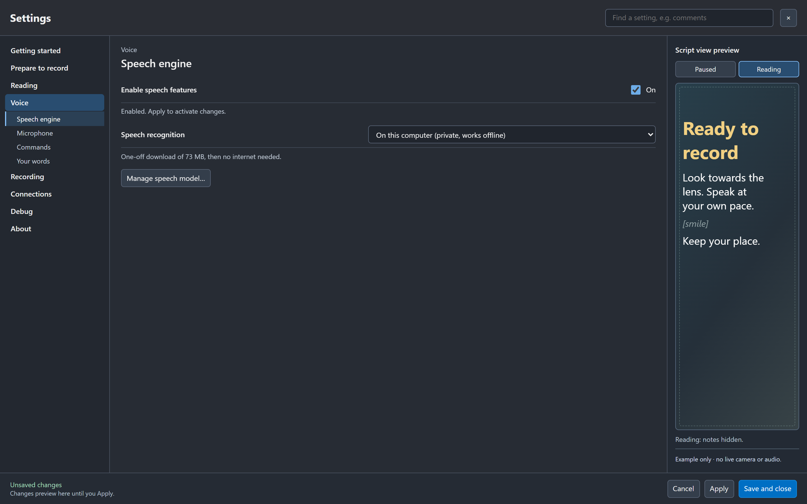
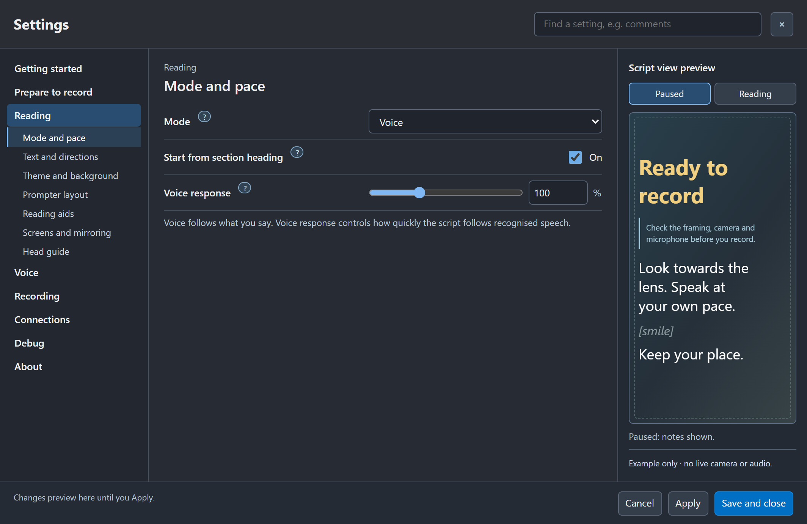
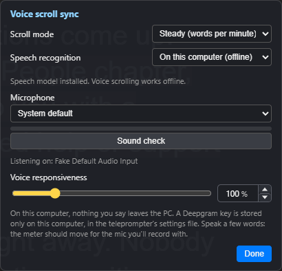
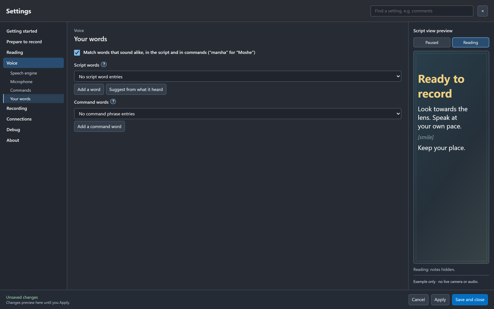
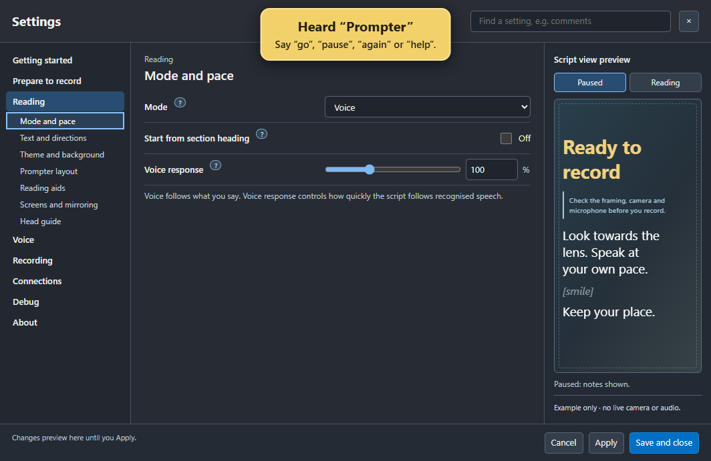
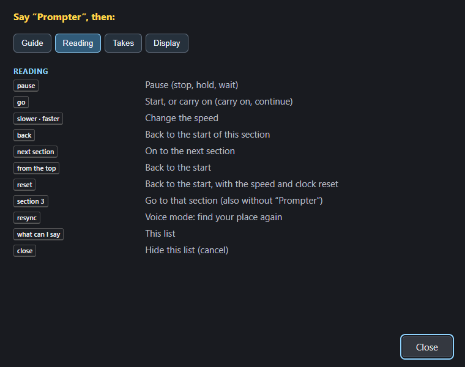
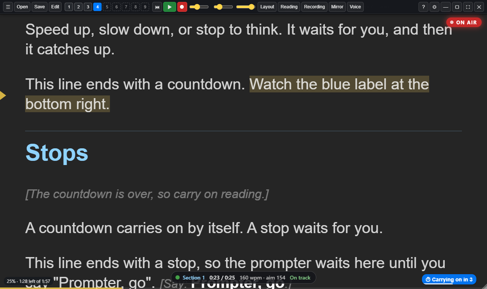
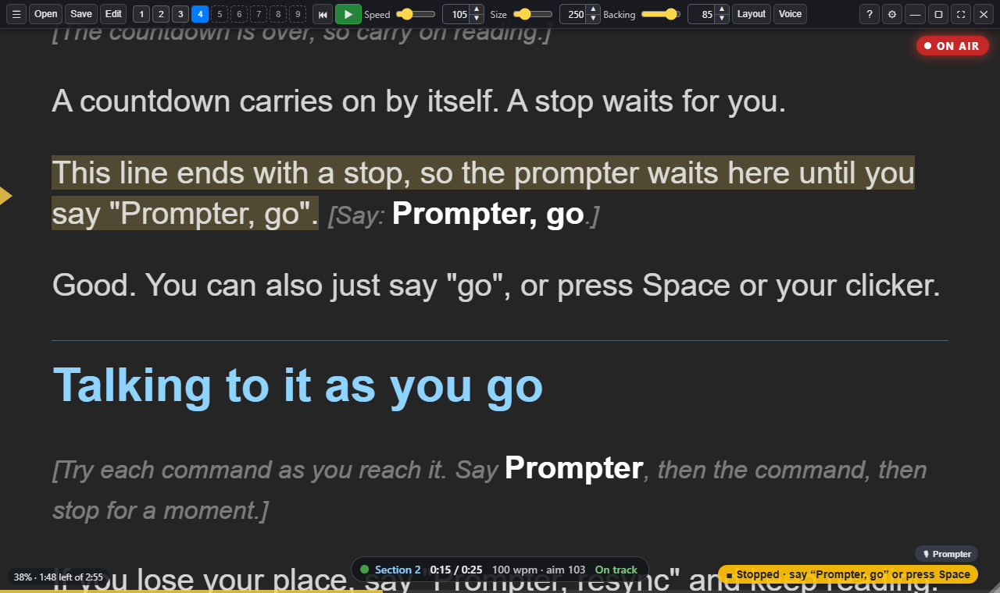
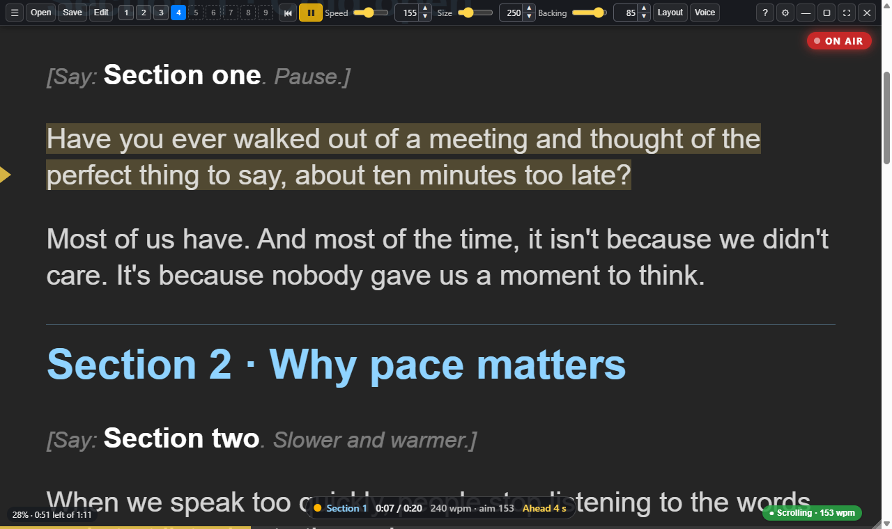

# Scrolling and voice

## RC12: voice checks, dialog actions and wake choice

Choose **Sightline**, Prompter, Computer, Teleprompter or Director under Voice
settings. Apply preserves your selection; reading “Sightline Prompter” is
ordinary narration. Dynamic listening labels and command help use your choice.

With command listening enabled, say the exact enabled button label in the
foreground Sightline dialog (including preparation, guide adjustments, user
guide and recording review): Continue, Continue anyway, Check again, Close,
Cancel, or its displayed next-step words. Gold feedback confirms the action.
Disabled, hidden, background or ambiguous buttons do not run. Existing button
handlers, permissions and confirmations still apply. OS file and security
prompts need their normal controls; ordinary script speech outside these
contexts retains wake-word protection.

Keep quiet for the room baseline, then speak normally. The voice-check clock
starts on voice onset, allows brief breaths and ends after sustained silence
or at ten seconds. Silence is incomplete; retry after checking the input.
Check again has a short settling period so the request is not the sample.
The prompter meter appears during measurement and returns to its prior state.
Quiet/noisy results are advisory; no gain change is forced.

Speech/wake and measurement capture request AGC off. The local support log
records the actual input name and applied AGC/noise/echo flags (or not reported).
Sightline never sets Windows microphone volume. Other apps or drivers may
still change it; the reported hardware-level drop is not attributed.

Start from section heading now applies at automatic Voice boundaries, Go and
restored boundary targets. Turn it off for body-line positioning. Mid-paragraph
edits retain their place. Exact wake-prefixed recorded Retake variants improve
recognition, and a bounded ordered phrase can recover after a short within-section
gap. Neither change guarantees recognition for every delivery or microphone.

**RC10 Voice boundaries:** `{stop}` prepares the next spoken passage without
holding Voice. Retake returns to the completed section until you speak the next
passage; no extra Go is needed. Stops and timed pauses still control Scroll.
Use an explicit spoken Pause for a deliberate Voice hold, and finish recording
explicitly after the final passage. Off-script and sound-check holds remain.

## RC1: recorded section-number fixes

In 1.3.0 RC1, say **Prompter, section twelve** or **Prompter twelve**.
**Section twelve** also works at a phrase boundary; a bare **twelve** is
ordinary speech. **Prompter, next section** advances and **Prompter, restart
section** repeats this section. **Prompter, finish recording** or **Prompter,
finish** ends the recorder only when enabled and permitted; plain **stop**
pauses prompting.

The recorded wake mishearings `popter` and `pumpter` are accepted. A split
number such as `twel` then `ve` can wait four seconds from that fragment,
with a hard six-second wake limit. Recording commands retain four seconds.
A fresh, separately finalised wake also separates consecutive section attempts.
The original slot-04 section 7/12 and finish-tail audio is a regression case;
other voices and microphones can still need tuning or a controller fallback.

[Post-record command cut ranges](19-post-record-review.md) are review
suggestions, including attempts that did not execute. Callback-time metadata
is not audio alignment; raw command tracing remains an explicit preference.

## RC 1 recording feedback

**Prompter, restart section** (or **restart sections**, **again**, **retake**)
returns to this section's start, including when you are near its start.
**Prompter, next section** advances. **Prompter, restart** still resets the
whole script. The usual enabled command-listening mode is required.

With OBS integration and recording controls enabled, **Prompter, finish**,
**end**, **end recording**, **finish recording** and **stop recording** finish
recording. The recogniser's observed **stopped recording** variant is accepted.
**Prompter, stop** continues to pause prompting. Recorder commands retain their
wake-word/end-of-phrase guard and OBS permissions.

Scripted voice or room checks show the sound meter automatically, then return
to your previous visibility choice. A yellow Section pill shows the current
section alongside recorder status; explicitly paged Notes show the current page.

## Recording commands

With OBS integration and recording controls enabled, say the wake word, then
**record on**, **record off**, **record pause** or **record resume**. Off and
pause also hold prompting. These commands disappear from help when OBS controls
are disabled. Normal **go**, **pause** and **again** remain available; their
recording behaviour follows the optional [linked mode](11-obs.md).

Choose **Steady / Voice** on the top bar, or use **Settings > Reading > Mode
and pace**. Enable speech and microphone input in **Settings > Voice** before
using voice following. Speech engine, Microphone and Voice commands have
separate named sections.

## Steady scrolling

The script moves at a fixed pace in words per minute. Set it with the **Speed**
slider. While scrolling, **↑** and **↓** make it faster or slower by 5 words a
minute. A script can set its own pace, section by section, with `{wpm: 140}`.
Turn on **Follow the script's pace** in Reading > Mode and pace to use those
settings.

## Voice scrolling

In voice mode the prompter listens to you and keeps the words you're saying on
the reading line. Speed up, slow down, pause to think or ad-lib a line, and it
waits for you and then catches up.



### Speech recognition on this computer (the default)

Speech is turned into words **on your own computer**. You don't need an
account or a key, it works offline, and nothing you say leaves the PC.

The first time you open Sightline, a small note at the bottom right offers it:
choose **Download**. Or open **Settings > Voice > Speech engine** (or the Voice panel) and
click **Download speech model**.
It's a one-off download of about 73 MB, and progress is shown as it goes.
In Sightline 1.2.0, the same Voice page also has Reinstall and Remove.
**Settings > Connections > Apps and add-ons** lists the model and the optional AI kit,
with their status and maintenance controls. Stop prompting and recording
before repairing/removing the model; a failed repair keeps the old copy.
After that, voice scrolling works with no internet connection at all.

### Deepgram (online)

If you prefer, choose **Deepgram** as the speech recognition and paste in a key
from [console.deepgram.com](https://console.deepgram.com/). Your audio is then
sent to Deepgram while voice scrolling is on. The key is stored only on this
computer and is never written to exported settings files.

### Using it

#### Start naturally with the section heading (RC5 preview)

In **Reading > Mode and pace**, enable **Start from section heading** in Voice
mode. A cold start, Next/Previous, numbered jump or section retake then positions
the section heading at the reading line. With the recorder already running and
Listening ready, say a short warm-up phrase, read that heading, settle for a
beat and continue into the script. Keep the heading as an H2; do not duplicate
it in the body or turn it into a silent bracket direction.

The editor can distinguish the section title from the body in the original
script/handover and trim the lead-in against the recording. It is not an exact
automatic edit boundary. Use natural titles; phrases that are voice commands
can still be interpreted as commands when command listening is enabled.
The default is off and starts at the first body line. Scroll and Notes do not
use this Voice-only preference. Try **A natural start: spoken section headings**
from Files > Sample scripts. Opening the sample starts no device or recorder.



#### Start voice following

1. Choose **Voice** as the scroll mode.
2. Pick your microphone in the Voice panel. Speak a few words and check the
   meter moves.
3. Press **Space** (or **Ctrl+Shift+L**). A green **Listening** label appears
   at the bottom right.
4. Start reading. If you scroll by hand, voice scrolling gives way for a moment
   and then picks up from what's on screen.
5. Press **Space** again, or click the Listening label, to stop.



**Scroll catch-up speed** (previously Voice response/responsiveness) sets how
quickly the display glides towards recognised speech. 100% is normal; higher
is snappier and lower is smoother. It does not improve recognition or mic gain.
RC9 also follows nearby ordered phrases when common words caused a stall, and
handles common contraction/compound boundaries. Distant guesses retain stricter
checks. Try your normal voice and microphone before recording a full session.

### If ordinary words or whole lines are missed

Check that Sightline is using your intended microphone, then run the room
and voice sound checks at your normal speaking distance and level. A meter
can move even when the input is too quiet for reliable recognition. Adjust
the input level that actually feeds Sightline and check again; a recording-app fader may affect only that app's recording.

Once the level is suitable, use **Your words** for recurring names or
phonetic forms. Playing synthetic speech through speakers is useful for
development checks, but it adds a different speaker/room/mic path. Check
normal speech before changing a working recording setup.

### What it heard

While voice scrolling listens, Sightline keeps a **heard log**: every word
the speech engine heard, next to the script words it matched them with, one
file per script per day in the `heard-logs` folder in Sightline's settings
folder. It never leaves your computer. It's there to find the words voice
scrolling keeps mishearing (a name, a technical term), so they can be
corrected. An AI assistant can read it with `node scripts/sightline.mjs heard`
(see [Setting up your AI](10-setting-up-your-ai.md)), which lists the words
heard in place of script words, most often first.

### Your words

Names and unusual words are what speech recognition gets wrong most:
*Siobhan* heard as *shivawn*, *Sightline* as *site line*, and sometimes the
wake word or a command. **Settings > Voice > Your words** fixes them.



- **Match words that sound alike** (on unless you turn it off): a word heard
  that isn't in the script but sounds like a longer script word, starts with
  the same letter and is about as long counts as that word: *marsha* for
  *Moshe*, *abrams* for *Abrahams*. It works for commands too: *prompta*
  wakes it like *Prompter*, and *slowa* is *slower*. No list needed.
- **Script words** is your list for the rest. Type your word, then what it
  hears instead, with commas between. A heard form of two or three words,
  such as *site line*, works too.
- **Command words** does the same for the wake word and the commands: choose
  one (the wake word, pause, keeper and so on), then type what it hears, such
  as *prompt her* for Prompter or *cheaper* for keeper. A command still only
  counts at the end of what you say. Give each heard form one meaning:
  conflicting forms are declined, and built-in phrases keep their meaning.
  Recording and guide on/off use explicit phrases or your taught synonyms;
  similar spelling alone does not trigger them.
- Each form is a **synonym**, not a replacement: it counts as your word
  wherever the script has your word, and as itself everywhere else. So a
  script that really says *Marsha* still matches *Marsha*.
- **Suggest from what it heard** looks through the heard logs for words it
  took for another more than once, with **Add** beside each.
- **Teach…** (on either list) listens for eight seconds while you say the
  word or command a few times, with a pause between, and adds whatever it
  hears that isn't the word. It needs the speech model on this computer.

The fixes apply the next time voice scrolling starts, and they're kept with
your settings, so **Export Settings** takes them to another computer.

## Voice commands: "Prompter, …"

In RC8, **Prompter, record**, **Prompter, start recording** and **Prompter,
begin** confirm OBS recording, then start the prompter's delivery view.
**Prompter, practice**, **Prompter, start practice** and **Prompter, go**
run the prompter without starting, pausing or stopping OBS. This practice
override ignores recorder directives, recorded slates and OBS chapters;
it leaves your saved linked-recording preference unchanged. An explicit
recording command or Record take returns to recording operation.

The Voice panel distinguishes local processing from optional Deepgram audio
transfer. Recognised text and optional scratch audio may still be saved locally;
local recognition does not mean that no files are kept. See the privacy notice
for each microphone feature and your chosen online services.

Stream Deck 0.2.0 and the shared pad/phone controls add session listening
off/on and Restart listening. Turning off pauses voice following and stops
that recognition listener while OBS continues recording. Turning on honours
the saved preference: Always resumes wake listening; otherwise press Play.
Scratch audio and sound check use the microphone separately. This is not a
system microphone mute, and it never silently enables Always listening.

**The wake word** is "Prompter" unless you choose another on **Settings > Voice > Voice commands >
Wake word**: Computer, Teleprompter or Director. Pick one that doesn't come up in
your scripts. Below, read "Prompter" as whichever you chose. Apply refreshes
the active listener immediately, including while it waits for the wake word.

Say **"Prompter"**, leave a brief beat, say the command, then stop for a moment.
The beat helps the recogniser separate the wake word from the command. Finish
within four seconds of the wake acknowledgement; after that, say the wake word
again. RC8 allows an exact recording-command prefix heard within that window
up to six seconds from the wake word to finish, accommodating delayed final
words. Other recorder commands keep the four-second window. Commands only
count at the end of a phrase. Pick a wake word your script
doesn't use as an instruction: reading a complete command aloud can trigger it.
For the Teleprompter choice, the recogniser's split spelling *tele prompter*
works too. Split command words are held out of script tracking.

As soon as RC8 recognises the wake word, a prominent gold acknowledgement
appears on the script and every open Settings/utility window. It confirms
recognised commands or explains failures without taking focus or playing a
sound. Earlier previews display a smaller message only on the script.



### If listening stops responding

Sightline checks that microphone audio is flowing and the local recogniser
is acknowledging it. A stopped audio context, ended mic track, failed
connection or stalled recogniser triggers a fresh listener, keeping the
script position and voice hold. OBS and scratch recording are independent.
Silence and missing transcripts alone do not cause a restart. Deliberate
listening-off and `{listen: off}` remain respected.
Switching listening off also cancels an in-progress startup. Late messages
from that old session cannot interrupt its replacement.

Recovery tries at most three times in a minute, then shows that listening
has stopped. Use **Settings > Debug > Status and recovery > Restart listening**,
or click the listening badge, for a deliberate retry. Status and recovery
shows listening health and links to the speech settings. Enable command
listening in **Voice > Commands** before requesting a restart.
Recovery events go in the support log without spoken words or audio.

For a missed wake word, enable **Trace command words to the local heard log**
in **Settings > Debug**, then Apply and reproduce it. This is **off by default**.
It saves recognised text during commands-only listening, including while
stopped, and may include nearby conversation. Turn it off afterwards.
Entries use `mode: "commands"`; ordinary voice entries use `mode: "voice"`.
The trace can reveal a mishearing; add that form in **Voice > Your words**.
An operating listener can still misrecognise a word; recovery cannot fix
every recognition error. This option saves no audio.

### Supported voice phrases

| Say "Prompter, …" | What happens |
| --- | --- |
| **pause** (or stop, hold, wait) | Pause. In voice mode the prompter keeps listening, so you can carry on |
| **go / practice / start practice** (or carry on, continue, start) | RC8: run the prompter while leaving OBS unchanged. While paused in voice mode, "go" on its own works too |
| **slower** / **faster** (or slow down, speed up) | Steady scrolling: 10 words a minute slower or faster. Voice mode: less or more responsive |
| **back** (or previous section, previous page) | Back to the start of this section, or the one before. In notes, the previous page |
| **next section** (or next page) | On to the next section. In notes, the next page |
| **from the top** (or top, start again) | Back to the start |
| **reset** (or restart) | Back to the start, with the speed back to normal and the pacing clock cleared, ready for a fresh run |
| **section 3** (1–99, including “section twenty one”) | To the start of that section. You can say it without "Prompter" too, as your spoken slate before each section: saying the section you're in counts as a retake |
| **again** (or retake, restart section, restart sections) | Drops a marker and restarts this section, including near its start |
| **marker** | Saves a bookmark and log event without an on-screen flag; enabled OBS chapters are still sent |
| **back to the marker** (or from the marker, last marker) | Back to the last marker, to read on from there (Shift+B) |
| **keeper** (or keep that, good take) | Marks the take you're on, or the one you've just finished, as a keeper in the [take log](05-recording-a-take.md#the-take-log) |
| **scrap that** (or bin it, bad take) | Marks that take to be thrown away |
| **resync** (or find me) | Voice mode: if it has lost you, keep reading and it finds your place anywhere in the script |
| **bigger** / **smaller** | Text size |
| **what can I say** (or help, commands) | Opens commands in grouped tabs; stays until your next command, Close or Esc. OBS commands appear only with OBS recording controls enabled |
| **guide on · guide off** | Shows or hides the separate head-position guide; repeats keep the requested state |
| **close** (or cancel, never mind) | Hides that list |
| **record / start recording / begin / record take** | Optional OBS integration: confirm recording, then start prompting. Requires enabled OBS recording controls |
| **finish recording** (or stop recording, stopped recording, end recording, finish, end) | Optional OBS integration: stop prompting and finish the OBS recording |
| **record on / record off** | With OBS recording permission: explicitly start or finish recording; off holds prompting |
| **record pause / record resume** | When enabled: pause or resume the existing recording; pause holds prompting. Check your format supports pausing |

In RC10, **“Prompter, what can I say?”** opens a separate upright window.
Drag its title bar onto another screen; its position and size are remembered.
Tabs keep the same frame. Close, Escape or **“Prompter, close”** hides it without
closing Settings or stopping the take. It follows **Hide from capture**.



Choose when it listens on **Settings > Voice > Voice commands**:

- **In voice mode** (the default): commands work while voice scrolling.
- **Always, even when stopped**: the microphone listens for the wake word
  whenever Sightline is open, running or stopped, in voice or steady
  scrolling, so **"Prompter, go"** starts it hands-free and commands work
  while it scrolls at a steady pace. A small **🎙 Prompter** label at the
  bottom right shows that it's listening. This uses speech recognition on
  this computer, so nothing is sent anywhere, but the mic stays on.
- **Off**.

### What the microphone does, and doesn't

- **Local recognition processes audio on this computer.** Voice following
  saves recognised words in the [heard log](#what-it-heard), as text, to help
  with words it mishears. The commands-only listener does not itself write
  a heard log. Other enabled microphone features work independently.
- **You can see when it's on.** While it follows your voice the prompter says
  **Listening**; while it only listens for the wake word, **🎙 Listening for
  “Prompter”** shows at the bottom right, and the
  [control window](06-remotes-and-screens.md#the-control-window) shows the same.
- **Deepgram is the one exception:** choose it, with your own key, and your
  audio goes to Deepgram while voice scrolling runs.
- **Scratch audio** (Settings > Recording > Audio) is the only time Sightline keeps a
  recording of your microphone, and only if you turn it on; it stays on this
  computer.

[Privacy, licence and policies](../POLICIES.md) has the full picture,
including when Sightline goes online.
It also links to the terms and MIT licence, accessibility statement and
voluntary-support policy, with the company's privacy contact and ICO
registration. Setting voice commands to Off does not stop voice following,
scratch audio or a sound check; quit the app to stop all microphone use.

### Recognised Retake variants

RC10 accepts the observed “V take” and “VE take” forms after the wake word.
Say “Prompter, retake” normally; these are recognition fallbacks, not phrases
to learn or put in spoken script copy. A plain “V take” without the wake word
stays ordinary speech.

## Stops and timed pauses

Scroll mode honours `{stop}` and `{pause}` as manual holds and timed pauses
as countdowns. Continue with “Prompter, go”, Space or a controller.

| In the script | Scroll | Voice in RC10 |
| --- | --- | --- |
| `{stop}` | Wait for deliberate continuation | Position the next spoken passage and keep listening |
| `{pause}` | Wait for deliberate continuation | Follow your natural pause |
| `{pause: 5s}` | Count down five seconds, then continue | Treat as a beat cue without a countdown |





### In voice scrolling

At a section-ending stop, the next section's first spoken line moves to the
reading line, with its heading and preparation notes above it. No extra Go is
needed. Retake still returns to the section just completed until you start
speaking the next passage. At that point, Retake belongs to the new section.
The take log follows the same rule; displaying the next opening does not start
its take. An optional heading lead-in still applies to cold starts and retakes.

An explicit “Prompter, pause” holds Voice deliberately; “Prompter, go” resumes.
For an ad-lib or question, use the off-script directives below. The final
passage leaves commands listening. Finish the recorder explicitly with
“Prompter, finish recording” when the performance is safe.

Automatic unordered matching stays within the current section so similar
headings cannot pull the script into another section. Ordered nearby speech
can flow across sections; “Prompter, resync” can search the whole script.

### Off script: `{listen: off}`

For a part you don't read from the script, such as an ad-lib, a demo or
questions, put `{listen: off}` before it and `{listen: on}` where the script
starts again:

```
… and that's the theory. {listen: off}

[Demo: show the team page, then take a question.]

{listen: on}
So, back to the three habits.
```

At `{listen: off}` the microphone is muted, so nothing you say is listened to,
and the prompter holds with **Off script · mic off · Space to carry on**. When
you're back on script, press **Space**, the clicker, the phone remote or the
Stream Deck: the prompter goes to `{listen: on}` and follows you again (in
steady scrolling, it scrolls on from there). The take log notes how long you
were off script, so the edit can keep that part whole.

### Sound checks in the script: `{soundcheck: …}`

A script can start with a sound check, so every session begins with the room
and the mic checked:

```
{soundcheck: room}
{soundcheck: voice}
```

At each one the prompter stops and shows a card:

- **Room check: stay quiet.** It measures the room's background noise for 5
  seconds, then says **Quiet room ✓**, **OK** (a little background noise) or
  **Noisy ✗** (a fan, traffic or hum).
- **Voice check: read this at your normal level.** Read the line on the card
  for 7 seconds, and it says **Good level ✓**, **Too quiet**, **Loud**,
  **Clipping ✗** or **Didn't hear you**, with how far to turn your mic's gain,
  such as *Turn the mic gain up about 8 dB*. Adjust the input level that
  actually feeds Sightline, then check again. A separate recording fader in
  Riverside or OBS may affect only that app and leave Sightline's input
  unchanged. Sightline does not change your microphone gain for you.

Say **"Prompter, again"** (or click **Check again**) to measure again after
you've changed something, and press **Space** or say **"Prompter, go"** to
carry on. Both work in steady and voice scrolling. Each result is kept with
the session, in the [take log](05-recording-a-take.md#the-take-log) and the
edit pack. The AI script prompt puts them at the top of recording scripts.

### Commands in the script: `{prompter: …}`

`{prompter: slower}`, `faster`, `bigger`, `smaller` or `marker` runs that
command as you reach it, as if you'd said "Prompter, slower" there: slow down
for a hard passage, make the text bigger for a section read from further away.

To try it all, open ☰ > Script > **Sample scripts > Voice control, stops and
countdowns**. It walks you through a countdown, a stop, going off script and
the voice commands.

## The sentence highlight

The sentence you're on is lit with a soft band, so your eyes always have
somewhere to land. In voice mode it's the sentence you're **about to say**.
Otherwise it's the sentence on the reading line.



Turn it off or on in **Settings > Reading > Reading aids** under Reading
indicators. **Tools > Adjust** provides separate live size and spacing controls.


## RC4 navigation corrections

Begin is an alias for Go. Next, Previous and explicit Section N commands release
the previous voice stop and position the spoken opening at the reading marker.
The ordinary product name Sightline Prompter is protected against arming the
following word as a section command. Keep a keyboard/pad fallback and verify
recognition with your own microphone; a parser test does not prove acoustics.
