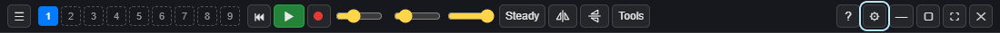
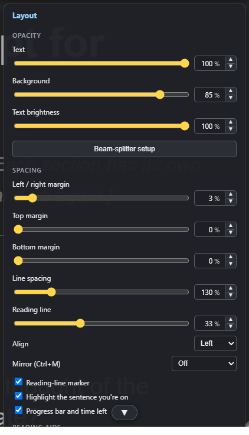
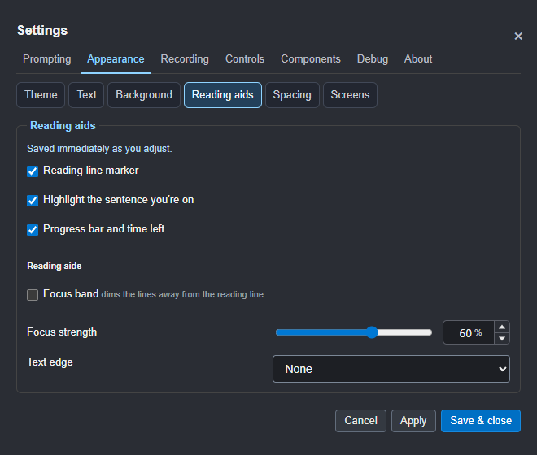

# Layout and display

## The Layout panel

The top toolbar has separate **left/right** and **top/bottom** mirror icons.
Each stays lit while its axis is on; click again to turn it off. Both can be
on together. The Layout and Reading toggles, keyboard and remote controls
stay in step with these buttons.

The **Tools** button opens quick adjustments: **Spacing and mirror**
(**Ctrl+Shift+K**), **Text and colour**, **Take display**, and **Voice and
microphone**. Changes show straight away. Drag a panel by its title to move
it out of the way; double-click the title to recentre it.

Settings reuses these controls in **Appearance** under **Text**, **Background**,
**Reading aids**, **Spacing** and **Screens**, plus **Recording > Takes** and
**Prompting > Script**. There is
one copy of each control; closing Settings returns it to the quick panel.

- **Text opacity**, **Backing** and **brightness**: how see-through the words
  are, how solid the dark band behind them is, and how bright the text is.
  They're separate, so you can have solid text on a faint background.
- **Background on air**: the backing while you're on air (scrolling, held at
  a stop, or the **On air** button lit); **Background** is the level the rest
  of the time. Off air the window is solid, like any other; on air the
  backing goes almost clear (7% to start with), so you can see your slides or the
  call behind the words while you read. The control
  bar's Backing slider changes whichever is in use: its label reads **On air**
  while you are.
- **Margins** keep the text narrow, so your eyes stay near the camera. The top
  and bottom margins fade the text out near the edges.
- **Line spacing**, **alignment** (left or centred) and the **reading line**:
  where the line you're reading sits. Put it just under your webcam.
- **Heading size**: section headings grow with the text, so if they get too
  big when you make the text larger, lower this. 100% is their usual size
  next to the text (40% to 150%).
- **Mirror**, the **reading-line marker**, the **sentence highlight** and the
  **progress bar**.
- **Reading aids** (below), the **ON AIR** light and an optional start beep.
- **Hide from screen capture** and **click-through** (below).
- **Talking points**, the **pacing light**, the **take summary** and **Follow
  the script's pace** (see [Recording a take](05-recording-a-take.md)).
- **Show directives**: see `{ }` instructions as tags, to check a script.

## Reading aids

The separate **Appearance > Reading aids** topic brings these choices together.
Fonts are in **Appearance > Text**, and colour themes are in **Appearance > Background**.

- **Theme**: standard, yellow on dark, high contrast or soft cream.
- **Font**: standard, Atkinson Hyperlegible, OpenDyslexic or Verdana. Some
  people find Atkinson Hyperlegible or OpenDyslexic easier to read.
- **Heading font**: section headings and titles can have their own font, for
  example Standard headings with OpenDyslexic text, where the dyslexia font
  makes big headings hard to read. **Same as the text** (the default) follows
  the Font above.
- **Text effect**: an outline or a shadow on the text, for busy backgrounds.
- **Focus band**: dims the lines away from the reading line, with a strength
  setting.
- **Sentence highlight**: lights the sentence you're on (see
  [Scrolling and voice](03-scrolling-and-voice.md)).

## Settings > Appearance > Screens

Window and monitor placement, Keep on top and the eye-line strip. Fonts and
heading size are in **Appearance > Text**; backing and colours are in
**Appearance > Background**. Highlights are in **Appearance > Reading aids**;
the reading line and mirroring are in **Appearance > Spacing**. Delivery directions are in
**Prompting > Script**.

## Mirroring

For beam-splitter rigs, where you read the screen through angled glass,
mirror the prompter. In **Tools > Spacing and mirror**, two
buttons do it: **↔ Left–right** (most beam splitters) and **↕ Up–down**. Each
stays lit while it's on; click it again to turn it off. Both lit mirrors both
ways, and the panel stays open. **Ctrl+M** steps through off, ↔, ↕ and both.
The control bar, the pad and the control window stay
readable.

For the clearest camera image through the glass, set **Background** to 100%
and **Text brightness** to about 70% in the Reading view.

## Eye-line mode

**Ctrl+L** shrinks the prompter to a strip at the top centre of the screen,
right under the webcam. Its width, height and reading line are set separately
on **Settings > Appearance > Screens**.

## Keeping the prompter off recordings

Tick **Hide from screen capture** in the Layout panel, and the prompter won't
show up in screen shares or screen recordings (Zoom, Teams, Riverside, OBS and
so on). You still see it.

**Click-through** (**Ctrl+Shift+X**) lets clicks on the script go to the
window behind, so you can work in another app with the script on top.
