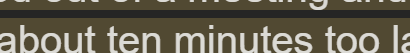
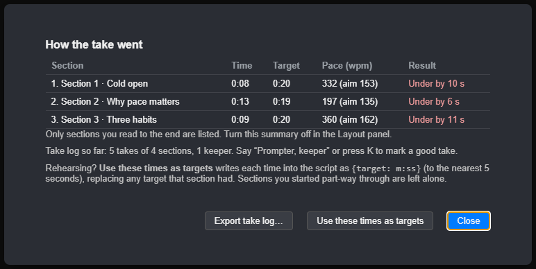
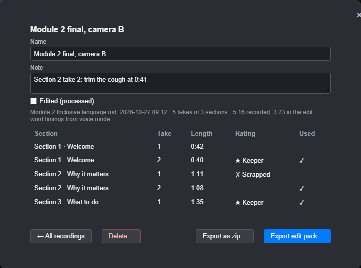
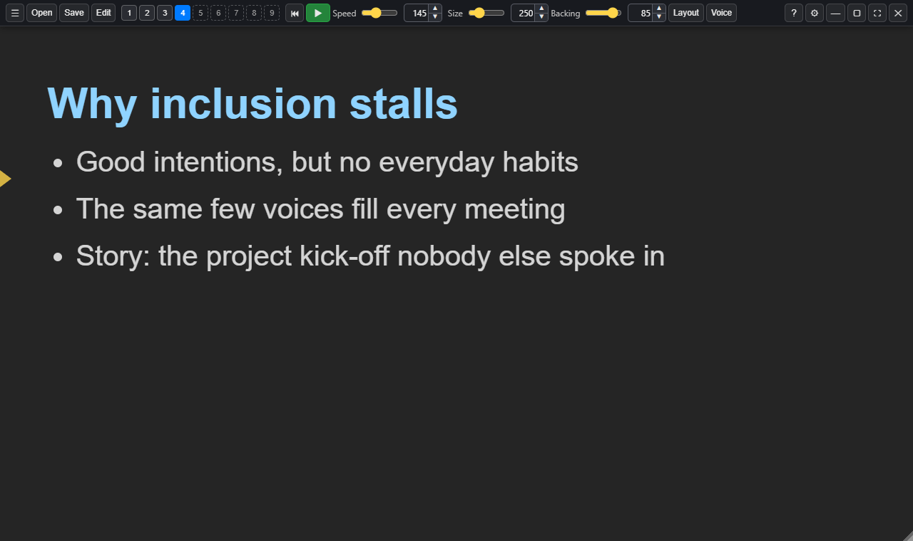

# Recording a take

## The pacing light

While the script scrolls, a light at the bottom shows how you're doing against
the target. It gives the time so far against the section's target, your pace
in words per minute against the target pace, and a plain verdict.

- **Green, "On track"**: within 5% of the target.
- **Amber, "Ahead 4 s" or "Behind 8 s"**: 5 to 10% out.
- **Red**: more than 10% out.

By default each section is timed on its own (good for recording a module one
section at a time), and the timer stops at each `{pause}`. Put
`{pacing: session}` at the top of a script to time the whole take instead.

The **ON AIR** light at the top right shows while the script is scrolling.

## The take summary

When you stop, a summary lists each section you read to the end, with its time,
target, pace and result.

Rehearsing? **Use these times as targets** writes each time into the script as
`{target: m:ss}`, so your next take is paced to match your rehearsal.

## Markers and retakes

- Press **B** to drop a marker at the reading line when you fluff a line.
- **Ctrl+B** jumps to the next marker, whether you dropped it or it's a
  `{marker}` in the script.
- **Shift+B** (or "Prompter, back to the marker") goes back to the last marker
  so you can read on from there, without starting the section again. The
  take carries on, and the edit pack marks it as a restart, so the edit can
  cut from your first reading of that marker to the second.
- Markers in the script are logged with the take as you read past them. Name
  one, `{marker: Setup}`, and the name goes into the take log and the edit
  pack, so a long section can be cut at each part.
- **←** goes back to the start of the section, ready for a retake. So does
  saying **"Prompter, again"**, which drops a marker first.

## The slate

The slate gives the edit a sync point at the start of every take, in place of a
clap. Turn it on in **Settings > Scrolling**, under **Slate at the start of
each take**:

- **Flash and beep**: the screen flashes white and beeps, then shows the
  section and take number (for example *Section 3 · Take 2*) and the section's
  title for a second. Your microphone records the beep.
- **Flash only**: the same without the beep. The flash lights your face, so it
  still shows in the video.
- **Off** (the default).

A slate shows when you start scrolling, when you carry on from a `{stop}`
(naming the section that comes next), when voice scrolling starts, and after
"Prompter, again". Start reading after the beep. While it shows, the label at
the bottom right says *Get ready*.

The [take log](#the-take-log) notes when each slate went off (the **slate**
column), and the first slate is time 0. In the edit, find the first beep or
flash in the recording: every take's times line up from there.

## Scratch audio for syncing

Tick **Record a scratch audio track for syncing** in **Settings > Scrolling**
and Sightline records the microphone to a plain audio file while the prompter
runs, from just before the first slate until you stop. It's not a recording
to use, only a reference: an editor, or an editing tool, lines your real
recording (Riverside, OBS, a camera) up with the take log by matching the two
soundtracks, so it works with no slate, and the slate's beep is on it too
when there is one.

- One file per run, a WAV (16 kHz, mono), kept in the `scratch-audio` folder
  beside the take logs. It records straight through an
  [off-script](03-scrolling-and-voice.md#off-script) part.
- The take log notes where each file sits on its clock, and the
  [edit pack](#the-edit-pack) includes the files.
- A run that logged no take keeps no file. Deleting a session in
  [Recordings](#recordings) deletes its scratch audio too.
- It never leaves your computer.

## The take log

Sightline doesn't record your video or audio; keep recording with OBS,
Riverside, Zoom or your camera. It logs the timings to line up with that
recording (and, if you choose, a [scratch audio](#scratch-audio-for-syncing)
file to help).

While you record, Sightline logs every take of every section: when it
started and ended, whether you read it to the end or went back for another
go, and any markers. The edit can then use the right take of each section
without anyone hunting for it by ear.

- A take starts when the reading line enters a section while the prompter is
  running, and ends when you move on to the next section, go back for a retake,
  or stop. Waiting at a `{stop}` doesn't count towards it.
- **Rate a take** as you go, or straight after:
  - Say **"Prompter, keeper"** (or press **K**) for a take you're happy with.
  - Say **"Prompter, scrap that"** (or press **Shift+K**) for one to throw away.

  A small message confirms it, such as *Section 3, take 2: keeper ★*.
- For each section, the log picks the take to use: your last keeper, or else
  the last take you read to the end and didn't scrap.
- The take summary shows how many takes and keepers you have so far.

The log is saved as you go, one per script per day, so nothing is lost if you
close the app; open the script again the same day and the take numbers carry
on. Every log is kept in [Recordings](#recordings). For just the log, the
**Export take log…** button in the take summary saves a JSON file for edit
tools and a CSV beside it for a spreadsheet:

| Column | What it holds |
| --- | --- |
| section, title, take | Which section, and which take of it |
| start, end, duration | Seconds from the start of the log |
| started_at, ended_at | The clock time (UTC), to line up with your recording |
| status | **complete** (read to the end), **retake** ("Prompter, again"), **stopped** or **skipped** |
| rating | **keeper** or **scrap**, if you rated it |
| slate | When the take's slate went off, if the slate is on |
| use | **yes** on the take the log picks for that section |
| markers | Times of any markers you dropped in it |
| words, spoken_seconds, speaking_seconds, speaking_wpm, overall_wpm, target_seconds, vs_target_seconds | Voice mode: the take's pace. How many words you said, the time from first to last word with and without pauses of a second or more, words per minute both ways, and the section's `{target}` with how far over or under you were |

**Word timings (voice mode).** When the prompter is following your voice,
the JSON also records when you said each word of the script, take by take:
the word, its place in the script, and the time on the same clock as the
columns above (and the slate). The time is when you *said* the word, from the
speech engine's own timings, not when it was recognised a moment later. If
you go back and read a phrase again, the new reading replaces the old one. An
editing assistant can use these to cut on a word or a sentence. Steady
scrolling has no word timings, since nothing is listening to the script.

## The edit pack

**File > Export Edit Pack…** (also ☰ > Playback) turns the take log into
everything an editor, or an AI editing agent, needs to cut the recording.
Choose a folder and Sightline makes a new one inside it, named after the
script and the date, holding:

| File | What's in it |
| --- | --- |
| take-log.json, takes.csv | The take log, as above |
| sentences.csv | Every sentence of every take: when you said it, whether you said all of it, and any words you missed |
| words.csv | Every word you said, with its start and end |
| edit-marks.csv, edit-marks.json | Places worth knowing about: where each sentence starts (a clean place to cut), long pauses, re-reads (where you went back and said a phrase again), skipped words and markers |
| captions.srt, captions.vtt | Captions in your script's own wording, two lines at most |
| scratch-audio/ | The [scratch audio](#scratch-audio-for-syncing) files, if it was on |
| README.md | A brief for whoever edits it, person or AI: how to line the pack up with the recording and how to use each file |

All the times are on the take log's clock, where 0 is the first slate. Find
the first slate's flash in your recording and every time lines up from
there. Words, sentences and captions come from voice mode; with steady
scrolling the pack still has the takes. Nothing is sent anywhere: the pack is
plain files on your computer.

## Recordings

**File > Recordings…** (**Ctrl+Shift+R**, also ☰ > Playback) lists every
recording session, newest first: one per script per day, with its date, takes,
keepers and length. Choose one to see its takes, which take of each section
the edit will use, and how long the edit comes to.

- **Name** it, such as *M2 final, camera B*, and add a **note** for yourself or
  your editor. The take log itself isn't changed: names and notes are kept in
  `library.json` beside the logs.
- Tick **Edited (processed)** once it's been cut, so the list shows what's
  still to do.
- **Export edit pack…** saves [the edit pack](#the-edit-pack) as a folder;
  **Export as zip…** saves it as one zip file, to send or upload.
- **Delete…** moves its take log and any scratch audio to the Recycle Bin,
  after asking. Your own video and audio recordings aren't touched: Sightline
  never had them.
- **Start a new take log** starts again from take 1 (today's takes so far stay
  in the list), and **Show the folder** opens the folder where the logs are
  saved.

An AI agent can do the same through the local API: see
[Working with AI](09-working-with-ai.md).

## Notes (talking points)

For a talk from notes rather than a word-for-word script, tick **Notes** in the
Layout panel (the Recording view), or put `{mode: notes}` at the top of the
script (`{mode: points}` works too). The script shows a page at a time, with
no scrolling.

- A `# heading` starts a page, with that heading as its title, and `{page}`
  starts one with no title.
- Each `## heading` on the page is a bullet, with any lines under it smaller.
- A `{target}` on a `# heading` times its page.
- With no `# headings` or `{page}` after the title, each `## section` is a page
  of its own, as talking points always were.

The sample **Notes, a page at a time** (Script > Sample scripts) shows it.

**Space** starts and stops the talk timer. **→** and **Page Down** go to the
next page, and **←** and **Page Up** go back. Say "Prompter, next page" or
"Prompter, previous page" too. The pacing light shows the page's time against
its target, and each page is logged as a section in the take log.
