# Remotes and second screens

In 1.1.0, **Settings > Components** lists Stream Deck
as optional software, with its installer, **Locate** and **Check again**.
It checks the app and Sightline plugin files separately. **Controls > Stream
Deck > Check compatibility** confirms the running plugin; unconfirmed versions
are never described as up to date. A missing local app greys out its enable
box, while the setup guide and installation controls remain available.

## Head-position guide (development)

Use **Tools > Show head guide**, or **Ctrl+Shift+H** from
any app (**Cmd+Shift+H** on Mac). The same action appears in the native Tools
menu. It opens over your camera preview without requiring an OBS connection.
Drag its title bar and bottom-right resize handle to fit the outer dotted
rectangle to your 16:9 preview. Adjust the head outline with +/−, change
opacity or colour, then **Lock** to pass clicks through to the preview.

**Adjust**, the prompter's **Guide adjustments** button, or **Tools > Guide
adjustments…** toggles a separate floating control window. It stays above
the prompter and works while the guide is fullscreen, Clean or click-through
locked. **Done**, Escape or the window's close button hides only the adjustments.

1. Set **Eye centre** and **Level**, or use the arrow nudges to align both eye
   marks with your camera preview. Positive Centre moves right; positive Level
   moves down. Values are percentage offsets from the original eye position.
2. Choose **Lock eye position**, then fit **Top** and **Bottom** of the head
   independently. Moving one edge leaves the other edges and both eyes fixed.
3. Fit the **Left** and **Right** edges independently around that eye centre.

**Background** adds a dark layer behind the guide to improve contrast over
the preview. It starts at 12%; choose 0% for a fully transparent background,
or increase it up to 80%. **Outline** changes line opacity separately. The
dashed Ideal reference is brighter for easier comparison. Neither slider
changes the prompter's own background setting.

**Overall proportions and placement** contains the existing **Size**, **Width**
and **Height** controls. They also preserve both eye marks. Unlock the eyes to
drag or nudge Actual position again. Eye lock is separate from the guide's
toolbar **Lock**, which passes clicks through the whole overlay.

**Save as ideal** copies the position, overall proportions and four edges to the
dashed **Ideal position** outline. Then unlock the eyes and move the
actual outline independently to compare your current framing with the
reference. **Back to ideal** restores it and unlocks the eyes;
**Hide ideal** hides the reference. Eye lock fixes the outline inside the
guide; moving or resizing the whole overlay still moves the reference on screen.
This is a manual check, without face detection or automatic tracking.

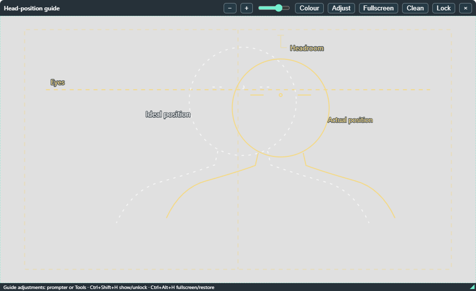

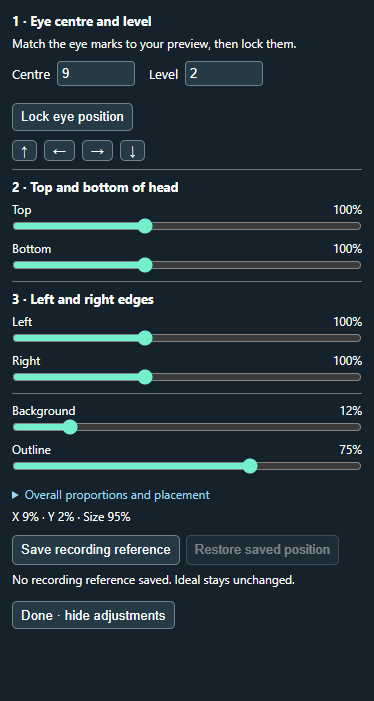

**Centre window** and **Beside prompter** recall separate overlay placements. Move or
resize the window after choosing one to save that placement for next time.
These controls position the overlay window; **Actual position** adjusts the
head shape inside it. The ideal, actual and window settings stay in place
when you change scripts. New edit packs retain the guide snapshot per take,
including the live window bounds, fullscreen state and both outlines.

With voice commands enabled and listening, **“Prompter, guide on”** shows
the guide and **“Prompter, guide off”** hides it. Repeating either command
keeps the requested state. Use your selected wake word if different.

F1 help has a **Head guide** tab for these controls. The other tabs follow
enabled modes, so disabled OBS recording controls do not crowd the help.

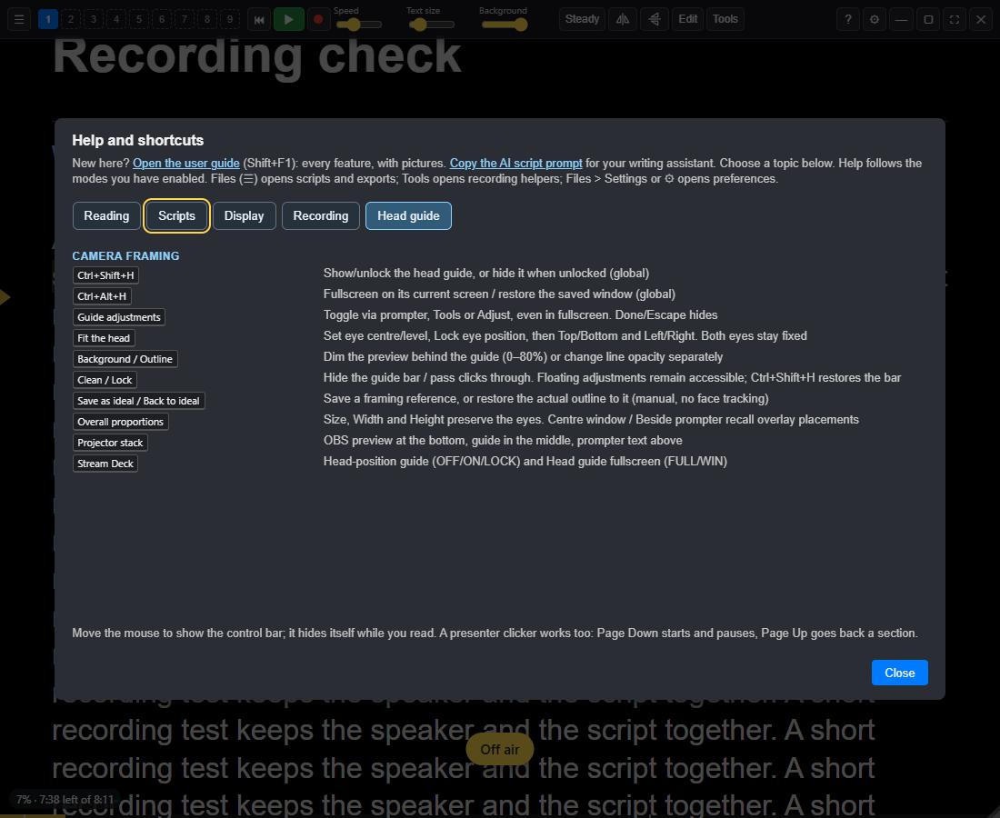

The hotkey, menu and Stream Deck key all behave alike: show if closed, unlock
if locked, otherwise hide. The next opening is unlocked. If another app has
claimed the hotkey, a toast explains how to recover through the menu or key.
The guide remembers its position, size and appearance; it stays upright when
the prompter is mirrored. **×** closes it. Closing Sightline closes it too.

For the projector setup, put the **OBS Preview Projector at the bottom**, the
**head guide in the middle**, and **Sightline text above**. While the guide is
open, Sightline temporarily keeps the prompter above it, then restores your
Keep on top preference when the guide closes. The prompter needs a transparent
background to see the camera; the guide does not change that opacity for you.
Check this order with your real projector, particularly if OBS's projector
is itself set Always on top; turn that OBS option off if it competes.

**Fullscreen** on the guide, **Ctrl+Alt+H** globally (Cmd+Alt+H on Mac), or the
**Head guide fullscreen** Stream Deck action fills the guide's current monitor
and hides its toolbar. It uses a borderless screen-sized window so the three
layers can remain together. On a non-16:9 display, the guide keeps its shape
with the same centered fit as a 16:9 camera projector. The next fullscreen
press restores the saved window size and shows controls. It does not change
OBS's projector mode or the prompter's own fullscreen setting.

**Clean** hides the guide's toolbar/footer without resizing the window. The
regular guide hotkey/key reveals controls or unlocks it without leaving
fullscreen. **Lock** additionally passes clicks through. Windowed and
fullscreen choices are remembered, as is the original window position.
The separate **Guide adjustments** button stays available on the prompter
while the guide is shown, so no shortcut is needed to adjust a fullscreen guide.

The companion Stream Deck development branch adds a **Head-position guide**
action you can drag onto any key. It shows **OFF**, **ON** or **LOCK**, using
Sightline's status feed. Older app versions flash an alert instead of sending
an unsupported command. Existing sample-profile key assignments are unchanged.

The separate **Head guide fullscreen** action shows **FULL** or **WIN**.

This is a separate desktop window, not an OBS scene source. Camera-only OBS
recordings do not include it. It normally requests capture protection, even if
the prompter's Hide from capture setting is off. Protection for full-display
recording depends on the capture method and platform: verify a short recording
first. It does not track your face, access the camera or record audio/video.
The session-only **Debug > Allow all windows to be captured** override
also permits the guide to be captured. Turn it off before ordinary recording;
the normal rules are restored and quitting clears the override.

## Presenter clickers and foot pedals

Most clickers and pedals send Page Down and Page Up. **Page Down** starts and
pauses, and **Page Up** goes back a section. Pedals that send the arrow keys
work too: → and ← move between sections.

## Game controllers

Plug in or pair a game controller (Xbox, PlayStation or similar) and it works
straight away:

| Button | What it does |
| --- | --- |
| **A** (✕ on PlayStation) | Start and pause, or carry on from a stop |
| **B** (○) | Drop a marker |
| **X** (□) | Jump to the next marker |
| D-pad up and down | Faster and slower, while scrolling |
| D-pad left and right | Previous and next section |

The buttons can't be changed yet; choosing your own is on the roadmap.

## Stream Deck

Sightline 1.1.0 pairs with companion **0.2.0**, extending **0.1.9** with
**Record take (OBS)** and **Finish recording (OBS)**. Enable OBS and allow
recording controls in Sightline first. The keys show confirmed recording
state; a disconnected state stays unknown. Play/Pause, section stops and
retakes keep the same OBS recording running.

Use **Use the OBS recording profile** in the key's settings to choose a
separate recording layout for that model, including Mobile and Pedal.
The Pedal recording layout is Record take, Play/Pause, Finish recording;
the last pedal finishes the whole file. Standard profiles remain available.
These additions require Sightline 1.1.0 with OBS enabled; they are not in
the earlier 1.0.6 app. The Marketplace listing is pending.

Use the matching app and plugin rather than older local installers.
The [acceptance test](14-acceptance-test.md) checks the physical keys, guide
controls and continuous OBS recording; installation alone is not a passed test.

The **Sightline Prompter plugin for Stream Deck** runs the prompter from an
Elgato Stream Deck's keys, the Stream Deck + dials and the Stream Deck Pedal,
and the keys show what the prompter is doing: ▶ or ❚❚, On air in red, the
script slot that's open, the section and the time left.

**Getting it:** [download Stream Deck 0.2.0](https://github.com/JoJo-1965/sightline-prompter/releases/download/v1.1.0/Sightline-StreamDeck-0.2.0.streamDeckPlugin)
from the app release, then double-click it to open Stream Deck. The source
repository stays private; Marketplace listing is pending. Current links are
on the [Sightline page](https://joannelockwood.co.uk/sightline#stream-deck).

**Setting it up:**

1. In Sightline, **Settings > Controls > Stream Deck**, tick **Let the
   Sightline plugin for Stream Deck control the prompter**, and **Save**. The
   plugin finds Sightline itself, so there's no code or token to type. It gets
   its own key, for buttons only: it can play and pause, move through the
   script, switch slots and show what's happening, but it can't load scripts,
   access arbitrary settings or touch your recording files. Its named controls
   can adjust the guide and session listening. (That's separate from AI access,
   which you can leave off.)
2. Install the plugin. Stream Deck offers a ready-made **Sightline** profile
   for each Stream Deck you have: the Mini, Stream Deck, Neo, XL, +, + XL and
   the Pedal.
3. Keep Sightline open while you record. If a key goes grey, it says why:
   *Get Sightline* (Sightline isn't installed), *Turn on Stream Deck* (step 1), or
   *Not running* (Sightline is closed). Pressing a grey key opens the download
   page or these steps.

| Keys | What they do |
| --- | --- |
| Play / pause, On air, Eye-line, Click-through | Two-state keys that light up to match the prompter |
| Back to the top, Previous and Next section | Move through the script |
| Marker, Back to the marker, Keeper, Scrap that | The same as the keys and voice commands |
| Script slot | Opens slot 1 to 9; lit while that slot is open |
| Mirror | Steps through the modes, or turns ↔ or ↕ on and off |
| Layout, Reading, Recording | Opens or closes that panel |
| Scroll mode | Switches between steady and voice scrolling; lit in voice |
| Control pad, Control window | Opens or closes the floating pad (**Ctrl+Shift+P**) or the control window (**Ctrl+Shift+O**); lit while open |
| Faster, Slower, Bigger, Smaller | Speed and text size |
| Section and time left | Shows them; press to play or pause |

On the Stream Deck +, the dials turn through sections, scroll the script by
hand, and change the speed, text size and backing, with the values on the
touch strip. The Pedal's three pedals are previous section, play or pause, and
next section.

The plugin works with Sightline 1.0.6 or later, on Windows and macOS (Stream
Deck doesn't run on Linux).

### Compatibility and updates

In **Settings > Controls > Stream Deck**, choose **Check compatibility**.
Sightline shows its running version, the version reported by the connected
plugin and any required update. The plugin's **Test connection** reports the
same pairing, plus whether OBS and guide commands are supported. It runs
automatically when a key's settings page opens.

| Check | Requirement |
| --- | --- |
| Ordinary prompting controls | Sightline 1.0.6 or later; the reported minimum plugin version must be met |
| Version reporting in both apps | Sightline 1.0.7-rc.3 or later and plugin 0.1.9 or later |
| OBS and head guide | The app must advertise those commands; OBS also needs its saved connection and recording permission |

The connection protocol and supported commands decide whether an action can
run. A newer version is not rejected just because its number differs, and
compatible RC versions are supported. A known incompatible connection shows
an update message and blocks plugin actions. An unavailable command is blocked
without disabling ordinary supported controls. No check starts or stops OBS.

Older apps/plugins can still use supported controls, but a version they do
not report is **not confirmed**, not assumed up to date. Plugin announcements
expire after 30 seconds without a heartbeat. This is a local status exchange,
not a search of installed files or a guarantee that the program is genuine.

**Compatible** and **latest** are different. The local check compares the
minimum/recommended versions known by the app and the actions it supports.
For the latest public Sightline release, use **About > Check for updates**.
Download the current plugin from the app's public release. Its source stays
private. Marketplace updates apply once a real listing is live.

## Stream Deck operator controls (0.2.0)

These controls require the matching updated Sightline 1.1 build, not just
a compatible version number. Neither new package has been installed yet.

- **Listening:** choose session off/on or Restart listening. Off pauses voice
  following and stops its recognition listener; OBS keeps recording. On honours
  the saved command preference: Always resumes wake listening, otherwise press
  Play for voice following. Sound check/scratch audio use the mic separately.
- **Status / session check:** choose progress with play/pause, or software
  status with a button to open **Session check**. It reports script, listening,
  OBS and debug-capture state; it does not certify captured picture/sound/sync.
- **Finish recording:** hold for one second by default, including the OBS
  pedal. Release early to cancel. Connection, page, setting or recording
  changes cancel a pending hold. The checkbox allows an immediate press if
  preferred. The bar measures the hold; confirmed OBS state supplies the result.
- **Head guide dial:** choose Eye X/Y, Top/Bottom/Left/Right, Width/Height,
  overall size, Background or Outline. Align eyes, press to lock them, then
  fit the edges around the fixed reference. Works inside the fullscreen overlay.
  Press/tap can instead toggle adjustments, ideal visibility or match the
  actual reference to the saved ideal. The saved ideal is not overwritten.

Choose **Use the head-guide dial profile** in Stream Deck's action settings
for the opt-in + or + XL framing layout. Related section, speed, size and guide
actions share settings; saved older buttons keep their original behaviour.
After a failure, select that key/dial in Stream Deck to read its full reason.

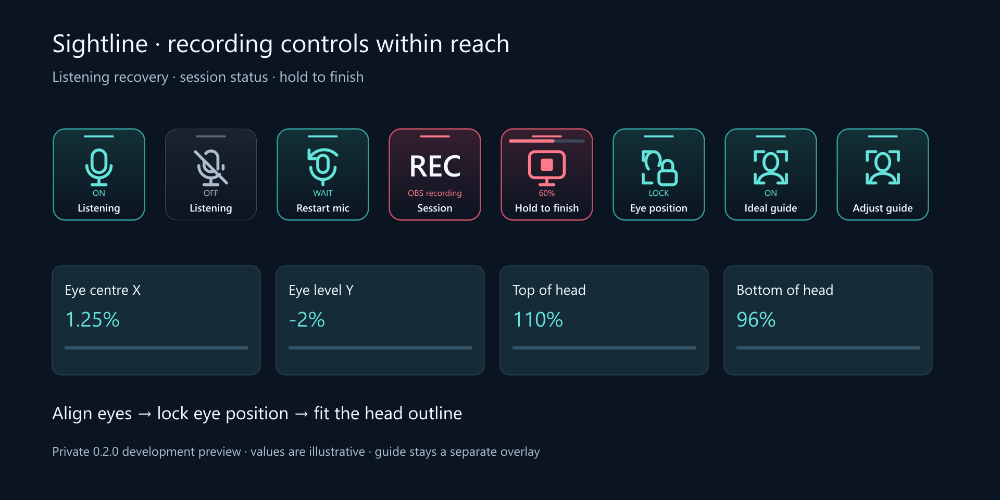

## The floating pad

**Ctrl+Shift+P** or **Tools > Control pad** opens a floating button grid.
The Compact preset starts with Top, Previous, Start / Pause and Next.
**Customise** on the pad opens **Settings > Controls > Pad**.

Choose **Compact**, **Reading**, **Studio** or **Framing & checks**, then **Use preset**, or add
individual functions from the list. Presets replace your selection; Compact
resets it. Up to 36 buttons can include markers, Keeper/Scrap, speed, text
size, mirror axes, guide, OBS and script slots. Drag selected buttons to
reorder them, or use **Earlier / Later**, including across the short list
pages. Remove a button to hide it. Changes save immediately.

The pad and phone share this selection and order, with the Stream Deck
artwork and equivalent actions. Stream Deck profiles keep their own key
assignments. Choose 2, 3, 4 or 6 pad columns; narrow phones use two columns
for larger touch targets. Short landscape screens use four columns, or six
for layouts with nine or more selected buttons. Order stays the same.
Buttons reflect the current state. Empty slots
are disabled; OBS controls appear only when OBS and recording permission
are enabled, and require a connection. Long pads can scroll within the screen.

**Framing & checks** adds guide visibility/fullscreen, **Adjust guide**, eye lock,
ideal visibility, restoring Actual, listening off/on and recovery, **Session
check**, sound check and OBS recording. Existing layouts stay as you chose them;
add just the buttons you need if you prefer. Their symbols match the plugin.

**Adjust guide** opens a panel on the device you are using, including the phone.
Use **Eyes** for centre/level and arrow nudges, lock the eyes, then **Outline**
for independent edges, width, height and overall size. **Compare** has background
and line opacity, ideal visibility and **Match saved ideal**. Matching restores
Actual and unlocks the eyes; it does not overwrite Ideal. These are manual
references, not camera tracking. The guide must be visible before adjustment.

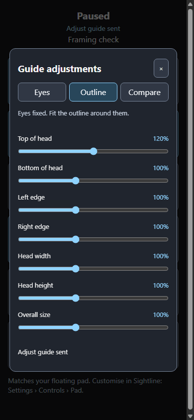

**Session check** opens local script, listening, guide and enabled OBS status,
plus reasons for unavailable selected controls. The full PC checklist can be
opened while prompting is paused. It does not validate the recorded picture,
sound or sync. **Listening off** stops recognition/voice following for the
session and leaves OBS recording; **On** honours the saved command preference.
Sound check and scratch audio use the microphone separately.

**Finish recording** requires a one-second hold by default. Release early to
cancel; a lost connection, changed recording or removed permission cancels too.
With a keyboard, hold Enter or Space. **Controls > Pad > Hold Finish recording**
changes the shared pad/phone preference; Stream Deck keeps its own per-key
checkbox. The progress bar measures the hold, not OBS completion. Read the
reported OBS state afterwards. Ordinary Play/Pause never finishes the OBS file.

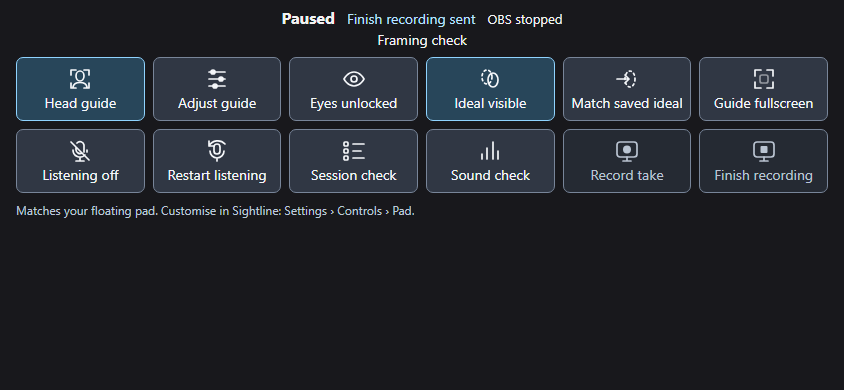

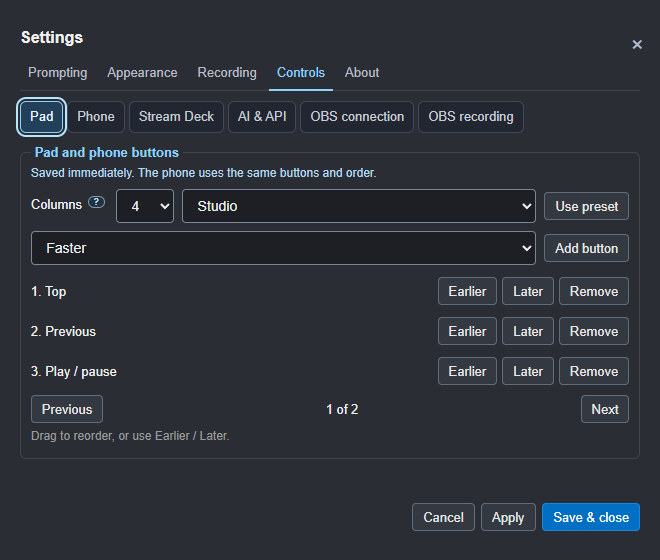

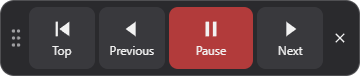

Drag it by the title/grip, even onto another monitor or over Riverside.
It reopens where you left it. Over a mirrored prompter, it flips to match.

## The control window

**Ctrl+Shift+O** or **Tools > Control window** opens an ordinary, upright
window for a second screen or an operator. It shows a live copy of the script
that follows the prompter, with the reading line, the pacing light, the
section and time left, and big buttons.

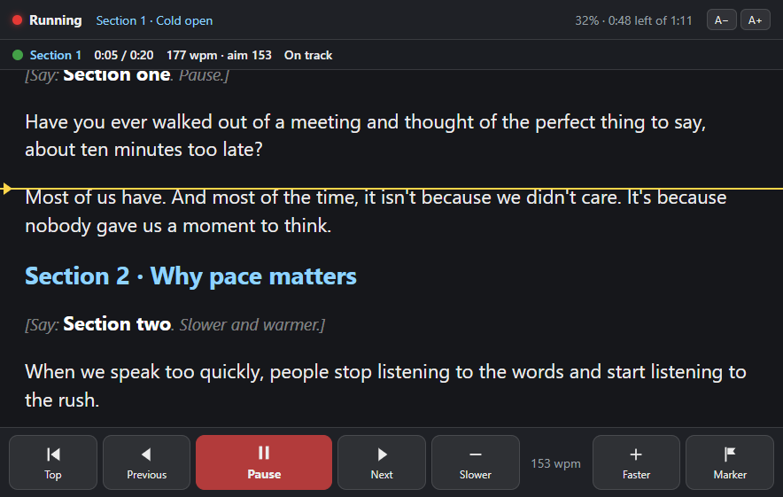

Click any line in the copy to move the prompter there. **A−** and **A+** change
the copy's text size. The keys work here too: Space, Page Up and Page Down,
Home, the arrows and B.

**The broadcast row**, along the bottom, changes the prompter itself, for when
it's full screen on a prompter monitor such as the Elgato Prompter, too small
and too far away to work Settings on:

- **On air**, lit red while you're on air.
- **Text −** and **+**: the prompter's text size, with the size now.
- **Backing −** and **+**: how solid the backing behind the text is, on air or
  off air, whichever is in use.
- **↔ Mirror** and **↕ Mirror**, each lit while it's on.
- **Voice scroll**, lit while the prompter follows your voice; press it for
  steady scrolling, and again to go back.
- **Eye-line** mode.
- A blue **🎙** badge at the top shows when the microphone is on: following
  your voice, or listening for the wake word.
- **Sound check**: the [sound-check meter](05-recording-a-take.md#sound-check-and-loudness)
  shows here, on the right, and keeps going while a take runs, so you can
  watch your mic without it showing on the prompter in front of you.

## The phone remote

On **Settings > Controls > Phone**, tick **Control the prompter from a phone on the
same Wi-Fi** and save. Scan the QR code with your phone for the same buttons
and order as the floating pad, with larger touch targets and the current
section showing. Choose your layout in **Controls > Pad**. It updates on
the phone automatically; there is no separate phone layout to maintain.

The code appears after **Apply** or **Save & close**; reopen Settings if needed.
It also works in the separate movable Settings window (fixed in RC10).

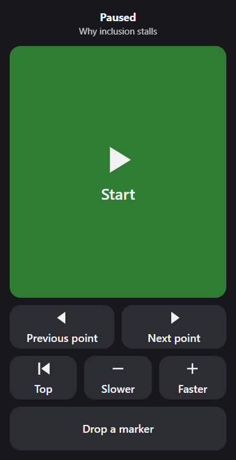

Phone taps show **Sending…**, followed by the button name and **sent** when
Sightline accepts the request. Section, prompting and OBS status show the
resulting state separately. **Unavailable** means the app refused the request;
**no reply** means the phone could not confirm delivery. Commands are never
automatically replayed after a connection problem, and a rapid second tap on
the same pending button is ignored. Polling does not repeatedly announce
unchanged status to assistive technology.

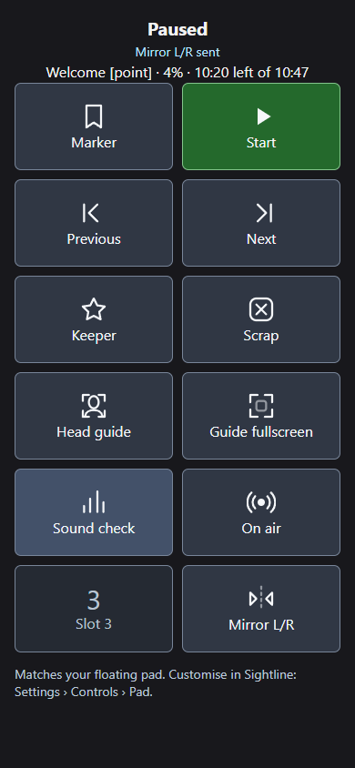

In 1.1.0, rotating to landscape uses the available width and
shorter buttons: the 12-button Studio layout fits in two rows on typical
phone screens. Portrait keeps its large touch targets. The footer has extra
space above browser controls, and long layouts remain scrollable. This is
included in the frozen build; RC14 has the earlier layout.

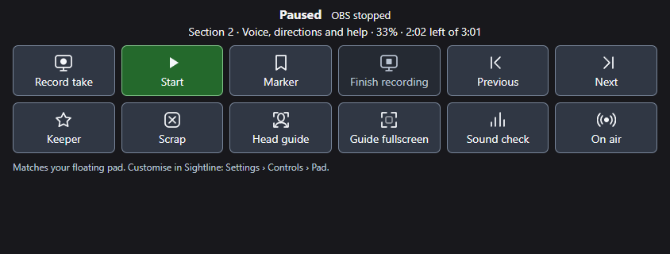

Only a phone with the code in the QR code can connect. **New code**
disconnects any phone already connected. The first time, Windows may ask
whether to let Sightline Prompter use the network. Allow it on private
networks.

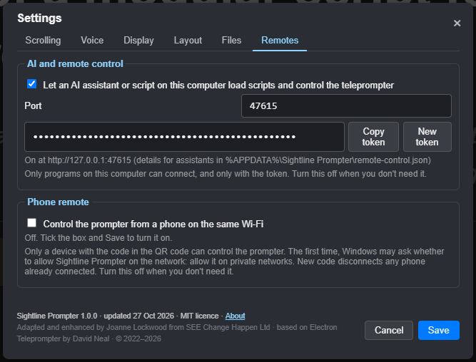

## Choose your buttons and keys

In 1.1.0, open **Settings > Controls > Buttons & keys**. Choose
an action, select **Press a key or button…**, then press your clicker, pedal,
keyboard key or controller button once. Escape cancels; learning times out
after 15 seconds. Assigning an existing input replaces its action. Changes
save immediately and are included in JSON/XML settings exports.

Use the action list beside each entry to change it, or Remove to clear that
entry. Lists use three entries per page. **Reset defaults** clears custom keys
and restores the original controller buttons. The defaults are A/play-pause,
B/marker, X/next marker and D-pad/speed or sections.

Plain keys and Shift combinations use physical key positions. Ctrl, Alt,
Command, Escape, Tab, F1 and F11 remain reserved for menus, the system and access
tools. Mappings act while the prompter has focus, and pause during editing,
typing and Settings. Space/Enter on a focused button keep normal activation.
Held buttons fire once; reconnecting a held button does not trigger it.

Controller entries match the device name; identical controllers share their
assignments. Device-specific entries override generic controller defaults.
**Do nothing** suppresses that default for the chosen device. Removing a
device-specific entry reveals any generic default underneath. Keyboard pedals
work as local keys. Stream Deck uses its own profiles and buttons-only API.
OBS actions still require the existing connection and recording permissions.

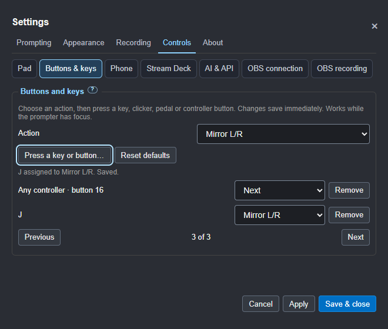

## AI and remote control

On **Settings > Controls > AI & API**, you can let an AI assistant (such as Claude
Code or Codex) or a script on this computer load scripts and control the
prompter. It's off by default, and only programs on this computer that have
the token can connect. **How to set up your AI** on that tab opens
[Setting up your AI](10-setting-up-your-ai.md), which explains the port, the
token and the status line, and how to set up each AI. What an AI can do with
it is in [Working with AI](09-working-with-ai.md#2-record-let-the-ai-run-the-prompter).

## Choosing the prompter monitor

On **Settings > Appearance > Screens** (or Window > Prompter monitor), pick a monitor and
the prompter opens full screen there, now and each time the app starts. A
dedicated prompter screen such as the Elgato Prompter shows up by name.
**F11** gives a normal window again.

If a monitor is unplugged or the resolution changes, the prompter and the
control window move back onto a screen you can see, with the control bar in
reach.
