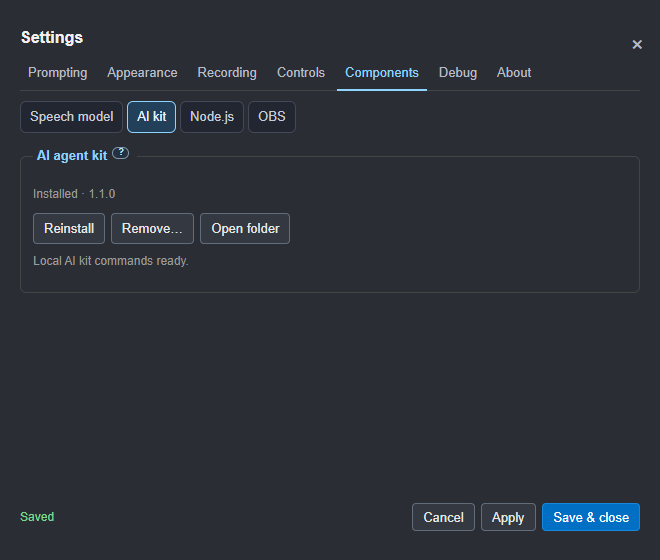
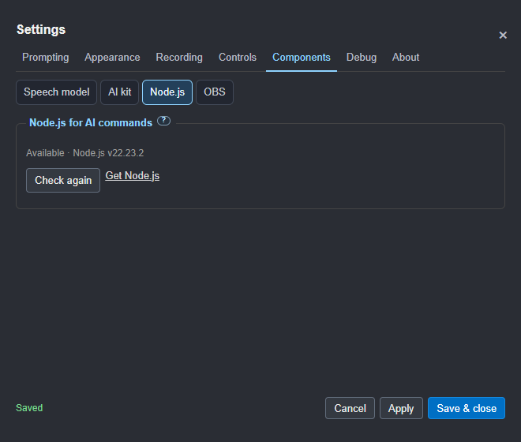
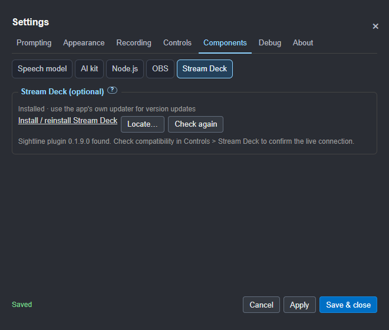
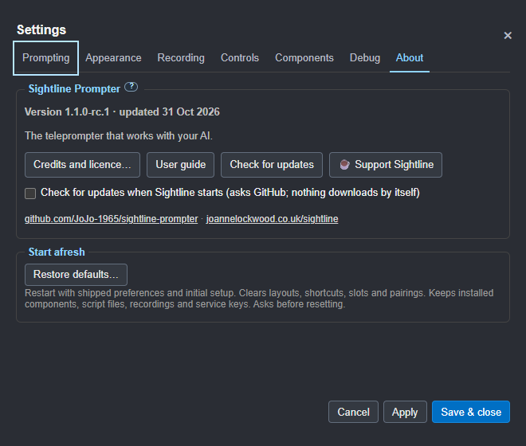
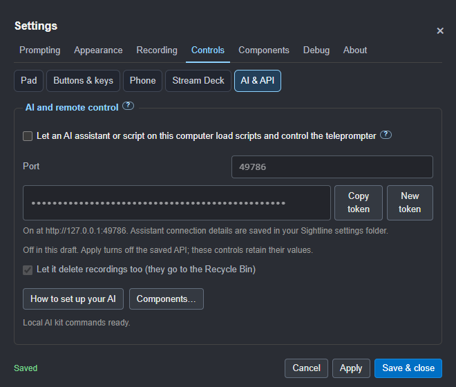
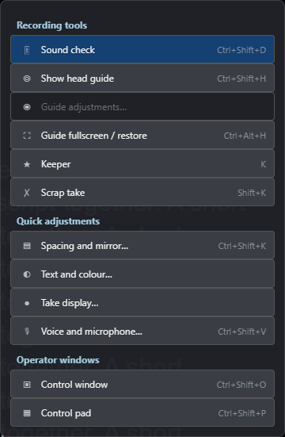
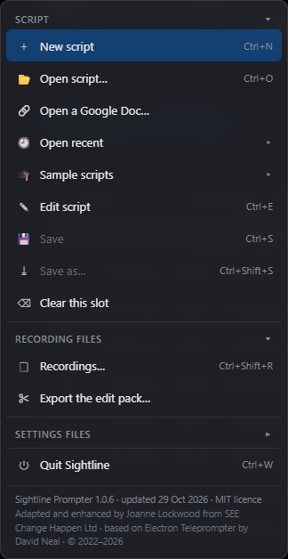
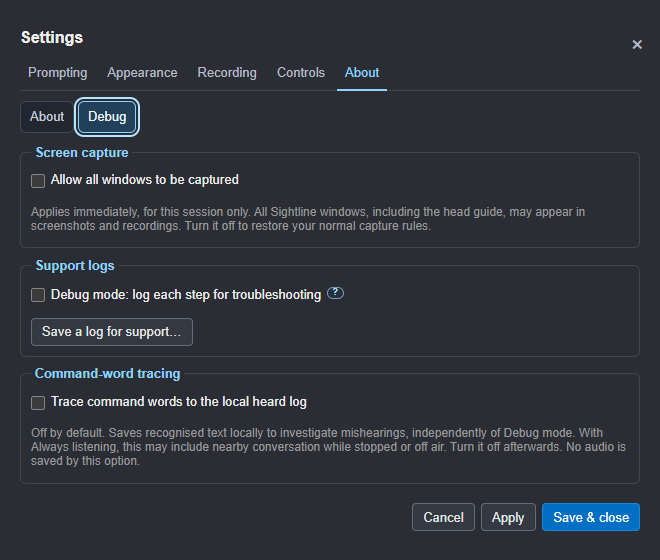

# Settings

**1.1.0 release candidate:** this regrouping is built and awaiting acceptance. For the published
1.0.6 layout, use the guide bundled with that app.

Open **⚙ Settings** on the top bar or press **Ctrl+,** (**Cmd+,** on Mac).
In RC8, Settings opens in its own upright window. Drag the native title bar
to place it beside the prompter or on another screen. Its position and size
are remembered; opening Settings again brings the same window forward and
keeps any unsaved draft. **F1 / ?** opens Help in a separate movable window too.
RC11 keeps these windows above their prompter owner, including fullscreen.
Opening Settings brings it forward and focuses its controls.
**“Prompter, what can I say?”** also has its own movable window in RC10.
Settings, both help windows and Guide adjustments follow **Hide from capture**;
turn it off to take support screenshots. The head-guide overlay stays protected
unless the session-only **Debug > Allow all windows to be captured**
override is active.
There are seven groups, with a second row of focused topics. Each setting has
one home. Script files, recordings and settings import/export are in the
**Files menu (☰)**; live tools are under **Tools** on the top bar.

About shows the source/build version. A candidate such as 1.1.0-rc.1 recognises
the later final 1.1.0 as an update. Nothing installs automatically.

[Browse the full Settings screenshot gallery](settings-gallery.md) for every
topic and page. The same gallery opens from the guide's contents and works
offline in the app.

Settings keeps the same width and height across every tab and page. It only
reduces the available content space when you resize the Settings window.
There is no scrolling. Longer topics use **Previous / Next**, with the current
section and page number shown between them. Smaller windows use more pages;
your draft stays intact as you move between them. Word lists use pages too.

The small raised **?** pill sits beside the option it explains, with a larger
tap area. Hover over it, focus it with the keyboard, or tap/click it for an
explanation of the nearby choice. Click again, click elsewhere, or press
**Esc** to dismiss it. When an explanation is open, the first Esc closes
that explanation and leaves Settings open. The explanation can be hovered
without disappearing as you move the pointer onto it.

## Find a setting

| Group | Topic | What belongs here |
| --- | --- | --- |
| **Prompting** | Scrolling | Steady or voice mode, steady speed and the opening countdown |
| | Voice | Speech engine, model download, responsiveness, Deepgram key and microphone |
| | Commands | When to listen, wake word, listener state and Restart listening |
| | Your words | Script synonyms, command synonyms, sound-alike matching, suggestions and Teach |
| | Script | Notes mode, pacing, script directions, slide cues and directive display |
| **Appearance** | Text | Body and heading fonts, heading size, comment size/colour and text-size preview |
| | Background | Text opacity, backing on/off air, brightness and colour theme |
| | Reading aids | Focus band, text edge, reading-line marker, sentence highlight and progress bar |
| | Spacing | Margins, line spacing, reading line and alignment |
| | Screens | Beam-splitter mirroring, prompter monitor, Keep on top, eye-line strip and keeping controls visible |
| **Recording** | Takes | Slate, ON AIR display, countdown beep, capture protection and click-through |
| | Takes: rehearsal coaching | Optional recognised filler/repetition counts during active voice following; Apply to save |
| | Audio | Scratch audio, loudness per take and keeping the sound-check meter visible |
| | OBS connection | Enable OBS, address, port, protected password and the saved-connection test |
| | OBS recording | Start/stop permission, chapters and preparing the recorded slate |
| | OBS setup | Optional separate profile/scenes assistant and configuration guide |
| **Controls** | Pad | Select and arrange shared pad/phone buttons, columns and presets |
| | Buttons & keys | Learn local keys, clicker/pedal inputs and controller buttons; choose actions and reset |
| | Phone | Enable the phone remote, scan its QR code or replace its code |
| | Stream Deck | Enable the companion plugin's buttons-only connection and open its guide |
| | AI & API | Enable local automation, port, token, recording-delete permission and AI setup help |
| **Components** | Speech model | Install, repair or remove the offline speech model |
| | AI kit | Install, repair, remove or open the standalone agent kit |
| | Node.js | Check the runtime for kit commands and open its supplier installer |
| | OBS | Installation check, supplier installer and custom location |
| | Stream Deck | Elgato app and Sightline plugin installation checks |
| **Debug** | Debug | Support logs, capture override and optional command-word tracing |
| **About** | About | Version, credits, updates, support and Restore defaults |

OBS settings stay discoverable while disabled so you can configure them.
OBS connection, recording and setup are together under **Recording**.
**Prepare recorded slate** explains
any unmet prerequisite beside the button and shows progress or errors in Settings.
Recording commands in Help and the live recording controls still follow the
permissions you have enabled. The head guide is independent of OBS.

## Components

In the next candidate, **Components** is a top-level group. Its named subtabs
keep each optional part's status beside its actions, without numbered component
pages. **Debug** also has its own top-level group.

- **Offline speech model:** Install downloads about 73 MB. Reinstall downloads
  a fresh copy to staging; an incomplete download leaves the previous model
  available. Remove moves the model to your system bin. Voice following and
  offline commands need it; steady scrolling still works without it.
- **AI agent kit:** Install copies the skills, script checker, command tool
  and briefs from this app into a managed folder. Open folder and read
  **START-HERE.md**. No repository clone or npm install is needed. Reinstall
  refreshes this managed copy; keep personal files elsewhere. Remove moves
  it to your system bin. Other applications' installed skills stay separate.
- **Node.js:** reports whether a suitable version is available on the app's
  PATH. Commands need 22.16 or later. Use Get Node.js for its own installer,
  restart Sightline, then Check again. The desktop app needs no separate Node.
- **OBS Studio:** checks the usual installation folders and running portable
  copies. Install / reinstall opens OBS's own download page. **Locate** remembers
  a custom installation; **Check again** detects later removal too.
- **Stream Deck:** checks the Elgato application and looks for the Sightline
  plugin manifest. Its installer is separate from the plugin. **Controls >
  Stream Deck > Check compatibility** confirms the live plugin version and
  protocol; finding installed files alone does not confirm a working connection.

Unavailable controls are greyed out with a visible explanation. **AI & API**
reports readiness of the supplied kit commands: these need both the kit and
Node.js. Other API clients and the built-in reviews do not. Turning the API
off disables its port, token and deletion controls without erasing their values.
Installation, help and Components links remain available.

OBS and Stream Deck cannot be enabled for a missing local application. An
existing enabled connection can still be switched off. OBS's address stays
editable so you can use OBS on another computer; that setup needs no local
OBS installation. A confirmed live connection also establishes availability.
OBS recording permissions stay unavailable while the integration is off.
After installing or locating software, use **Check again**. These checks do
not claim that third-party software is the newest version; use its own updater.

Model Reinstall and Remove also appear in **Prompting > Voice**. Stop
prompting and recording before changing the model. Always command listening
pauses for maintenance and resumes afterwards if a usable model remains.
Removal asks first. Component actions apply immediately, independently of
Settings Apply/Cancel. The existing first-run model download offer remains.
Installing the AI kit does not enable the API or alter your assistant.

## Setup and session checks

For a clean start, use **Settings > About > Restore defaults…**. A confirmation
explains the reset before anything changes. Sightline restarts with shipped
preferences and opens Getting started. It clears layouts, shortcuts, slot
assignments, recent-file history, pairings and remembered window positions;
integrations start disabled. Open your existing scripts again when ready.

Installed components and their remembered locations stay. Script files,
recordings, scratch audio and saved service keys stay too; OBS profiles and
scenes are untouched. Phone and Stream Deck pairing details are renewed, so
reconnect them after enabling their integrations. The last setup is kept
locally as `app-state.before-defaults.json`; it may contain service keys, so
keep it private. This is a support backup, not a shareable settings export.

Cancel leaves the setup unchanged. Save or close the script editor and pause
prompting first. Reset is blocked during component maintenance or OBS
recording/setup, including paused recordings or an enabled connection whose
recording state cannot be confirmed. Pending take data is saved before restart.
Unsaved Settings drafts are discarded only after confirmation.

**Help > Getting started…** opens the first-use checklist. Optional tools can
be skipped; a new profile sees it automatically. **Tools > Session check…**
links to existing script, sound, framing, enabled OBS, sync and control tools.
Refresh after changing settings. Status describes configuration and connection
evidence; it does not certify your recorded camera or microphone.

**Recording > OBS setup** opens the optional separate-profile assistant and
[configuration guide](15-obs-setup.md). Review its plan before Create. Existing
setups remain available, and recording/streaming/replay must be stopped.

The API controls below are off in a draft. The saved service stays on until
Apply; the grey controls retain their values.

## Fonts, backing and reading aids

Open **Appearance > Text** for the body font, heading font, heading size,
comment size/colour and text-size preview. Square-bracket comments follow
Heading font, with independent size and colour. **Theme** resets their colour;
the visibility choice remains in **Prompting > Script**. Quoted spoken words
keep their script style. These appearance changes save immediately.
The visible notes distinguish changes saved immediately
from the text-size preview saved with Apply or Save & close.

**Appearance > Background** holds visibility, brightness and colour choices.
Use Background for the off-air level and Background on air for the level used
when ON AIR is enabled. Both values are remembered.

**Appearance > Reading aids** holds the focus band, text edge, reading-line
marker, sentence highlight and progress bar. [Layout and display](04-layout-and-display.md)
explains these choices, with illustrations.

## Apply, Save & close and Cancel

- **Apply** saves your changes and keeps Settings open.
- **Save & close** saves and closes.
- **Cancel**, **×** and **Esc** close without saving the pending draft.

If there are unsaved changes, closing offers **Save**, **Discard** or
**Keep editing**. Shared live controls show **Saved immediately as you adjust**;
cancelling the draft keeps those changes. The text-size preview has its own
**Preview until Apply or Save & close** note and is restored when cancelled.

The footer shows **Unsaved changes** when you edit the pending draft and
**Saved** after Apply. Clearing or choosing a slide-cue file also counts as a
pending change. Invalid numbers return you to the relevant topic and page,
with the field focused and its permitted range explained.

Changing group or topic never applies or discards the draft. Settings remembers
the last topic used, and returning to a group recalls its last topic during
that session. Older saved tab choices are carried across where possible.

Use **Tab** to move between the selected group, selected topic and controls.
Within either tab row, **← / →** changes selection; **Home / End** goes to its
first or last tab. Hidden topics stay out of keyboard navigation. Focus stays
inside Settings until you close it, then returns to the control that opened it.

Drag the native title bar to move Settings between screens. The inline
fallback can be dragged inside the prompter; double-click its title to recentre.

## Settings files and automation

**Files > Save settings to file** and **Load settings from file** preserve
the shared pad/phone layout in JSON and XML. From the next candidate, the
local settings API accepts `padLayout` too, with the same validation. Unknown
actions are removed, duplicates are collapsed and invalid column counts are
rejected before other settings change. Remotes, credentials and tracing
permissions remain protected.

New XML exports preserve structured values such as button layouts and word
lists as JSON inside XML. An older export containing only `[object Object]`
does not contain the original structure; export again from the corrected app.

## Voice and commands are separate

**Prompting > Voice** chooses how speech is recognised and which microphone
to use. **Prompting > Commands** chooses when the wake word is heard, including
Always listening while stopped. **Your words** holds training and synonyms.

See [Scrolling and voice](03-scrolling-and-voice.md) for the modes and commands.
Sound checks and loudness are in **Recording > Audio**, with a live meter
available from **Tools > Sound check** or **Ctrl+Shift+D**.

## Connections in Controls

**Controls > Phone** pairs a phone on the same Wi-Fi. **Controls > Stream Deck**
enables the companion plugin's connection. **Controls > AI & API** enables an
AI assistant or local script to control Sightline. Each connection is optional.
Enable Phone and choose **Apply** or **Save & close** to display the QR code.
RC10 fixes its image in the separate Settings window.

**Check compatibility** shows the running Sightline version, the connected
plugin's reported version and any update requirement. Version reporting needs
plugin 0.1.9 or later; an older or disconnected plugin stays unconfirmed.
This checks the local pairing, while **About > Check for updates** checks
the latest public app release. See [compatibility and updates](06-remotes-and-screens.md#compatibility-and-updates).

Follow [Remotes and second screens](06-remotes-and-screens.md) for pairing and
connection steps, or [Setting up your AI](10-setting-up-your-ai.md) for automation.

## Tools and Files

The toolbar's **Edit** button sits immediately left of **Tools**. It opens the
script editor, or read-only sample source with **Save a copy…**.
**Tools** drops down beneath its button and shifts inward at the window edge.
It follows the button when the window size or mirror mode changes.

Settings starts centred on its first opening, then remembers where you put
it. It keeps the same dimensions across topics and stays upright when the
prompter is mirrored. Use the window's native title bar to move it across
screens. Closing with **×**, Escape or Cancel keeps the existing unsaved-change
prompt; quitting Sightline with a Settings draft asks too. Apply stays open;
Save & close saves and hides the window.

**Tools** holds Sound check, the head guide and fullscreen/restore, Keeper,
Scrap, quick display/voice panels, the control pad and the control window.
Quick panels reuse the existing live controls rather than separate copies.
If Settings is already open, a quick display tool brings the corresponding
Settings topic forward, keeping the same live controls and draft.
Their keyboard shortcuts, voice commands and Stream Deck actions still work.

**Files (☰)** holds New/Open, Google Docs, recent and sample scripts,
Edit/Save/Save as, Clear slot, Recordings, the edit-pack export, settings-file
import/export and Quit. It does not repeat playback, appearance, voice or
window tools. **Settings…** is always visible near the menu's foot, above Quit,
even when its groups are folded. The top bar keeps slots, playback, speed,
size, backing, independent mirror axes and
mode switching; on narrow windows, Tools and Settings provide the additional adjustments.

The native application menu keeps standard keyboard/platform access through
**File, Edit, Playback, Tools, Window and Help**. Script slots are under File.
Detailed preferences remain in Settings. **F1** opens grouped shortcuts;
**Shift+F1** opens the illustrated guide. On Mac the usual application menu
also remains available.

Keyboard and voice help keep a consistent frame size as you switch topics.
Longer topic contents stay inside that frame; the tabs and Close stay in place.

**Copy the AI script prompt** is available in F1 Help as well as the native
Help menu, without enabling remote control.

## About, updates and support

**About** gives the version, **Credits and licence**, the user guide,
Joanne's tip jar and **Check for updates**. Update checks ask GitHub; nothing
downloads or installs automatically.

**Credits and licence** opens the full About page, also available from
**Help > About**. Copyright and attribution live there, with no repeated
messages in the Files menu or the Settings overview.

**Debug > Debug mode** adds detail to the local support log. **Save a log for support…**
creates a file containing the version, system and enabled features, excluding
scripts, keys, audio and command-word traces. It sends nothing itself.

**Allow all windows to be captured** applies immediately and lasts only until
Sightline closes. It overrides capture protection for open and newly opened
windows, including the head guide. A persistent banner and phone notice show
when it is active. Untick it or use the banner's **Turn off** button to restore
the current normal rules, including any changes made during the override.
It does not enable command-word tracing or change the saved capture preferences.
This control is not exported or available through the settings API.

The separate **Trace command words to the local heard log** checkbox is also
under **Debug**. It is off by default and does not require Debug mode.
Apply saves the choice. This saves recognised text for investigating mishearings;
with Always listening it may include nearby conversation while stopped or off air.
Turn it off afterwards. Health and recovery logs contain no spoken words.

Sightline is free and stays free. Support is voluntary and gives no extra
features. See [privacy, terms and support](../POLICIES.md).
