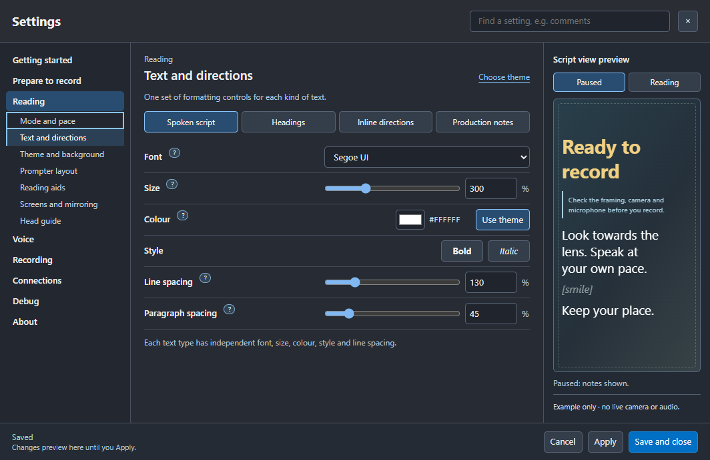
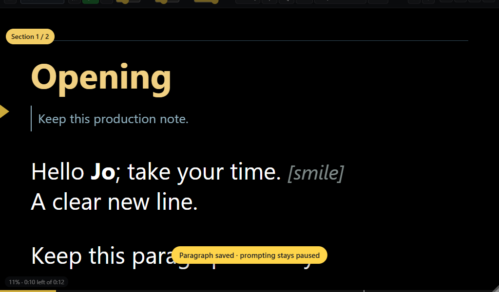
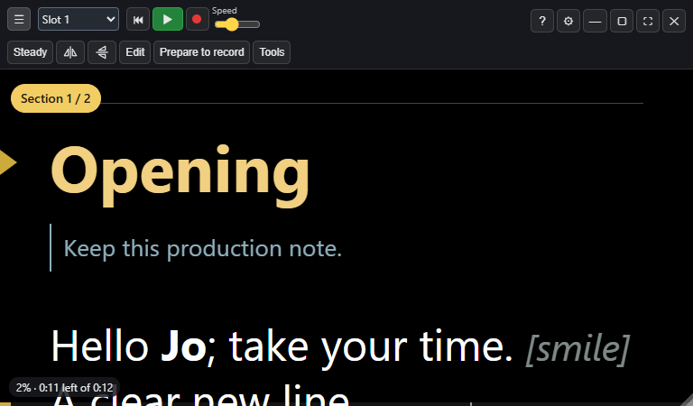

# Settings

This source guide describes **Sightline 1.2.0**, based on the approved
interactive demo and Joanne's combined Connections/recording feedback.
The same guide is bundled with the installer and available from Help.

Open **Settings** on the toolbar, **Files (☰) > Settings**, or **Ctrl+,**
(**Cmd+,** on Mac). Settings opens in an upright, movable window. It retains
the same frame while you change sections; resizing never moves a control
onto another page. There is no numbered pagination. Longer Getting started,
Preparation, OBS connection, MCP/API and assignment panels scroll in the centre pane,
keeping navigation, the reading example and footer in place.

On larger windows, choose an area and a named section in the sidebar, or use
**Find a setting**. Compact windows use **Area** and **Section** selectors.
Disabled features are excluded from search and navigation where appropriate:
OBS recording/setup needs OBS enabled; speech commands/words need speech enabled.

The selected area expands in the left list. Controls stay in the centre and
**Script view preview** stays on the right; search is in the header. Compact
windows use a **Preview** action to open a movable, non-modal companion.
It stays in sync while Settings remains usable. The third column follows width,
so a short but wide window keeps it. Paused/Reading changes only the example,
never the actual prompter, microphone or recorder.

## Apply, save and cancel

Every preference in Settings uses the same draft:

- Appearance changes preview in the sample and the prompter.
- **Apply** saves the draft and keeps the window open.
- **Save and close** saves and closes.
- **Cancel** discards changes made since opening or the last Apply.
- **×**, native Close and **Esc** check for unapplied changes.

Device/service activation happens on Apply, rather than while choosing values.
**Tools** is labelled **Live adjustments**: its controls apply immediately.
Installing a component, importing/saving a theme, testing a microphone,
resetting pairings, recorder commands and guide visibility/placement/reference
actions are explicit actions. Cancelling another Settings edit does not undo
them. Guide appearance and eye-lock preferences use Apply like other settings.

The small **?** pill explains the adjacent option. Hover, focus or click/tap
it. An open explanation takes the first Esc; Settings stays open.
Sliders have matching numeric values, units and keyboard adjustment.
Text size, line/paragraph spacing, scroll catch-up speed and WPM use five-point increments.
Margins, opacity, countdown and reading positions use whole values. Fine head
alignment displays at most two decimals. Sliders and number boxes agree;
existing stored precision is retained until you adjust the value.

## Areas and sections

| Area | Sections |
| --- | --- |
| Getting started | First setup: current configuration and guided next steps; Restore defaults |
| Prepare to record | Overview |
| Reading | Mode and pace; Text and directions; Theme and background; Prompter layout; Reading aids; Screens and mirroring; Head guide |
| Voice | Speech engine; Microphone; Commands; Your words |
| Recording | Takes; Sound check; Slate and sync |
| Connections | Pad and phone; Phone remote; Keyboard and clickers; Game controller; Stream Deck; OBS integration; MCP, AI, and API; Apps and add-ons |
| Debug | Status and recovery; Speech trace; Capture for demos; Support log |
| About | Version and updates; Credits and licences; Help and support |

## Prepare and reading

**Prepare to record > Overview** puts the real head-guide/audio/test workflow
first, with Open workflow and retained test/reference outcomes. Detailed reading,
guide, sound and recorder settings sit below it. The main toolbar also has a
direct Prepare to record action. Guide position and detection feedback are shared
with the Ctrl+Shift+H overlay; choose a camera or an available OBS scene there.
See [Prepare to record](16-prepare-to-record.md).

Test recording results persist beside this action and on the prompter. A clip
needs actual picture/sound review before passing. Audio checks show the main
sound meter automatically, then restore its earlier visibility.

**Connections > OBS integration** has three visible subtabs: Connection,
Recording control, Profile and scenes. Connection and recording state are
separate. Apply connection changes before testing; retained pass/fail feedback
does not replace reviewing a recording. **MCP, AI, and API** contains the optional
[MCP connection and separate grants](../MCP.md). Installation/repair is under
**Apps and add-ons**; Restore defaults is under **Getting started**.

**Mode and pace** has one Mode selector offering
Notes/page, Voice and Scroll. Voice shows scroll catch-up speed; Scroll shows WPM, script
pacing and countdown; Notes/page shows page-navigation guidance. Unrelated
controls are hidden and disabled, with their values retained. The separate
Notes checkbox is removed. Apply saves the chosen mode; Cancel restores it.

A movable **non-modal preview window** is available for compact Settings
layouts. It remains open while you change settings, using the same draft as the
inline example. Its small Close preview button, native X and Escape close the
preview without closing Settings. Preview controls never start prompting or
recording. The [combined review](../design/settings-feedback-batch-2026-11-02.md)
records the approved layout. Voice requires enabled speech and microphone input;
Scroll and Notes/page do not require speech components.

**Text and directions** has four named targets:

| Target | Script syntax and behaviour |
| --- | --- |
| Spoken script | The words you read aloud; also the base size used by the toolbar |
| Headings | Titles and section headings, with their existing title hierarchy |
| Inline directions | Square-bracket cues such as `[smile]`; silent, with separate Normal/Dimmed/Hidden visibility |
| Production notes | HTML comments such as `<!-- prepare the slide -->`; silent, visible while paused and hidden during delivery |

Each target has its own **font, size, colour, Bold, Italic and line spacing**.
Non-script fonts can **Follow script**. Size is expressed as a percentage:
headings are relative to script size, inline directions normally start at
85%, and production notes at 55%. Visibility no longer changes direction size.
Quoted words marked for speaking retain spoken-script styling and tracking.

**Paragraph spacing** is under **Spoken script**, separate from wrapped line
spacing. Choose 0–300% in five-point steps. 100% preserves the existing gap;
0% closes it. Heading and production-note block margins retain their own rules.
The sample and live script preview the draft; Apply saves it and Cancel reverts.
Reading themes include this value; older themes restore the default 100%.

**Use theme** beside a colour restores that item's palette colour.
**Choose theme** opens **Theme and background**.

### Theme and background

Choose Standard, Yellow on dark, High contrast or Soft cream. Soft cream's
new palette has a light cream background and dark text. Existing cream
profiles retain their earlier appearance until you change/reset their colours.

The **Background colour** picker is independent of text colour. Off-air and
on-air background opacity, text opacity and brightness have their own controls.
The right preview demonstrates paused versus reading appearance. Palette changes
preserve custom colours; Use theme restores inheritance.

**Save current as…** creates a named reading theme; choose it again from
**My saved themes**. Optionally export a copy while saving. **Import theme…**
and **Export theme…** use portable `.sightline-theme.json` files.
Names are unique; imported duplicates receive a suffix.

A reading theme contains the four text styles and reading background values.
It excludes scripts, window positions, controller/pad layouts, recorder setup,
pairings and credentials. It is **not a complete app backup**. Use
**Files > Save/Load settings** for the broader supported JSON/XML preference
transfer; sensitive opt-ins still require explicit setup on the destination.

### Prompter layout, aids and screens

**Prompter layout** contains alignment, margins and reading-line position.
Line spacing lives with each typography target.

**Reading aids** uses visible button subtabs for reading indicators versus slide cues
and directive tags. Sentence highlight, progress/time, marker, focus band,
strength and text edge stay together. **Focus strength** appears only while
**Focus band** is on; switching the band off retains the selected strength.
Production comments and inline directions keep their own appearance outside
the band. Top and bottom margin fading still applies to them.
Small **?** pills explain every control in both groups. Hover, focus with the
keyboard or click a pill to read its explanation; Escape closes it.

**Screens and mirroring** uses visible **Window and mirroring** and
**Eye-line strip** subtabs. Set the monitor, always on top, toolbar visibility, capture protection,
click-through and independent left/right and top/bottom mirroring here.
The compact mirror buttons use the same axis icons as the main toolbar.
RC11 keeps minimise, maximise/restore, fullscreen and Close at the top right
on the first toolbar row. Other groups can wrap below. At 1100 pixels wide
or less, the nine script buttons become a Slot 1–9 picker. Ctrl+1 through
Ctrl+9 still switch slots. Session controls sit below the full toolbar.

Enable the eye-line strip to reveal its width, height and reading-line controls.
These use the same sliders, number boxes and help pills as other settings.
The mouse pointer remains visible when the main toolbar hides.
On Windows, dragging the main prompter to another screen restores a normal
window, centred at 75% of that screen's usable width and height. This clears
eye-line mode and a pinned monitor choice. Moving within the same screen
retains the chosen size. Explicit monitor-menu placement still opens full screen.

**Head guide** has a stateful Show/Hide switch and visible **Guide**,
**Appearance** and **Recording reference** subtabs. Choose centred/beside-prompter
placement, eye locking, outline colour/opacity, backing opacity and Show Ideal.
Appearance/eye-lock preferences use Apply. Show/Hide, placement, fullscreen and
reference actions act immediately. Apply guide edits before saving/restoring
a reference. Save recording reference keeps Ideal separate; Restore is available
after a reference exists. The right-hand manual diagram is not camera tracking.
Use **Adjust guide** to fit eye centre/level, then top/bottom and sides.
See [head guide and capture limits](04-layout-and-display.md).

Sightline 1.2.0 restores the guide toolbar at the bottom of its
monitor. It collapses to a **Head guide ▴** tab; hover or click the tab to bring
the controls back. **Pin controls** keeps them visible and **Auto-hide** releases
the pin. **Adjust**, **Guide off**, **Move guide**, fullscreen and click-through
lock/unlock remain available. The toolbar has its own small window layer above
the prompter, including while the guide is locked or fullscreen. Turning the
guide off removes the toolbar and its tab. Existing guide picture bounds stay fixed.

## Voice

**Speech engine** has an enable switch, engine choice, readiness and service
key controls. Manage the offline model in **Connections > Apps and add-ons**.
The local engine runs on the computer; Deepgram is an optional online service.

**Microphone** has a separate enable switch, input selector and explicit
**Test selected microphone** meter. A test is temporary and stops when you
leave the section, disable input or close Settings. Selecting an input does
not adjust its gain.

**Voice commands** contains listening mode, wake word, listener status and
restart. **Your words** provides script-word corrections and command phrases,
with named item selectors rather than height-dependent pages.
Voice-command help needs speech, microphone input and listening enabled.
Recording commands also need the relevant recording integration and permission.

## Recording

**Takes** contains take summary, pacing light, start beep, on-air indication and
optional aggregate rehearsal counts. **Sound and scratch audio** holds per-take
level feedback, the independent scratch reference and sound-check display.
A low level is advisory; consider room noise before increasing gain.

**Slate and sync** holds the local slate choice. A screen-only flash does not
validate camera lip sync. OBS's recorded slate route is configured separately
under **Controls > OBS recording control**. Verify the actual recorded picture/sound.

Section stops and retakes keep the existing recording workflow. Ordinary
reading needs no compulsory recorder directives.
See [production handover](12-production-handover.md).

Installed components uses visible **Speech model**, **AI kit**, **Node.js** and
**OBS** subtabs. Dropdowns choose values or list entries; they do not hide these
functional groups. Group tabs share pointer, arrow-key and Home/End behaviour.

## Controls and optional components

Each optional interface has **one enable switch**. Off hides its configuration
and preserves saved values. Installation/readiness is separate from activation.
Disabling an interface does not uninstall its software.

- **Pad and phone** arranges the shared layout when either interface
  is enabled. Choose a button by name, use Earlier/Later or drag neighbouring
  buttons, and select presets, columns and hold-to-finish. Compact views edit
  the selected button without arbitrary page numbers.
- **Phone remote** shows the local QR/link after enabling and applying.
  New code disconnects previously paired phones. Use the same private network.
- **Keyboard and clickers** learns custom plain-key/Shift mappings.
  Core shortcuts remain available when custom mappings are off.
- **Game controller** separately enables and assigns controller buttons.
  Resetting one input type preserves the other type's mappings.
- **Stream Deck** is its single setup home: installation/readiness,
  enablement, companion plugin compatibility and support.
- **OBS integration** lives under Controls. Enable it before its recording
  and profile/scene sections appear. Apply, start OBS and test the saved
  WebSocket connection. Recording control is a separate permission.
- **MCP, AI, and API** uses a local port and access token. General authorised
  clients can use it; the supplied AI kit commands additionally need the
  optional kit and a suitable Node.js installation.

**Connections > Apps and add-ons** selects the offline model, AI kit, Node.js
readiness or OBS installation. External apps keep their own update process.
**Restore defaults** confirms a restart into onboarding; components, scripts,
recordings and retained service keys are not uninstalled.

## Tools, debug and help

**Tools** has Prepare, Adjust and During take tabs. It follows the same visual
controls as Settings, with separate controls and shared saved values.
Disabled functions are omitted. If the prompting window cannot fit the menu,
Tools opens in its own utility window.

**Debug > Health** explains listener recovery. **Command tracing** is off by
default and can record recognised nearby conversation during Always listening.
Health/recovery events contain no spoken words. **Support logs** exports a
local diagnostic file without sending it.

**Screen capture > Allow all windows to be captured** is an immediate,
session-only override, including the head guide. Its banner stays visible.
Turning it off restores the normal capture rules. It is not exported or
available through the settings API. Capture protection still depends on the
recording route: check a short recorded file.

**About** holds version/update information, credits and support.
**F1 / ?** and voice help use grouped topics and omit disabled feature keys.
See the [screenshot gallery](settings-gallery.md) and
[privacy, terms and support](../POLICIES.md).

## RC12 dialog placement and voice

Sightline windows first open on the parent’s monitor, then remember their own
monitor, position and size. Settings, help/tools panels, preparation, recording
review, guide adjustments and the user guide use saved placement. A missing
monitor falls back to the parent and visible work area. Native OS dialogs keep
the correct owner and platform-supported placement. With listening enabled,
say an enabled button’s exact label in the foreground Sightline dialog. Hidden
or disabled controls retain their gates.
