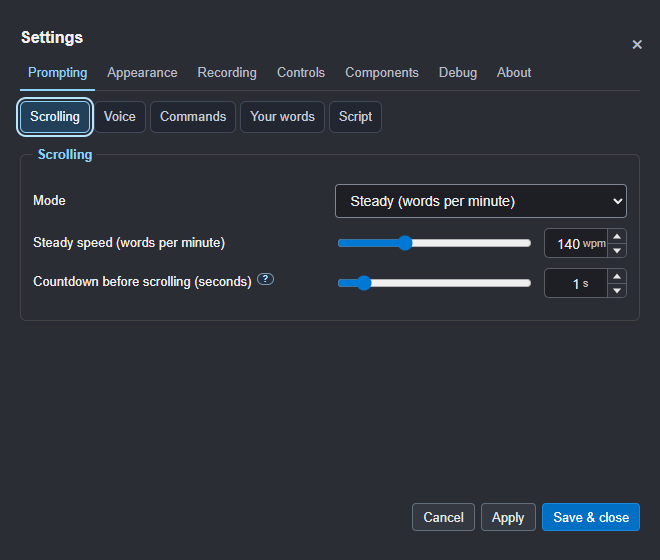
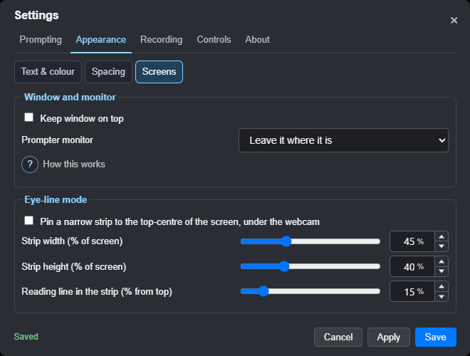
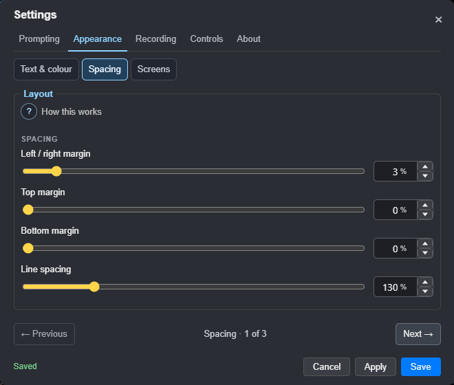
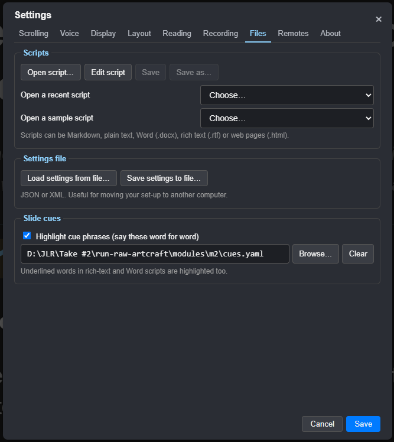
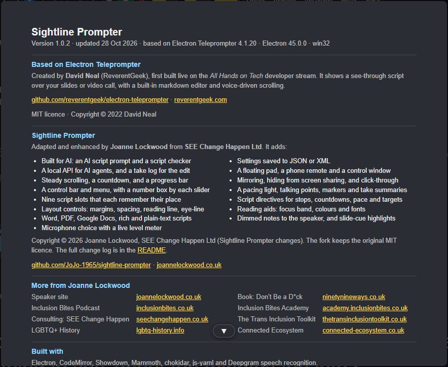

# Settings

The optional **head-position guide** opens from the Window menu or global
Ctrl+Shift+H hotkey (Cmd+Shift+H on Mac). Adjust its appearance on the overlay;
placement and appearance are saved. See [the guide controls](06-remotes-and-screens.md#head-position-guide-development).

Open Settings with **⚙** in the control bar, **Ctrl+,** or ☰ > Settings. The
tabs keep everything in view, and the panel stays the same size on every
tab. **←** and **→** switch tabs, and the buttons stay at the bottom:

- **Apply** saves your changes and keeps Settings open.
- **Save** saves and closes.
- **Cancel**, the **×** at the top right and **Esc** close without saving.

If you've changed something you haven't saved, closing asks first:
**Save**, **Discard** or **Keep editing**. The Layout, Reading and Recording
tabs change the prompter as you go, so they're always kept.

Drag Settings by its title to move it anywhere in the window, for example
off the part of the script you're checking. It opens there next time;
double-click the title to put it back in the middle.

## Scrolling

The scroll mode (steady or voice), the steady speed, the countdown before
scrolling starts, the [slate](05-recording-a-take.md#the-slate) at the start
of each take, [scratch audio](05-recording-a-take.md#scratch-audio-for-syncing)
for syncing, and [loudness for each take](05-recording-a-take.md#sound-check-and-loudness).

## Voice

Speech recognition (on this computer, or Deepgram), the speech model download,
voice commands and their **wake word** (Prompter, Computer, Teleprompter or
Director), voice responsiveness and the microphone, and **Your words**: names
and words it mishears, and your own forms of the wake word and commands,
with sound-alike matching, suggestions from what it heard and **Teach…**, and
whether the [sound-check meter](05-recording-a-take.md#sound-check-and-loudness)
stays on screen during takes. See [Scrolling and voice](03-scrolling-and-voice.md)
and [Your words](03-scrolling-and-voice.md#your-words).

## Display

Text size, backing, the reading line, how notes in [brackets] show, the
reading-line marker, the sentence highlight, mirroring, always on top, the
prompter monitor and eye-line mode.

## Layout, Reading and Recording

The same controls as the Layout panel's three views, a tab each so none runs
off the bottom: **Layout** for margins, line spacing, heading size,
alignment and the reading line; **Reading** for text and background opacity (including the
background on air), themes, fonts and the focus band; and **Recording** for
the ON AIR light, hiding from screen capture, click-through, and the options
for timing and checking scripts. See [Layout and display](04-layout-and-display.md).

## Files

Open, edit and save scripts, open a recent script or a sample, and save or
load all your settings as a file (JSON or XML) to move them to another
computer. Your Deepgram key and microphone are never written to that file.
Slide cues can be loaded here too.

## Remotes

AI and remote control, the Stream Deck plugin (its own setting, for buttons
only), the control pad and control window, and the phone remote. See
[Remotes and second screens](06-remotes-and-screens.md).

## OBS (development branch)

The separate **OBS** tab is disabled by default and works independently
of normal prompting. See [OBS setup](11-obs.md) for status-only mode,
recording controls, the connection test and passwords. **Include the slate in
the OBS recording** is a separate opt-in; Apply, then **Prepare recorded slate**
with OBS stopped. It adds its own flash/tone source to the current scene.

## About

The last tab, **About**, gives the version, the credits and links to the
source code and the website. **Full About page…** opens the complete page (also
at the foot of the ☰ menu), with what's new, the licence and the credits, and
**User guide** opens this guide.

**Check for updates** asks GitHub for the latest release and tells you if
there's a newer one, with a link to what's new and the download. With
**Check for updates when Sightline starts** ticked (the default), it also
checks quietly a few seconds after you open the app, and a small note at the
bottom right says when a new version is out. Nothing downloads or installs by
itself, and nothing is sent but the request to GitHub.

**Debug mode** (on at first) adds a step-by-step trail to the small log Sightline always
keeps of hangs, crashes and errors, so a problem can be traced. **Save a log
for support…** puts the log in one file, with your version, system and which
features are on (never your scripts, keys or audio), to attach to a GitHub
issue or an email. Nothing is sent by itself.

**☕ Support Sightline** opens Joanne's tip jar, where you can say thanks
with a coffee (also **Help > Support Sightline (Joanne's Tip Jar)…** and the ☰
menu). It's a Stripe payment page: you choose the amount, and nothing else is
asked for but your card and an email for the receipt.
Sightline is free and stays free. Once you've opened it ten times, a small
note at the bottom right asks, once; close it and it never asks again. It
never shows while you're reading or on air.

