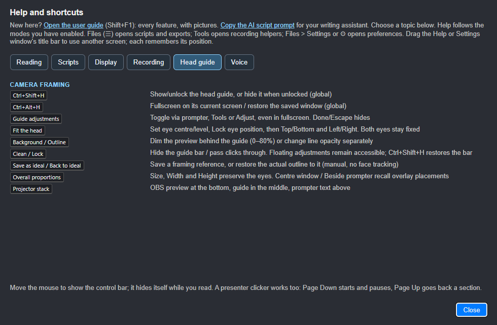
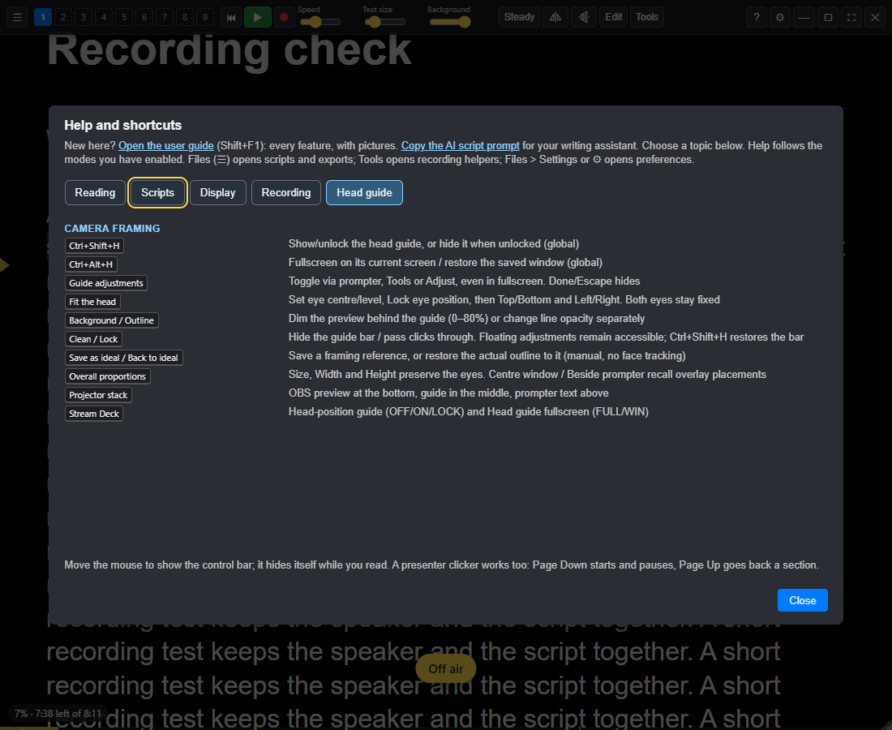

# Shortcuts and troubleshooting

**RC11 quick edit:** double-click a spoken paragraph while paused. Enter inserts
a line break; Ctrl+Enter saves; Escape cancels. Prompting stays paused.
Ctrl+E opens the full editor. On narrow windows, the Slot 1–9 picker replaces
the numbered buttons; Ctrl+1…9 shortcuts still work.

**Wake word sometimes stops responding:** check **Settings > Voice > Voice
commands**. Audio/engine faults recover automatically with bounded retries;
use **Restart listening** or click the listening badge for a manual retry.
To investigate a misheard word, enable the optional local command-word trace in **Settings > Debug**,
reproduce it, then switch tracing off. See [Listening recovery](03-scrolling-and-voice.md#if-listening-stops-responding).

**Changing pad or phone buttons:** use **Settings > Connections > Pad and phone**, or
**Customise** on the pad. Selection and order are shared; Stream Deck
profiles keep their physical key assignments.

**Reviewing delivery:** **Script health…** in the editor checks current text,
including unsaved changes. **Tools > Script & rehearsal review…** has the
same check and a Rehearsal tab for finished takes. **Recordings > Coach…**
reviews a saved session. Pause prompting first. Missing alignment is not proof
of missed speech, and optional filler counting must be enabled for future takes.

## Bookmarks and retakes

RC9 keeps bookmark navigation and editing events without painting flags over
script words. **B** saves one, **Shift+B** returns to the last and **Ctrl+B**
jumps to the next. Enabled OBS chapter sending remains active. Say **Prompter,
again** or **restart section** to restart the current section. The reading-line
triangle and sentence highlight are separate reading aids.

## Keyboard shortcuts

**Ctrl+Alt+H** (Cmd+Alt+H on Mac) toggles the head guide between borderless
fullscreen on its current monitor and its saved window size. Fullscreen
hides its controls; Ctrl+Shift+H reveals them without leaving fullscreen.

**Ctrl+Shift+H** (Cmd+Shift+H on Mac) works globally for the head-position
guide: show, unlock if locked, or hide if already unlocked. If another app
owns that shortcut, use **Tools > Head-position guide / unlock** or its
Stream Deck action. See [camera framing](06-remotes-and-screens.md#head-position-guide-development).

Press **F1** (or **?**) for the full list in its own movable Help window.
Drag its native title bar onto another screen. It remembers its position
and size, stays upright when prompting is mirrored and keeps the same frame
across topics. Close or Escape hides it without changing Settings.

Both help panels keep the same dimensions across their tabs. Settings also
has its own movable window; reopening it keeps the draft. Use **Files (☰)
> Settings…** or **Ctrl+,** if you cannot find the toolbar's gear icon.

The ones you'll use most:

| Keys                     | What they do                                   |
| ------------------------ | ---------------------------------------------- |
| **Space**                | Start / pause; continue after `{stop}` or a Scroll-mode `{pause}` |
| **↑** / **↓**            | While scrolling: faster / slower               |
| **→** / **←**            | Next / previous section                        |
| **Ctrl+Home**            | Back to the start                              |
| **B** / **Ctrl+B**       | Drop a marker / jump to the next marker        |
| **K** / **Shift+K** | This take's a keeper / scrap this take (take log) |
| **Ctrl+=** / **Ctrl+-**  | Bigger / smaller text                          |
| **Ctrl+M**               | Mirror                                         |
| **Ctrl+L**               | Eye-line mode                                  |
| **Ctrl+1** to **Ctrl+9** | Swap script slot                               |
| **Ctrl+Shift+P**         | Floating pad                                   |
| **Ctrl+Shift+O**         | Control window                                 |
| **Ctrl+Shift+V**         | Voice panel                                    |
| **Ctrl+Shift+R**         | Recordings                                     |
| **Ctrl+Shift+X**         | Click-through on / off                         |
| **Ctrl+Shift+D**         | Sound-check meter on / off                     |
| **Ctrl+,**               | Settings                                       |

## Troubleshooting

**The control bar has gone off the screen.** The prompter moves itself back
so the bar can be reached. If it hasn't, press **Shift+F11** twice to maximise
and restore it.

**Voice scrolling doesn't move.** Check the scroll mode is **Voice**, the
**Listening** label is showing, and the meter in the Voice panel moves when you
speak. If you use "On this computer", check Settings > Voice > Speech engine says the speech
model is installed.

**Voice scrolling has lost its place.** Scroll by hand to where you are. It
picks up from what's on screen once you stop scrolling.

**Ordinary words or whole lines are missing.** Pick the intended mic and run
the room and voice checks at your normal speaking distance. Check the input
feeding Sightline, since a recording fader in another app may not affect it.
Use Your words for repeated names or phonetic forms after checking level.
See [voice input checks](03-scrolling-and-voice.md#if-ordinary-words-or-whole-lines-are-missed).

**Sightline stops responding.** It asks whether to **Wait** or **Reload**;
reloading keeps your scripts and settings, but loses unsaved changes in the
editor. Hangs, crashes and errors are noted in `sightline.log` in Sightline's
folder (`%APPDATA%\Sightline Prompter` on Windows). To report it, turn on
**Settings > Debug > Debug mode**, make it happen again, then use **Save a log
for support…** and attach the file.

**A voice command isn't heard.** Say "Prompter", then the command, then stop
for a moment: commands only count at the end of what you say. Check Voice
commands is on in Settings > Voice > Speech engine. To use them while steady scrolling, or to
start with "Prompter, go", choose "Always, even when stopped" and look for the
🎙 Prompter label.

**The speech model download failed.** Check you're online and click
**Try again**. It carries on from the files it already has.

**The prompter shows up in my recording.** Enable **Hide from screen capture**
in **Reading > Screens and mirroring** and check a short recording. Exclusion
depends on the capture route. Debug's session capture override is for testing.

**The phone can't connect.** The phone and the computer need to be on the same
Wi-Fi. Allow Sightline Prompter on private networks if Windows asks. If you
made a new code, scan the new QR code.

**A [note] is showing as normal text.** Check the brackets are closed: the
note must end with `]`.

## RC12 audio diagnostics

The local support log includes the actual selected input and applied AGC,
noise suppression and echo cancellation, with not reported for unavailable
track settings. It contains no new audio recording or automatic upload.
Sightline requests AGC off and never sets hardware microphone gain. If the
Windows level changes, compare before/after with other audio apps closed.
Marked or discarded takes shorter than 1.5 seconds say Too short to assess;
raw measures remain in JSON/CSV and clipping warnings are retained.
