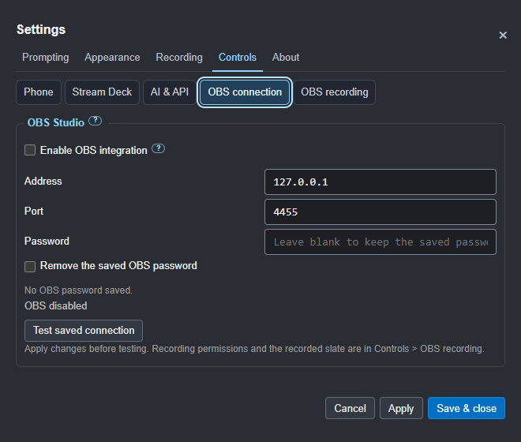
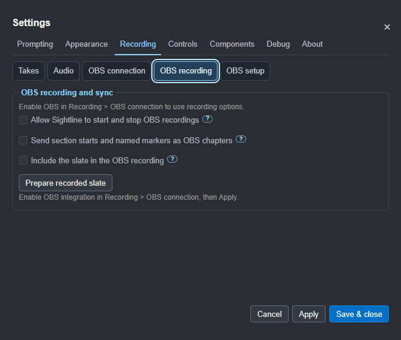

# Recording with OBS Studio

**1.0.7 release candidate: built, not publicly released.** These instructions
describe roadmap item 52 in the local Windows test build. Use the private
Stream Deck **0.1.9** companion for the recording keys. The published 1.0.6
app does not contain this OBS integration. Follow the
[acceptance test](14-acceptance-test.md) before approving the recording workflow.

Sightline connects to OBS Studio's built-in WebSocket interface. OBS handles
the audio and video recording; Sightline handles the script, takes and edit
information. You do not need a separate OBS plugin, Stream Deck or MCP server.

For the session checklist and which files to send to Production, follow
[From recording to the editor](12-production-handover.md).

## Connect once

1. In OBS Studio 28 or later, open **Tools > WebSocket Server Settings**.
   Enable the server and authentication. Note its port and password.
2. In Sightline, open **Settings > Recording > OBS connection**. Tick **Enable OBS integration**.
3. Use **127.0.0.1** for OBS on this computer. Enter OBS's port (normally
   **4455**) and password, then click **Apply**.
4. Click **Test saved connection**. Test uses the saved values; apply any
   changes first. A failed test shows a reason without starting recording.

The screenshot uses an isolated test server, so its port differs from OBS's
usual default. The password field never displays a saved password. Leave it
blank to keep the existing one, or select **Remove the saved OBS password**.
Passwords use the operating system's protected storage and are excluded
from settings exports and the local control API. On Linux a working keyring
is needed; Sightline does not fall back to plaintext password storage.

The connection is off by default. Disabled means no OBS socket, polling,
reconnection attempts or commands. Disabling or quitting Sightline leaves
OBS recording. Apply or Save the disabled setting to disconnect.

OBS on another computer can be addressed by hostname or IP, but this initial
integration uses unencrypted WebSocket. Use it only on a trusted network;
the default is this computer. There is no automatic network discovery.

## Watch status, or enable recording controls

Leave **Allow Sightline to start and stop OBS recordings** off for status
only. Sightline shows whether OBS is recording, paused or stopped, with
the same information in its control window. A lost connection shows
**recording status unknown**; it does not claim the recording stopped.

In **Settings > Recording > OBS recording**, enable recording controls to get **Record take** and **Finish recording**
beside the script, in the control window and on the phone remote:

- **Record take** checks OBS first. If OBS is stopped, it asks it to record,
  waits for confirmation and then starts Sightline's usual countdown,
  slate and prompting. If OBS is already recording, it uses that recording.
  An OBS recording paused externally must be resumed in OBS first.
- **Finish recording** stops prompting and asks OBS to finish its recording.
  If confirmation fails, inspect OBS before assuming recording has stopped.
- **Play, Pause, Again and On air** keep their existing behaviour. They
  do not start, pause or stop OBS. You can pause or repeat sections while
  OBS makes one continuous recording.

With voice commands listening, say **"Prompter, record take"** or
**"Prompter, finish recording"**, using your selected wake word. In a
stopped prompter, use the Always listening option if you want to start
hands-free. These commands require OBS integration and recording controls.
They do not enable the integration themselves.

The local API accepts `obs-record` and `obs-finish` as command actions,
subject to the same saved permissions. Request acceptance means the action
was dispatched, not that OBS has confirmed it: inspect `status.obs`.
The private companion Stream Deck test build **0.1.9** includes **Record take
(OBS)** and **Finish recording (OBS)** keys. They use these same permissions
and show stopped, recording, paused, confirming or unknown. Unsupported,
disabled and status-only app states block recording requests. These keys
are separate from ordinary Play/Pause and On air.

Each model has a separate sample profile ending in **OBS**, selected
explicitly with **Use the OBS recording profile** on a key's settings page.
Standard layouts keep their assignments. This is development code, not a
public Marketplace release. See [Stream Deck setup](06-remotes-and-screens.md#stream-deck).

## Put the slate into the recording

This is optional and needs OBS on the same computer, with recording controls
enabled. It uses OBS's included Browser source, not the protected head guide.

1. Stop recording and streaming in OBS.
2. In **Settings > Recording > Takes > Slate**, choose **Flash and beep** or **Flash**.
3. In **Settings > Recording > OBS recording**, tick **Include the slate in the OBS recording**,
   then **Apply** and **Prepare recorded slate**.
4. Preparation adds or updates only **Sightline recorded sync** above the
   current scene. It leaves your camera, microphone, profile and scene choice
   alone. The source is transparent between slates. Its audio goes directly
   to OBS track 1, without speaker monitoring; include track 1 in the recording.
5. Use **Record take**. Keep the normal scratch audio enabled for an independent
   microphone reference. Check a short recording before the full session.

Prepare again after restarting Sightline or changing scenes. The status line
shows whether the source is ready. Hidden, moved, cropped or muted sources
are declined. If the requested recorded slate fails, prompting holds while
OBS stays recording, so you can inspect the setup. No slate is sent while
OBS streams. Turning the option off closes its loopback service. The cached
source remains transparent if Sightline closes or it is reloaded offline.

The edit pack includes `recorded-sync.json`: section, take, reference ID,
render acknowledgement, recording identifier and an estimated OBS position.
Export after stopping to resolve the main recording's final filename.
**Ready and acknowledged do not mean the recorded file has been verified.**
Locate the flash and tone in that file before relying on their timing.

The recorded reference is digital. Camera video and microphone audio take
different paths, and the browser tone can reach the file after its flash.
It does not measure camera lip sync. Make a visible hand clap in front of
the camera, with the microphone in its normal position, to check that.

## Separate clean camera and microphone

The ordinary OBS connection needs no extra plugin. A second camera file
alongside the composed recording can use the optional
[Source Record filter](https://github.com/exeldro/obs-source-record).
This is configured in OBS; Sightline does not install or enable it for you.

Add Source Record to the camera source, with **Record mode: Recording**, a
separate output folder, full camera resolution and PCM audio where supported.
For the independent microphone, enable **Different audio**, choose the RØDE
source and set **Audio track: None**. In Source Record this selects the named
source instead of a numbered mixed OBS track. Choosing track 1 would include
the composed mix, even with a microphone selected. Keep microphone filters
off if Production needs audio before OBS processing.

The workstation check produced separate 3840×2160/30 fps camera and composed
files with 48 kHz/24-bit PCM. Extracting each PCM stream to WAV preserved its
samples exactly. The clean camera excludes the digital slate; the clean mic
still hears room sounds, including the local prompter beep. Keep those files
with the edit pack. Sightline resolves the main OBS file automatically, not
Source Record's separate filename or start offset. Use scratch audio or the
physical clap to align that recording; do not assume the two files start
together. See the [recorded workflow check](../RECORDED-SYNC-VALIDATION.md).

PCM is stored inside the MOV recording here. Your editing workflow can copy
that audio stream to a standalone WAV without re-encoding; the workstation
check used FFmpeg. Sightline does not automatically extract master WAVs.

## Chapters, file links and editing

Enable **Send section starts and named markers as OBS chapters** if wanted.
It also needs recording controls, a version of OBS exposing chapter
requests, and a compatible output format such as Hybrid MP4. Unsupported
chapters do not prevent prompting or recording; Sightline's own markers
are still saved. Chapter support is checked by capability, not assumed
from the OBS version number alone.

The take log and edit pack's `take-log.json` gain an optional `obs` array
of observations. It includes a recording identifier, observed state and
duration, and the output path when OBS supplies it, normally on stop.
The actual OBS video is not copied or moved into the edit pack.

These observations are control-message timing, not frame-accurate sync.
Keep the slate or scratch-audio synchronisation when accuracy matters.
Save or export the active script's edit pack after recording has finished
to include its confirmed file reference. Earlier exports are not rewritten.
The same-session recording ledger also links the final path to saved logs
for scripts used earlier in that recording. A connection break or app restart
can leave a file reference unknown; do not guess the association.

New takes and markers retain estimated positions against recent OBS clock
samples, with their age and uncertainty. Stale clocks and unverified split-file
offsets are left unknown. The edit pack also freezes the script version
actually read and the guide's ideal/actual poses and live window bounds.
See the [edit-pack contract](../EDIT-PACK.md#recording-script-snapshots-development-branch).

Publication is held until the exact script, recording-to-take references,
guide exclusion, separate clean camera/microphone tracks and recorded
picture-and-sound sync route have all been validated. A protected preview
overlay alone does not establish physical camera lip sync.

## If the connection fails

Check OBS is open, its WebSocket server and authentication are enabled,
and the address, port and password match. Sightline retries an enabled
connection. It never automatically stops OBS, changes its scenes, starts
a livestream or changes recording settings.

Before release, all five production checks still need to pass. A real
synthetic-speech test verified 3840×2160 video, 48 kHz/24-bit PCM stereo,
chapter creation and WAV extraction with unchanged samples. Recognition
of the original quiet microphone capture was partial. Controlled analysis
later recovered every sentence with a level boost and the existing aligner
reached the last word; [investigation details](../VOICE-VALIDATION.md).
No microphone gain or master audio was changed. The later recorded-source
and clean-camera checks passed on the workstation; normal speech, physical
camera lip sync and Stream Deck hardware still need checking. An OBS dock
and scene switching are follow-up work.

OBS may acknowledge a recording command before its output changes state.
Sightline waits for confirmed status before starting prompting or reporting
that recording finished. A timeout leaves the result unknown. Disabled,
status-only and disconnected Finish commands leave ordinary prompting alone.

See [OBS's connection guide](https://obsproject.com/kb/remote-control-guide)
and [recording chapter support](https://obsproject.com/kb/hybrid-mp4).
