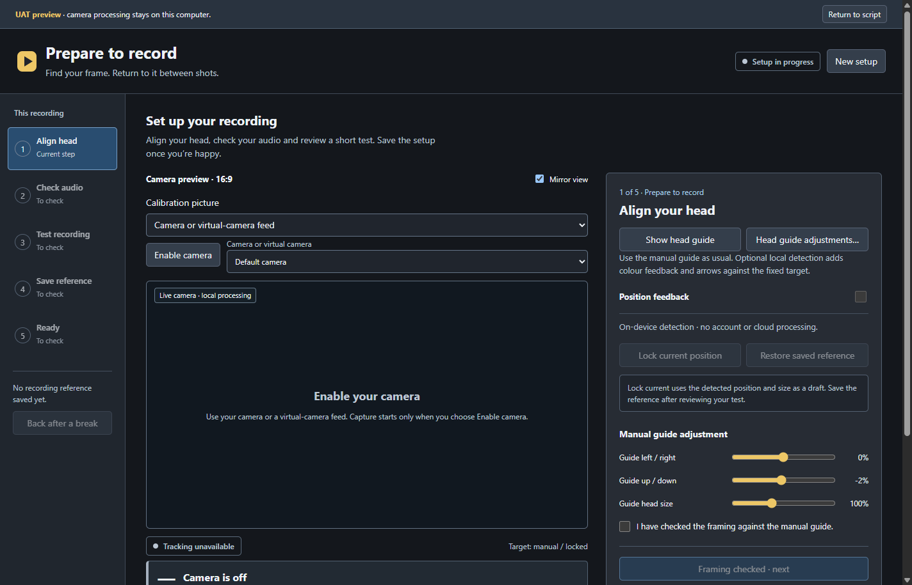
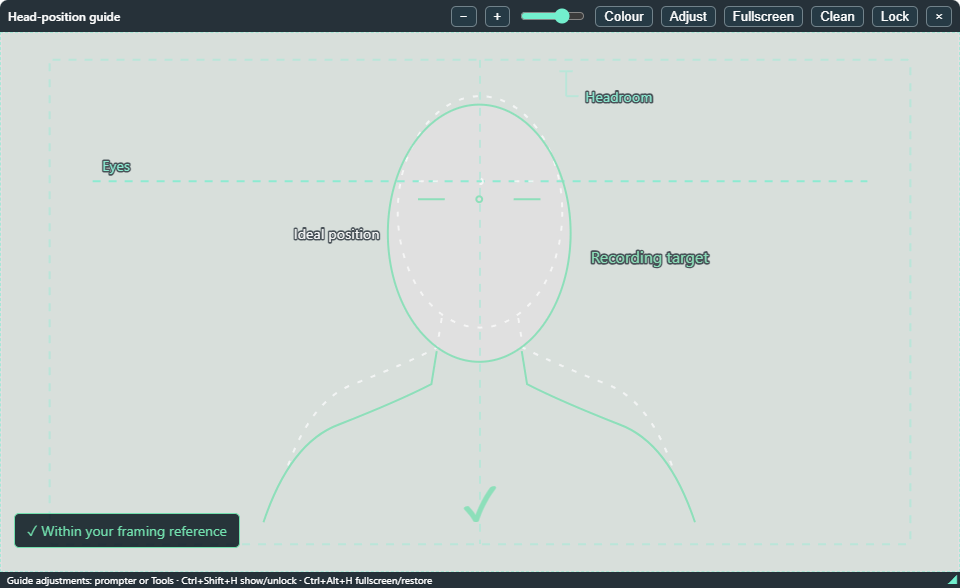
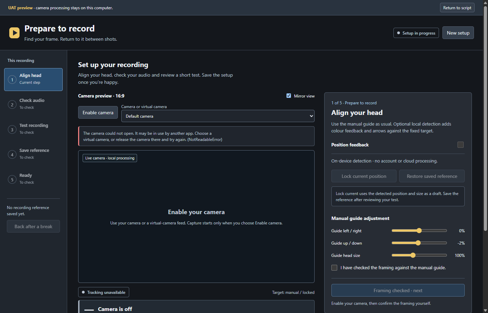

# Prepare to record

This workflow is included in the **1.2.0 candidate**. It uses the approved
pre-record layout with real local camera detection, microphone measurement and
a short recorded test. It supplements the existing manual Head guide.

Open **Tools > Prepare > Prepare to record**, or **Settings > Prepare to record >
Overview > Open workflow**, or use the main **Prepare to record** toolbar action.
Pause prompting and stop production
recording first. The preparation window is non-modal.

Test results appear in **Settings > Prepare to record > Overview**
and on the main prompter. A saved clip initially says **Review required**.
Review its picture and sound, confirm both, then select **Test checked** to pass.
Use **Test failed · retry** to retain a failed result while correcting the setup.
Changing the preparation setup marks it for recheck. An earlier saved test is
labelled as previous; it does not automatically validate today's recording.
The room/voice check shows its meter on the prompter using the same microphone
measurements, without opening a second capture stream.

## Align the shot

RC 4 uses the existing **Ctrl+Shift+H head guide** for live feedback as well as
manual alignment. Show the guide or open Head guide adjustments from this step.
Its position, size, manual shape and recording reference are shared. Lock current
in either view updates the same draft; it never replaces Ideal automatically.
Use the guide's normal placement/size controls to match the camera/projector
picture. Keep the same crop and aspect ratio; this is not automatic window fitting.

This isolated test capture shows the transparent guide without the desktop
picture behind it. In use, place it over the matching camera/projector picture.

When OBS integration is enabled and available, Calibration picture offers
**OBS scene preview** and a visible **OBS scene** list. Choose the scene matching
your projector, then Enable OBS preview. Sightline reads local preview frames;
it does not switch programme/recording scenes or start a recording. Changing
source/scene stops the old feed and requires explicit enable of the new one.
Disabled/unavailable OBS hides these options in preparation and the head guide.

**Temporary OBS virtual camera** is an optional alternative. Enable it explicitly.
Sightline stops that virtual output when capture ends only if it started it;
an already-running virtual camera is retained. A lost OBS connection may require
checking its virtual-camera state manually. Generic camera/virtual feeds remain.

Choose the camera or virtual-camera feed that matches your production picture,
then select **Enable camera**. Selecting an input while capture is off does not
start it. RC 3 lists the inputs before capture and leaves the selector available
if an attempt fails. Errors appear beside these controls, with a recovery hint.
If your recording app owns the camera exclusively, choose its virtual camera
or release the physical camera there, then try Enable camera again. Device
changes refresh the list; they do not start capture automatically.

The preparation view uses a centred 16:9 crop; verify that your recorder uses
the same framing. Mirroring changes the view and arrow direction, not the file.

The manual guide remains available. With **Position feedback** off, adjust the
guide and explicitly confirm your framing. Turn feedback on for local detection:
green means eye position and apparent face size are within tolerance, amber is
close, red asks for a correction, and grey means no reliable single face.
This estimates placement; it does not trace hair, identify you or correct gaze.

Distance guidance uses apparent face width, not a measured distance in metres.
The next candidate after RC 4 corrects this comparison to include the guide's
Width and left/right adjustments as well as overall Size. Its distance hint
shows face size as a percentage of that target: move towards 100%, with a
95–105% size tolerance. Eye position must also match before the guide turns green.
The target stays fixed while you move. Lock current keeps the custom proportions.

**Lock current position** makes the measured position a draft target. It does
not save or replace your recording reference. Manual adjustments change this
draft. The model is bundled; there is no API key, cloud processing or download.

## Check audio and review a real clip

Select your microphone and run the check. Remain quiet briefly, then speak when
prompted. Sightline measures room level, voice level and peaks without changing
gain. Quiet, noisy or clipping results are advisory: acknowledge the warning,
make a test and listen before deciding whether to change gain. An absent or
unusable signal needs correcting.

Record a short test, up to eight seconds. **Review test recording** plays the
actual camera-and-microphone WebM. Check picture and sound before accepting it.
The guide is not burned into this camera recording. The test does not start a
production recorder or verify OBS's actual recording route. An OBS-scene test is a sampled preview
with the selected microphone, rather than the production encoder's output.
Review the actual production file separately for picture/sound sync.

## Save and return after a break

**Save recording reference** explicitly stores the target, camera/resolution,
microphone, measured audio baseline and reviewed test location in this profile.
It also saves a compatible manual Head guide reference, retaining Ideal.

**Restore saved reference** or **Restore after a break** recalls that fixed
target. Align yourself and recheck audio. It retains the original target and
test; current movement never silently replaces them. A different camera or
resolution requires a new setup. **New setup** retains the old reference until
you explicitly replace it after a new test. Returning to the script releases
the preparation microphone. Position feedback can continue while the head guide
is visible; hiding both views or disabling feedback releases its picture feed.
Preparation leaves production recording stopped.

## Storage and limitations

Test clips are in this profile's `pre-record-tests` folder. They stay local and
are not included in reading themes or shareable settings exports. Review them
before sharing diagnostics or recordings. Existing test clips are retained;
delete unwanted clips from that folder when they are no longer needed.

Detection works best with one well-lit face near the camera. Multiple faces,
turning away, occlusion or camera loss produces an unavailable state. Use the
manual guide when automatic feedback is unsuitable. The Windows UAT validates
the software path with synthetic devices; your camera, microphone, framing and
recorder still need the acceptance check. macOS and Linux hardware checks remain
outstanding.
