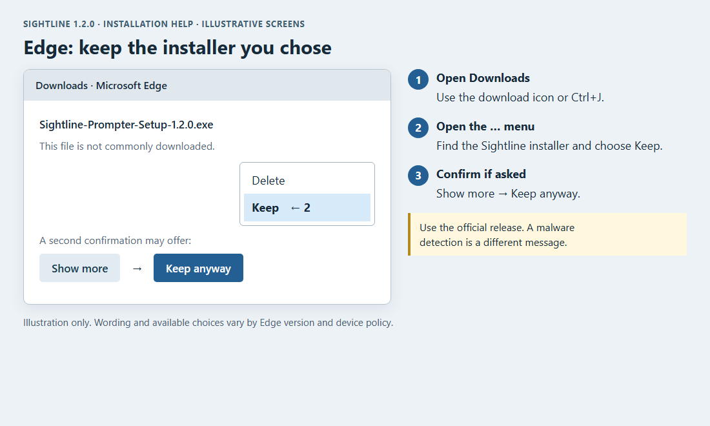
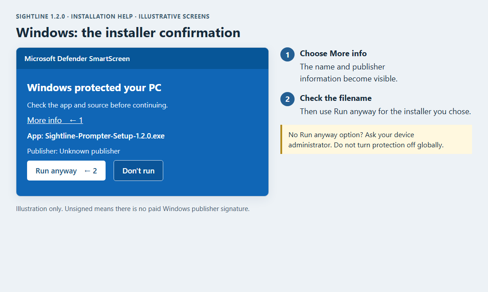
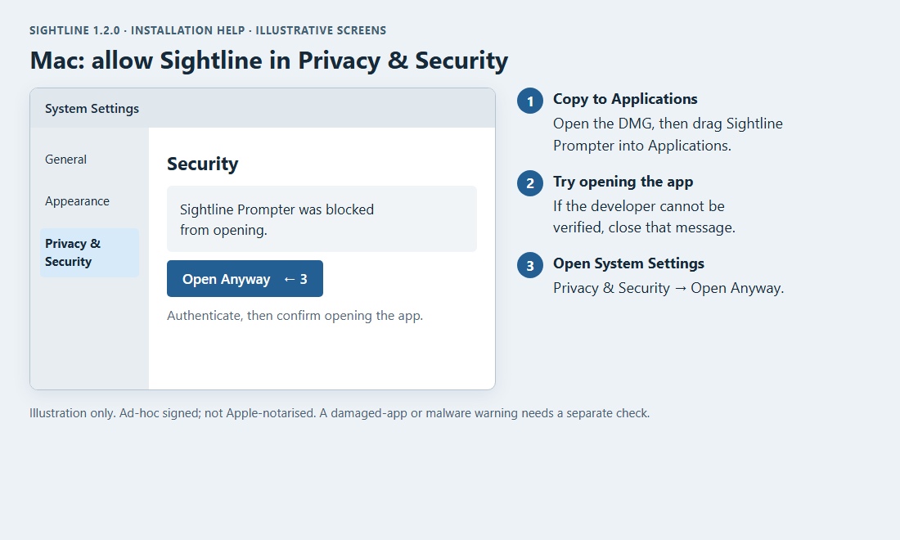

# Download and install Sightline

**Sightline 1.2.0 — Windows installers are unsigned. Mac apps are ad-hoc signed
and are not Apple-notarised.** Your browser or operating system may ask for
an extra confirmation. The steps below apply to a download you have chosen
from the [official Sightline release](https://github.com/JoJo-1965/sightline-prompter/releases/tag/v1.2.0).

The pictures are **illustrations**, not screenshots from your computer.
Wording and available actions can vary with browser/OS version and device policy.

## Choose the right file

| Computer | Release asset |
| --- | --- |
| Windows 10/11, x64 | `Sightline-Prompter-Setup-1.2.0.exe` |
| Mac with Apple silicon | `Sightline-Prompter-1.2.0-arm64.dmg` |
| Mac with Intel processor | `Sightline-Prompter-1.2.0-x64.dmg` |
| Linux | The `.AppImage` or `.deb` for your system |

On a Mac, **Apple menu > About This Mac** shows Chip for Apple silicon or
Processor for Intel. For an update, save any draft and close the older app first.
Personal scripts and recordings are retained.

## Microsoft Edge: keep the download

If Edge reports that the installer is **not commonly downloaded**:

1. Open Edge's **Downloads** list (the download icon or **Ctrl+J**).
2. Find the Sightline installer, open its **…** menu and select **Keep**.
3. If another confirmation appears, choose **Show more**, then **Keep anyway**.
4. Open the saved installer. Windows may then show its separate confirmation.



This flow follows [Microsoft's Edge download guidance](https://learn.microsoft.com/en-us/troubleshoot/microsoft-edge/development/download-failures).
Other browsers can also show a keep/confirmation step. Use their Downloads
list and read the specific message; do not treat a malware detection as merely
a download-reputation warning.

## Windows: run the installer

If you see **Windows protected your PC**:

1. Choose **More info**.
2. Check that the app is the Sightline installer you downloaded. Because this
   build is unsigned, Windows may show **Unknown publisher**.
3. Choose **Run anyway**, then continue through the installer.



If **Run anyway** is absent, or you see **Smart App Control blocked an app**,
your device policy may not allow this per-app choice. Ask the administrator
rather than disabling SmartScreen, Smart App Control or antivirus globally.
An antivirus quarantine is a separate issue: check its exact detection and
the file's source/hash before proceeding.

## macOS: copy the app, then allow it

1. Open the correct `.dmg` and drag **Sightline Prompter** to **Applications**.
2. Open it from Applications. If macOS cannot verify the developer, close
   that message without moving the app to the Bin.
3. Open **System Settings > Privacy & Security** and find the Security section.
4. Beside the blocked Sightline app, choose **Open Anyway**. Authenticate when
   asked, then confirm opening the app.



See [Apple's current instructions](https://support.apple.com/102445).
Ad-hoc signing checks bundle integrity; it is not Apple notarisation or a
paid Developer ID certificate. An “app is damaged” or malware message is not
the same as an unverified-developer prompt. Re-download the matching installer,
compare its checksum and report the exact message if it persists. If your
organisation blocks the app or offers no exception, use its support process.

## Check a downloaded file

The release includes **SHA256SUMS.txt**. Compare the hash of the installer
with the matching filename in that file. A matching hash checks file integrity
against the published release; it is not a security review of the app.

On Windows PowerShell:

```powershell
Get-FileHash "$env:USERPROFILE\Downloads\Sightline-Prompter-Setup-1.2.0.exe" -Algorithm SHA256
```

On a Mac:

```sh
shasum -a 256 ~/Downloads/Sightline-Prompter-1.2.0-arm64.dmg
```

Use the Intel filename instead if that is your download. You do not need to
send a password or API key to install Sightline. If asking for help, include
the filename, app/OS/browser versions and the message, without private credentials.

[Continue with Getting started](01-getting-started.md)
· [Support](https://github.com/JoJo-1965/sightline-prompter/issues)
