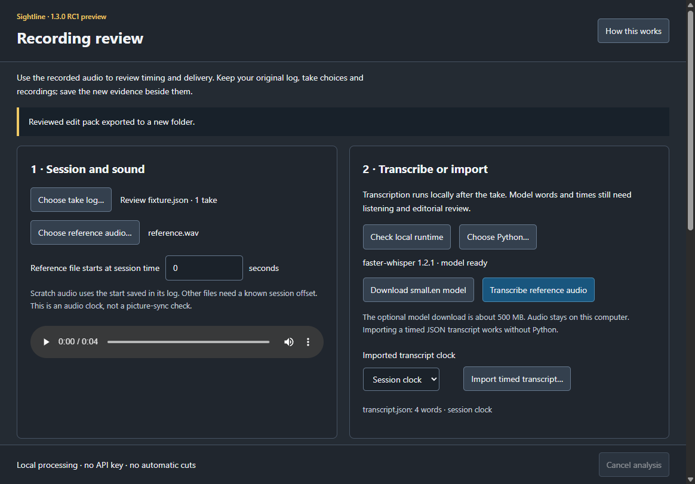

# Review the recorded audio

**1.3.0 RC1 preview · Windows tested.** This workflow adds evidence after a
session. Original logs, recordings, ratings and keeper choices stay intact.
Live following is useful for prompting; its times are not final edit points.



## Open a finished session

Choose **File > Review recorded audio…**, or open **Files > Recordings**,
select a session and choose **Review recorded audio…**. The same action is
available in **Settings > Recording > Takes**. The review is a separate,
nonmodal window; normal Settings keeps its approved layout.

Choose the finished take-log JSON. Scratch audio is found beside the take logs
or in an exported edit pack when present. Missing older scratch files do not
prevent choosing another valid reference. Pause prompting and finish the
production recorder before analysis. Starting a take during analysis stops
the worker and retains the previous saved review.

The reference file's **start in session seconds** maps its local clock onto the
take log. Sightline fills the saved scratch start. For another soundtrack,
enter a known offset; changing files clears an unknown start instead of
silently reusing the previous file's value.

## Local transcription

Transcription is explicitly started after recording; it does not run silently
on every pause. It needs an optional Python environment with faster-whisper,
PyAV and SciPy. RC1 does not bundle that runtime into the installer.

On Windows, one way to prepare it in PowerShell is:

```powershell
py -3 -m venv "$env:LOCALAPPDATA\Sightline\ReviewRuntime"
& "$env:LOCALAPPDATA\Sightline\ReviewRuntime\Scripts\python.exe" -m pip install faster-whisper==1.2.1 av==19.0.2 scipy==1.18.1
```

On macOS/Linux, the equivalent environment uses `python3 -m venv` and its
`bin/python`. These preview platforms have not received native acceptance for
the new review workflow. Basic prompting and JSON import do not need Python.

Choose that Python executable, then **Check local runtime**. **Download small.en
model** is an explicit, one-off network download of roughly 500 MB. Audio is
not uploaded, no API key is used, and transcription requires the cached model.
The CPU worker reports progress and has **Cancel analysis**. Closing the review
window also cancels the running worker. A cancelled or failed job preserves
the last saved review and original files.

Choose **Transcribe reference audio**. RC1 is English-only and supports selected
audio inputs up to 90 minutes. Short, named sections give the most useful
comparison. Unusually large takes can require splitting for script alignment.

Primary runtime references: [faster-whisper](https://github.com/SYSTRAN/faster-whisper),
[PyAV audio API](https://pyav.org/docs/stable/api/audio.html) and
[SciPy correlation](https://docs.scipy.org/doc/scipy/reference/generated/scipy.signal.correlate.html).

## Import a transcript instead

**Import timed transcript…** accepts a JSON word list, an object with `words`,
or segments containing word lists. Supported fields are `word/start/end` or
`w/s/e`, with optional probability. Times must be finite and ordered; invalid
input is refused. Choose **Session clock** when the word times already use the
take log. For **File clock**, enter the file's known session offset first.
Import does not need Python or a model download.

## Compare script and performance

The report shows script text, heard text and candidate substitutions, insertions
and omissions with listening ranges. Low agreement is labelled uncertain
instead of asserting missing words. Sections with only one take are prioritised
for listening. A different transcript can still mishear a correct performance;
these are review suggestions, never confirmed errors or automatic pickup orders.

**Listen** plays the reference around the candidate using its session mapping.
The transcript does not change the script or choose different keeper takes.
Post-record pace is an overall estimate; the old bunched live speaking-speed
figure is not reused as a measured value.

Command attempts have suggested cut ranges, including attempts the live listener
did not execute. Live callbacks add recognised/unmatched/blocked outcomes when
available; older recordings can only report execution as unknown. Quoted command
phrases may belong in the performance, so inspect every range before removal.
Raw live command speech still requires the existing command-trace preference;
the new default callback record stores action/outcome and estimated times.

## Align each master or clean-camera file

Add a recording and choose **Measure audio offset**. Sightline compares three
soundtrack windows against the scratch audio. A clear, consistent match records
its method, correlation checks, estimated offset and clock allowance. Silence,
repeated patterns, weak matches or inconsistent offsets remain uncertain;
no candidate is silently applied as a measured offset.

Each file has its own zero:

```text
recording time = session time − sessionOffsetS
```

SHA-256 hashes identify analysed media. Changed input size/time or a changed
source log invalidates saved evidence. **Audio alignment is not picture sync.**
Check a visible clap or the recorded flash/tone in the actual camera file.
The recorder-start reminder appears only after a confirmed recording state;
claps before Record do not verify the resulting file. Automatic clap recognition
and a verified camera latency estimate are deferred.

## Export the reviewed pack

The report is a fingerprinted sidecar in the preview profile's
`recording-reviews` folder. Matching reviews are included in normal saved-session
exports. The review window can export a new folder with the original source log
copied verbatim; existing folders and production media are not overwritten.

- `words.csv`, `sentences.csv` and draft captions use post-record evidence.
  Existing CSV columns are retained, with evidence fields appended.
- `live-*` retains the original word, sentence, caption, pace and edit-mark files.
- `delivery-review.csv` lists expected/heard candidates and single-take priority.
- `edit-marks` includes reviewable command start/end ranges and outcome evidence.
- `transcript.json`, `post-record-review.json` and `recording-offsets.json` retain
  provenance, file identity, clock mapping and practical limits.
- `timing-quality.json` and `TIMING-NOTES.md` say review is required. No automatic
  cutting, caption publication or verified picture-sync pass is implied.

The pack contains recognised speech and local file references. Share it
deliberately with your editor; Sightline does not send it to an AI service.

[Recording workflow](05-recording-a-take.md) · [Production handover](12-production-handover.md)
· [Guided tour](20-guided-tour.md)
