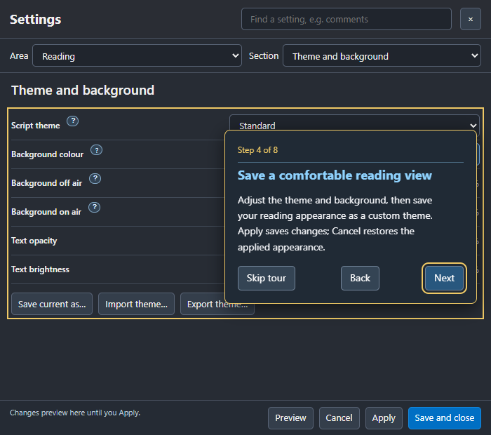

# Take the guided tour

Open **Getting started > Take a guided tour…** in Settings, or choose
**Help > Take a guided tour…**. A new profile offers the tour once; **Not now**
dismisses that offer. You can rerun the full tour whenever useful.

Coach marks point at the real Settings controls. **Next** and **Back** move
through script setup, reading mode, text, themes, recording preparation,
connections and post-record review. OBS, Stream Deck and AI/MCP steps appear
only when the corresponding integration is enabled.

**Skip tour** or **Escape** ends it immediately and removes the highlight.
The final **Finish** button closes the tour. Rerunning starts at the beginning.
Cards fit compact Settings windows and remain keyboard reachable.

The tour navigates pages; it does not Apply preferences, select a device,
download a model, start a microphone/camera or control your recorder.
Existing unapplied Settings edits remain a draft. Pause prompting and finish
recording before starting the tour. Use the built-in guide for detailed setup.

[Getting started](01-getting-started.md) · [Prepare to record](16-prepare-to-record.md)
· [Post-record review](19-post-record-review.md)
