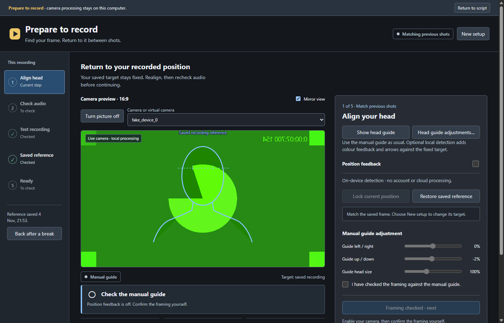

# Controller functions — RC2 preview

Use these with Sightline **1.3.0 RC2** and companion **0.2.1.1**. Existing keys
continue to work. New assignments are optional; no conversion is required.

## One function per key

Drag a grouped entry from Stream Deck's Sightline Prompter category. Select its
**Function** in the Property Inspector. The key changes to that function's icon;
pressing it executes directly. Use Test connection to check the app version,
session and any disabled reason. This is a settings selector, not a menu that
opens when the key is pressed.

| Entry | Functions |
| --- | --- |
| Navigation | Next, Previous, Top, Again / restart section |
| Take utilities | Marker, return to marker, Keeper, Scrap |
| Pace / Text size | Faster, Slower, Reset pace / Bigger, Smaller |
| Display / Mirror | On air, eye-line, click-through / mirror axis or cycle |
| Reading mode | Notes/pages, Voice, Scroll, cycle available modes |
| Head guide | Show/unlock/hide, adjustments, fullscreen, eye lock, ideal visibility, Match ideal, Lock detected position, Restore recording reference |
| Audio and listening | Sound meter, listening on/off, restart listening |
| Windows and panels | Existing live Layout/Reading/Recording panels, pad, operator window |
| Recording setup | Prepare, room/voice check, test start/stop/play, save checked reference, back after a break |
| Recorder utilities | Explicit OBS pause / resume |
| Recording review | Open logged session; export reviewed edit pack |
| Status display | Recorder, framing or preparation; optional press action |

Play/pause, Record take, Finish recording and Script slot remain focused
entries. **Again** reuses the section retake operation; **Top** retains the
existing restart operation. Match ideal changes the actual shape to the saved
Ideal; Restore recording reference uses this recording's saved pose. Lock
detected position creates a draft target and does not save or replace the Ideal.

## Prepare and return

1. Press **Prepare to record**. Select and explicitly enable the calibration
   picture in the workflow. Use manual alignment or enable local feedback.
2. Lock a detected position if wanted; check and accept framing in the app.
3. Run **Room and voice check**. Stay quiet for the first phase, then speak
   normally. Review the advisory measurements; accept any warnings deliberately.
4. Press **Start test clip** once picture, microphone, framing and audio are
   ready. **Stop test clip** ends early; otherwise the test lasts eight seconds.
5. **Review test clip** plays it in the workflow. Confirm picture and sound,
   then accept the test in the app. A key cannot make these decisions for you.
6. **Save checked reference** becomes available after those checks. **Back after
   a break** restores the saved target for comparison; it does not redefine it.

Preparation is blocked while prompting or OBS recording is active. Capture
does not start when installing the plugin or assigning a function. Test clips
are separate local preparation clips, not the production master.

## Recorder, review and dials

Pause/resume requires OBS integration enabled, recording controls allowed and a
confirmed compatible state. It is distinct from ordinary prompting pause.
Finish recording keeps its one-second default hold, including cancellation
and the existing explicit opt-out setting.

Open recording review selects the current script's logged session. Export
reviewed edit pack requires fresh matching analysis and opens the destination
chooser. There is no automatic transcription or overwriting of originals.

The **Adjustment dial** selects a turn purpose. Default press/tap resets pace,
does nothing for text size, plays/pauses for scrolling/sections, or toggles On
air for backing. Override it explicitly or choose No action. Pace/size repeat
at most five steps per event; Sections moves once per rotation event. Existing
focused dial assignments retain their original turn and press behaviour.

## Pad, phone and migration

Validation screenshot uses a synthetic picture and tone, not a camera/detection
acceptance result. It shows the actual workflow after saving and restoring a
checked reference. The approved Settings composition remains unchanged.

In **Connections > Pad and phone**, add functions from the grouped picker.
Your saved button IDs, order, columns and Finish hold setting stay unchanged.
Mapped keys/controllers use the same operation guards. Disabled interfaces
retain their saved assignments.

The optional **Sightline Virtual RC2** and **Sightline Plus RC2** profiles are
separate test layouts. Import them rather than replacing an existing profile.
The on-screen Virtual Stream Deck is device type 11; MCP Deck is a separate
device and is not the same interface.
