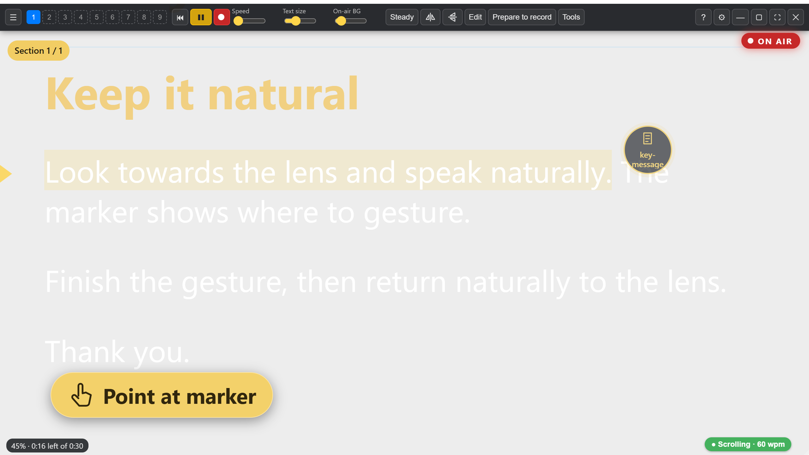
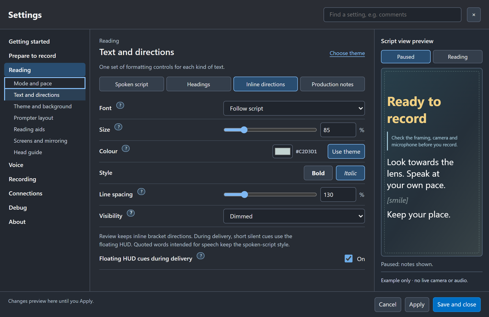

# HUD directions and pointing targets

Sightline **1.3.0 RC4 preview** adds a head-up display for short delivery cues.
It works without OBS. Start reading a take to see a gold cue such as Smile or
Point at marker. Pause to review the original inline square-bracket directions.
Starting a take in Sightline does not by itself prove a production recorder is on.



## Write the cue in the script

```md
[smile]
I can look towards the camera and speak naturally.

[point left: growth-chart]
Here is how the figures changed.
```

The script controls when a cue appears; a gesture needs no separate device key.
Short cues and graphic labels stay silent. Quoted `[Say: "Thank you"]` words
remain spoken and inline. Long `<!-- production notes -->` show while paused
and hide during delivery. Curly-brace pause/record commands remain app controls.

## Framing and direction

Use Prepare to record to align the shared head guide and save your reference.
Each side target sits halfway between that head edge and the prompter edge,
at the same level just below the saved eye line. It stays still during the
gesture. Words scroll in front of it. Complete the gesture, then return to
the lens. Left/right mean your own sides while presenting, not a prescribed hand.
Mirroring accounts for the displayed orientation; editors still check the output.

Up, Down, diagonals and Centre also use the shared reference. A guide on a
different screen cannot supply a usable target for this prompter view; align
the guide on the intended screen first. No camera capture starts from a cue.

## Visibility and controllers

In Reading > Text and directions > Inline directions, use **Floating HUD cues
during delivery**. Existing Hidden direction visibility also suppresses cues.
Review mode keeps your existing inline font/style preferences. Turning the HUD
off changes no script, recorder or take selection.



In Connections > Pad and phone, optionally assign **HUD cues on / off** from
View. Keyboard/clicker and game-controller mappings can use the same action.
Companion preview **0.2.1.6** adds it under **Display > Function** with a HUD icon.
Older companions continue their existing controls. No separate smile/left/right
keys are needed; small decks and pedals can keep their core layouts.

Existing device profiles are retained. Optional Mobile/Virtual 64 HUD RC4
profiles add the key in an unused cell; import only if you want a separate layout.
Your edited profile is never replaced automatically. On air is the backing
control; the OBS recording pill reports the recorder's confirmed state.

Pointing labels and qualified script/take anchors remain in the edit pack.
A cue does not prove a gesture happened or insert a graphic automatically.
