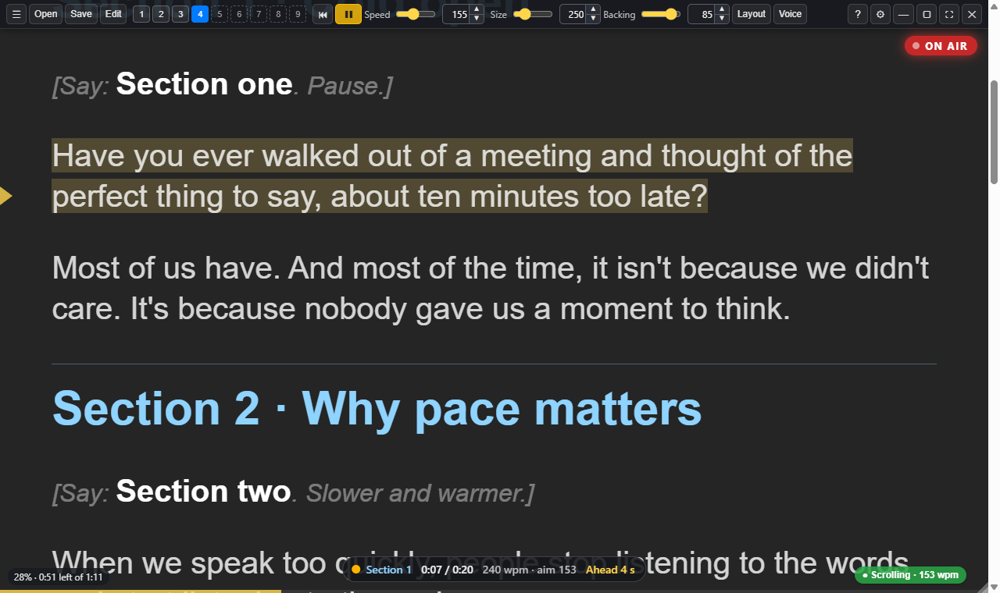

# Sightline Prompter user guide

[1.3.0 candidate release notes — RC1 to RC11](../RELEASE-1.3.0.md)

**Sightline 1.3.0 RC6 preview · companion candidate 0.2.1.6 · documentation revision 22**

Stable download remains Sightline 1.2.0. New preview workflows are described in
[RC6 notes](../RELEASE-1.3.0-rc.6.md); they are not in the stable installer.

New: [Controller functions and migration](21-controller-functions.md).
RC4 adds [HUD directions and pointing targets](22-hud-cues.md), with a gold cue
pill during delivery and the familiar inline directions when reviewing.

RC3 adds [pointing and graphic cues](02-scripts.md#pointing-cues-in-rc3), with
presenter-relative intent carried into the production handoff.

This is the canonical web/wiki documentation and the source of the guide bundled
with the installer. A separate GitHub wiki is intentionally disabled to avoid
diverging copies. Historical RC and preview notes are kept in
[development history](../CHANGELOG-HISTORY.md), not mixed into these instructions.

Sightline keeps your script near the lens while showing the call, slides or
camera picture behind it. Choose steady scrolling, voice following or Notes /
page mode. Voice commands, controllers and your preferred AI are optional.
Keep your normal production recorder; Sightline adds prompting and take context.

[Download 1.2.0](https://github.com/JoJo-1965/sightline-prompter/releases/tag/v1.2.0)
· [Grouped release notes](../RELEASE-1.2.0.md)
· [Feature grid](../FEATURE-GRID.md)
· [Roadmap](../../ROADMAP.md)

## Start or return to a recording

Start with **Files > Sample scripts > Start here: Sightline feature tour** or
**Settings > Getting started > First setup**. The tour works without optional
devices. Before a take, open **Prepare to record**, align the guide, check audio,
review a short test and save a reference. Restore that reference after a break.

## Contents

1. [Getting started](01-getting-started.md): installation, security warnings, first setup and a first read
2. [Writing scripts](02-scripts.md): file types, sections, inline cues, production notes and directives
3. [Scrolling and voice](03-scrolling-and-voice.md): reading modes, voice following and commands
4. [Layout and display](04-layout-and-display.md): fonts, backing, margins, mirroring and reading aids
5. [Recording a take](05-recording-a-take.md): sections, retakes, pacing and take choices
6. [Remotes and second screens](06-remotes-and-screens.md): pad, phone, keyboard, game controller and Stream Deck
7. [Settings](07-settings.md): named sections, controls, previews and save behaviour
8. [Shortcuts and troubleshooting](08-shortcuts-and-troubleshooting.md): input help and recovery
9. [Working with AI](09-working-with-ai.md): script writing, local control and edit-pack review
10. [Setting up your AI](10-setting-up-your-ai.md): installed kit and local API configuration
11. [Recording with OBS](11-obs.md): connection, permissions, linked prompting, states and slates
12. [Production handover](12-production-handover.md): test, sync reference, takes and files for the editor
13. [Settings screenshot gallery](settings-gallery.md): current controls, destinations and example states
14. [Recording acceptance walkthrough](14-acceptance-test.md): checks on your actual camera, recorder and controls
15. [OBS setup assistant](15-obs-setup.md): review a separate profile/scene plan without replacing your setup
16. [Prepare to record](16-prepare-to-record.md): shared guide, local feedback, audio/test and saved reference
17. [Configure MCP](17-configure-mcp.md): client examples, isolated profiles, permissions and revocation
18. [Download and installation help](18-installation.md): Edge Keep, Windows SmartScreen and macOS Open Anyway
19. [Post-record audio review](19-post-record-review.md): local transcription, delivery candidates, command ranges and per-file offsets
20. [Guided tour](20-guided-tour.md): first use, rerun, keyboard navigation and cancellation
21. [Controller functions](21-controller-functions.md): grouped assignments, preparation controls, adjustment dials and migration
22. [HUD cues](22-hud-cues.md): delivery directions, head-relative targets, inline Review and optional controller visibility

Open this guide from **Help > User Guide** or the **?** menu. **F1** shows the
enabled shortcuts. Use Settings search to find a control; use the searchable
feature reference to compare capabilities and requirements.

## Limits and support

Local recognition works offline after the model download; framing detection
is bundled. Optional online services have their own terms. Live word timings
and captions are estimates. The preparation clip does not prove your production
recorder's capture or lip sync. Mac builds are ad-hoc signed and unnotarised.

[Privacy, terms, accessibility and voluntary support](../POLICIES.md) explain
microphone use, local files, online services and Joanne's tip jar. The existing
coffee note recurs at a saved interval of 10–15 launches, deferring while busy.
