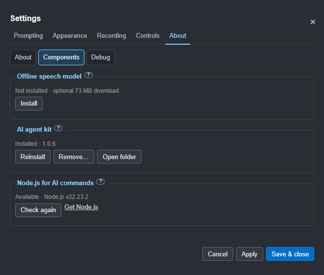

# Settings screenshot gallery

Development preview · 30 October 2026. These images show the OBS test branch;
the release remains on hold. The panel stays the same size across topics.
RC8 gives Settings and Help their own movable windows. The controls shown
below are retained; drag the native title bar to use another screen.

[Full audit and findings](../SETTINGS-UX-AUDIT.md)

[Read the illustrated Settings guide](07-settings.md) for what each choice does.

Jump to [Prompting](settings-gallery.md#prompting), [Appearance](settings-gallery.md#appearance),
[Recording](settings-gallery.md#recording), [Controls](settings-gallery.md#controls) or [About](settings-gallery.md#about).

## Prompting

### Scrolling

### Voice recognition and microphone

### Commands and wake word

### Question-mark help opened

### Your words

### Script behaviour

## Appearance

### Text

### Background

### Reading aids

### Spacing

### Screens

Mirroring has one Settings home here, alongside the window and monitor controls.

## Recording

### Takes

### Audio

## Controls

### Pad and phone layout

The same selected functions and order appear on both screens. Stream Deck
keeps its physical profiles; the pad and phone reuse its artwork and actions.

### Buttons and keys

Choose an action and press an input to learn it. Changes save immediately;
longer lists use pages. System shortcuts stay reserved.

### Phone

The example QR below is for illustration; scan the code in your own Settings.

### Stream Deck

### AI and API

### OBS connection

### OBS recording

## About

### Components

### Debug

Command-word tracing is off by default. The warning stays visible beside its
checkbox; health and recovery logging needs no spoken words.

The session-only capture override applies immediately. Its checked state is
shown below; the prompter also keeps a warning visible with a Turn off button.

