# Settings screenshot gallery

Development preview · 30 October 2026. These images show the OBS test branch;
the release remains on hold. The panel stays the same size across topics.
RC8 gives Settings and Help their own movable windows. The controls shown
below are retained; drag the native title bar to use another screen.

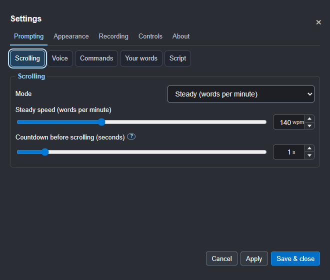

[Full audit and findings](../SETTINGS-UX-AUDIT.md)

[Read the illustrated Settings guide](07-settings.md) for what each choice does.

Jump to [Prompting](settings-gallery.md#prompting), [Appearance](settings-gallery.md#appearance),
[Recording](settings-gallery.md#recording), [Controls](settings-gallery.md#controls) or [About](settings-gallery.md#about).

## Prompting

### Scrolling

### Voice recognition and microphone

### Commands and wake word

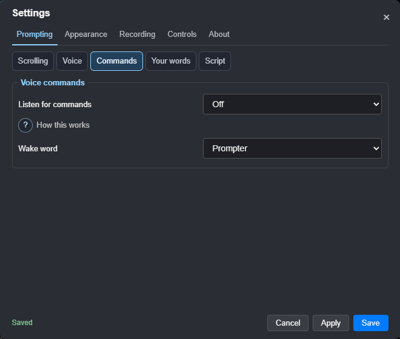

### Question-mark help opened

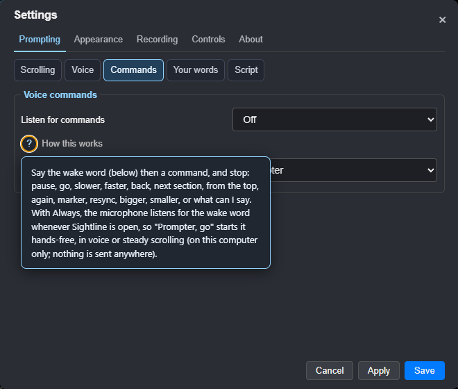

### Your words

### Script behaviour

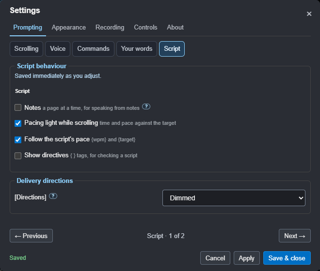

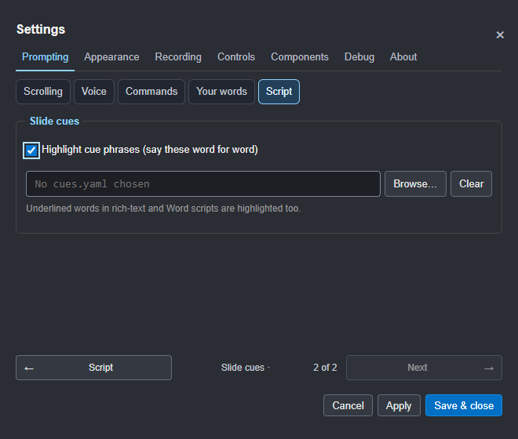

## Appearance

### Text

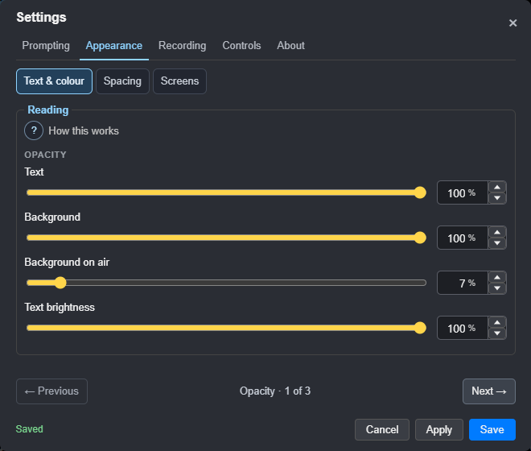

### Background

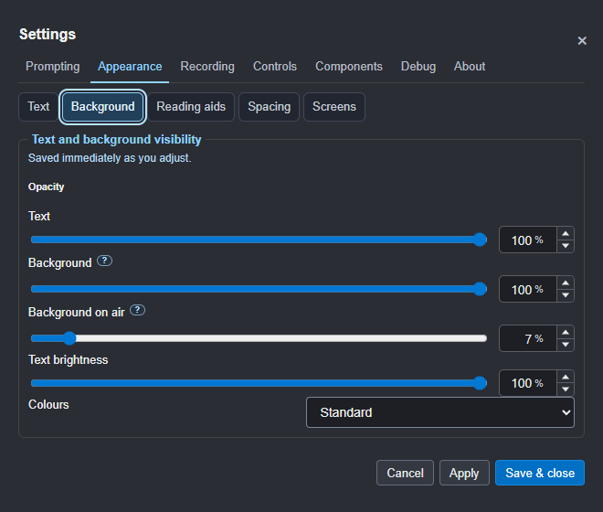

### Reading aids

### Spacing

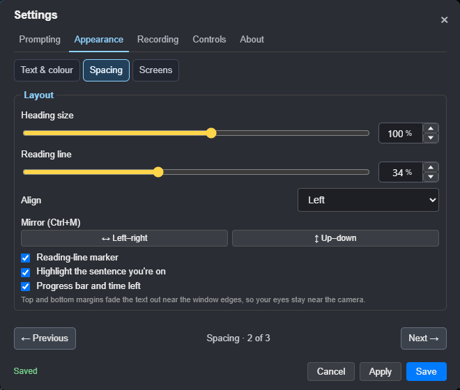

### Screens

Mirroring has one Settings home here, alongside the window and monitor controls.

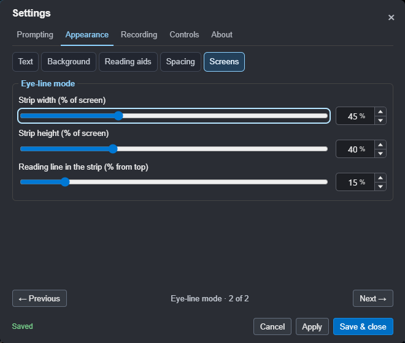

## Recording

### Takes

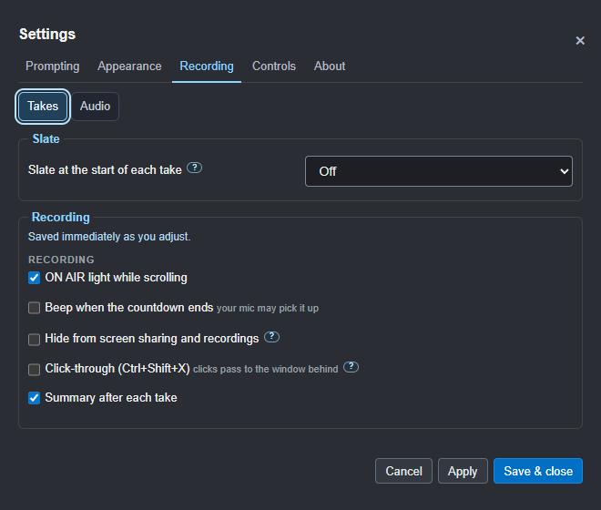

### Audio

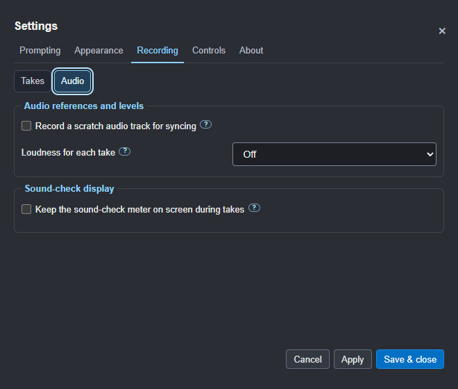

## Controls

### Phone

The example QR below is for illustration; scan the code in your own Settings.

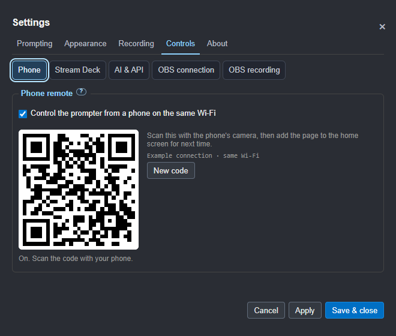

### Stream Deck

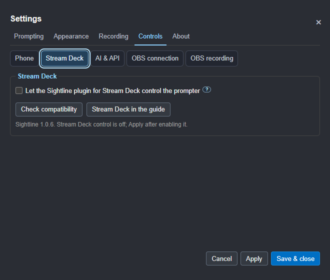

### AI and API

### OBS connection

### OBS recording

## About

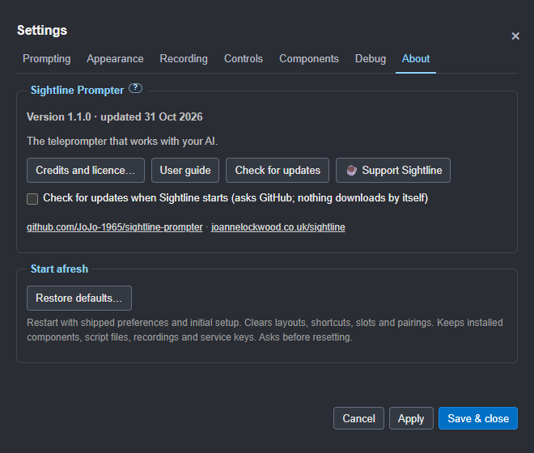
