# Settings screenshot gallery

Source preview · 1 November 2026. Updated images include independent spacing,
visible slate choices, linked recording, destination labels and unified Stream
Deck setup. These next-preview changes are unpublished.
The panel stays the same size across topics.
RC8 gives Settings and Help their own movable windows. The controls shown
below are retained; drag the native title bar to use another screen.

[Full audit and findings](../SETTINGS-UX-AUDIT.md)

[Read the illustrated Settings guide](07-settings.md) for what each choice does.

Jump to [Prompting](settings-gallery.md#prompting), [Appearance](settings-gallery.md#appearance),
[Recording](settings-gallery.md#recording), [Controls](settings-gallery.md#controls),
[Components](settings-gallery.md#components), [Debug](settings-gallery.md#debug) or [About](settings-gallery.md#about).

## Setup and session check

## Prompting

### Scrolling

### Voice recognition and microphone

### Commands and wake word

### Question-mark help opened

### Your words

### Script behaviour

## Appearance

### Theme

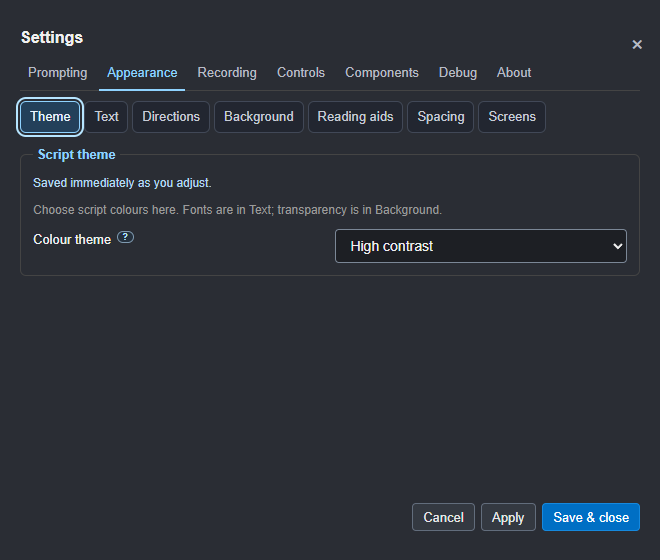

### Text

### Background

### Directions

The current unpublished follow-up separates inline cues from long production
notes. Each group has its own size, colour and line spacing. Both follow
Heading font; production notes still hide during delivery.

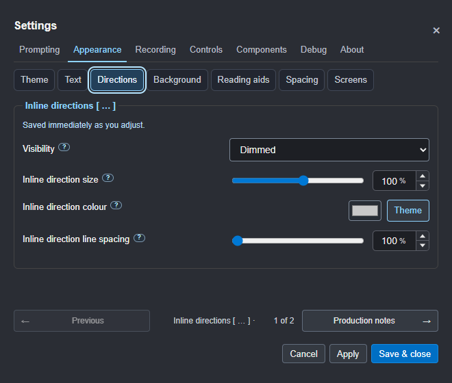

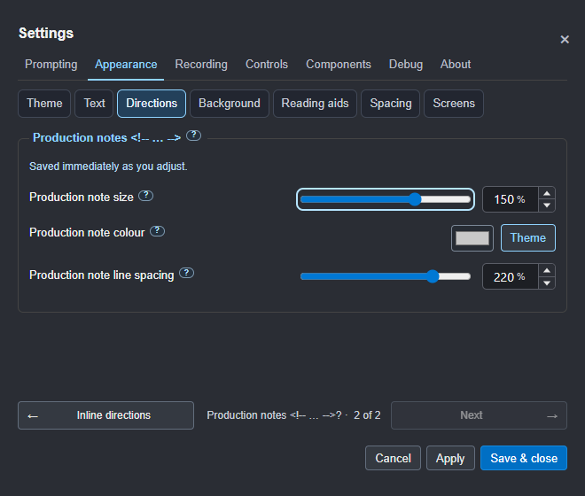

### Reading aids

### Spacing

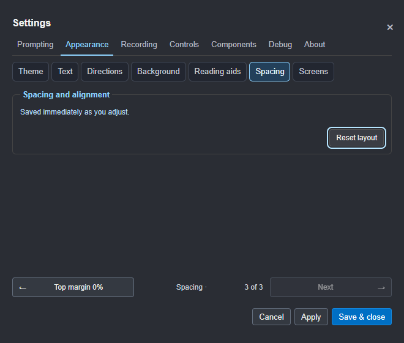

### Screens

Mirroring has one Settings home here, alongside the window and monitor controls.

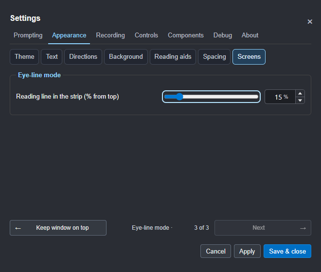

## Recording

### Takes

The next candidate adds optional recognised filler/repetition counts. The
choice defaults off and is saved with Apply. It starts no additional listener.

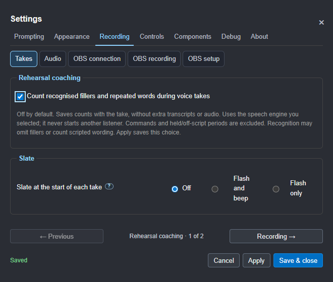

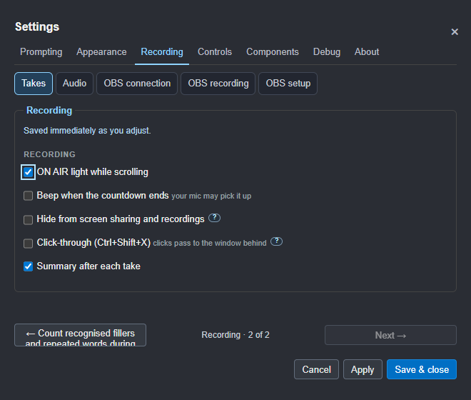

### Audio

### OBS connection

### OBS recording

### OBS setup

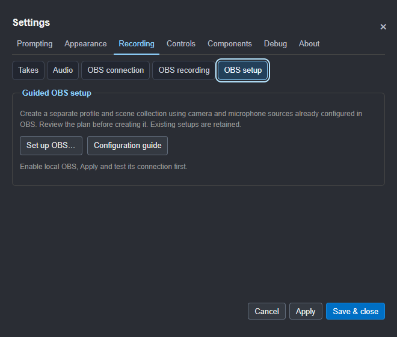

The [setup assistant](15-obs-setup.md) inspects configured sources and requires
a reviewed plan before creating a separate profile and scene collection.

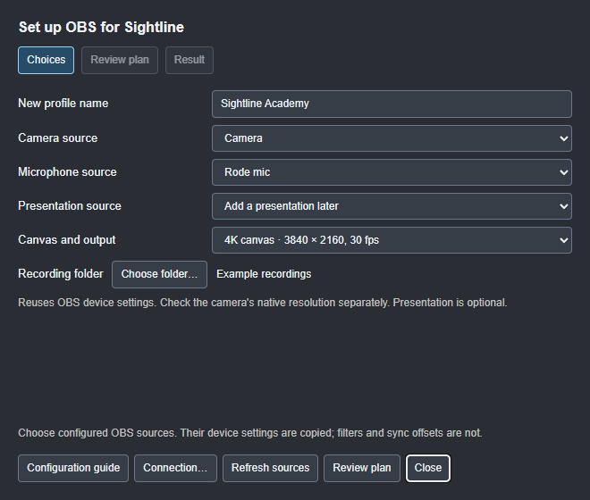

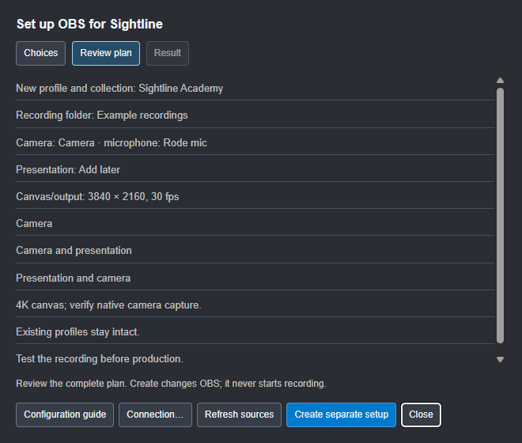

## Controls

### Pad and phone layout

The same selected functions and order appear on both screens. Stream Deck
keeps its physical profiles; the pad and phone reuse its artwork and actions.

### Buttons and keys

Choose an action and press an input to learn it. Changes save immediately;
longer lists use pages. System shortcuts stay reserved.

### Phone

The example QR below is for illustration; scan the code in your own Settings.

### Stream Deck

Installation, plugin checks and pairing share this single Controls topic.

### AI and API

## Components

Each optional component has its own named subtab. Installer links open the
supplier's website; Locate supports portable/custom copies. There are no
numbered component pages.

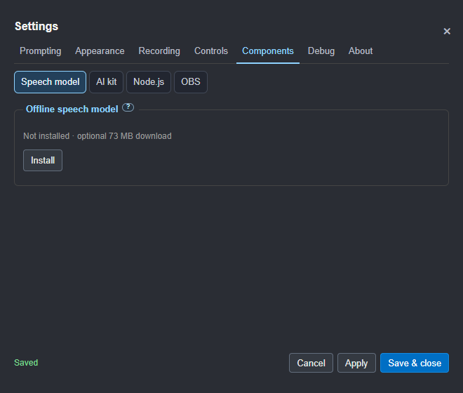

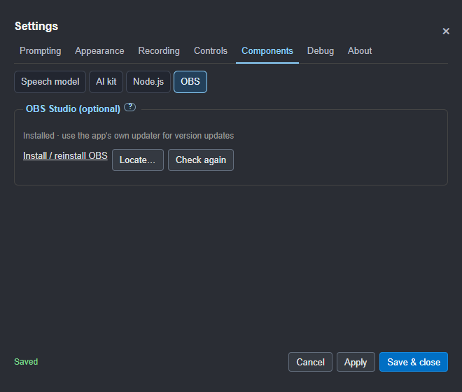

## Debug

Command-word tracing is off by default. The warning stays visible beside its
checkbox; health and recovery logging needs no spoken words.

The session-only capture override applies immediately. Its checked state is
shown below; the prompter also keeps a warning visible with a Turn off button.

## About

Restore defaults asks before resetting preferences and restarting onboarding.
Installed components, scripts, recordings and service keys are retained.

