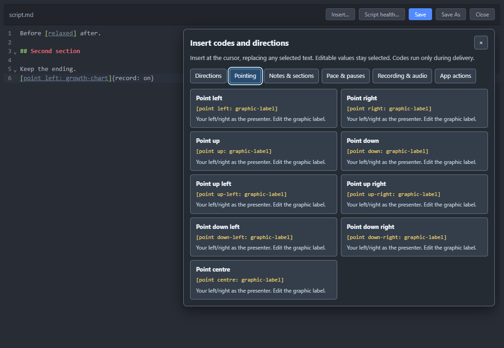

# Editor insertion tools after RC12

12 November 2026. Implemented and checked in source for the next combined
preview. The frozen RC12 binary and its 272-entry matrix remain unchanged.

Request: Ctrl+E needs a tool menu to insert codes and directions at the cursor.

## Implemented

- **Insert…** in the full editor toolbar. The visible groups are Directions,
  Pointing, Notes & sections, Pace & pauses, Recording & audio, and App actions.
  There are 41 templates across these six groups.
- Every supported directive family has a template. All nine pointing positions
  use presenter-relative sides and an editable graphic label.
- Insert at the cursor, replacing selected text. Values and labels stay selected.
  Headings and production notes get separate lines. Placement hints identify
  script/section-only settings.
- Opening the menu retains the editor selection. Insertion supports Undo,
  marks the script dirty and uses normal Save. Escape closes only the menu and
  returns to the editor; an outside click dismisses it.
- Read-only samples need Save a copy. Inserting/saving a recorder code does
  not execute it or enable an interface.
- Toolbar actions stay together; saved filenames display correctly on Windows;
  the reading marker stays hidden while editing.

## Evidence and next build

`npm run test:script-tools` covers canonical syntax/directive coverage and real
CodeMirror insertion, selected values, Undo, Save, retained text, no recorder
execution, protected samples, Escape and 1100/560/420px layouts. It uses an
isolated temporary profile and does not edit user scripts.

Add the editor-tool capability row and update publication metadata when the
next combined RC is packaged. Refresh its JL archive and promo UI-insert guide
then; do not describe this as already shipped in RC12.
