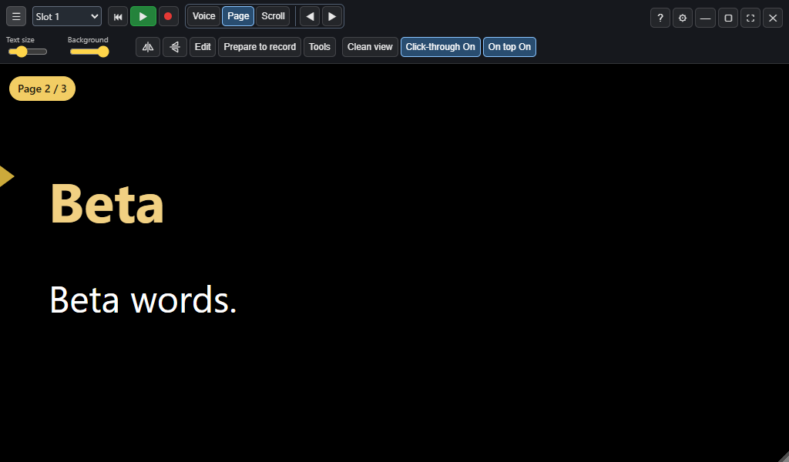
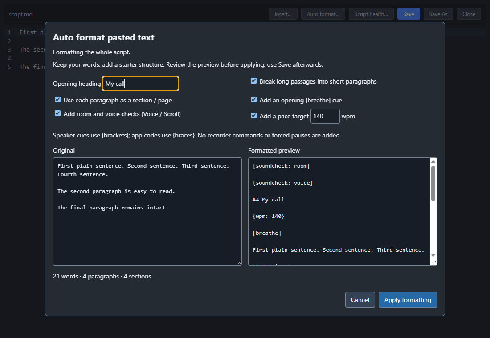

# Toolbar overlay controls and plain-text authoring after RC12

Source changes prepared after RC12 for the next combined preview, together
with the editor Insert menu. The running RC12 build, user profile and its
272-entry feature reference stay unchanged.

## Reading and call overlays

- Three visible toolbar choices: **Voice**, **Page**, **Scroll**. Page means the
  existing Notes display. Its Previous/Next buttons disable at the ends.
- Plain scripts without headings can page by paragraph. Authored Notes mode
  is honoured on load; an explicit mode choice overrides it for the open script
  without changing the file. Another script supplies its own initial mode.
- Pause delivery before changing mode. A held Voice session may change mode;
  Voice still requires enabled speech and microphone input. Selecting a mode
  does not start the microphone or recorder.
- **Clean view** temporarily hides prompter chrome and the separate head guide.
  It preserves fonts, backing, reading position, saved guide/reference and
  recorder state. Hover the small top-edge tab and choose **Show controls** to
  restore the display. Escape also restores it while Sightline has focus.
- **Click-through On/Off** is on the toolbar. Script clicks pass to the call
  behind; toolbar, session actions and recovery controls remain interactive.
  The editor accepts input even while the saved click-through preference is on.
- **On top On/Off** keeps the prompter above the call. These use the existing
  saved settings. Clean view is transient and starts off on launch.
- Global **Ctrl+Shift+X** still toggles click-through from another app; turning
  it off also restores clean-view controls. The shared pad/phone/mapping action
  **Clean view** is optional. Existing layouts and control IDs are retained;
  no new Stream Deck profile or companion package is implied.

## Paste and Auto format

Open Ctrl+E, paste a plain block and choose **Auto format…**. It previews the
whole document, or only the selected passage, before changing the editor.
Default output adds an opening heading and short paragraphs. Original words,
punctuation and ordering are retained; wrapping/whitespace can change.

Optional controls add a section/page per paragraph, an opening `[breathe]` cue,
room/voice checks for Voice/Scroll, and a pace target. No recorder commands,
forced stops, mode directive or wording rewrite is invented. Existing markup
is protected; select a plain passage within a structured script instead.

Cancel leaves the editor and file intact. Apply changes only the editor;
Undo restores the previous text and Save writes it. A changed source is refused
instead of applying an old preview. Samples require an editable copy.

## Validation

`npm run test:overlay-authoring` uses isolated profiles and synthetic OBS state.
It covers mode/script overrides and gates, page bounds, native click-through
exceptions, clean-view/guide recovery, shared controls, responsive toolbar and
format dialogs, exact original wording, preview/Cancel/Undo/Save, selection-only
formatting and protected markup/samples. No user scripts or recording state
are used. Physical call-overlay UAT remains for the next combined build.

The full production integration check also passes. It caught and verified a
fix for opening `{record: on}` after Record take: reuse the confirmed recording
instead of nesting a second Start request while the first action is busy.

