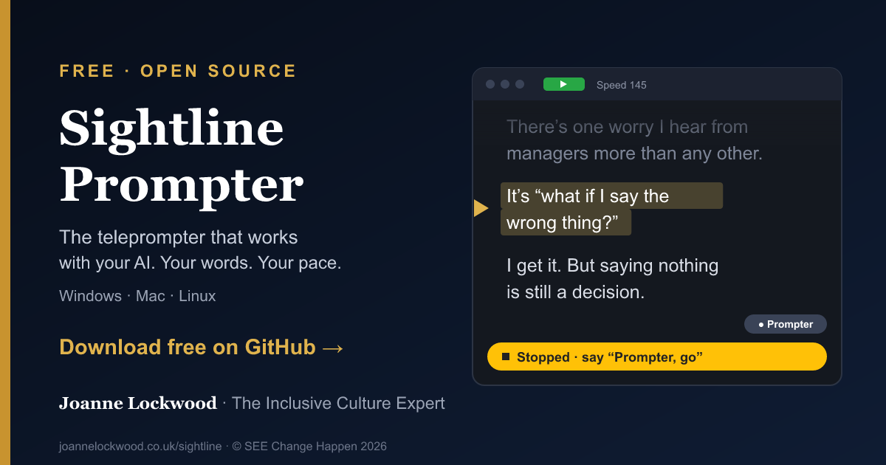

# Sightline Prompter



**The teleprompter that works with your AI.** A traditional teleprompter,
built for your workflow: free, open source and see-through, with voice control.
Your favourite AI can prepare scripts and, through an authorised local agent,
configure and control Sightline. Optional scripting directives steer its
operation; take information helps your external editing workflow. For speakers,
content creators and learning teams. Windows, macOS and Linux.

**Your words. Your pace.** Keep your script near the lens, see the slides or
call behind it, and choose voice following or a steady pace.

**By a speaker, for speakers. By a content creator, for content creators.**
Built by Joanne Lockwood with Claude Code, from David Neal's Electron
Teleprompter. AI is optional: write your own script, or use your assistant to
prepare one, control prompting through the local API and interpret the edit pack.

**Sightline works alongside your recording tool.** Keep recording with the
tools you already use (OBS, Riverside, Zoom, Teams, your camera or your
phone). Sightline adds section and take timings, word-alignment estimates,
retakes, markers and keeper ratings for your editor. A slate and optional scratch
audio help align that information with the recording. OBS or your usual tool
supplies the production master; scratch audio is a timing reference.

**[Download the latest release](https://github.com/JoJo-1965/sightline-prompter/releases/latest)** · [Installing it, and the security warnings](docs/guide/01-getting-started.md#installing-sightline) · [Privacy, terms and accessibility](docs/POLICIES.md) · [User guide](docs/guide/README.md) · [Working with AI](docs/guide/09-working-with-ai.md) · [Everything it adds](docs/FEATURES.md) · [joannelockwood.co.uk/sightline](https://joannelockwood.co.uk/sightline)

> **About Sightline Prompter.** This is a fork of
> [reverentgeek/electron-teleprompter](https://github.com/reverentgeek/electron-teleprompter),
> created by [David Neal](https://reverentgeek.com) and released under the MIT
> licence. Adapted and enhanced by Joanne Lockwood from SEE Change Happen Ltd.
> Everything from the original still works. See the [change log](#change-log)
> for the details, and **Help > About** in the app for credits.

**Released: Sightline 1.1.0 + Stream Deck 0.2.0.** OBS support, the manual head guide,
shared pad/phone controls and the Settings/help updates are included.
[Download Sightline](https://github.com/JoJo-1965/sightline-prompter/releases/tag/v1.1.0)
or [the Stream Deck plugin](https://github.com/JoJo-1965/sightline-prompter/releases/download/v1.1.0/Sightline-StreamDeck-0.2.0.streamDeckPlugin).
The plugin source repository stays private; its installer is available here
while the Elgato Marketplace listing is prepared. Existing 0.1.9 assignments
remain supported. Use the [workflow walkthrough](docs/guide/14-acceptance-test.md)
to check your own recording setup.

## Optional AI, from script to edit

| Step       | What your AI does                                                         | What Sightline does                                                                                        |
| ---------- | ------------------------------------------------------------------------- | ---------------------------------------------------------------------------------------------------------- |
| **Write**  | Writes the script, with sections, target times, stops and countdowns      | **Help > Copy the AI Script Prompt** gives it the instructions, and a checker validates the result         |
| **Record** | Loads the script and runs the prompter through a local API, if you let it | Follows your voice, holds at every `{stop}`, takes "Prompter, …" commands, and logs every take            |
| **Edit**   | Fetches the edit pack and helps review takes in your external editing workflow | Keeps take/section timings, recognised word alignments, edit marks and draft captions in **Files > Recordings** |

- **Scripts that direct the prompter.** The [AI Script Prompt](docs/AI-SCRIPT-BRIEF.md)
  works with ChatGPT, Claude, Gemini or Copilot. The script that comes back has
  `## sections`, `{target: 1:20}` pacing, `{stop}` before a demo, `{pause: 3s}`
  for a breath, `{marker}` for the edit and `[notes to you]`, all
  [documented](docs/SCRIPT-DIRECTIVES.md). Draft in Google Docs, Word or PDF
  and open it as it is.
- **An AI that can run the prompter.** Switch on the local API (Settings > Controls) and an agent on your computer, such as Claude Code, can write a
  script into a slot, start, pause, jump sections, change speed, drop markers
  and rate takes. It's off by default, token-protected and closed to web
  pages.
- **An edit pack made for an editing agent.** Each take's start and end,
  whether it was read through or retaken, its markers, rating and pace, every
  word with when you said it, sentences, edit marks and captions, and the take
  to use for each section. Every session is kept in **File > Recordings**, and
  an agent can list them and fetch any pack itself.
- **Local recognition by default.** After the model download, it works offline.
  Choosing Deepgram sends audio to that service; sharing files with your AI is
  a separate choice. Recognised text and optional scratch audio can be saved locally.

The whole workflow is in the guide: [Working with AI](docs/guide/09-working-with-ai.md).

**Included in the unpublished 1.1.0 test build:** optional OBS recording controls,
a recorded slate, head-position guide, script/rehearsal review and shared pad/phone
controls. Physical acceptance remains. Signed installers are on the [roadmap](ROADMAP.md).

[One-page overview](docs/marketing/ONE-PAGER.md) · [Audiences, messages and supported claims](docs/marketing/POSITIONING.md)

## Features

- **Follows your voice**, with speech recognition on your own computer (free
  and offline), or [Deepgram](https://deepgram.com/) if you prefer. The
  sentence you're about to say is highlighted
- **"Prompter, …" voice commands:** pause, go, slower, again (for a retake),
  keeper, scrap that, marker, resync, "Section 3" and more, with a choice of
  wake word (Prompter, Computer, Teleprompter or Director)
- **Your words:** names and words it mishears, and words that sound alike,
  count as the script word or command, as synonyms rather than replacements;
  it suggests fixes from what it heard and can learn a word you say
- **Or a steady pace** in words per minute, with section targets, a pacing
  light, a take summary and a rehearsal timer
- **Stops and countdowns** written into the script, **notes mode** (a page at
  a time), and a **take log**, **edit pack** and **recordings library** for the
  edit
- Opens **Markdown, Word, rich text, plain text, PDF and Google Docs links**,
  with a built-in editor and live reload
- **Nine script slots**, live controls, Files and Tools menus, grouped settings, a
  floating button pad, a phone remote, a control window for a second screen,
  clickers, pedals and game controllers, and a
  [Stream Deck plugin](docs/guide/06-remotes-and-screens.md#stream-deck) with
  keys that light up, dials and the Pedal (coming to the Elgato Marketplace)
- **For real rigs:** mirroring for beam-splitter glass, full screen on a
  prompter monitor such as the Elgato Prompter, an eye-line mode, hiding from
  screen sharing and click-through
- **Reading aids:** a focus band, colour themes, and fonts including Atkinson
  Hyperlegible and OpenDyslexic
- A **user guide** with screenshots, built into the app

The full list, side by side with the original, is in [FEATURES.md](docs/FEATURES.md).

## Usage

**New to Sightline? Read the [user guide](docs/guide/README.md)**, with screenshots of every screen. It's also built into the app: Help > User Guide (Shift+F1). Coming from Electron Teleprompter? See [everything Sightline adds](docs/FEATURES.md).

Sightline Prompter can load any markdown and/or HTML syntax and display that as a translucent overlay on the screen. In this way you can load a script and still see your presentation, video conferencing, or any other applications through the script.

Use the File -> Open menu (or keyboard shortcut) to open a text file that contains markdown or HTML as a script.

### What is Markdown?

Markdown is a lightweight syntax for creating formatted documents. For example, headings use the <code>#</code> symbol.

```md
# This is a Main Heading
## This is a Secondary Heading
```

### Use H2 tags for navigation

Use H2 tags (`##` in markdown) to create both headings and navigation points in your script. Pressing the right arrow on your keyboard will jump the script to the next heading, left arrow to go back. You can also use a presentation remote/clicker (e.g. [Logitech presentation remotes](https://www.logitech.com/en-us/products/presenters.html)) to go navigate forward/back.

### Built-in Markdown Editor

Press `Cmd/Ctrl+E` to open the built-in editor, or `Cmd/Ctrl+N` to start a new script. The editor uses a dark theme with syntax highlighting for markdown, and the background becomes opaque so you can focus on writing.

You can freely toggle between the editor and the teleprompter preview with `Cmd/Ctrl+E` to see how your script looks — your changes are preserved as you switch back and forth. Save with `Cmd/Ctrl+S` or use `Cmd/Ctrl+Shift+S` to save as a new file. If you close the app or open a different file with unsaved changes, you'll be prompted to save first.

### Voice-Driven Auto-Scroll

The teleprompter can listen to you and scroll the script automatically as you speak. No keyboard, remote, or foot pedals required! Your speech is turned into words and matched against your script, so the prompter follows your real cadence and tolerates ad-libs and re-reads. The sentence you're about to say is lit up as you go.

Speech recognition runs **on this computer** by default, with the [sherpa-onnx](https://github.com/k2-fsa/sherpa-onnx) streaming Zipformer English model: no account or key, it works offline, and nothing you say leaves the PC. [Deepgram](https://deepgram.com/) (online, with your own key) is still there as an option.

#### Setup

1. Open **Settings > Prompting > Voice**, or **Tools > Voice and microphone**. With "On this computer" chosen, click **Download speech model**. It's a one-off download of about 73 MB.
2. To use Deepgram instead, choose it there and paste in a key from [console.deepgram.com](https://console.deepgram.com/). The key is stored locally in the app's state file and is never written to exported settings files.
3. Choose **Voice** as the scroll mode, and grant microphone access the first time you start.

#### Auto-Scroll Usage

- Press `Cmd/Ctrl+Shift+L` (or `Playback > Start / pause`) to start listening. A green "Listening" pill appears in the top-right corner.
- Start reading your script. As you speak, the prompter smoothly scrolls to keep your current word about a third of the way down the screen.
- If you scroll manually (trackpad, arrow keys, page keys), auto-scroll yields to you for a few seconds before resuming.
- Press `Cmd/Ctrl+Shift+L` again, or click the indicator pill, to stop listening.

#### Adjusting the speed

Auto-scroll uses a smooth, critically-damped animation. If it feels too laggy or too snappy for your speaking style, tune it with:

| Shortcut             | Action                          |
| -------------------- | ------------------------------- |
| `Cmd/Ctrl+]`         | Increase auto-scroll speed      |
| `Cmd/Ctrl+[`         | Decrease auto-scroll speed      |
| `Cmd/Ctrl+\`         | Reset auto-scroll speed to 1×   |

The speed is persisted across sessions. Speed range is 0.25× to 4× in 0.1 steps.

#### Selecting a microphone

By default, auto-scroll uses your system's default audio input. To pick a specific microphone (e.g. a USB lavalier or a podcasting mic), open `Settings > Prompting > Voice` and choose one from the list. The selection is saved and reused on every subsequent auto-scroll session.

A few notes:

- Device names only appear after you've granted microphone access at least once. If the dropdown shows generic IDs, start auto-scroll once to grant access, then reopen the picker.
- Plugging or unplugging a mic while the picker is open refreshes the list automatically.
- If the previously selected mic is unavailable when auto-scroll starts (unplugged, disconnected hub, etc.), it falls back to the system default and briefly shows "Saved mic unavailable — using default" in the indicator. The saved selection is kept so it picks up automatically when you reconnect.
- A microphone change takes effect the next time you start auto-scroll; it does not interrupt an active session.

### Keyboard Shortcuts

#### Shortcuts for the managing the teleprompter overlay

| Shortcut              | Action                        |
| --------------------- | ----------------------------- |
| `Right Arrow`         | Jump to next section (H2)     |
| `Left Arrow`          | Jump to previous section (H2) |
| `Ctrl+Shift+P`        | Floating control pad on / off |
| `Ctrl+Shift+O`        | Control window (operator screen) on / off |
| `Up/Down Arrow`       | Scroll up/down                |
| `Cmd/Ctrl+Plus`       | Increase font size            |
| `Cmd/Ctrl+Minus`      | Decrease font size            |
| `Cmd/Ctrl+0`          | Reset font size to default    |
| `Cmd/Ctrl+M`          | Toggle mirror/flip mode       |
| `Cmd/Ctrl+Shift+Up`   | Increase background opacity   |
| `Cmd/Ctrl+Shift+Down` | Decrease background opacity   |
| `Cmd/Ctrl+Shift+0`    | Reset opacity to default      |

#### Shortcuts for managing the editor

| Shortcut              | Action                        |
| --------------------- | ----------------------------- |
| `Cmd/Ctrl+N`          | New file                      |
| `Cmd/Ctrl+O`          | Open a markdown/text file     |
| `Cmd/Ctrl+E`          | Toggle editor / preview       |
| `Cmd/Ctrl+S`          | Save (in editor mode)         |
| `Cmd/Ctrl+Shift+S`    | Save As (in editor mode)      |

#### Shortcuts for voice-driven auto-scroll

| Shortcut              | Action                        |
| --------------------- | ----------------------------- |
| `Cmd/Ctrl+Shift+L`    | Toggle auto-scroll            |
| `Cmd/Ctrl+]`          | Increase auto-scroll speed    |
| `Cmd/Ctrl+[`          | Decrease auto-scroll speed    |
| `Cmd/Ctrl+\`          | Reset auto-scroll speed       |

## Support Sightline

Sightline is free, and always will be. If it helps you, you can say thanks
with a coffee: **[☕ Joanne's tip jar](https://buy.stripe.com/4gMeVd5GLgmZdx9btV5ZC01?utm_source=sightline&utm_medium=github)**, or [leave a message on Ko-fi](https://ko-fi.com/joannelockwood). It helps pay for
the things a free app still costs, like code signing. There are no perks: Sightline is the same for everyone, whether you give or not.

## More from Joanne Lockwood

| | |
| --- | --- |
| Speaker site | [joannelockwood.co.uk](https://joannelockwood.co.uk) |
| Book: Don't Be a D*ck | [ninetynineways.co.uk](https://ninetynineways.co.uk) |
| Inclusion Bites Podcast | [inclusionbites.co.uk](https://inclusionbites.co.uk) |
| Inclusion Bites Academy | [academy.inclusionbites.co.uk](https://academy.inclusionbites.co.uk) |
| Consulting: SEE Change Happen | [seechangehappen.co.uk](https://seechangehappen.co.uk) |
| The Trans Inclusion Toolkit | [thetransinclusiontoolkit.co.uk](https://thetransinclusiontoolkit.co.uk) |
| LGBTQ+ History | [lgbtq-history.info](https://lgbtq-history.info) |
| Connected Ecosystem | [connected-ecosystem.co.uk](https://connected-ecosystem.co.uk/) |

## Roadmap

Planned features and their order are in [ROADMAP.md](ROADMAP.md).

## Change log

### Unreleased

- **Recording workflow preview:** optional linked OBS recording starts with Play,
  pauses/resumes with prompting and finishes at the script end. Continuous is
  the default. Explicit **record on / off / pause / resume** voice commands and
  optional `{record: …}` directives require OBS permission. A persistent pill
  shows OFF, RECORDING, PAUSED or UNKNOWN.
- **Production preparation:** `<!-- production comments -->` show while paused
  and hide during delivery; short `[smile]` cues remain inline. Both stay outside
  speech tracking. Sound checks offer **Continue anyway**, logging measurements
  and acceptance without forcing microphone gain.
- **Recording framing reference:** save and restore Actual position separately
  from Ideal; the edit pack keeps both. Guide adjustments initially open below
  the prompter toolbar and retain their movable position.
- **Navigation and pairing:** Previous/Next name destinations and disable at
  the bounds. Slate choices use visible radio controls. Stream Deck setup and
  pairing share **Controls > Stream Deck**. The preview launcher temporarily
  pairs the plugin, restoring installed-app discovery on normal exit. Moving
  the pointer away from the toolbar hides it promptly.

- **Windows app name:** Task Manager shows **Sightline Prompter**, replacing
  the long product description in the executable metadata. This takes effect
  when you run the updated build.
- **Independent line spacing:** **Settings > Appearance > Spacing** has separate
  controls for script, headings and square-bracket comments. Existing profiles
  retain their previous spacing until you adjust it. Quoted spoken directions
  keep script spacing.
- **Theme and clearer Settings:** **Appearance > Theme** has its own named tab.
  Settings rows have more breathing room and aligned controls; the panel keeps
  its stable size, with no scrolling.

### 1.1.0 (31 October 2026)

Released with **Stream Deck 0.2.0**. Earlier RC identifiers below are test
history, not additional public releases. Existing plugin **0.1.9** assignments,
scripts and additive edit-pack formats remain supported. The source freeze and
validation limits are recorded in the [freeze record](docs/BUILD-FREEZE-1.1.0.md).

- **Documentation review:** the guide index now names the frozen 1.1.0/0.2.0
  pair. Overview and marketing copy retain the AI-led workflow while explaining
  that AI is optional, distinguish estimated
  alignment from exact recording times, explain scratch audio and qualify
  capture behaviour. Installation help separates reputation warnings from
  malware/damage alerts. A one-pager and audience/message reference are included.
  About uses the same AI-led message; the Voice panel explains local
  recognition, optional online audio transfer and local saved files.
  The promotional infographic restores a tested QR, strengthens icon contrast
  and makes voice control explicit alongside AI and script directions.

- **Pad and phone operator controls:** both now include listening off/on and
  recovery, a local session check, eye locking, ideal-reference controls and
  an adjustment panel with Eyes, Outline and Compare tabs. Choose **Framing &
  checks** under **Settings > Controls > Pad**, or add individual buttons.
  Existing selections stay in place. Finish recording requires a one-second
  hold by default; the pad setting is separate from each Stream Deck key.

- **Stream Deck operator controls:** configurable listening off/on or recovery,
  session status and fuller error help, an optional one-second Finish recording
  hold, and head-guide dials for eye centre, independent edges and visibility
  levels. Eye locking keeps the reference fixed while fitting the outline.
  Two opt-in framing profiles cover + and + XL. New controls need the matching
  app capabilities. Both packages are available from the 1.1.0 release.

**Local Windows acceptance build:** RC1 established the feature baseline;
RC2 refreshed its bundled help and added the reusable acceptance samples.
**1.0.7-rc.3** adds compatibility reporting with private Stream Deck **0.1.9**;
**1.0.7-rc.4** keeps the toolbar sliders labelled at every supported width;
**1.0.7-rc.5** adds eye-anchored head-outline fitting;
**1.0.7-rc.6** improves toolbar access and centres Settings on opening;
**1.0.7-rc.7** adds floating guide adjustments, eye-anchored edge fitting and
separate guide-background opacity;
**1.0.7-rc.8** also makes Settings and F1 Help independent movable windows;
**1.0.7-rc.9** adds optional offline reading at the end of Windows installation;
**1.0.7-rc.10** fixes the phone QR image, makes voice help movable, puts
mirroring under Screens and honours capture preferences for helper windows;
**1.0.7-rc.11** improves OBS button contrast and keeps Settings above the prompter.
**1.0.7-rc.12** adds independent size and colour for square-bracket comments.
**1.0.7-rc.13** adds custom pad/phone layouts and listening recovery.
**1.0.7-rc.14** gives troubleshooting controls their own **About > Debug** topic.
**Included in the frozen build:** compact phone landscape controls
use four or six columns, with all 12 Studio buttons in two rows. Portrait
keeps its large controls, and footer spacing accounts for browser controls.
The same batch adds live API/JSON/XML pad-layout changes, phone sending/sent
feedback and a session-only capture override in **Debug**. Invalid
layouts are rejected before other settings change; protected permissions stay
local. The capture override has persistent desktop/phone warnings and resets
on exit. A plan-first installation helper checks hashes and verifies the
complete destination/version after an explicitly requested installation.
The batch also adds top-level **Components** for model/AI-kit installation,
repair and removal, plus a Node.js check. **Controls > Buttons & keys** learns
keyboard, clicker, pedal and controller inputs, with action choices and reset.
The batch is included in the 1.1.0 feature freeze, awaiting final acceptance.
It now includes **Script health** in the editor and a **Rehearsal** review tab:
section reading estimates, delivery prompts, take pace, alignment coverage and
logged rereads. Recognised filler/repetition counts are optional aggregates
attached to voice takes; no extra listener, transcript or audio is added.
The latest published app remains **1.0.6**. No tag, merge, Marketplace publication or
website deployment is part of this candidate.

- **Build versioning:** the frozen build reports **1.1.0**. Update
  checks recognise a later RC or the final 1.1.0 release correctly; installed
  1.0.7 previews remain traceable and published 1.0.6 history is retained.
- **Review before and after a take:** **Script health…** in the editor checks
  current text, including unsaved changes. It estimates section reading time,
  flags sentences of 30 words or more and suggests trying similar word starts
  aloud. **Tools > Script & rehearsal review…** and **Recordings > Coach…**
  show take pace, unmatched sentence words and logged rereads. These are review
  prompts, not proof of a delivery error. Optional filler counts are under
  **Recording > Takes**; `rehearsal-coach.json` travels with the edit pack.
- **Setup once, check each session:** Help > Getting started opens a first-use
  checklist; Tools > Session check links to script review, sound, framing,
  enabled OBS and sync checks. Settings now has top-level Components and Debug,
  named component subtabs and OBS under Recording. The fixed frame remains.
- **Start afresh:** **Settings > About > Restore defaults…** confirms before
  restarting into onboarding with shipped preferences. Layouts, shortcuts,
  slots, recent history and pairings reset; integrations start off. Installed
  components, scripts, recordings and service keys stay. A private local
  settings backup is kept; recording, editing and component maintenance block
  reset until safe.
- **Optional OBS setup:** review configured camera/mic sources, folder and
  1080p/4K canvas before creating a separate profile and three scenes. Existing
  setups remain available; outputs must be stopped. The
  [configuration guide](docs/guide/15-obs-setup.md) explains native camera mode,
  clean-camera/WAV outputs and physical sync checks. Setup starts no recording.
- **Components in one place:** **Settings > Components** shows the
  offline speech model, bundled AI kit and Node.js status. Install, Reinstall
  and Remove manage Sightline's own copies; Node.js uses its own installer.
  Voice settings also offer model repair/removal. A failed repair retains the
  previous copy; stop prompting and recording before changing the model.
- **Explain unavailable controls:** Components also checks optional OBS and
  Stream Deck installations, offers their installers and remembers custom
  locations. Missing prerequisites grey out dependent controls with a reason;
  saved choices survive. AI kit readiness is separate from API access, and
  remote OBS works without a local install. Plugin compatibility still needs
  the live handshake; third-party apps use their own updaters.
- **Choose your buttons:** **Settings > Controls > Buttons & keys** learns a
  physical key or controller button, then runs your chosen pad action. Plain
  keys and Shift combinations work while the prompter has focus; system
  shortcuts stay reserved. Changes save immediately, with pages for longer
  lists and Reset defaults. Stream Deck profiles stay independent.
- **Your control layout:** **Settings > Controls > Pad** selects up to 36
  buttons with drag reordering, accessible Earlier/Later moves, columns and
  Compact/Reading/Studio presets. The phone shares the selection and order,
  using Stream Deck artwork with larger touch targets. Hardware profiles
  keep their own assignments. The pad's Customise button opens the editor.
- **Wake-word listening recovery:** interrupted audio or a stalled recogniser
  restarts with bounded retries, preserving position and hold. Silence and
  listening-off stay respected. **Prompting > Commands** shows state and
  Restart listening. The optional command-word trace is off by default and
  lives under **Settings > Debug**, independently of Debug mode,
  with a warning about nearby conversation and the usual Apply/Save controls.
  Applying a wake-word change updates an already-running listener too.
  Stopping during startup cancels cleanly; late messages from the old
  listener cannot stop its replacement.
- **Comment appearance:** **Settings > Appearance > Text** has independent
  Comment size and Comment colour controls for `[delivery directions]`.
  Comments follow Heading font; Theme restores the usual colour. Quoted
  spoken words keep their script style, and delivery notes stay outside
  speech tracking, word counts and timing.
- **Settings opens above prompting:** native ownership keeps Settings and both
  help windows above the prompter, including when reopening in fullscreen.
- **Readable OBS controls:** Record take and Finish recording have dark
  backgrounds, clear outlines and readable text when enabled or disabled,
  with a visible keyboard-focus ring.
- **OBS settings together:** **Recording > OBS connection** and **OBS recording**
  sit alongside the other integrations. **Prepare recorded slate** explains
  why it is unavailable, then shows progress, readiness or an error in Settings.
- **Phone QR and helper windows:** **Controls > Phone** displays its QR code
  in the separate Settings window. **Hide from capture** now applies live to
  Settings, keyboard/voice Help and Guide adjustments; turn it off to capture
  those windows for support. The head-guide overlay keeps independent protection.
- **One mirroring home:** **Appearance > Screens > Beam-splitter mirroring**
  contains both toggles, with no copies in Background or Spacing. Settings
  toggles work in their separate window and remain in sync with the toolbar.
- **Movable voice help:** **“Prompter, what can I say?”** opens a separate,
  upright window with grouped tabs, a draggable title bar and remembered
  position/size. Close, Escape and **“Prompter, close”** dismiss it independently.
- **Read after installing:** the Windows finish page has independent **Read
  release notes** and **Read Getting Started guide** tick boxes alongside
  **Run Sightline Prompter**. The reading options start unticked and open
  version-matched, offline pages in your browser. Silent installs skip them.
- **Movable Settings and Help:** **Ctrl+,** and **F1 / ?** open separate upright
  windows. Drag their native title bars to another screen; each remembers its
  position and size. Settings retains its fixed layout, paged topics, live
  previews and Apply/Save/Cancel behaviour. Closing Settings, or quitting the
  app with a draft, asks before discarding changes. Reopening an already open
  window brings it forward without resetting the draft. Both stay above the
  prompter, including fullscreen, and follow **Hide from capture**.
- **Guide adjustments in fullscreen:** the prompter's **Guide adjustments**
  button, **Tools > Guide adjustments…**, and the guide's **Adjust** toggle a
  separate window above the prompter, even when the guide is Clean or locked.
  Set eye centre and level first, lock them, then fit Top/Bottom and Left/Right
  independently. **Background** dims the preview beneath the guide (0–80%,
  initially 12%); **Outline** controls the lines separately. The saved Ideal
  reference is brighter. Shape and background settings persist in edit packs.
- **Edit beside Tools:** a labelled toolbar button opens the editor or read-only
  sample source. Tools opens beneath its own button, staying within the window
  edges and following changes to window size and mirror mode.
- **Centred Settings:** opens in the horizontal and vertical centre each time,
  and recentres on window resize. Drag it aside while open; old saved offsets
  no longer move the next opening away from the centre.
- **Fit the head guide around fixed eyes:** **Adjust > Lock eye position**
  stops accidental dragging or nudging. Independent **Width** and **Height**
  controls reshape Actual position around both fixed eye marks. Save as ideal
  keeps the shape; the dimensions and eye lock are recorded in the edit pack.
- **Labelled toolbar sliders:** compact labels stay above every visible slider:
  **Speed** (or **Response** in voice mode), **Text size**, and **Background**
  (**On-air BG** when on air). Narrow windows keep the labels too.
- **Safer script slots:** Clear this slot asks for confirmation, naming the slot
  and script, with Cancel selected. The saved script stays on disk.
- **Samples in the editor:** Edit script opens sample source in a labelled
  read-only view. Save is disabled; **Save a copy…** creates your editable version
  in another folder. Changing scripts also clears stale editor contents.
- **Mirroring on the toolbar:** separate left/right and top/bottom icons toggle
  each axis independently, with the same state as the quick panels and remotes.
- **Stable help panels:** keyboard and voice help keep their dimensions across
  topic changes. **Files (☰) > Settings…** provides a labelled preferences entry.
- **Stream Deck compatibility:** **Settings > Controls > Stream Deck > Check compatibility**
  shows both reported versions, the required/recommended plugin and any update
  needed. Plugin **Test connection** checks the pairing automatically on opening
  a key's settings, including supported OBS/guide commands. Known incompatible
  connections and unavailable actions are blocked. Older unreported versions
  stay unconfirmed; supported ordinary controls still work. This is a local
  compatibility check, not a guarantee that either app is the latest release.
- **Optional OBS recording (52):** **Settings > Recording > OBS connection**
  is off by default, with authenticated connection, saved-connection test
  and status-only operation. Allow controls in **OBS recording** for
  **Record take** and **Finish recording**, also available on the phone,
  control window and by voice. Start/stop wait for confirmed OBS state.
  Ordinary Play/Pause, section stops, retakes, On air and module changes
  keep OBS recording. Disabling the integration leaves OBS alone.
- **Recorded sync and production exports:** prepare an optional flash/tone
  source in **Recording > OBS recording**, with OBS stopped and track 1
  included. Edit packs retain the exact script, guide snapshots, OBS
  observations, confirmed main filenames and estimated take/marker clock
  positions. Module changes save the outgoing take and scratch WAV before
  loading the new script. Collect OBS masters separately; clean Source
  Record output has its own filename and start offset.
- **Head-position guide (55):** a separate transparent window with saved
  Ideal and manually adjusted Actual outlines. Drag, nudge and scale Actual
  without moving Ideal; recall Centre or Beside panel placement. Use
  **Tools > Head guide / unlock**, **Ctrl+Shift+H**, voice **guide on/off**
  or Stream Deck. **Ctrl+Alt+H** toggles borderless fullscreen/restore;
  Clean hides controls and the regular guide shortcut reveals them.
  Session settings persist across scripts and are saved with takes.
  It is a manual reference, without face tracking. Verify exclusion in the
  actual recording, especially with whole-screen capture.
- **Stream Deck companion (39):** private **0.1.9** has version reporting, confirmed-state
  OBS Record take/Finish keys, guide controls, studio line artwork, 27 key
  actions, 5 dial actions and 18 standard/OBS profiles. It uses its own
  buttons-only connection. Physical key checks and Marketplace submission
  remain; no listing is live.
- **Settings and navigation:** seven groups with focused topics: Prompting,
  Appearance, Recording, Controls, Components, Debug and About. Appearance separates Text,
  Background, Reading aids, Spacing and Screens. The panel stays the same
  size; long topics and word lists use pages rather than scrolling. Files
  handles scripts, recordings and import/export; Tools holds live helpers.
  The top bar retains live controls and Steady/Voice switching.
- **Settings usability:** miniature ? pills beside options support hover,
  keyboard focus and click/touch. Explicit labels, dark controls, visible
  immediate-save notes and Unsaved changes feedback explain the state.
  Apply stays open; Save & close saves and closes. Invalid numbers reveal
  and focus the field needing correction. Cue changes flag the draft.
  Credits and attribution have one home on the full About page.
- **Grouped, mode-aware help:** F1 and voice help use tabs and hide actions
  for disabled modes. Explicit **Prompter, guide on/off** set visibility;
  **Prompter, cancel** dismisses voice help. The offline guide includes the
  approved Settings gallery and illustrated production handover.
- **Voice tuning:** documented phrases and taught synonyms remain, with
  bounded split-wake/section handling and a four-second wake expiry.
  Loose guesses that could trigger OBS recording or guide actions were
  removed; ambiguous taught forms are declined. A controlled quiet-capture
  investigation recovered the missing synthetic speech with an analysis
  copy, without changing the microphone or masters. Normal live speech
  remains an acceptance check.
- **Acceptance walkthrough:** **Files > Sample scripts** includes RC module
  A and B. [Guide 14](docs/guide/14-acceptance-test.md) covers the matching
  pair, claps, natural speech, stops, retakes, guide checks, module handover
  and evidence review. All five Academy requirements remain the publication
  gate. Physical camera/mic sync, real projector stacking and Windows manual
  accessibility checks must not be described as passed. macOS/VoiceOver
  testing is deferred.
- **Remote tools:** local API and matching Stream Deck actions switch
  Steady/Voice mode, the floating pad and the control window; state feedback
  follows Sightline.
- **Support and reliability:** local crash/hang/error logging, optional debug
  detail, Save a log for support, and a Wait/Reload prompt for an unresponsive
  window. Settings/panels are brought back inside the current window. First
  use offers the speech-model download with progress and setup guidance.
- **Policies and website preparation:** the shared policy hub covers the
  app, plugin and voluntary support, including the England/UK base, company
  details and ICO registration. Selected approved Settings screenshots and
  matching RC descriptions are prepared for the Joanne Lockwood website;
  deployment remains held.

### 1.0.6 (29 October 2026)

- **You can see when the microphone is on:** while Sightline listens for the wake word, the label says **🎙 Listening for “Prompter”** (your wake word), with a note that nothing is recorded or sent; the control window shows a 🎙 badge too, also while following your voice. The guide has a new **What the microphone does, and doesn't** section, and the About page links to [Privacy, licence and policies](docs/POLICIES.md): what Sightline does with your mic and data, when it goes online, and the MIT licence and warranty. Full policies will follow
- **Always listen for the wake word** (Settings > Voice > Voice commands > **Always, even when stopped**): the microphone listens for "Prompter" whenever Sightline is open, running or stopped, in voice scrolling too, so **"Prompter, go"** starts it hands-free. It was "In voice mode and while steady scrolling", which in voice scrolling only listened once you'd started
- **Section jumps land where reading does:** going to a section ("Prompter, section three", the arrow keys, the control window, the Stream Deck) now puts its first line at the reading line, so the reading arrow points at the middle of it, as it does while you read. Before, a jump left the line half a line high. Which section you're in is now judged at the reading line, not the top of the window. The arrow measures the real line spacing, and the control window's reading line points at the middle of the line too
- **"Prompter, close"** (or cancel, never mind) hides the "what can I say" list
- **Sound checks in the script:** `{soundcheck: room}` stops the prompter and measures the room's background noise for 5 seconds (quiet, OK or noisy); `{soundcheck: voice}` has you read a line at your normal level and says whether it's good, too quiet, loud or clipping, with how far to turn the mic's gain. "Prompter, again" or **Check again** measures again; Space or "Prompter, go" carries on. Each result goes in the take log (`soundChecks`, a new field) and the edit pack. The spec (0.5), the checker, the AI script prompt and the sightline-script skill know it, and the AI puts both at the top of recording scripts. The samples for recording ("Voice control, stops and countdowns", batch and single take) start with them. The local API, the control window and the Stream Deck plugin have a `sound-check` command to turn the meter on and off
- **The control window's broadcast row:** the control window (**Ctrl+Shift+O**) gains a second row for working the prompter from a second monitor when it's full screen on a prompter monitor such as the Elgato, too small and far away for Settings: **On air**, the prompter's **text size** and **backing** (− and +, with the value now), **↔** and **↕ Mirror**, **Eye-line** and **Sound check**. The sound-check meter shows in the control window too, and keeps going during takes there while the prompter stays clear
- **Sound check and loudness per take:** a sound-check meter (**Ctrl+Shift+D**, **Sound check** in the Voice panel, or ☰ > Playback) shows the mic's level against green, amber and red zones, a peak line, a CLIP light, the loudness in LUFS and the room's background noise, at the bottom left of the prompter; it hides during takes unless Settings > Voice keeps it on. **Settings > Scrolling > Loudness for each take** (in voice scrolling by default, or Always, or Off) measures every take's loudness (ITU-R BS.1770), peak and background noise: a take that clipped, was very quiet or had a noisy room says so as it ends, the take summary lists the levels, and the take log (`loudness`) and edit pack (new last columns in takes.csv) keep them. It measures the mic as Sightline hears it, before any processing (roadmap 41 and 42)
- **Support Sightline:** Sightline stays free; if it helps you, you can say thanks with a coffee in [Joanne's tip jar](https://buy.stripe.com/4gMeVd5GLgmZdx9btV5ZC01?utm_source=sightline&utm_medium=github), a Stripe payment page where you choose the amount. It's in **Help > Support Sightline (Joanne's Tip Jar)…**, the ☰ menu, Settings > About and the About page. After Sightline has been opened ten times, a small note asks once, and never again; it never shows while you're reading or on air. There are no perks: Sightline is the same for everyone, whether you give or not
- **Installing, and getting past the security warnings:** the user guide (Getting started > Installing Sightline), the readme and joannelockwood.co.uk/sightline now say which file to download for each computer, and step by step how to get past the browser's download warning, Windows SmartScreen (and what to do about Smart App Control), and the Mac's *Apple could not verify* and *damaged* messages, with how to uninstall
- **Scratch audio for syncing** (Settings > Scrolling > **Record a scratch audio track for syncing**): while the prompter runs, Sightline records the microphone to a plain WAV file (16 kHz, mono) beside the take logs, starting just before the first slate so its beep is on it. The take log places each file on its clock (`audio`: file, start and end, a new field), the edit pack and Recordings exports include the files, and deleting a session deletes them too. An editor or an AI editing agent can line the real recording up with the take log by matching the two soundtracks, with no slate needed. It never leaves your computer (roadmap 33)
- **Off script and commands in the script:** `{listen: off}` before an ad-lib, a demo or questions mutes the microphone (nothing is listened to) and holds the prompter, in steady and voice scrolling, with *Off script · mic off · Space to carry on*; Space, a clicker, the phone remote or the Stream Deck carries on from the next `{listen: on}`, where voice following picks up. The take log records each stretch in `offScript` and the edit pack marks it `off-script` with its duration (new fields only). `{prompter: slower}`, `faster`, `bigger`, `smaller` or `marker` runs that command as the reading reaches it. The spec (0.4), the checker, the AI script prompt and the guide know them (roadmap 35)
- **Stream Deck setting** (Settings > Remotes > Stream Deck): the Stream Deck plugin gets its own key, separate from AI access, that can only press buttons: `GET /status`, `GET /events`, `POST /command` and `POST /slot`. Anything else (loading scripts, settings, recordings) is refused. Sightline writes it to `stream-deck.json` while the setting is on and deletes it when it's off. Turning remote settings on or off no longer waits for an open event stream to close
- **Stream Deck plugin, signposted:** Settings > Remotes has a **Stream Deck** button, and the user guide (Remotes and second screens > Stream Deck), the About box and the feature list describe the coming Sightline Prompter plugin for Stream Deck: what its keys and dials do, the sample profiles, and how to set it up (roadmap 39)
- **The local API for buttons:** `GET /events` streams the prompter's state (playing, on air, mirror, slot, section, time left, speed, text size, backing, the open panel) each time it changes, so a button can light up to match; and `POST /command` gains `on-air`, `mirror`, `mirror-h`, `mirror-v`, `bigger`, `smaller`, `layout`, `reading`, `recording`, `eye-line`, `click-through`, `scroll` and `backing`. It's what the coming Stream Deck plugin uses (roadmap 39)
- **Your words** (Settings > Voice): voice scrolling now copes with the names and words it mishears. **Match words that sound alike** (on by default) counts a heard word that sounds like a script word, starts with the same letter and is about as long, as that word ("marsha" for "Moshe"). **Your list** adds the rest: your word, then what it hears instead ("site line" for "Sightline" works too). Each is a synonym, not a replacement, so it counts as your word where the script has it and as itself everywhere else. **Command words** does the same for the wake word and commands ("prompt her" for Prompter, "cheaper" for keeper), and sound-alikes count there too ("prompta"), still only at the end of what you say. **Suggest from what it heard** offers the words the heard logs show it mishearing more than once, and **Teach…** listens while you say the word and adds what it hears. They're kept with your settings (roadmap 20)
- **Recordings** (**File > Recordings…**, **Ctrl+Shift+R**, also ☰ > Playback): every recording session in one list, newest first, with its date, takes, keepers and length. Open one to see its takes and which ones the edit will use; **name** it, add a **note**, tick **Edited** once it's cut, **export** its edit pack as a folder or a **zip**, or **delete** it (to the Recycle Bin, after asking). It replaces File > Export Take Log, Start a New Take Log and Show Take Logs Folder, which now live in the panel. An AI agent can do the same through the local API (`GET /recordings`, `GET /recording`, `GET /recording/pack`, `POST /recording/update`, and `POST /recording/delete` only if **Settings > Remotes > Let it delete recordings too** is ticked) or `node scripts/sightline.mjs recordings`, `recording`, `recording-pack`, `name`, `note`, `processed` and `delete-recording`. Names and notes are kept beside the logs, so take logs are never rewritten (roadmap 36)
- **Countdowns in voice mode:** a timed pause, `{pause: 3s}`, no longer holds the prompter in voice scrolling, because the text only moves when you speak. It shows as a small blue **⏸ 3s** mark and you take the beat yourself. A `{stop}` (or `{pause}` with no time) still holds, so you can go off script without the prompter jumping ahead. Steady scrolling is unchanged. The guide, spec and AI script prompt say so
- The "Voice control, stops and countdowns" sample has a new part, **Finding your way**, showing "what can I say", spoken section slates, back to the marker and the wake word choice
- **Choose the wake word** (Settings > Voice > Wake word): Prompter (the default), Computer, Teleprompter or Director. The messages and the "what can I say" card use the word you chose
- **Notes mode** (talking points, reworked): `{mode: notes}` (or `{mode: points}`, or Layout > Recording > Notes) shows the script a page at a time. A `# heading` starts a page with that title, `{page}` starts one without, and each `## heading` on it is a bullet with any lines under it smaller; a `{target}` on the `# heading` times the page. Scripts without them keep one section per page. "Prompter, next page" and "previous page" work, the pacing light says "Page 2 of 3", and each page is logged as a section. A new sample, **Notes, a page at a time**, shows it. The checker and the AI script prompt know `{page}` and `{mode: notes}` (roadmap 49)
- **Rehearsal and pace outside the app:** `node scripts/sightline.mjs pace "<script>"` (also `rehearsal`) prints each section's pace summary and every take's pace from the take log, or `--json` for an AI agent. A practice run is logged like any take, so this is the rehearsal timer's result too (roadmap 44)
- **Back to the last marker:** **Shift+B**, or "Prompter, back to the marker", goes back to the last marker so you can read on from there. The take carries on, and the take log and edit pack record it as a restart (`restarts`: when, which marker, and when it was first read), so the edit can cut to the second reading instead of needing a new take. The API has `back-to-marker` too (roadmap 46, asked for by the Academy)
- **Named markers:** `{marker: Setup}` names a marker; plain `{marker}` still works. Every `{marker}` in the script is now logged with the take as you read past it (in voice mode, when you say the word after it), and a name goes into the take log (`markerList`) and the edit pack's marks, so long sections can be cut at each part. The script checker, the spec and the AI script prompt know the new form (roadmap 45, asked for by the Academy)
- **Pace for each take** (voice mode): the take log and edit pack now give each take's words, spoken time (first to last word), speaking time (less pauses of a second or more), speaking and overall words per minute, and the section's `{target}` with how far over or under, as new columns at the end of takes.csv; and each section in take-log.json has a summary such as "S3: 2:31 spoken, 151 wpm speaking, 138 wpm overall, target 2:40 (9 s under)". Nothing existing was renamed or removed (roadmap 43, asked for by the Academy)
- The welcome tour now points to the mirror buttons, the control window and the sound check
- **Mirror toggles:** the Layout panel's Mirror dropdown and the **Beam-splitter setup** button are replaced by two buttons, in the Layout and Reading views: **↔ Left–right** and **↕ Up–down**. Each stays lit while it's on and turns off when clicked again; both on mirrors both ways, and the panel stays open. Beam-splitter setup only looked as if it changed the mirroring; for the same look, set Background to 100% and Text brightness to about 70%
- The dropdowns in the Layout panel and on Settings > Layout, Reading and Recording are all the same width, so they line up
- **Heading font** (Layout panel > Reading, and Settings > Reading): section headings and titles can use a different font from the text, for example Standard headings with OpenDyslexic text. **Same as the text** is the default
- **Heard log** (voice scrolling): every word the speech engine hears is logged next to the script words it was matched with, one file per script per day in the `heard-logs` folder, never leaving your computer. `node scripts/sightline.mjs heard` (or `node scripts/heard-report.mjs <file>`) lists the words heard in place of script words, most often first, to find mishearings worth correcting (roadmap 20, first part)
- **Move Settings and the panels:** drag Settings, the Layout panel or the Voice panel by its title to anywhere in the window, to see the script while you change things. Each opens where you left it; double-click the title to put it back
- **Say "Section 3" to go there:** a spoken slate such as "Section one" (with or without "Prompter") now takes you to the start of that section; saying the section you're already in counts as a retake. Before, the words were ignored, because the slate line is a note in the script
- **"Prompter, reset"** goes back to the top and also puts the speed back to normal and clears the pacing clock, for a fresh run. "From the top" still just goes back to the start

### 1.0.5 (28 October 2026)

- **Heading size** (Layout panel > Layout, and Settings > Layout): section headings grew with the text, so they got very big when you made the text larger. Now they have their own size, from 40% to 150% of their usual size next to the text

### 1.0.4 (28 October 2026)

- **Easier to find: the control pad and the control window** are now at the top of ☰ > Window (they were at the foot of ☰ > Playback), and Settings > Remotes has a tickbox for each
- **"Prompter, what can I say?"** (or "Prompter, help"): shows every voice command and what it does on the prompter, until your next command, a click, Esc or 15 seconds. It's in the F1 shortcuts too
- **"Prompter" is acknowledged straight away:** as soon as Sightline hears the wake word, a message says *Listening… go · pause · again · marker*, so you know it's ready for the command; if what follows isn't a command, *Didn't catch that* shows the words it heard. *Heard: "Prompter, go"* still confirms each command
- **Apply in Settings:** saves your changes and keeps Settings open; **Save** saves and closes. Closing with changes you haven't saved now asks first (Save, Discard or Keep editing), including when a button in Settings opens something else
- **Quit Sightline** at the foot of the ☰ menu, always in view (and at the end of ☰ > Window); the old "Close the teleprompter" item in ☰ > Help is gone
- The Voice panel's microphone hint no longer names a particular microphone

### 1.0.3 (28 October 2026)

- **Help for the AI and remote settings:** Settings > Remotes now says what an AI can do and has a **How to set up your AI** button, which opens a new user guide page, [Setting up your AI](docs/guide/10-setting-up-your-ai.md) (Claude Code, Codex, ChatGPT, Claude and Gemini, and every AI and remote control setting). The guide also covers game controllers, and its links to the readme and roadmap open on GitHub instead of going back to the contents
- **Check for updates** (Settings > About): says whether there's a newer release, with a link to what's new and the download. Sightline also checks quietly when it starts and shows a small note if there is one; untick **Check for updates when Sightline starts** to stop that. Nothing downloads or installs by itself (roadmap 38)
- **Clickable progress bar:** point at the bar along the bottom to see the section and time at that place, click to jump there, or drag along it; white ticks mark where each section starts. Clicks are ignored while the prompter runs, so pause first (roadmap 37)
- **Sightline doesn't record your video or audio**, and now says so up front (readme, guide, feature list): it works alongside OBS, Riverside, Zoom or your camera, and gathers the timings to line up with the recording
- **Skills for Claude Code and Codex, and a setup guide for every AI** ([Setting up your AI](docs/guide/10-setting-up-your-ai.md), also in the app's user guide): `skills/sightline-script` writes and checks scripts to the Sightline spec; `skills/sightline-session` loads scripts into slots, controls the prompter, and builds and uses the edit pack. They use a new command, `node scripts/sightline.mjs` (status, open, load, slot, command, logs, takelog, pack), which reads the API token itself and never prints it. ChatGPT, Claude and Gemini projects get steps for writing and for editing from uploaded files
- **Edit pack** (File > Export Edit Pack…, also ☰ > Playback): the take log turned into what an editor or an AI editing agent cuts with, in one new folder: every word you said with its start and end, every sentence of every take (with any words you missed), edit marks (sentence starts, long pauses, re-reads, skipped words, markers), and captions in your script's own wording as SRT and VTT, with a README brief for editing agents ([docs/EDIT-PACK.md](docs/EDIT-PACK.md)). The take log now also notes each re-read and keeps each take's sentences. Words and captions come from voice mode (roadmap 26)
- **Export the take log…** in the ☰ menu, and the **Export take log…** button in the take summary, now work. Before, only File > Export Take Log did
- **On air is the see-through one now:** off air, the prompter is an ordinary solid window (Backing 100% to start with); on air (scrolling, held at a stop, or the On air button lit) the backing goes almost clear (Background on air, 7% to start with), so you can see your slides or the call behind the words while you read. 1.0.2 had it the other way round. Levels you've already set are kept

### 1.0.2 (28 October 2026)

- **On air button** on the control bar, next to ▶ (**Ctrl+Shift+A**, also ☰ > Playback): go on air by hand, for a talk to camera or to check the look. It lights red whenever you're on air, scrolling included, and the control bar slides away as quickly as it does while scrolling
- **Two backing levels, off air and on air:** Backing is the level while you set up; **Background on air** (90% to start with) takes over while scrolling, held at a stop, or with the On air button lit, so you can see the room through the glass while you set up and read easily while you record. The control bar's Backing slider and **Ctrl+Shift+↑ / ↓** adjust whichever level is in use (the slider reads **On air** while you are), and both are also in the Layout panel > Reading and Settings > Reading
- **The control bar fits any window from about 640 pixels wide.** With the new buttons it ran off the right edge of narrower windows (in a 1280-pixel window, Help, Settings and the window buttons were cut off). Now, as the window narrows, the bar drops the units, then the slider labels, then the number boxes (On air becomes a red record dot), then Edit, Save and Settings, then the empty slots, and last Reading, Recording and Mirror. The sliders stay in every width (they used to vanish below 1150 pixels)
- **Mirror button** on the control bar: steps through off, ↔ horizontal, ↕ vertical and ↔↕ both, and shows which is on (same as **Ctrl+M**)
- **Reading** and **Recording** buttons on the control bar, and **Reading** and **Recording** tabs in Settings: the long Layout panel is now three shorter views, so nothing sits below the fold
- **One Sightline at a time:** starting it again (from the Start menu, a shortcut or the command line) brings the open one to the front instead of opening a second copy, which could overwrite the first one's settings and take log
- **Settings > About**, a new last tab: the version, credits and links, with buttons for the full About page and the user guide. It replaces the line at the foot of every tab
- Settings stays the same height on every tab, so it no longer jumps as you switch
- The arrows on the number boxes are drawn, not typed, so they keep their size at any Windows display scaling (the down arrow could vanish at 125% or 150%, on Settings > Layout)
- The speed box has room for "wpm"
- Click-through's shortcut sits beside its name in the Recording view, so the hint fits on one line
- The reading-line arrow points at the middle of the line you're reading, in any font and size (it pointed at the top of the words)
- Running from source shows the Sightline icon, not Electron's
- **Word timings in the take log** (voice mode): every take now records when you said each word of the script, from the speech engine's own timings (so a word is placed when it was said, not when it was recognised a moment later), on the same clock as the take times and the slate. A phrase read again replaces the first reading. They're in the exported JSON, for an editing assistant to cut on words and sentences (roadmap 26, first part)
- **No scroll bar on the script**, in the prompter or the control window. The progress bar and time left show where you are; the mouse wheel, arrow keys, sections and clicking a line in the control window still move it
- **Working with AI**, a new page in the user guide (Help > User Guide): how your AI writes the script and its directions, runs the prompter through the local API, and takes the take log for the edit. The readme, feature list and Help > About now lead with it
- Help > About lists one feature per line, and text in the menus, panels and dialogs no longer leaves a single word hanging on the last line
- **Slate and sync mark** (Settings > Scrolling, "Slate at the start of each take"): before each take the screen flashes white and beeps, then shows the section and take number for a second. The take log records when each slate went off (the first is time 0), so every take can be lined up with the recording; no clap needed. It shows when you start scrolling, carry on from a `{stop}`, start voice scrolling, or say "Prompter, again". Choose flash and beep, flash only, or off (the default)
- Two pauses on one line, such as a countdown and then a `{stop}`, now both count. Before, the second was skipped
- A take that ends at a `{stop}` now ends where you stopped reading, not when you carried on

### 1.0.1 (28 October 2026)

- **Take log for the edit** (File > Recordings): every take of every section is logged as you record, with its start and end times, whether you read it to the end or went back for a retake ("Prompter, again" or ←), and its markers. Say **"Prompter, keeper"** or **"Prompter, scrap that"** (or press **K** or **Shift+K**) to rate the take you're on or have just finished; the log picks the take to use for each section (the last keeper, else the last complete take not scrapped). It's saved as you go, one per script per day, and exports as JSON for edit tools with a CSV beside it. The take summary shows the takes and keepers so far
- **Floating chevrons instead of scroll bars** in Settings, the Layout and Voice panels, the ☰ menu and Help, as in the About box: a small ▲ or ▼ appears at the edge only when there's more to see. In Settings they sit inside the pinned title and tabs and the Save and Cancel row
- **What Sightline adds**, side by side with Electron Teleprompter 4.1.20: [docs/FEATURES.md](docs/FEATURES.md)

### 1.0.0 (27 October 2026), based on Electron Teleprompter 4.1.20

The first Sightline Prompter release. Your settings, slots and saved scripts
from Electron Teleprompter are copied across automatically the first time it
starts. Earlier version numbers belong to the original project.

**Scrolling and playback**

- Steady scrolling at a set words per minute, alongside the original voice-driven mode
- Countdown before scrolling starts
- Progress bar and time left, worked out from your words per minute
- Back to the start (`Ctrl+Home`)
- Presenter clickers: `Page Down` starts and pauses, `Page Up` goes back a section

**Scripts**

- Opens Word (`.docx`), rich text (`.rtf`) and plain text as well as markdown and HTML
- `=== SECTION` lines in Word and rich-text scripts become sections you can jump between
- `[Stage directions]` are dimmed or hidden, while "quoted words" inside them stay bright
- Slide-cue phrases from a `cues.yaml` file are highlighted in script order
- Script directives in `{curly braces}` are hidden while you read (see [docs/SCRIPT-DIRECTIVES.md](docs/SCRIPT-DIRECTIVES.md)). `{pause}` stops steady scrolling until you press Space or the clicker, and `{pause: 3s}` waits and carries on. A section's `{wpm: n}` or `{target: m:ss}` sets the scroll pace (switch this off with Layout > Follow the script's pace). Show directives in the Layout panel shows them as small tags, with ⚠ on typos
- Check a script from the command line: `npm run check-script -- my-script.md`. It reports unknown directives, bad values, unmatched braces and sections without a target, and exits with 1 on errors, so AI script pipelines can use it
- Reading aids in the Layout panel: a **focus band** that dims lines away from the reading line, with a strength setting; a **text edge** (outline or shadow) for see-through reading over busy backgrounds; **colour themes** (standard, yellow on dark, high contrast, soft cream); and **fonts**, including Atkinson Hyperlegible, OpenDyslexic and Verdana
- Recording helpers: an **ON AIR** light while scrolling; an optional **beep** when the countdown ends (off by default, since the mic would hear it); **hide from screen sharing and recordings**; and **click-through**, where clicks on the script reach the window behind but the controls still work (**Ctrl+Shift+X** toggles it from any app)
- **Game controllers:** A starts and pauses, B drops a marker, X jumps to the next marker, the d-pad changes speed and section. USB foot pedals that send keys (Page Down, arrows) work as before
- **Notes** (talking points) for speaking from notes: `{mode: notes}` in a script (or `{mode: points}`), or Layout > Recording > Notes. A page at a time, with no scrolling: a `# heading` or `{page}` starts a page and each `## heading` is a bullet; without them, each section is a page. Space starts and stops the talk timer; Page Down or → moves to the next point and Page Up or ← goes back. The pacing light shows each point's time against its `{target}` ("On track", "10 s left", "Over by 12 s") and the whole talk's time, and the summary lists every point
- **Floating control pad** (View > Floating Control Pad, **Ctrl+Shift+P**): a small window with Start / Pause, Top, Previous and Next that stays on top of everything. Drag it by its grip anywhere, even onto another monitor or over Riverside, and it reopens where you left it. Over the prompter window it flips with the prompter's mirror setting, so it reads correctly in beam-splitter glass; off the prompter it reads normally. In talking points, Previous and Next step through the points
- Next and Previous section (arrow keys, pedals, the pad and the remote) now go from where you are in the script, not from the last section you jumped to. Previous from part-way through a section goes back to its start first
- **Phone remote** (Settings > Remotes): scan the QR code with a phone on the same Wi-Fi to get big Start / Pause, Previous, Next, Top, Slower, Faster and Drop a marker buttons, with the current section and time left. Off by default. Only a device with the code in the QR code can connect; New code disconnects phones already connected. The first time, Windows may ask to allow the app on the network: allow it on private networks
- **Control window** (View > Control Window or the ☰ menu under Playback, **Ctrl+Shift+O**): an ordinary, upright window for a second screen. It shows a live copy of the script that follows the prompter, with the reading line, the pacing light, the section and time left, and big Top / Previous / Start / Next / Slower / Faster / Marker buttons. Click any line in the copy to move the prompter there. Keys work too: Space, Page Up / Down, Home, ↑ / ↓ and B. A− / A+ change the copy's text size, and it reopens where you left it
- **Prompter monitor** (Settings > Display, or Window > Prompter Monitor): pick a monitor (the Elgato Prompter shows up by name) and the prompter opens full screen there, now and each time the app starts. F11 gives a normal window on that monitor
- **Windows stay in view.** If the prompter is bigger than its screen, or its control bar ends up above or off the screen (after a drag, a monitor unplugged, or a resolution change), it shrinks or moves back so the bar can be reached. The control window does the same when a monitor goes away
- **Voice scrolling on your own computer** (Settings > Voice): free, offline and private, and now the default. A one-off 73 MB download (with progress shown) fetches the speech model; after that nothing you say leaves the PC. Words reach the prompter while you're still speaking, not at the next pause. In a side-by-side test on a real 9-minute recording with retakes, it kept the prompter on the reader's line 96% of the time, with a typical delay of a few hundredths of a second; Moonshine, which waits for pauses, managed 75%. Deepgram stays as a choice, with your own key
- **The sentence you're on is highlighted** (Settings > Display, the Layout panel or the ☰ menu under Display; on by default): in voice mode, the sentence you're about to say; otherwise the one on the reading line. A soft band that keeps the text colour on every theme
- Words with apostrophes now match whichever apostrophe the script uses: "isn't" heard matches "isn’t" typed
- **Voice commands: "Prompter, …"** (Settings > Voice): say "Prompter", then pause, go, slower, faster, back, next section, from the top, again (marker and retake), marker, resync, bigger or smaller, then stop for a moment. They only count at the end of what you say, so a script line such as "the prompter pauses" never triggers one. In voice mode, "pause" holds the scroll but keeps listening, and "resync" finds your place anywhere in the script. Choose "In voice mode and while steady scrolling" to use them with steady scrolling too (the mic listens for commands only, on this computer). Commonly misheard words are matched too ("paws", "rezinc")
- **User guide with screenshots** ([docs/guide](docs/guide/README.md)): getting started, writing scripts, scrolling and voice, layout, recording a take, remotes and second screens, every Settings tab, shortcuts and troubleshooting. It opens inside the app from Help > User Guide, the ☰ menu or **Shift+F1**, and works offline; the shortcuts panel (F1) links to it
- **Stops and timed pauses in scripts:** `{stop}` (or `{pause}`) waits until you say "Prompter, go" (or just "go"), press Space or use the clicker, with a yellow Stopped label; `{pause: 5s}` shows a blue "Carrying on in 5" countdown with a bar that runs down, then carries on. Both now work in voice scrolling too. In steady scrolling the mic listens for "Prompter, go" while it waits. A new sample script, **Voice control, stops and countdowns**, walks through them all, and the other samples use them too
- **Help > Copy the AI Script Prompt** (also in ☰ > Help): puts the [brief for AI script writers](docs/AI-SCRIPT-BRIEF.md) on the clipboard, ready to paste into ChatGPT, Claude or Gemini. The brief now covers `{stop}` and countdowns
- **PDFs and Google Docs** (File > Open a Google Doc…): open a PDF like any other script, with its paragraphs and headings rebuilt and page numbers and running headers left out; or paste the link of a Google Doc shared as "Anyone with the link" (or drag it from the browser). The latest version is fetched each time you open it, or with File > Reload from Google Docs
- A [note in brackets] that wraps onto the next line of the script file is now dimmed like any other note (before, it showed as normal text)
- **Tidier menu and Settings.** The ☰ menu groups fold up: Script and Playback start open; opening another group closes the rest, so the menu stays short (the menu remembers). The menu closes when you click anywhere else. The button pad is now in the menu under Playback (Ctrl+Shift+P). Settings is split into tabs (Scrolling, Voice, Display, Layout, Files, Remotes; Files has opening and saving scripts, the settings file and slide cues) with an × at the top right, and Save / Cancel always in view. A quiet line at the foot of the menu and Settings shows the version, release date, licence and credits, with a link to About (Help > About lists the newer features too)
- **Rehearsal timer:** after a practice run, **Use these times as targets** in the take summary writes each section's time into the script as `{target: m:ss}` (to the nearest 5 seconds), replacing any target it had. Sections started part-way through are left alone. Works with .md and .txt scripts
- The take summary flags sections that ran short as well as long: within 5% of the target is "On track", 5 to 10% under or over is amber ("Under by 8 s"), and more than 10% is red
- **Finish on time:** a single take (`{pacing: session}`) with a whole-script `{target: m:ss}` sets its scroll pace so it lands on that time, as section targets already do for each section
- **Pacing light** while scrolling: time against target and actual against target words per minute, with a green, amber or red light and the words "On track", "Ahead 5 s" or "Behind 8 s". In section mode (the default, for batch recording) each pass through a section is timed afresh and the timer stops at `{pause}`s; `{pacing: session}` times the whole take instead. When you stop, a **summary** lists each section you read to the end, with its time, target, pace and result
- Markers: `{marker}` in a script, or press **B** to drop one at the reading line during a take; **Ctrl+B** jumps between them
- Built-in sample scripts (Script > Sample scripts): a welcome tour, which opens on first run, plus batch recording, a single take, a formatting test and plain-text sections. Each opens as a copy, so editing never changes the original
- Nine script slots (`Ctrl+1` to `Ctrl+9`). Each slot reopens where you left it, even after a restart
- Drag a script file onto the window to open it

**Controls and layout**

- Control bar with open, save, edit, slots, play, sliders, layout, voice, help, settings and window buttons. It hides while you read and comes back when you move the mouse
- Every slider has a number box beside it. You can type a value, use the arrow keys (`Page Up` / `Page Down` move 10 steps), or press and hold the ▲ ▼ buttons. Speed shows words per minute; everything else shows a percentage
- In-app menu grouped into Script, Playback, Display, Window, Settings and Help
- Layout panel: text opacity, background opacity and text brightness, each set independently (none affects the controls), left/right and top/bottom margins (the text fades out near the window edges), line spacing, reading line, alignment, mirror and reading-line marker
- Eye-line mode: a small window near the camera
- Mirroring in one click: ↔ Left–right and ↕ Up–down toggles in the Layout panel (both on mirrors both ways), also Ctrl+M and the Mirror button. For a clear camera image through beam-splitter glass, set Background to 100% and Text brightness to about 70%
- Mirror the script horizontally, vertically or both, for any beam-splitter or reflector rig. `Ctrl+M` steps through Off → Horizontal → Vertical → Both. The whole prompter display is mirrored, controls included, so everything reads correctly in the reflection (this also fixes the control bar scrolling away while mirrored)
- Minimise, maximise and full screen, which work properly on a transparent window
- Keyboard shortcuts panel (`F1` or `?`) and an About page

**Voice scroll sync**

- Voice panel with the Deepgram key box, microphone choice, a live level meter and a responsiveness setting

**Settings**

- Save and load all settings as JSON or XML (File > Save Settings to File). The Deepgram key is never written to these files

**AI and remote control** (off by default)

- An optional HTTP API on `127.0.0.1` so an AI assistant or a local script can open or write scripts, switch slots, play, pause, change speed and jump sections, and list your recordings and fetch their edit packs. `node scripts/sightline.mjs` wraps it for AI agents, and [Setting up your AI](docs/guide/10-setting-up-your-ai.md) shows how to set up Claude Code, Codex, ChatGPT, Claude or Gemini
- Each request needs a secret token. Requests from web pages are refused, and the API can't switch itself on
- When the API is on, its address and token are written to `remote-control.json` in the app's settings folder:
  - Windows: `%APPDATA%\Sightline Prompter`
  - Mac: `~/Library/Application Support/Sightline Prompter`
  - Linux: `~/.config/Sightline Prompter`

  The file is deleted when the API is switched off. The app never shows your full user path.

| Endpoint            | What it does                                              |
| ------------------- | --------------------------------------------------------- |
| `GET /status`       | Current script, slot, speed, progress and slots           |
| `POST /open`        | Open a script file `{ path, slot }`                       |
| `POST /load-text`   | Save text as a script and open it `{ text, name, slot }`  |
| `POST /command`     | `play`, `pause`, `toggle`, `restart`, `next-section`, `previous-section`, `faster`, `slower`, `reset-speed`, `set-wpm`, `go-to-section`, `marker`, `back-to-marker`, `keeper`, `scrap`, `help` |
| `POST /slot`        | Switch to a slot `{ slot }`                               |
| `POST /settings`    | Change display settings                                   |
| `POST /window`      | `minimize`, `maximize` or `fullscreen` (each toggles)     |

## Developer Setup

1. Install [Node.js LTS](https://nodejs.org/) (v22+)
1. Clone or download the source code.
1. Open a terminal/command window, change to the source code folder, and install dependencies using `npm install`.
1. Launch the app from the terminal using `npm start`.

## Origin Story

Electron Teleprompter, the app this is based on, was originally built "in the open" on the [All Hands on Tech Live](https://www.twitch.tv/pluralsight_live) developer stream. You can watch past streams on Pluralsight's [YouTube](https://www.youtube.com/c/pluralsight), [LinkedIn](https://www.linkedin.com/company/pluralsight), or [Facebook](https://www.facebook.com/pluralsight).
