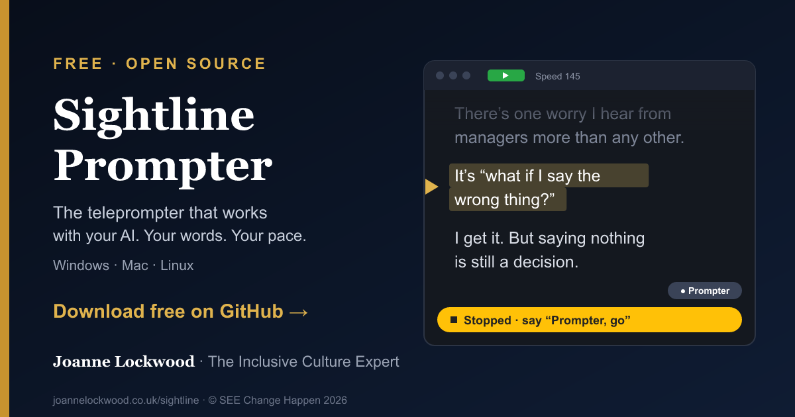

# Sightline Prompter

> **Development preview: 1.3.0 RC7, documentation revision 23.**
> The public download below is stable 1.2.0. This candidate adds optional
> [post-record audio review](docs/guide/19-post-record-review.md) and a
> [rerunnable guided tour](docs/guide/20-guided-tour.md). Read the
> [RC7 notes and limits](docs/RELEASE-1.3.0-rc.7.md) before testing. This candidate
> adds [grouped controller functions](docs/guide/21-controller-functions.md),
> explicit reading modes, preparation/review controls and an Adjustment dial.
> RC3 adds silent `[point left: graphic-label]` cues with presenter-relative
> directions and structured, take-linked production intent in the edit pack.
> RC4 adds [floating HUD cues](docs/guide/22-hud-cues.md), corrected Next/section
> positioning, product-name wake protection, naturally wrapped production notes
> and consolidated About controls. [RC4 notes](docs/RELEASE-1.3.0-rc.4.md).
> RC5 adds an optional spoken section-heading lead-in in Voice mode, preserving
> the heading/body distinction for editorial trimming and the existing default.
> RC6 fixes review scrolling to the opening comments and makes script pauses
> Scroll-only, including when recording is linked.
> RC7 fixes guided OBS setup when its optional replay buffer is unavailable.



**The teleprompter that works with your AI.** Free, open source and see-through,
with voice following, steady scrolling and Notes / page mode. Keep your words
near the lens while seeing the call, slides or camera picture behind them.
For speakers, content creators, trainers and learning teams.

**Sightline 1.2.0 · Stream Deck companion 0.2.0 · 4 November 2026**

[Download Sightline](https://github.com/JoJo-1965/sightline-prompter/releases/tag/v1.2.0)
· [User guide](docs/guide/README.md)
· [Getting started](docs/guide/01-getting-started.md)
· [Full feature grid](docs/FEATURE-GRID.md)
· [JL website](https://joannelockwood.co.uk/sightline/)

**Download blocked?** Edge: **… > Keep > Show more > Keep anyway**.
Windows: **More info > Run anyway**. Mac: **System Settings > Privacy & Security
> Open Anyway**. Read the [illustrated installation help](docs/guide/18-installation.md)
for the exact message, trusted source checks and device-policy limits.

By a speaker, for speakers. By a content creator, for content creators.
Built by Joanne Lockwood with Claude Code and Codex, from David Neal's
[Electron Teleprompter](https://github.com/reverentgeek/electron-teleprompter).
The original MIT licence and attribution are retained. AI is optional.

## Start here

1. Install the download for your computer. Read the [installation and security
   notes](docs/guide/01-getting-started.md#installing-sightline), particularly on Mac.
2. With no saved scripts, the app opens **Start here: Sightline feature tour**.
   Use Space at each stop, try the suggested action, then continue. Reopen it
   from **Files > Sample scripts**. See the [demo guide](docs/DEMO-SCRIPTS.md).
3. Choose **Settings > Getting started > First setup**. Before a recording,
   open **Prepare to record**, check the picture and sound, review a test and
   save a recording reference. Test your actual recording route too.

Keep using your usual recorder for the production master. Sightline provides
prompting, optional OBS recording control and an edit pack for your external
editing workflow. Its short preparation clip is a local camera/microphone test.

## Read and present

- A transparent script over video calls, slides, a camera picture or a dark
  background. Adjust backing colour and opacity without hiding your content.
- Scroll at a steady pace, follow your voice, or page through talking points.
  Use sections, stops, countdowns and optional script directives.
- Open Markdown, Word, PDF, text or a supported Google Docs link. Use the
  built-in editor, file watching, recent files and nine remembered script slots.
- Style spoken script, headings, inline cues and production comments separately:
  font, size, colour, bold, italic and line spacing. Save portable reading themes.
- Preparation comments in `<!-- ... -->` hide during delivery and return while
  paused. Short cues such as `[smile]` can remain inline. Neither is spoken text.
- Fit the reading line, margins, mirroring, focus band and eye-line strip to
  your screen or beam-splitter setup. Optional aids have contextual help.

## Prepare a consistent shot

The preparation workflow shares a target with the **Ctrl+Shift+H head guide**.
Use manual adjustment or optional local face/eye-position feedback. Green,
amber and red compare your position with a fixed reference; grey means tracking
is unavailable. It measures apparent face size, not distance in metres or gaze.

The bottom guide toolbar auto-hides to a recoverable **Head guide** tab. Hover
to restore it, pin it when useful, and access Adjust, lock/unlock, fullscreen,
Move guide and Guide off above the prompter. Calibration stays in Guide
adjustments until you explicitly open the full preparation workflow.

Check voice against room noise without changing gain automatically. Quiet or
noisy readings are advisory: listen to the test. Save the reviewed target,
audio baseline and test reference to help realign after a break. Ideal stays
separate from the reference for this recording.

[Preparation guide](docs/guide/16-prepare-to-record.md)

## Connections and controls

**Settings > Connections** is the home for optional interfaces. Enable only
what you use; disabled interfaces hide their configuration and retain values.

- Keyboard shortcuts, configurable clickers/pedals and a game controller.
  Assignment lists show every mapping; long lists scroll.
- A configurable floating pad and phone remote, plus an upright control window.
  The pad shows all configured buttons with drag and Earlier/Later controls.
- The **Stream Deck 0.2.0** companion: keys, compatible dials and pedal actions,
  connection/version checks and starter profiles. Its source remains private;
  install it free from [Elgato Marketplace](https://marketplace.elgato.com/product/sightline-prompter-34676f28-e2e5-422d-9b48-e03dfd80bebe),
  where it is listed as version 0.2. A direct installer also accompanies the
  app release. Existing supported assignments are retained.
- **OBS integration**, with one sidebar home and Connection, Recording control
  and Profile and scenes subtabs. Connection status and recorder state are
  separate. Recording controls and linked prompting require explicit permission.
- A local API and optional **MCP** adapter, with separate read, script, prompting
  and recording permissions. Configure MCP is next to its enable switch.

[Control guide](docs/guide/06-remotes-and-screens.md)
· [OBS guide](docs/guide/11-obs.md)
· [Configure MCP](docs/guide/17-configure-mcp.md)

## Optional AI: write, record, hand over

Use **Help > Copy the AI Script Prompt** with your preferred assistant to
prepare sections, pacing targets, stops and recording directions. A local
authorised assistant can load a script or control prompting through MCP/API.
The app checks directives; you review the words and recording actions.

Take logs retain sections, retakes, markers, keeper choices and available
recording references. Export the script snapshot, edit notes, timing estimates
and optional scratch audio for an editor or editing agent. **Live word timings
and draft captions need checking against the recording**; they are not precise
cut points or proof that words were omitted. Sightline does not automatically
produce the finished edit.

[Working with AI](docs/guide/09-working-with-ai.md)
· [AI script brief](docs/AI-SCRIPT-BRIEF.md)
· [Production handover](docs/guide/12-production-handover.md)

## Privacy, installation and support

No Sightline account or subscription is required. Local recognition works
offline after its model download; the framing model is bundled. Optional
Deepgram sends audio to that service. Your chosen AI has its own terms.
Credentials stay out of reading-theme exports. Read the
[privacy, terms, accessibility and support policies](docs/POLICIES.md).

Windows, Apple-silicon Mac, Intel Mac and Linux installers are provided. Mac
bundles use free ad-hoc signing and are **not Apple-notarised**. Security
warnings can remain; follow the installation guide for the downloaded build.
Verify capture exclusion, device compatibility and actual picture/sound sync
on your own setup. OBS-scene calibration is a sampled preview, not the encoder output.

[Report an issue](https://github.com/JoJo-1965/sightline-prompter/issues)
· [Support Sightline](https://joannelockwood.co.uk/sightline/#support)
· [Roadmap](ROADMAP.md)

## Change log

### 9 November 2026 — Stream Deck plugin published

The free Stream Deck companion 0.2.0 is now published on
[Elgato Marketplace](https://marketplace.elgato.com/product/sightline-prompter-34676f28-e2e5-422d-9b48-e03dfd80bebe) as version 0.2.
The direct package remains available. This distribution update does not change
app features, existing installations or the separate 0.2.1 preview candidate.

### 1.3.0 RC7 — OBS setup reliability

Guided OBS setup now loads configured sources when the optional replay buffer
is unavailable. Recording, streaming, active replay buffers and unconfirmed
connection states still block setup changes. Existing profiles remain intact
during source inspection. See [RC7 notes](docs/RELEASE-1.3.0-rc.7.md).

### 1.3.0 RC6 — review and Voice fixes

- Paused/review scrolling leaves opening comments clear of the floating
  session controls, including wrapped rows on smaller screens. Scroll up or
  use Back to the start to read the beginning in full.
- Starting delivery removes that review space, hides preparation notes and
  retains reading-line alignment. This correction is included in RC6.

#### Pause directives follow the reading mode

Voice ignores bare and timed `{pause}` directives, including linked recording;
take the beat naturally. Scroll retains manual holds and timed countdowns.
Explicit `{stop}`, off-script holds, sound checks and spoken pause commands
remain deliberate controls. RC6 includes this correction; earlier RC3–RC5
packages are unchanged. RC5 already fixes Next/section navigation resuming Voice without
an extra Go. Help, authoring instructions and the mode-comparison demo agree.

### 1.3.0 RC3 preview

**Pointing and graphics:** inline left/right/up/down, diagonal and centre cues
can name a graphic. Directions mean the presenter's own sides. Quoted asset
labels remain silent. Existing inline appearance controls apply. Captured
script snapshots and edit packs retain cue/section/take associations and
qualified spoken anchors for the editor to review against the visible gesture.
Includes a focused sample, refreshed AI brief/spec/checker and handoff guide.
No automatic graphic insertion or gesture detection is claimed.

[RC3 notes and testing limits](docs/RELEASE-1.3.0-rc.3.md)

**Authoring follow-up:** the script-writing and session/production skills now
share a [cue planning contract](docs/POINTING-CUE-AUTHORING.md). A complete
[RC3 promo rehearsal script](docs/marketing/PROMO-SCRIPT-1.3.0-RC3.md) matches
its [direction plan](docs/marketing/PROMO-POINTING-DIRECTIONS-RC3.md).
Academy generators must preserve source directions as visible cues in the
final Sightline copy. This documentation/kit follow-up is for the next bundle;
the existing RC3 installer receipt remains frozen.

### 1.3.0 RC1 preview — 4 November 2026

Post-record transcript/import and script comparison, command cut ranges,
measured per-file audio offsets, targeted command recognition regressions and
optional coach marks. See the [grouped candidate notes](docs/RELEASE-1.3.0-rc.1.md).
The original logs and live estimates remain available. This is a preview;
[1.2.0 remains the stable download](https://github.com/JoJo-1965/sightline-prompter/releases/tag/v1.2.0).

### Read after installing

Open the feature tour and check the tools you use. Personal scripts and
recordings are retained; review your camera, microphone and recording route.
For browser or operating-system warnings, see the
[illustrated installation guide](docs/guide/18-installation.md).

### 1.2.0 — 4 November 2026

- **Settings and reading:** consistent named navigation and live preview;
  complete independent styling for four text types, portable themes, clearer
  spacing, bounded numbers and mode-aware controls. Connections replaces the
  former split Controls/Components setup.
- **Preparation and head guide:** local detection and manual alignment share
  a fixed target; reviewed audio/test/reference steps support repeatable shots.
  Distance respects custom proportions. The bottom toolbar is recoverable;
  calibration stays in its panel and the redundant footer strip is removed.
- **Recording and OBS:** clearer connection/recorder states, persistent test
  outcomes, automatic sound-check meters, a section pill, explicit recording
  commands, linked prompting and selected-scene calibration with gated options.
- **Controllers and AI:** complete pad/keyboard/controller assignment lists,
  Stream Deck compatibility checks, optional local MCP with explicit grants,
  and setup instructions beside the controls.
- **Reliability and delivery:** expanded voice-command aliases, qualified edit
  estimates, refreshed sample scripts/help, a recurring voluntary coffee note
  and verified free ad-hoc Mac bundle signing.

[Detailed notes grouped by topic](docs/RELEASE-1.2.0.md)
· [Earlier release and development history](docs/CHANGELOG-HISTORY.md)

Earlier public versions: [1.1.0](https://github.com/JoJo-1965/sightline-prompter/releases/tag/v1.1.0)
and [1.0.6](https://github.com/JoJo-1965/sightline-prompter/releases/tag/v1.0.6).

## Developer setup

Use Node.js 22.16 or later and the package manager pinned in `package.json`.

```sh
corepack enable
pnpm install --frozen-lockfile
pnpm start
pnpm test
pnpm test:mcp
pnpm check:release-docs
pnpm dist
```

`pnpm start` rebuilds the generated CodeMirror, framing and MCP bundles. Do not
edit generated bundles. Native UI/integration checks are in `scripts/` and use
isolated test profiles. Follow [AGENTS.md](AGENTS.md) and the
[deployment checklist](docs/DEPLOYMENT-CHECKLIST.md) for release work.

## Origin and licence

Sightline is a fork of David Neal's Electron Teleprompter. Original work and
Joanne Lockwood's enhancements are distributed under the [MIT licence](LICENSE).
See **Help > About** for credits. [SEE Change Happen](https://seechangehappen.co.uk/)
and [Joanne Lockwood](https://joannelockwood.co.uk/) support its development.
